# Distributed Systems Engineering Handbook v4.13 (English)

**Audience:** Senior Engineer / hands-on technical lead with practical backend experience
**Pair:** `distributed-systems-engineering-workbook-v4.13.en.md`
**What this file is:** the models, the conditions, the worked examples, and the decisions. Exercises, blank worksheets, labs, and the answer key are in the Workbook. The editorial record and the validation gates are Appendix M at the end of this file. They are outside the 4-week read.

Read a section here, then do the matching exercise in the Workbook before you look at the answer key. The answer key is the last part of the Workbook.

## Design loop

Use this loop for every design in the Handbook:

```text
1. Invariant       — what must not be wrong?
2. Inputs          — traffic, latency, pool, partitions, SLO, payload.
3. Model           — formula, or a state/failure timeline.
4. Worst case      — load, backlog, downtime, duplicates, stale window.
5. Threshold       — the point that forces reject, scale, retry, or degrade.
6. Candidates      — options that could be used.
7. Decision        — choose for this domain and this system.
8. Verification    — the minimum measurement or lab that checks the assumption.
9. Recovery        — what happens if the assumption is wrong or the failure occurs.
```

Study weights, the calendar, and the personal baseline are at the front of the Workbook.

# PART A — CORE LAWS, THEOREMS, AND PRINCIPLES

This part comes before implementation patterns. The goal is to separate four layers of knowledge:

```text
Theorem / impossibility result
→ a limit that tuning cannot remove

Law / quantitative model
→ a quantity that can be estimated or calculated

Design principle
→ where authority, correctness, and resource boundaries belong

Implementation pattern
→ how one concrete choice is built
```

Do not use a theorem as a slogan. Each item must answer:

1. The precise statement at the level you will use.
2. The conditions and scope.
3. The design consequence.
4. What you must **not** infer.
5. A worked example.
6. The matching exercise in the Workbook.
7. A short interview answer.

---

# A0. LAW → PRODUCTION REALITY FRAMEWORK

This framework is the authoring and study standard for every item in **Core Laws, Theorems, Models, Problems, and Principles**. It exists to prevent two opposite errors:

1. Learning a theorem or law as a slogan without knowing how it changes a production design.
2. Jumping to a pattern or tool without knowing which fundamental limit that pattern is reacting to.

Standard flow:

```text
FORMAL CORE
→ MODEL BOUNDARY
→ PRODUCTION PRESSURE
→ FAILURE SIGNATURE
→ ENGINEERING RESPONSE
→ QUANTITATIVE CHECK
→ VERIFICATION EVIDENCE
→ RESIDUAL RISK
```

## A0.1 Eight required layers

### L1 — Formal Core

Write the shortest core sentence that does not distort the scope:

```text
Law / Theorem / Model / Principle:
Core statement:
```

Example:

```text
Little’s Law:
L = λW inside one system boundary, as a long-run average in steady state.
```

### L2 — Model Boundary

Every law is true only inside a specific model. Record:

```text
Assumptions:
Applies when:
Does not cover:
```

For Little’s Law:

- use the mean; do not substitute p99 and call it the average;
- stay inside one system boundary;
- steady-state / long-run average;
- the law does not by itself describe the latency distribution or a burst.

### L3 — Production Pressure

Turn the statement into a production question:

```text
Production question:
Which resource / invariant / authority is under pressure?
```

Example:

> If Fraud latency rises while the request rate stays the same, how many in-flight slots, connections, and how much memory does Payment need in order to keep that sojourn time?

### L4 — Failure Signature

Describe what can be observed, not only the guessed cause:

```text
Symptoms:
Metrics:
Logs/traces:
Business impact:
```

Example:

- pool wait rises;
- p99 rises before CPU;
- in-flight requests rise while the system can still absorb the arrival rate;
- upstream timeouts and retry amplification;
- orders move to `PENDING_FRAUD_REVIEW`.

### L5 — Engineering Response

Record candidate responses in three layers:

```text
Prevent:
Contain:
Recover:
```

Do not write one pattern as the universal answer.

Example:

- Prevent: capacity headroom, timeout budget, concurrency limit.
- Contain: bulkhead / circuit breaker / load shedding.
- Recover: drain the queue, controlled replay, reconciliation.

### L6 — Quantitative Check

Every law or model that has numbers must lead to a worksheet:

```text
Inputs:
Formula/model:
Expected case:
Worst reasonable case:
Threshold:
```

If it is not a quantitative law, replace the worksheet with a state or failure timeline, or with an authority proof.

Example for CAP / quorum:

```text
N = 5
Majority = 3
Partition = 3–2
Authority = 3-node side
Minority response = reject / read-only
```

### L7 — Verification Evidence

A claim is not approved only because it is theoretically right. State how the implementation will be verified:

```text
Paper evidence:
Targeted test:
Production metric:
Exit threshold:
```

Example:

- Paper: `L = λW`, and a separate pool-ceiling / queue-growth check once the pool saturates.
- Test: inject 2.5s Fraud latency.
- Metric: in-flight, pool wait, p99, rejection rate, queue depth over time.
- Exit: pool wait under 50ms, no cascading timeout, SLO held.

### L8 — Residual Risk and Decision

End with:

```text
What remains unsolved:
Accepted risk:
Escalation trigger:
Decision:
```

This stops a law from becoming an absolute promise.

---

## A0.2 Standard 12-section chain for each Law → Production Reality lesson

Each law, theorem, or principle in this handbook should use the same structure:

1. **Classification** — law, theorem, impossibility result, model, principle, or checklist.
2. **Formal/Core Statement** — the precise statement at the level of use.
3. **Assumptions and Boundary** — conditions and scope.
4. **Production Translation** — the production question the statement creates.
5. **Failure Signature** — metrics, logs, traces, business symptom.
6. **Worked Production Scenario** — timeline or numbers.
7. **Engineering Responses** — Prevent / Contain / Recover.
8. **Quantitative or Authority Check** — formula, quorum, state transition, or causal proof.
9. **What It Does Not Guarantee** — what must not be inferred.
10. **Verification Plan** — paper, targeted test, production evidence.
11. **Workbook and Exit Criteria** — the exercise and the pass bar.
12. **Interview/A6 Card** — a 60–90 second answer and a reuse note.

The sections below are teaching notes plus one worked scenario. They are not 17 completed 12-section cards. Card status is recorded in A18.

The blank Law card and the 20-point exit check are in the Workbook, section “Law card template”.

## A0.4 Master map — from law to production reality

| Core item | Production pressure | Failure signature | Primary response | Required evidence |
|---|---|---|---|---|
| Little’s Law | Latency increases in-flight/resource pressure while the system can still absorb arrivals | Pool wait, queue depth, memory, p99 rise | Reduce W, bound concurrency, keep capacity headroom | `L=λW`, a separate saturation check, latency injection, pool metrics |
| CAP | Authority during a network partition | Minority still accepts writes; conflicting histories | Reject the minority, or use a domain-safe merge | 3–2 partition drill, invariant analysis |
| PACELC | Latency versus consistency when there is no partition | Slow cross-region ACK, or stale read | Choose sync/async/read path by domain | RTT, replication lag, RPO/SLO |
| Safety/Liveness | A workflow is correct but must not be stuck forever | Invalid terminal state, or pending for too long | Invariant + deadline + escalation | State machine, stuck-state metric |
| Quorum Intersection | Whether two decision sets can be independent | Split authority, conflicting commit | Majority / voting / config transition | Quorum worksheet, membership-transition case |
| Happens-before | Which events actually have a causal order | LWW picks the wrong write; out-of-order state transition | Version / causal metadata / state machine | Causal graph, clock-skew scenario |
| FLP | Crash and delay cannot be distinguished with certainty | Repeated elections, no progress under unstable timing | Preserve safety; rely on eventual synchrony | Timeout / election failure timeline |
| Two Generals | A lost ACK creates an ambiguous outcome | Retry creates a duplicate side effect | Identity, query, reconciliation | Lost-response test, provider lookup |
| Byzantine model | A participant may behave arbitrarily | Conflicting messages or signatures | Choose the correct trust and failure model | Threat model, trust-boundary review |
| Amdahl | The serial fraction caps speedup | Adding workers does not raise throughput | Shrink the serial fraction or partition the bottleneck | Scaling benchmark, serial-fraction estimate |
| USL | Contention and coordination reduce scale | 32 instances are slower than 16 | Split the shared bottleneck; fit the model from measurements | Multi-point load test, fitted capacity curve |
| End-to-End Principle | A lower layer does not understand business correctness | TCP or Kafka ACK succeeds, but the business effect is duplicated | Enforce the invariant at the business boundary | End-to-end failure test |
| Bounded Resources | An unbounded queue, pool, or retry | OOM, unbounded latency, retry storm | Bound + reject/load-shed + recovery | Capacity threshold and saturation test |
| Backpressure | `λ > μ` persists | Lag or queue grows, then timeout, then retry | Throttle / admission control / bounded buffer | Lag growth and drain calculation |
| Coordination is Expensive | A cross-boundary invariant reduces scalability | Lock contention, cross-shard latency | Localize the invariant; pay for coordination only where needed | Partition-boundary ADR, contention benchmark |
| Failure Detection is Suspicion | Timeout or lease expiry does not stop the peer physically | Old leader or worker keeps writing | Term / epoch / fencing at the resource | Stale-writer test |
| Distributed Fallacies | Network assumptions treated as facts | Hidden latency; topology, security, or ownership incident | Review network and operational reality | Dependency checklist, failure injection, ownership map |

---

## A0.5 Three levels of production evidence

| Level | Evidence | Use when |
|---|---|---|
| **E1 — Paper** | Formula, state machine, causal or quorum proof, failure timeline | Eliminate a wrong solution before code |
| **E2 — Controlled** | Targeted lab, benchmark, latency/crash/partition injection | Check framework or product behavior |
| **E3 — Operational** | SLI/SLO, traces, incident/runbook/recovery evidence | Approve a production threshold and the ongoing risk |

A Law → Production Reality item is complete only when:

- E1 is present;
- E2 exists for a hard assumption or for framework-specific behavior;
- E3 is defined as what production must collect, even if the learner does not yet have a production environment.

## A0.6 Anti-pattern review

Do not accept these jumps from a law to production:

- `CAP → database X is AP` without naming the operation, configuration, and partition behavior.
- `Little’s Law → the pool must equal L` without considering burst, tail latency, database capacity, and queueing. `L` is unconstrained concurrency demand, not a configuration.
- `FLP → consensus cannot be done`.
- `Amdahl → adding workers is useless` without measuring the serial fraction.
- `Kafka exactly-once → business exactly-once` outside the Kafka transaction boundary.
- `Timeout → the peer is dead`.
- `Distributed lock → the old writer has stopped`.
- `Circuit breaker → the dependency has been fixed`.
- `DLQ → the message has been processed`.

# Law 1 — Little’s Law

## Statement

In a system that is stable over the long run:

```text
L = λ × W
```

- `L`: average number of work items in the system.
- `λ`: average throughput. In steady state this equals the average arrival rate.
- `W`: average time one item spends in the system.

## Conditions

- Use the same system boundary for `L`, `λ`, and `W`.
- The system is approximately stable over the measurement window.
- Use the mean. Do not substitute p95 or p99 and call the result average concurrency.
- An ever-growing backlog is not a steady state. Do not plug a fixed `W` into Little’s Law and treat the result as the occupancy of an unstable queue.

## Consequence

If latency rises while the arrival rate stays the same, **and the system can still absorb that arrival rate**, in-flight work rises linearly. That pulls on connections, memory, workers, and queues.

If a pool or worker limit makes throughput fall below the arrival rate, the system leaves the steady state assumed by a fixed `W`. Queue length then becomes a function of time. It is not the Little’s Law number.

## Do not infer

- The latency distribution.
- The optimal worker count.
- That the system is stable. Stability is an input to the law, not a result of it.
- “Average concurrency” computed from p99.
- That `L` is the pool size you should configure.
- That a connection deficit (`L − pool`) is a stable queue depth.

## Worked example

```text
λ = 800 req/s
W = 0.5s
L = 400 in-flight

If W rises to 3s and the system can still complete 800/s at that sojourn:
L = 2,400 in-flight
```

`2,400` is the concurrency required to keep mean sojourn at 3 seconds. It is not the queue length after the pool fills.

Exercise: Workbook → Law 1.

## Interview answer

> Little’s Law states that average concurrency equals throughput multiplied by average time in the system, in steady state, inside one boundary. I use it as a first-order model for in-flight requests, connection pressure, and queue occupancy. If a pool caps throughput below the arrival rate, I stop using a fixed sojourn and switch to a queue-growth model. I still validate both results against the latency distribution and burst behavior.

---

## Production example — Fraud latency exhausts the pool

### Inputs

```text
Arrival rate λ:                  800 requests/second
Normal mean latency Wnormal:     100ms = 0.1s
Incident mean service latency:   2.5s   (time a request holds a Fraud connection)
Fraud connection pool:           300 connections
Application memory/request:      64kB, decimal
```

These are two different regimes. Do not add them into one snapshot.

### 1. Steady state, pool not saturated

```text
Lnormal = λ × Wnormal
        = 800 × 0.1
        = 80 requests

Pool utilization = 80 / 300 = 26.7%
Spare connections = 300 − 80 = 220
```

Normal operation is inside the steady-state assumption. Average in-flight is 80.

### 2. Unconstrained demand if sojourn stayed 2.5s

If every request still completed and the mean time in system stayed 2.5s at 800 arrivals/s:

```text
Ldemand = 800 × 2.5 = 2,000 requests
```

That is the concurrency required to keep `W = 2.5s`. The pool has 300 connections, so this steady state is not available.

```text
Demand / pool = 2,000 / 300 ≈ 6.67×
Connection deficit = 2,000 − 300 = 1,700
```

`1,700` is missing capacity. It is not the number of requests sitting in a stable queue.

A 25× rise in service latency would raise average in-flight 25× only while arrival rate is unchanged **and** the system still completes 800/s. The 300-connection pool cannot do that.

### 3. Saturated pool: throughput ceiling and Q(t)

If each admitted request holds a connection for the whole 2.5s:

```text
λmax = PoolSize / Wservice
     = 300 / 2.5
     = 120 requests/second

QueueGrowth = λ − λmax
            = 800 − 120
            = 680 requests/second
```

This rate applies while arrival stays near 800/s, the queue has not hit its bound, and there is no rejection or retry feedback.

```text
Q(t) ≈ 680 × t        # seconds since saturation, queue started empty
```

Examples, not a steady state:

```text
t = 1s    → Q ≈ 680
t = 2.5s  → Q ≈ 1,700
t = 10s   → Q ≈ 6,800
```

At `t = 2.5s`, `Q = 1,700`. The queued requests alone are not `Ldemand`. Active work is capped near 300, so total occupancy at that instant is `300 + 1,700 = 2,000`, which equals `Ldemand`. Section 4 shows why that equality holds and why it does not continue. Mean sojourn at that moment is already wait plus 2.5s for the queued requests, so a fixed `W = 2.5s` does not describe the saturated system.

### 4. Memory is also a function of time

Memory for the unconstrained demand, if 2,000 requests were actually in the system at 64kB each:

```text
2,000 × 64kB = 128,000kB = 128MB decimal
```

That figure describes the demand case in section 2. It does not describe the saturated system.

While the pool is saturated, split active and queued memory, and let the queue term grow:

```text
Active  = 300 × 64kB = 19.2MB
Queued  = Q(t) × 64kB
Total(t) = 19.2MB + Q(t) × 64kB

At the instant Q = 1,700:
Queued = 108.8MB
Total  = 128MB
```

At `t = Wservice = 2.5s`, with the queue empty at the saturation instant and the rates held constant:

```text
Q(W) = (λ − Pool/W) × W = λW − Pool
Occupancy = Pool + Q(W) = λW = Ldemand = 2,000
```

The matching `128MB` is that identity, not a steady incident memory and not a numerical accident. Occupancy equals `Ldemand` at that one instant, then exceeds it. For `t > 2.5s` the queue is still growing at 680/s, sojourn is wait plus 2.5s, and `W` is no longer 2.5s. Little’s Law is not satisfied by noticing that the two formulas meet at `t = W`. Real memory also includes socket and TLS buffers, request and response bodies, framework objects, trace context, thread or coroutine state, queue metadata, and GC overhead. If queued requests hold less memory than active ones, use separate `memory_active` and `memory_queued` inputs.

### 5. Production decision

`Ldemand = 2,000` does **not** mean the pool should be set to 2,000. It is the first-order estimate of concurrency required to preserve a 2.5s sojourn. Raising the pool can move the pressure onto Fraud and make the incident worse.

Once `λ > λmax`, the decision is about bounding `Q(t)`, not about reading 2,000 off Little’s Law.

Candidate response:

- Prevent: capacity headroom, deadline budget, concurrency limit.
- Contain: a Fraud bulkhead, a shorter timeout, a circuit breaker, load shedding.
- Recover: move the order to `PENDING_FRAUD_REVIEW`, drain the queue under control, and reconcile.

### 6. Verification evidence

```text
E1 Paper:
- Lnormal = 80, steady, pool not saturated
- Ldemand = 2,000 if W stayed 2.5s at 800/s; this steady state is unavailable
- Connection deficit = 1,700; this is not Q
- λmax ≈ 120/s
- QueueGrowth ≈ 680/s
- Q(t) ≈ 680 × t until a bound, reject, or arrival change
- Memory(t) = 19.2MB + Q(t) × 64kB under the equal-memory assumption

E2 Controlled:
- Inject 2.5s Fraud latency
- Measure in-flight, pool wait, queue depth versus time, p99, rejects, and memory
- Confirm queue depth tracks about 680/s rather than sitting at 1,700

E3 Operational:
- Pool utilization and wait
- Fraud latency and timeout rate
- Pending-review count
- Queue age and recovery time
```

### Diagram

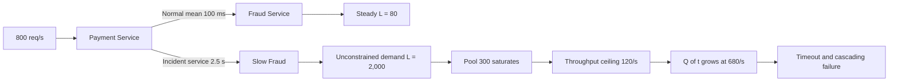

# Theorem 2 — CAP Theorem

## Statement used here

During a **network partition**, a distributed system cannot guarantee both of the following at once:

- **CAP consistency:** atomic consistency / linearizability. Operations can be placed in one total history that respects real-time order.
- **CAP availability:** every request that reaches a non-failing node receives a non-error response in finite time.

Partition tolerance is not an optional switch when the system really runs across a network. The design question is how the system reacts when a partition happens.

## Design consequence

A 5-node cluster splits 3–2:

- Prefer consistency: the minority of 2 nodes stops accepting writes.
- Prefer availability: both sides may accept operations, and the design must then accept conflict, merge, compensation, or a weaker invariant.

## Do not infer

- The system does not “always pick 2 of 3” at every moment.
- A database is not permanently CP or AP independent of the operation and configuration.
- Not every consistency model is linearizability.
- CAP does not decide, in place of the domain, which conflicts are acceptable.

Exercise: Workbook → CAP.

## Interview answer

> CAP matters specifically during a network partition. If consistency is required, a minority partition must reject some operations. If availability is required on both sides, the system must accept conflicts or weaker invariants and define a resolution model.

---

## Production example — a 5-node cluster splits 3–2

This example is a PostgreSQL primary with replicas, whose single writer is chosen by a consensus service such as etcd through Patroni. It is not a five-way Raft log of SQL rows. The five consensus members split 3–2. For balances, the two-member side must not elect a second primary: two primaries can commit two balance histories. The three-member side may keep or elect one primary, and that primary continues to accept writes. The minority returns 503 or read-only. PostgreSQL streaming replicas do not cast those votes. Their lag is a replication question, covered in Lesson 9. A view counter is a different design: both sides may accept increments and merge by summing, because that invariant allows it. CAP does not choose for the domain. The invariant chooses the reaction.

### Diagram

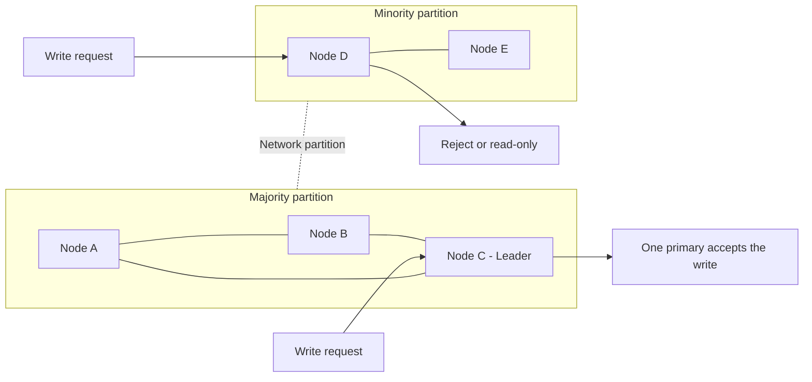

# Principle 3 — PACELC

## Statement

```text
If Partition: Availability versus Consistency
Else:         Latency versus Consistency
```

Even without a partition, stronger consistency usually needs extra coordination or synchronous replication, which increases latency.

## Worked example

- ACK the write at the leader only: lower latency, larger failure window.
- Wait for a majority of replicas: higher latency, stronger authority or durability under the specific semantics.
- Read a local replica: faster, and possibly stale.
- Read the leader or a quorum: fresher, at the cost of a network hop and coordination.

## Do not infer

PACELC does not replace a benchmark. It names the trade-off axis to measure. It does not supply a latency number.

Exercise: Workbook → PACELC.

## Production example — Singapore and Frankfurt

The primary is in Singapore and a replica is in Frankfurt, with RTT 160–200ms. Waiting for a cross-region ACK slows the write and reduces RPO. ACK inside Singapore, then replicate asynchronously, is faster and leaves a stale window. A payment ledger may pay the latency. A product catalog usually accepts a short stale window. The latency–consistency trade-off exists even when there is no partition.

### Diagram


# Principle 4 — Safety and Liveness

## Safety

> Something bad must not happen.

Examples:

- One payment intent is not charged twice.
- Inventory does not go below 0.
- A minority partition does not commit a conflicting history when consistency is preferred.

**Domain transfer — Graphics/HMI.** The same safety shape appears when runtime telemetry must not mutate the Graphic Document. The document authority, not the telemetry producer, decides whether a mutation is legal. The distributed-systems point is the authority boundary, not the graphics vocabulary.

## Liveness

> The system must eventually make progress toward a meaningful result.

Examples:

- An order in `PENDING_PAYMENT` eventually becomes `CONFIRMED`, `CANCELLED`, or `MANUAL_REVIEW`.
- An Outbox backlog is eventually drained.
- A failed compensation is eventually retried, sent to a DLQ, or escalated.

## Tension

Rejecting every operation can preserve safety and destroy liveness or availability. Accepting every operation can preserve short-term progress and destroy safety.

Exercise: Workbook → Safety and liveness. Fill that sheet for every design.

## Interview answer

> I separate safety from liveness. Safety defines what must never happen, while liveness defines how the workflow eventually reaches a terminal or recoverable state. A design that only blocks forever may be safe but operationally useless.

---

## Production example — an order stuck in `PENDING_PAYMENT`

Safety: one payment intent is not charged twice, and the order is not confirmed before payment. Liveness: within 15 minutes the order must become `CONFIRMED`, `CANCELLED`, or `MANUAL_REVIEW`. Do not blindly retry the charge to protect safety, and do not leave the order pending forever. Use a payment intent, a query or webhook, a reservation TTL, reconciliation, and escalation.

### Diagram

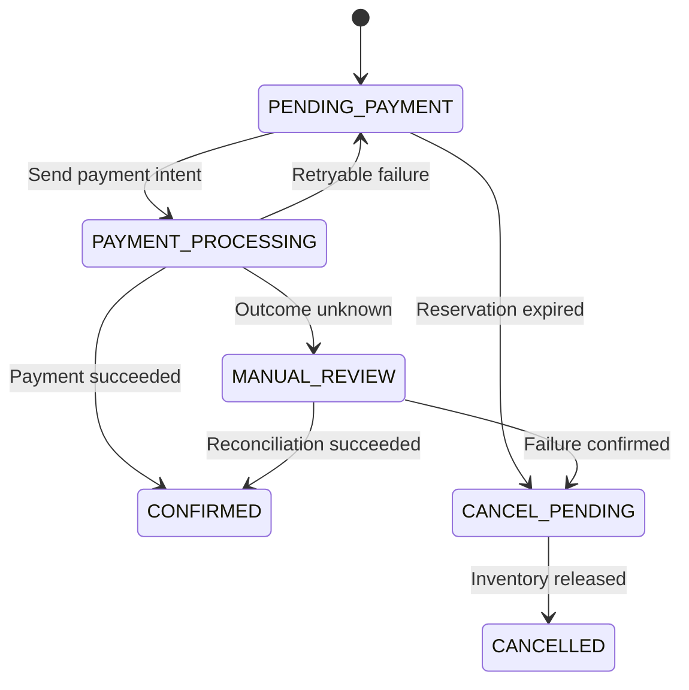

# Principle 5 — Quorum Intersection

## Statement

Two write quorums must intersect so that two conflicting decisions cannot both be confirmed independently.

The usual majority-write condition is:

```text
W > N / 2
```

Read-your-latest-write, in the abstract quorum model, usually also requires:

```text
R + W > N
```

## Worked example

A 5-node cluster:

```text
Q1 = {A, B, C}
Q2 = {C, D, E}
Intersection = {C}
```

No two majority 3-node sets are disjoint. This matters only when the nodes follow the same voting, term, and configuration rules. A membership change needs a protocol such as joint consensus so intersection survives across the two configurations.

## Do not infer

- Intersection alone does not describe the full semantics of Cassandra, a Dynamo-style system, Raft, or any specific database.
- A quorum does not by itself fix a stale client cache, an external side effect, or business deduplication.
- Having enough nodes does not mean those nodes can communicate in time.
- `R + W > N` does not give linearizability once sloppy quorums, hinted handoff, or concurrent writes are in the protocol.

Exercise: Workbook → Quorum intersection.

## Production example — 5-member etcd

`Q1={A,B,C}` and `Q2={C,D,E}` intersect at C, so two majorities are not fully independent. In a 3–2 split, the side of 3 continues and the side of 2 loses quorum. A 4-member cluster still tolerates only 1 member failure, the same as a 3-member cluster. A 2–2 partition is worse for availability: neither side has a majority, so both sides stop. That is why etcd and ZooKeeper usually use 3 or 5 members, spread across failure domains.

### Diagram

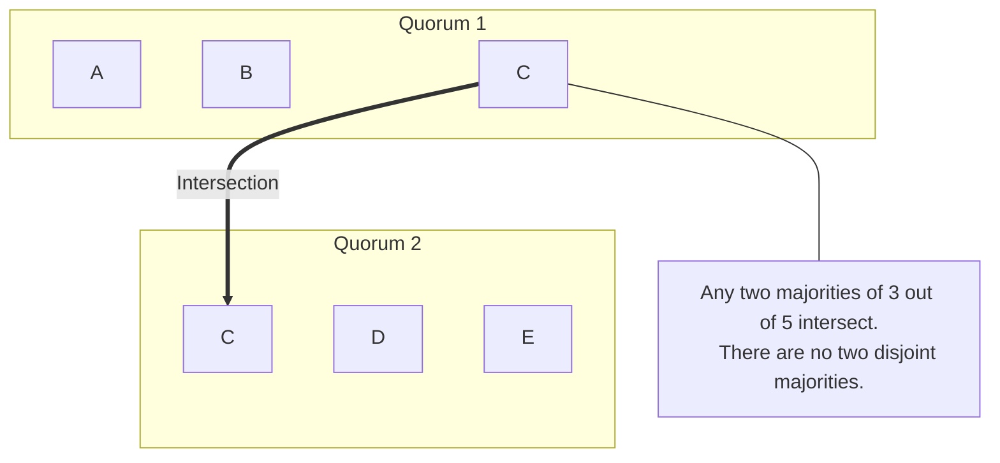

# Principle 6 — Happens-before and Partial Order

## Statement

Event A `happens-before` B when there is a causal relation:

1. A occurs before B in the same process.
2. A is the send and B is the receive of the same message.
3. The relation is transitive.

If neither A→B nor B→A can be shown, the two events may be concurrent.

## Consequence

- A larger machine timestamp does not prove that an operation happened later in real time.
- Last-write-wins on wall-clock time can choose the wrong write because of clock skew.
- Per-partition order does not create a global order.
- Causal order can matter more than total order in many domains.

## Worked example

```text
Node A's clock is 5s fast.
It writes X at real time 10:00:00 with timestamp 10:00:05.
Node B writes X at real time 10:00:02 with timestamp 10:00:02.
```

LWW by timestamp selects A even though B happened later in real time. The example assumes the two writes are not ordered by happens-before. If B's write causally depended on A's, a skewed clock can also violate causality, which is a stronger failure than picking the wrong concurrent write.

Exercise: Workbook → Happens-before.

## Production example — order events

`OrderCreated → InventoryReserved` and `OrderCreated → PaymentSucceeded`, but `InventoryReserved` and `PaymentSucceeded` may be concurrent. The order may receive the two events in either order and confirms only when the state machine has both conditions. Timestamps from two machines do not create a trustworthy global order, because of clock skew.

### Diagram

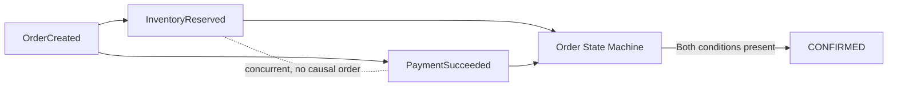

# Impossibility result 7 — FLP

## Statement used here

In a completely asynchronous model, if even one process may crash, no deterministic consensus algorithm guarantees termination in every execution.

## Practical meaning

- A timeout does not prove that a node is dead. The node may only be very slow.
- Raft and Paxos do not “break” FLP. They rely on timing assumptions and eventual synchrony to make progress in practice.
- Consensus can keep safety and temporarily lose liveness when the network is too unstable.

## Not required in this sprint

A formal proof.

Exercise: Workbook → FLP.

## Interview answer

> FLP explains why deterministic consensus cannot guarantee termination in a fully asynchronous system with even one possible crash. In practice, protocols use timeouts and eventual synchrony to make progress, while preserving safety during unstable periods.

---

## Production example — is the controller slow or dead?

The Kubernetes control plane misses a heartbeat inside the timeout. The controller may have crashed, or it may still be alive during a GC pause, CPU throttling, or network delay. Waiting for absolute certainty loses progress. Acting early can create competing actors. The protocol uses a timeout, a term or epoch, and a majority to make progress under eventual synchrony. The timeout is not proof.

### Diagram

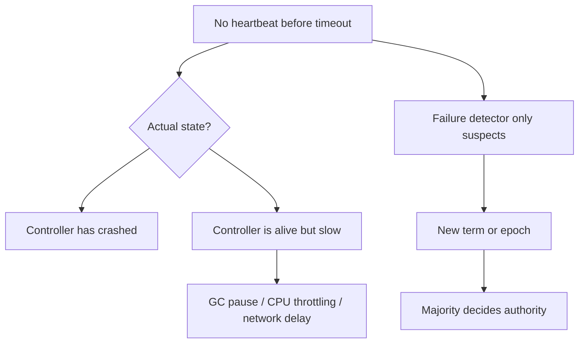

# Problem 8 — Two Generals Problem

## Statement used here

Over a channel that can lose messages, two parties cannot reach absolute common knowledge with any finite chain of requests and acknowledgements.

## Timeline

```text
A sends the operation
B executes the operation
B sends ACK
ACK is lost
```

A does not know whether B never received the request or B executed it and the ACK was lost. An ACK of the ACK can also be lost.

## Consequence

- A payment timeout creates an ambiguous outcome.
- A retry needs an operation identity and idempotency.
- You cannot “handshake until absolute certainty” on an unreliable network.
- Recovery needs a query, reconciliation, a timeout state, or compensation.

Exercise: Workbook → Two Generals.

## Production example — the payment ACK is lost

The provider charges `paymentIntentId=P123` successfully, and the HTTP 200 is lost. The order does not know whether the request never arrived or the charge already happened. A practical design retries the same P123, queries status, keeps `PAYMENT_UNKNOWN`, accepts a webhook with an event ID, and reconciles. Do not create a new payment intent only because the old response was lost.

### Diagram

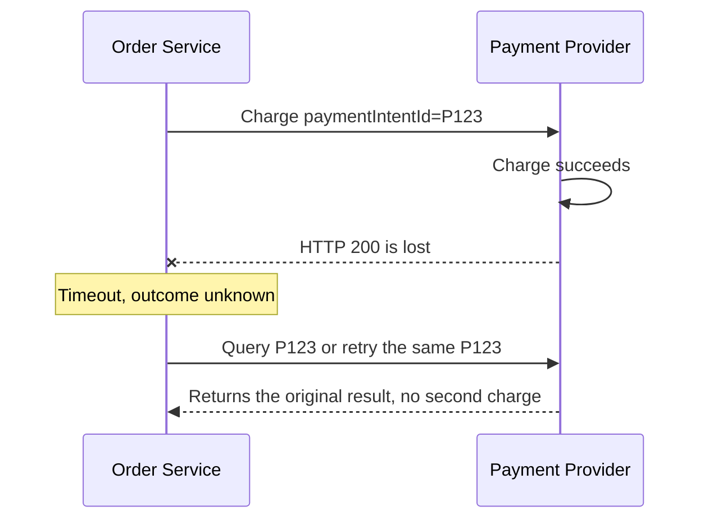

# Problem 9 — Byzantine Generals and the Failure Model

## Crash failure

A node stops, disconnects, or fails to respond before the deadline.

## Byzantine failure

A node may behave **arbitrarily**: it sends wrong or contradictory information to different peers, because of malicious behavior, a bug, memory or data corruption, or compromised software. The deciding point is that the protocol cannot assume the node only crashes or stays silent.

## Consequence

- Standard Raft and Paxos target crash faults, not Byzantine fault tolerance.
- An ordinary enterprise backend mostly designs for crash and omission faults, because the nodes share a trust boundary.
- Blockchain and other trust-minimized systems have a different failure model, and the quorum and cryptographic-verification cost is higher.

## Do not infer

Not every bug forces the system onto Byzantine consensus. Raise the failure model to Byzantine only when correctness must hold even if a participant can behave arbitrarily or is no longer trusted. Establish the trust model, the threat model, and the impact first.

---

## Production example — a crashed broker and a malicious validator

A Kafka broker losing power is a crash fault. A blockchain validator signing two conflicting blocks is Byzantine behavior. Standard Raft and Paxos handle crash faults. They do not handle a node that deliberately tells different peers different things. A bug or corruption can create Byzantine-style behavior, but Byzantine consensus is required only when the protocol must tolerate an arbitrary or untrusted participant. Establish the trust and threat model first.

### Diagram

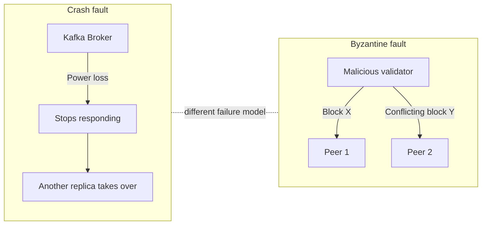

# Law 10 — Amdahl’s Law

## Statement

```text
Speedup(N) = 1 / ((1 - P) + P/N)
```

- `P`: the fraction that can be parallelized.
- `N`: the number of workers or nodes.

## Worked example

90% parallel, 10% serial:

```text
N=10:
Speedup = 1 / (0.1 + 0.9/10)
        = 1 / 0.19
        ≈ 5.26x

N→∞:
Max speedup = 1 / 0.1 = 10x
```

## Consequence

- Adding consumers does not help if a global lock takes most of the time.
- Adding workers cannot beat a serial transaction boundary.
- Adding partitions does not help an operation that must coordinate globally.

Exercise: Workbook → Amdahl.

## Production example — more consumers, still a global aggregate

The pipeline is 90% parallel parse/enrich and 10% serial global aggregate. With infinite workers the maximum speedup is `1/0.1 = 10x`. With 10 workers it is about `5.26x`. Further scale requires partitioning the aggregate, not only adding consumers.

**Domain transfer — Graphics/HMI.** Workers do not help without limit if the final commit or render stays on the main thread. The serial fraction is that main-thread step.

### Diagram

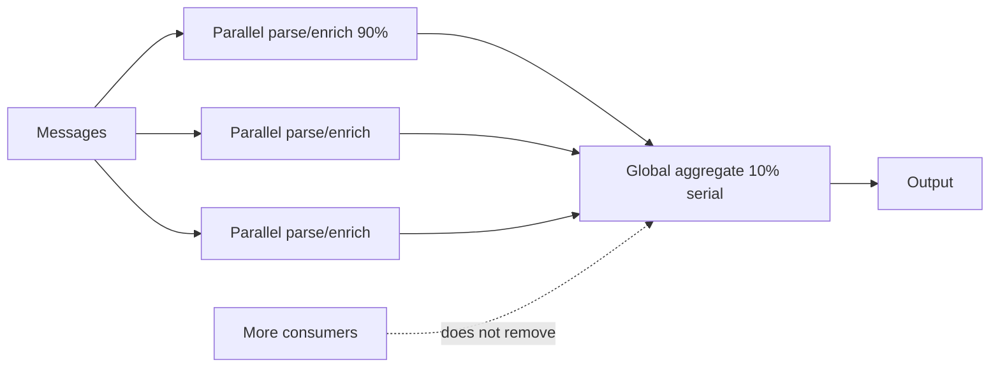

# Model 11 — Universal Scalability Law (USL)

## Statement

```text
C(N) = N / (1 + α(N-1) + βN(N-1))
```

- `α`: contention / serialization.
- `β`: coherency / coordination cost.
- `N`: number of processing units.

## Meaning

- Scale starts near linear.
- Contention then reduces the gain.
- When coordination cost is large, adding a node can reduce throughput.

## Worked example

With `α=0.03`, `β=0.002`:

```text
C(8)  = 8  / (1 + 0.03×7  + 0.002×8×7)  ≈ 6.05
C(16) = 16 / (1 + 0.03×15 + 0.002×16×15) ≈ 8.29
C(32) = 32 / (1 + 0.03×31 + 0.002×32×31) ≈ 8.18
```

From 16 to 32 units, relative capacity falls slightly because the coordination term dominates.

## Do not infer

- Do not pick `α` and `β` by intuition. Fit them from a benchmark or from production measurements.
- USL does not replace a queueing model or a capacity test.

Exercise: Workbook → USL.

## Production example — 32 instances are slower than 16

The API scales well up to 16 instances. At 32 instances throughput does not rise, because the instances contend on the same hot PostgreSQL row or index, on cache-invalidation broadcast, and on distributed-lock traffic. `α` reflects contention. `β` reflects coordination and coherency. The right action is to reduce the shared bottleneck or partition the hot key, not to auto-scale blindly.

### Diagram

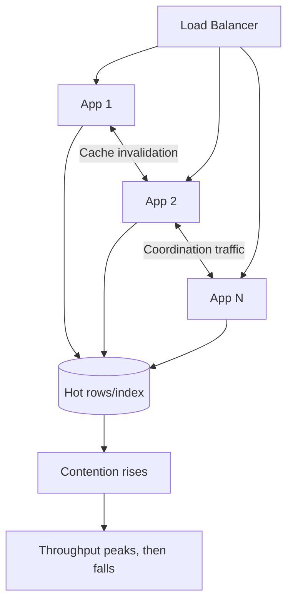

# Principle 12 — End-to-End Principle

## Statement used here

Final correctness has to be protected at the layer that understands the business effect. A lower layer can support reliability. It does not replace end-to-end verification.

This is the engineering reading of the end-to-end argument: a function that must be correct for the application cannot be left solely to a lower layer that does not understand that function.

## Examples

- TCP retransmission does not guarantee that a payment is charged only once.
- A Kafka ACK does not guarantee that Inventory reserved the right stock.
- A Redis lock does not make PostgreSQL reject a stale writer.
- HTTP 200 does not prove that a whole Saga finished.
- **Domain transfer — Graphics/HMI.** Renderer success is not the authority of the Graphic Document. The document boundary still has to accept or reject the result.

Exercise: Workbook → End-to-end principle.

## Production example — TCP is correct and the payment is still duplicated

Request 1 charges successfully and the response is lost. The client opens a new connection and sends Request 2. TCP delivers both requests accurately and does not know they are the same business intent. The payment boundary still has to enforce idempotency with a payment intent and a persistent result. A Kafka ACK likewise does not replace the invariant `inventory >= 0`.

### Diagram

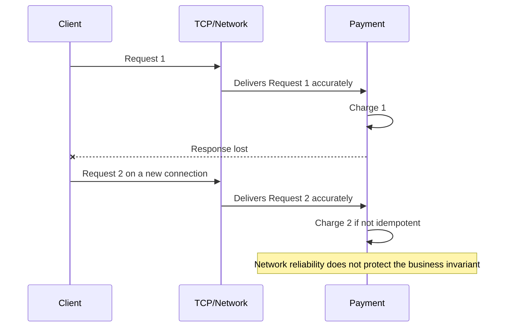

# Principle 13 — Bounded Resources

## Statement

Every resource needs an explicit bound:

- retry attempts;
- timeout;
- queue length;
- connection or thread pool;
- concurrency;
- backlog;
- retention;
- pending duration;
- memory and disk.

An unbounded queue does not remove overload. It turns overload into latency, memory pressure, and unbounded recovery time.

## Rule

```text
Bounded queue
+ explicit rejection or load shedding
+ an observable threshold
+ a recovery plan
```

Exercise: Workbook → Bounded resources.

## Production example — an unbounded queue causes OOM

The service receives 20,000 msg/s and processes 15,000/s, so the queue grows at 5,000/s. A queue of 100,000 fills after `100,000 / 5,000 = 20s`. Without a limit, memory and latency grow until OOM. Use a bounded queue, alerts at 60% and 80%, reject or load shedding, a durable broker when the work must not be dropped, and a retry budget.

### Diagram

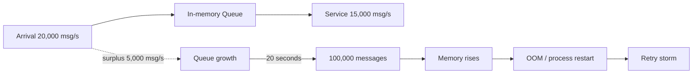

# Principle 14 — Backpressure

## Statement

When downstream is slower than upstream, the system must pass a slow-down signal or limit work:

- producer throttling;
- a bounded buffer;
- a semaphore or concurrency cap;
- reject / load shedding;
- pull-based consumption;
- an adaptive rate limit.

Without that:

```text
λ > μ
→ backlog grows
→ latency rises
→ timeout
→ retry
→ λ rises further
```

## Do not infer

Backpressure does not mean every retry stops. It needs a concrete contract or control loop, and it can reduce short-term availability or throughput.

---

## Production example — Kafka lag grows continuously

The producer writes 60,000 msg/s. Consumer capacity is 48,000/s. Lag grows at 12,000/s. After 15 minutes the backlog is `10,800,000` messages. If safe capacity cannot be increased, throttle the producer, limit the API that creates events, prioritize critical traffic, or pause secondary workload. Adding queue space does not fix a long-term `λ > μ` mismatch.

### Diagram

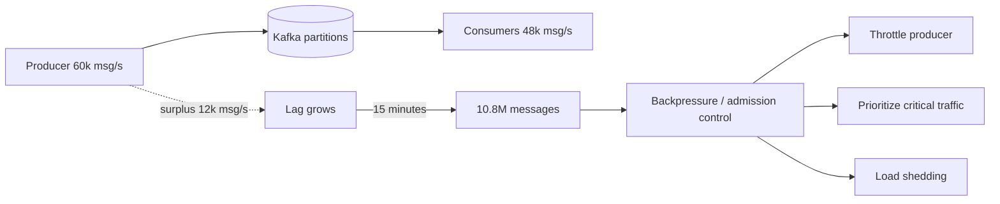

# Principle 15 — Coordination Is Expensive

## Statement

The wider an invariant spreads across nodes, partitions, or services, the more coordination the system needs:

- a global lock;
- a quorum;
- a distributed transaction;
- synchronous replication;
- total ordering;
- cross-partition validation.

## Design implication

Make the invariant local to a key when that matches the business:

- order lifecycle by `orderId`;
- account invariant by `accountId`;
- inventory by `productId` or reservation unit.

Do not dodge coordination when the business really needs it. Avoid paying coordination cost for an invariant that does not need it.

Exercise: Workbook → Coordination cost.

## Production example — a global inventory lock during a flash sale

If every purchase takes one global lock, product A blocks product B even when they are unrelated. Making the invariant local to `productId` allows parallel handling. An order with many products still needs cross-key coordination, a reservation, and a Saga. Partition by the invariant boundary, not only by table size.

### Diagram

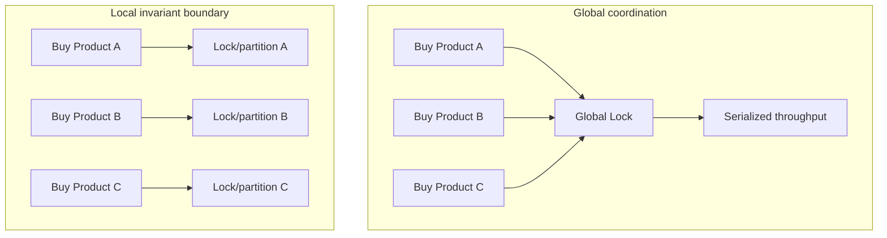

# Principle 16 — Failure Detection Is Suspicion, Not Proof

## Statement

A timeout, a missed heartbeat, or lease expiry only allows the system to suspect that a peer is no longer valid. It does not prove that the peer has stopped.

## Consequence

- A retry after a timeout can duplicate the operation.
- An old leader can wake up.
- An old lock owner can keep writing.
- The authority boundary needs a term, an epoch, or a fencing token.

## Domain transfer — Graphics/HMI

An old evaluation result that returns after the time context has changed must not be committed only because the evaluation ran successfully. State authority has to check the current context or version. That is the same rule as a fencing token: the resource checks the epoch, the producer does not declare itself current.

---

## Production example — a Redis lock expires

A acquires a lock with TTL 10s, then pauses for 15s in GC. B acquires a new lock and writes. A wakes up and still believes it is valid. Lease expiry did not stop A physically. Storage must enforce a fencing token: B's token 11 is accepted, A's token 10 is rejected.

**Domain transfer — Graphics/HMI.** A result whose context is v10 must be rejected once authority is already at v11.

### Diagram

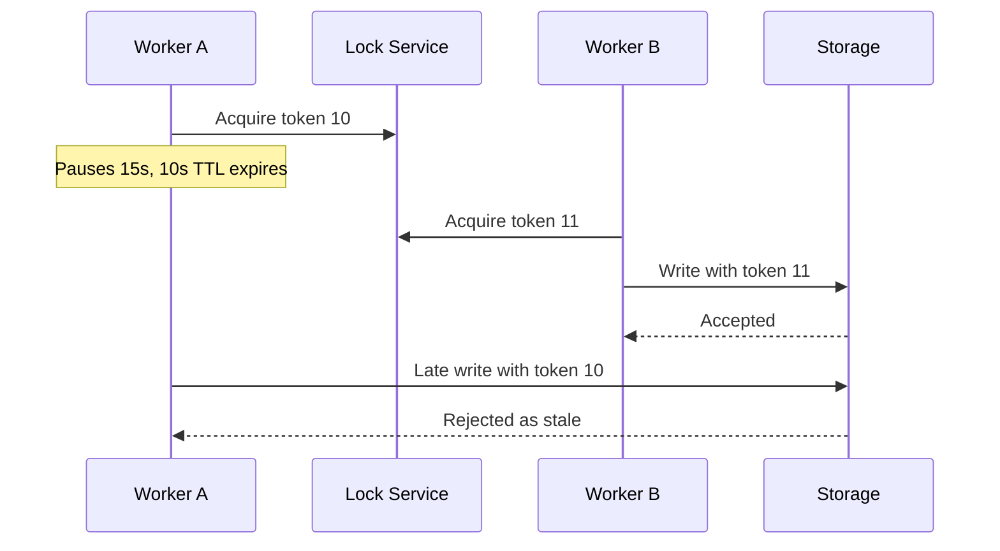

# Checklist 17 — Fallacies of Distributed Computing

Use this as a review checklist:

1. The network is reliable.
2. Latency is zero.
3. Bandwidth is infinite.
4. The network is secure.
5. Topology does not change.
6. There is one administrator.
7. Transport cost is zero.
8. The network is homogeneous.

Exercise: Workbook → Fallacies review worksheet.

## Production example — “same Kafka cluster, so it is always fast”

When the broker leader changes and DNS or network policy is wrong, metadata refresh raises latency, the producer times out and retries, TLS and ACL spend CPU, cross-zone traffic raises RTT and cost, and the app and platform teams coordinate slowly. This case breaks several assumptions at once: reliable network, zero latency, infinite bandwidth, fixed topology, free transport, and one administrator.

### Diagram

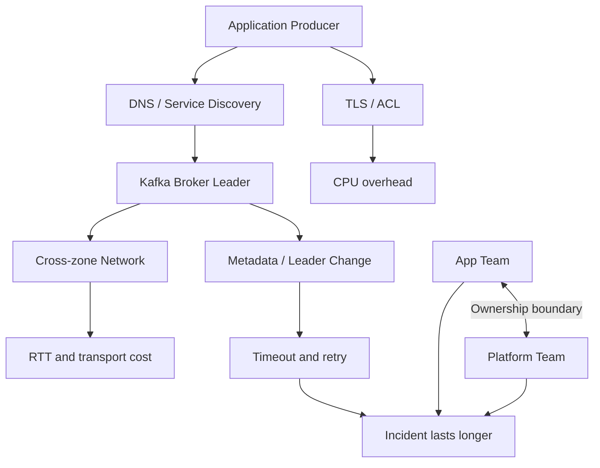

# Study priority for the laws and principles

## Must be usable without looking them up

1. Little’s Law.
2. CAP.
3. PACELC.
4. Safety vs Liveness.
5. Quorum Intersection.
6. Happens-before.
7. End-to-End Principle.
8. Bounded Resources.
9. Backpressure.
10. Failure Detection is Suspicion.
11. Fallacies checklist.

## Understand the meaning; a proof is not required yet

12. FLP.
13. Two Generals.
14. Byzantine failure model.
15. Amdahl’s Law.
16. Universal Scalability Law.

## Not required in the 4-week sprint

- Formal proofs of FLP, Paxos, or Raft.
- A deep vector-clock implementation.
- CRDT algebra.
- A detailed Byzantine Fault Tolerance protocol.
- Advanced queueing theory such as M/M/c or Erlang C.

---

# PART C — ENGINEERING CALCULATION HANDBOOK

# Formula 1 — Retry amplification

If the layers have attempt counts `A1...An`, and every layer actually uses its full attempt count because downstream keeps failing, the **upper bound** is:

```text
TotalAttempts = A1 × A2 × ... × An
DownstreamRate = OriginalRate × TotalAttempts
```

> Be explicit about whether “retry 3 times” means 3 attempts in total, or 1 initial attempt plus 3 retries = 4 attempts.

## Worked example

```text
Original rate:        600 operations/s
FE attempts:          2
Gateway attempts:     2
Service attempts:     3
Downstream capacity:  5,000 requests/s
```

```text
Worst-case downstream rate
= 600 × 2 × 2 × 3
= 7,200 requests/s
```

The upper bound exceeds capacity by `2,200 requests/s`, which is 44% of capacity. This is not the throughput that always happens. Retries stop early on success, and deadlines or rate limits can make the real attempt count lower.

Exercise: Workbook → Calculation 1.

# Formula 2 — Exponential backoff and jitter

```text
Backoff(n) = min(MaxDelay, BaseDelay × 2^(n-1))
FullJitter(n) = random(0, Backoff(n))
```

`n` is the retry number, starting at 1. It is not the first attempt.

## Worked example

`BaseDelay=200ms`, `MaxDelay=3,000ms`:

| Retry n | Backoff ceiling |
|---:|---:|
| 1 | 200 ms |
| 2 | 400 ms |
| 3 | 800 ms |
| 4 | 1,600 ms |
| 5 | 3,000 ms |

Full jitter for retry 4 lies in `[0, 1,600ms]`. For a continuous uniform distribution, the expected delay is about `ceiling / 2`. That is a statistical expectation, not a guaranteed delay for one request.

Exercise: Workbook → Calculation 2.

# Formula 3 — Overall retry budget

```text
TotalTime = Σ AttemptTimeout + Σ BackoffDelay + LocalOverhead
```

## Worked example

```text
3 attempts × 900ms       = 2,700ms
Backoff 150ms + 300ms    =   450ms
Serialization/cleanup    =   200ms
Total                    = 3,350ms
```

If the upstream deadline is `3s`, the policy is infeasible even before jitter and tail latency.

Exercise: Workbook → Calculation 3.

# Formula 4 — Deadline propagation

```text
RemainingBudget = AbsoluteDeadline - CurrentTime
DownstreamTimeout + Cleanup + ResponseMargin <= RemainingBudget
```

## Worked example

```text
Client deadline          5,000ms
Gateway overhead           150ms
Order local work           250ms
Response reserve           400ms
Remaining for Payment    4,200ms
```

Payment must not spend the entire `4,200ms` on Fraud. It still needs a local commit, cleanup, and a response.

Exercise: Workbook → Worksheet 4.

# Formula 5 — Little’s Law for in-flight work

```text
L = λ × W
```

- `L`: average number of requests or messages in the system.
- `λ`: throughput per second. In steady state, throughput equals the arrival rate.
- `W`: **mean** time in the system, in seconds. Little’s Law uses the long-run average in steady state. Do not substitute p95 or p99 and call the result average concurrency.

If a limit caps completions below the arrival rate, stop. Report unconstrained demand and the queue-growth model as two results. See Law 1.

## Worked example

Payment receives `800 req/s`, and the system can still complete that rate:

```text
Fraud latency 0.5s → L = 800 × 0.5 = 400 in-flight
Fraud latency 3.0s → L = 800 × 3.0 = 2,400 in-flight
```

A 6× latency increase makes in-flight work 6× only while the arrival rate is absorbed. If a pool cannot serve 800/s at the new latency, `2,400` is demand, not observed occupancy.

Exercise: Workbook → Calculation 5.

# Formula 6 — Queue growth and drain time

When the arrival rate is above the service rate:

```text
QueueGrowth = λ - μ
QueueAfter(t) = InitialQueue + (λ - μ) × t
```

When the service rate is above the arrival rate:

```text
NetDrainRate = μ - λ
DrainTime = Backlog / NetDrainRate
```

## Worked example

```text
Arrival:  1,500/s
Service:  1,000/s
Duration: 20s
Backlog:  (1,500 - 1,000) × 20 = 10,000
```

After recovery:

```text
Arrival:  800/s
Service:  1,200/s
Drain:    400/s
Time:     10,000 / 400 = 25s
```

These formulas assume rates are nearly constant over the interval, the queue has not hit its limit, and there is no drop or retry feedback. When the queue is bounded, the surplus becomes reject or drop instead of more backlog.

---

# Formula 7 — Worker capacity and utilization

```text
Capacity = WorkerCount × RatePerWorker
Utilization = ArrivalRate / Capacity
```

## Worked example

`100 workers × 10 req/s = 1,000 req/s` capacity.

Arrival `900/s` → utilization `90%`.

Operating near 100% usually makes queue latency rise sharply. Maximum capacity should not be the normal operating point. `RatePerWorker` must be measured on the real workload and latency distribution. It is not a constant independent of downstream.

Exercise: Workbook → Calculation 7.

# Formula 8 — Approximate connection-pool sizing

```text
Connections ≈ RequestRate × TimeHoldingConnection
```

Use mean hold time when the goal is average concurrency. A percentile hold time is a stress approximation, and it must be labeled as one.

## Worked example

```text
500 req/s × 0.04s = 20 connections
```

If holding the database transaction open during a Kafka publish raises hold time to `0.20s`:

```text
500 × 0.20 = 100 connections
```

This is a **first-order approximation** for the trade-off of a network call inside a database transaction. Standard Little’s Law uses average hold time. Production sizing also has to check p95/p99 concurrency, burstiness, transaction mix, database `max_connections`, pool wait time, and database capacity. Do not raise the pool only because the multiplication produced a large number.

### Do not sum percentiles

`p99(A + B + C)` is not `p99(A) + p99(B) + p99(C)` unless the slow tails happen on the same requests. Workbook 8 adds component p99 values only as a labeled upper-bound stress input, not as the p99 of hold time.

Exercise: Workbook → Calculation 8.

# Formula 9 — Availability of a dependent chain

If an operation needs every component to be available, and you temporarily assume independence:

```text
SeriesAvailability = A1 × A2 × ... × An
```

## Worked example

Database and Kafka are both `99.99%`:

```text
0.9999 × 0.9999 = 0.99980001 ≈ 99.98%
```

Real failures can correlate through a region, DNS, the network, or a Kubernetes cluster, so the product is only a baseline. The series formula is right only when the operation fails if **any** required dependency is unavailable. A fallback, cache, redundancy, or graceful degradation is a different model.

## Approximate downtime per year

Using a 365-day year:

| Availability | Downtime/year |
|---:|---:|
| 99% | 3.65 days |
| 99.9% | 8 hours 46 minutes |
| 99.99% | 52 minutes 34 seconds |
| 99.999% | 5 minutes 15 seconds |

---

# Formula 10 — Majority quorum

```text
Majority = floor(N / 2) + 1
FaultToleranceForMajority = N - Majority
```

This is how many nodes can be lost while the remaining nodes can still form a majority. It does not guarantee that the whole system still meets every SLO, or that no data is lost.

| N | Majority | Crash fault tolerance | Even split to watch |
|---:|---:|---:|---|
| 3 | 2 | 1 | 2–1: one side continues |
| 4 | 3 | 1 | 2–2: neither side has a majority, so both stop |
| 5 | 3 | 2 | 3–2: the side of 3 continues |
| 7 | 4 | 3 | 4–3: the side of 4 continues |

A 4-node cluster does not survive more crash faults than a 3-node cluster, and a clean 2–2 partition is an availability regression: a 3-node 2–1 split still has one live majority. Prefer 3 or 5 voting members unless a protocol-specific reason says otherwise.

For the general read/write quorum model:

```text
R + W > N
W > N / 2
```

Do not apply this mechanically to every database. Read the product’s actual consistency semantics.

Exercise: Workbook → Calculation 10.

# Formula 11 — Consumer capacity and lag

```text
ConsumerCapacity = min(ConsumerCount, PartitionCount) × EffectiveRatePerConsumer
LagGrowth = max(0, ProduceRate - ConsumerCapacity)
CatchupRate = ConsumerCapacity - CurrentProduceRate
CatchupTime = Backlog / CatchupRate   # only when CatchupRate > 0
```

## Worked example

```text
Produce:          20,000 msg/s
Consumers:        6
Per consumer:      2,500 msg/s
Capacity:         15,000 msg/s
Lag growth:        5,000 msg/s
```

After 10 minutes:

```text
5,000 × 600 = 3,000,000 messages of lag
```

If the producer drops to `10,000/s`, catch-up rate is `5,000/s`, and catching up takes `600s = 10 minutes`.

## Partition constraint

Inside one consumer group:

```text
ActiveConsumers <= PartitionCount
```

With 6 partitions and 8 consumers, at most 6 consumers are active and 2 are idle. Real throughput is also limited by the hottest partition, ordering, batch size, downstream I/O, and rebalance.

---

# Formula 12 — Outbox backlog

```text
BacklogGrowth = OutboxWriteRate - RelayPublishRate
BacklogAfter(t) = InitialBacklog + BacklogGrowth × t
```

## Worked example

```text
Write:   5,000 records/s
Relay:   4,000 records/s
Growth:  1,000 records/s
```

After one hour:

```text
1,000 × 3,600 = 3,600,000 records
```

Also compute record size, index growth, retention, and catch-up capacity. `AverageRowBytes` must include the real payload, or the raw payload must be called out separately. Raw payload does not include the row header, indexes, WAL/redo, replication, or bloat.

---

# Formula 13 — Cache hit ratio and backend load

```text
BackendRate = IncomingRate × (1 - HitRatio)
```

## Worked example

```text
Incoming: 10,000 req/s
Hit ratio: 95%
Backend:   500 req/s
```

If the cache disappears entirely, the backend receives `10,000 req/s`, a 20× load increase over the normal state.

---

# Formula 14 — Modulo partitioning and movement

```text
partition = hash(key) mod N
```

When `N` changes, most keys can move. With well-balanced consistent hashing, adding one node to N nodes usually moves about:

```text
1 / (N + 1)
```

of the keys. That is the **expected fraction** when one equivalent node is added to N balanced nodes. The real fraction depends on virtual nodes, hash distribution, weighting, replication, and the rebalance strategy.

---

# Formula 15 — Storage and retention

```text
DailyStorage = EventsPerSecond × AverageEventBytes × 86,400
RetentionStorage = DailyStorage × RetentionDays × ReplicationFactor
```

## Worked example

```text
10,000 events/s
1 kB/event (decimal = 1,000 bytes)
7 days retention
Replication factor 3
```

```text
Raw/day = 10,000 × 1kB × 86,400 ≈ 864GB/day
7 days  ≈ 6.05TB raw
RF=3    ≈ 18.14TB before compression/overhead
```

Add index and segment overhead, headroom, and a growth forecast. Compression can reduce this a lot, and it must not be assumed before it is measured. If you use KiB/GiB/TiB, recompute on 1,024. This handbook uses decimal kB/GB/TB in the storage examples.

---

# Lessons

Theme parts group the models. The delivery order is the four-week calendar in the Workbook. Lesson 5 is Part II and is scheduled on day 5, inside calendar week 1.

# PART I — FAILURE, RETRY, IDEMPOTENCY, AND CONCURRENCY

# Lesson 1. Failure model and ambiguous outcome

## 1.1 The real problem

The frontend calls `POST /orders`. The backend creates the order successfully, and the response does not return before the timeout. The user clicks again.

What the frontend can observe is only:

```text
No response arrived in time
```

The frontend cannot yet conclude:

```text
The request never reached the backend
The backend has not processed it
The backend processed it but has not committed
The backend committed and the response was lost
```

## 1.2 Core model

### Partial failure

Some components or connections fail while others keep working. A distributed system does not have a simple state of “entirely up” or “entirely down”.

### Ambiguous outcome

The caller cannot be sure of the business result. A timeout is the caller’s observation, not the business result.

### Process failure and machine failure

```text
Machine / Node
├── Order Process
├── Payment Consumer
└── Outbox Relay
```

- One process crashes: process failure.
- The whole node can no longer serve: machine failure.
- A process can exhaust RAM, CPU, or disk and degrade the machine.

## 1.3 Vocabulary map

| English | Core meaning | Do not read it as |
|---|---|---|
| partial failure | only part of the system has failed | one task is only partly finished |
| ambiguous outcome | the business result is not known | the operation definitely failed |
| transient failure | the failure may be temporary | every failure should be retried |
| permanent failure | retrying the same conditions will not fix it | the operation can never be attempted again under new conditions |
| resource saturation | a resource has reached its limit | the machine has necessarily crashed |
| network partition | nodes cannot communicate | a Kafka topic partition |
| Kafka partition | an ordered log shard inside a topic | a network split |

## 1.4 Worked example

```text
T0: FE sends create order
T1: BE inserts the order
T2: DB commits
T3: Response is late or lost
T4: FE times out
T5: User retries
```

Invariant:

```text
One checkout intent creates at most one order.
```

Candidates:

- A natural business identity such as `checkoutSessionId`.
- An explicit `Idempotency-Key`.
- The frontend sends a retry signal plus a strong business identity.
- A unique constraint or conditional insert closes the race window.

## 1.5 Failure traps

- `timeout` does not mean the request was not processed.
- `retry=true` says what kind of attempt this is. The backend still needs a way to find the original operation.
- A lock does not replace operation identity.
- Comparing the whole payload can confuse two legitimate orders that look the same.

Exercise and exit check: Workbook → Lesson 1.

# Lesson 2. Retry strategy and retry amplification

## 2.1 The problem

One user action passes through:

```text
Frontend → API Gateway → Order Service → Payment Service
```

If each layer has 3 attempts:

```text
3 × 3 × 3 = 27 downstream attempts
```

If “retry 3 times” means the first try plus 3 retries:

```text
4 × 4 × 4 = 64 downstream attempts
```

If the user clicks twice:

```text
2 × FE attempts × Gateway attempts × Service attempts
```

A duplicate user action and an automatic retry are different sources of load.

## 2.2 Core model

A complete retry strategy answers:

1. Which operation may be retried?
2. Which failures are retryable?
3. Which layer is the retry owner?
4. What is the total attempt count?
5. How long does it wait?
6. What is the overall deadline?
7. Is the operation idempotent?
8. What is the fallback when the budget is exhausted?

### Timing strategies

```text
Immediate:     0s → retry
Fixed delay:   2s → 2s → 2s
Exponential:   1s → 2s → 4s → 8s
With jitter:   random around or inside the backoff interval
```

Simple formula, where `n` is the retry number starting at 1:

```text
delay = min(maxDelay, baseDelay × 2^(n - 1))
```

## 2.3 Retryable vs non-retryable

| Case | Handling |
|---|---|
| Temporary 503 | retry with backoff, bounded |
| 429 | follow `Retry-After` when present |
| GET timeout | usually retryable |
| POST payment with an idempotency contract | may be retried |
| 400 validation | do not retry the same request |
| 401 expired token | refresh or log in, then try again |
| 403 no permission | do not retry |
| insufficient balance | do not retry until the condition changes |

## 2.4 A timeout is not a retry delay

```text
Call 1
→ wait for a 3s request timeout
→ retry immediately
```

This is still an immediate retry, because the retry delay is 0.

Exercise and exit check: Workbook → Lesson 2.

# Lesson 3. Idempotency and operation identity

## 3.1 Core model

Idempotency does not mean the request runs only once. It means:

```text
The same logical operation is executed many times
→ the final business effect is equivalent to executing it once.
```

### Natural business key

Examples:

- `checkoutSessionId`
- `paymentIntentId`
- `bookingReference`

If the domain guarantees that this key uniquely represents one operation, it can be used directly.

### Explicit idempotency key

Use this when the domain does not yet have a clear operation identity, or when the API needs a general contract.

The backend can store:

```text
principal_id
idempotency_key
request_hash
status: PROCESSING | SUCCEEDED | FAILED
business_result_id
serialized_response
created_at / expires_at
lease_until / fencing_token
```

Unique constraint:

```text
UNIQUE(principal_id, idempotency_key)
```

## 3.2 Worked example

Two requests arrive almost together:

```text
R1: INSERT key=K
R2: INSERT key=K
```

The unique constraint lets only one request create the record. The other reads the current state.

If the key is the same and the payload differs:

```text
Reject: idempotency key reused with a different request
```

## 3.3 Takeover when `PROCESSING` is stuck

A worker can insert `PROCESSING` and crash before it finishes. The unique constraint then blocks every retry, and the operation stays incomplete. “The row exists” is not the same as “the effect finished”.

A retry may take over the row only when both are true inside one atomic update:

- the status is still `PROCESSING`;
- `lease_until` has passed.

The new attempt then sets a new lease and a higher fencing token. A late write from the crashed worker carries the old token and is rejected by storage. An older token is not an alternative way to steal a lease that is still valid. Do not delete the row and start a second business effect.

Takeover decides who may drive the row. It does not prove the previous attempt failed.

- Local database work only: if the first transaction rolled back, the new attempt may run it.
- External side effect, such as a payment, an email, or a call to another service: the first attempt may have succeeded and crashed before writing `SUCCEEDED`. Query that effect with the same operation identity before creating it again. If it already exists, store `SUCCEEDED` and return that result. If the query is also unknown, stay in `PROCESSING` or move to `MANUAL_REVIEW`. Lease expiry is not a reason to charge again.

If the stored status is `SUCCEEDED`, return the stored response. If it is `FAILED` and the failure is retryable, either keep the same key and move the row back to `PROCESSING` under the lease rule, or define a new operation identity. Do not reuse the key for a different payload. A retryable `FAILED` still needs the same external query when the failure itself was a timeout.

Key expiry is a retention decision. Expire only after the business effect can no longer be confused with a new operation, and never while a lease is still valid.

## 3.4 Idempotency vs lock

| Mechanism | What it solves |
|---|---|
| Lock | who may execute at one moment |
| Idempotency | whether running the logical operation again creates another effect |
| Unique constraint | the correctness boundary at storage |
| Request identity | which attempts belong to which operation |
| Lease + fencing token | who may drive a `PROCESSING` row after the lease expires; not proof that the previous effect failed |

Exercise and exit check: Workbook → Lesson 3.

# Lesson 4. Optimistic concurrency — priority gap

## 4.1 The lost-update problem

Two requests both read:

```text
quantity = 1
version = 7
```

If both write `quantity = 0`, both can report success even though only one unit was left.

## 4.2 Three main mechanisms

### Atomic conditional update

```sql
UPDATE inventory
SET quantity = quantity - 1
WHERE product_id = :productId
  AND quantity >= 1;
```

- Updated rows = 1: success.
- Updated rows = 0: the condition is no longer true.

This is the default for a short decrement. It does not need a version column.

### Optimistic concurrency

```sql
UPDATE inventory
SET quantity = quantity - 1,
    version = version + 1
WHERE product_id = :productId
  AND quantity >= 1
  AND version = :expectedVersion;
```

No lock is held during application processing. The conflict is detected at write time. The version predicate is the optimistic check. The `quantity >= 1` predicate is the inventory invariant. They can be combined; they are not the same mechanism.

### Pessimistic locking

```sql
SELECT quantity
FROM inventory
WHERE product_id = :productId
FOR UPDATE;
```

The lock is held so another transaction cannot change the row until commit or rollback. The following update and commit are part of the same transaction. Do not hold this lock across a network call.

## 4.3 Decision guide

| Condition | Suitable candidate |
|---|---|
| Short update, simple condition, including a flash-sale decrement | atomic conditional update |
| Low contention, and the application does work between read and write | optimistic concurrency |
| High contention, and the read–calculate–write critical section is short and local | pessimistic lock |
| Invariant across services | Saga, reservation, or coordination, not only a database lock |

A flash sale of the last unit is the first row, not the third. High contention does not by itself justify `SELECT FOR UPDATE` when the write is a single conditional decrement. A pessimistic lock is for a short local read–calculate–write that cannot be expressed as one conditional update. Holding it across a 5-second pricing call is the wrong candidate.

## 4.4 Optimistic concurrency is not event sourcing

- A version column only detects that the data changed.
- Event sourcing stores the event sequence as the source of state.
- An audit history can sit next to versioning. It is not a requirement.

Exercise and exit check: Workbook → Lesson 4.

# PART II — MESSAGING, DUAL WRITE, SAGA, AND RECOVERY

# Lesson 5. Kafka offset and business completion

## 5.1 Core model

```text
Kafka log: the message is retained according to retention
Offset: the position the consumer group has read or committed
Business completion: the side effect in the database or in an external system
```

These three are independent. A Kafka partition is an ordered shard of a topic. It is not a network partition.

## 5.2 Timeline

### Process, then commit

```text
1. Poll message M
2. Update the database successfully
3. Crash
4. Offset not committed
5. M is delivered again
```

Result: at-least-once delivery. The business effect can be repeated unless the consumer is idempotent.

### Commit, then process

```text
1. Poll M
2. Commit the offset
3. Crash
4. The business update has not happened
```

Result: the message is not read again by itself. Business processing can be lost.

## 5.3 Delivery semantics — the boundary of the guarantee

### At-most-once processing

Committing or acknowledging progress before business processing can mean the message is not redelivered after a crash. The advantage is that the broker does not redeliver. The disadvantage is lost business processing.

### At-least-once delivery

Process first, commit progress after. A crash between the two steps redelivers the message. This is the common model, and it requires an idempotent consumer.

### Effectively-once business outcome

```text
At-least-once delivery
+ operation identity / message ID
+ idempotent processing
+ an atomic local state transition
≈ one business effect
```

### Kafka exactly-once semantics

Kafka transactions can atomically consume, process, and produce **inside Kafka records and offsets** when the transaction APIs and isolation settings are used correctly. They do not cover PostgreSQL, a payment provider, email, or any side effect outside Kafka. External effects still need idempotency, an Outbox and an Inbox, a query and reconciliation, or business recovery. The Outbox and the Inbox are defined in the next section.

Do not mix three questions:

1. Can the message be delivered again?
2. Can the consumer code run again?
3. Can the business effect be created again?

## 5.4 Idempotent consumer

Inside the same local database transaction:

```text
INSERT processed_message(message_id) -- unique
UPDATE business_state
COMMIT
```

If the message is a duplicate:

- the unique constraint sees that it was already processed;
- no second business effect is created;
- the offset can still be committed afterward.

Because the insert and the business update commit together, a crash cannot leave a durable “business updated, processed-message missing” state. That window exists only if the two writes are separate commits. Do not design that split.

`processed_message` is the consumer-side **Inbox**. The Transactional Outbox in Lesson 6 keeps the publisher from losing the event when the database commits and Kafka does not. The Inbox keeps a redelivered event from applying the business effect twice. They are a pair, and they cover different sides of the handoff. Neither one covers a payment, an email, or any effect outside this database. Those still need the provider identity and the query in section 5.5.

## 5.5 External side effect

A database transaction cannot roll back an email or an external payment. Those need their own contract:

- an idempotency key with the provider;
- the provider transaction ID;
- a status query;
- webhook deduplication;
- reconciliation.

## 5.6 Poison messages, retry topics, DLQ, and safe replay

### What a poison message is

A message becomes a **poison message** when the consumer cannot process it successfully after a reasonable number of attempts. Classify it before retrying:

| Failure class | Example | Default handling |
|---|---|---|
| Transient dependency failure | database timeout, `503`, rate limit | bounded retry + backoff/jitter |
| Invalid data or schema | missing required field, unsupported enum | do not hot-retry; quarantine / DLQ |
| Deterministic code bug | the same payload always throws | stop the hot retry; alert, fix, controlled replay |
| Business rejection | order already cancelled, insufficient balance | record the business result; do not DLQ it as a technical failure |
| Authorization or security failure | expired credential, principal no longer allowed | refresh or re-authorize by policy; do not retry forever |

### Retry topology

```text
Main topic
→ Consumer attempt 1
→ retry topic 10s
→ retry topic 1m
→ retry topic 10m
→ DLQ / quarantine
```

Do not let a poison message block the whole partition forever. There are two directions, depending on the ordering invariant:

- Keep strict ordering: pause the partition and remediate the bad message. Partition availability drops.
- Allow later messages to proceed: move the bad message to a retry topic or DLQ, and show that continuing does not break per-key order or the invariant.

### A DLQ is not a place to throw an error and forget it

A DLQ record should at least carry:

```text
original topic / partition / offset
message key / business identity
schema version
first failure time / last failure time
attempt count
error category / error fingerprint
trace ID / correlation ID
consumer version
redacted payload or a payload reference
```

Do not put secrets or raw credentials on the DLQ. PII follows the retention and access policy.

### Safe replay runbook

1. Identify the root cause and the affected messages.
2. Fix the code, schema, config, or dependency.
3. Choose the replay identity and the idempotency boundary.
4. Re-authorize if the privileged operation requires current authorization.
5. Replay at a small rate limit. Do not burst into downstream.
6. Watch duplicate count, error rate, lag, and the business invariant.
7. Stop the replay if the old error fingerprint returns.
8. Audit who replayed, which range, which version, and what the result was.

### Metrics and alerts

- retry attempts by error category;
- retry-topic depth and oldest-message age;
- DLQ depth and arrival rate;
- poison-message count by schema and consumer version;
- replay success, failure, and duplicate count;
- partition paused duration;
- remediation lead time.

### Worked example

The Inventory consumer receives `OrderCreated v3`, and the old deployment only understands schema v2. Retrying immediately 100 times does not change the result. It only increases lag. The consumer quarantines the message with `schema_version=3`, alerts the team, deploys a compatible handler, and replays the message with the same `eventId`. The processed-message unique constraint makes sure inventory is reserved only once.

### Exit criteria

- Classify transient, permanent, business, and security failures.
- Do not hot-retry a schema or code bug.
- The DLQ has an owner, retention, remediation, and safe replay.
- The decision to keep or drop ordering is protected by an invariant.

Exercise: Workbook → Lesson 5.

# Lesson 6. Dual write and the Transactional Outbox

## 6.1 The dual-write problem

Order Service must:

1. write the order to PostgreSQL;
2. publish `OrderCreated` to Kafka.

There is no single local transaction that covers both resources.

## 6.2 Three options

### A. Kafka first, database second

Failure window:

```text
Kafka has the event
The database did not commit
```

Recovery candidates:

- the consumer checks the source record;
- a compensating event;
- a reservation TTL;
- reconciliation.

### B. Database first, Kafka second

Failure window:

```text
The database has the order
Kafka does not have the event
```

Recovery candidates:

- scan for stuck orders;
- replay the publish;
- an event marker;
- a reconciliation job.

### C. Transactional Outbox

```text
BEGIN
INSERT order
INSERT outbox_event
COMMIT
```

Relay:

```text
read outbox → publish to Kafka → mark published
```

A relay crash after publish and before the mark can publish again. The consumer must still be idempotent.

## 6.3 Direct publish is not wrong by default

It can fit when:

- Kafka is internal and p99 is low;
- the transaction lock scope is small;
- the publish timeout is tight;
- traffic is moderate;
- the failure can be detected and recovered;
- the business accepts temporary inconsistency.

Do not look only at average latency. Measure:

- p95 / p99 / p99.9 publish latency;
- database transaction duration;
- lock wait;
- connection-pool saturation;
- behavior when Kafka is slow or unavailable.

Exercise: Workbook → Lesson 6.

# Lesson 7. Two-Phase Commit (2PC) foundation

## 7.1 The problem

Several resource managers must decide to commit or abort one transaction together. For example, a coordinator drives two databases that support a prepare/commit protocol.

## 7.2 Two phases

```text
Phase 1 — Prepare
The coordinator asks each participant: can you commit?
The participant writes a durable prepare state and returns YES or NO.

Phase 2 — Decision
If every answer is YES → the coordinator records COMMIT and tells participants to commit.
If any answer is NO → the coordinator records ABORT and tells participants to roll back.
```

## 7.3 What it guarantees

- Atomic commit among participants that actually support the protocol.
- No participant commits that transaction before the global decision.
- A durable prepare and decision log supports recovery after a crash.

## 7.4 Failure and trade-off

- A participant that has prepared can hold locks or resources while it waits for the decision.
- Coordinator failure or a network partition can leave the transaction `in-doubt` and blocked until recovery or a timeout policy handles it.
- Operational coupling, and a requirement that the participant and driver support the protocol.
- Latency rises because of extra network rounds and durable log writes.
- Standard 2PC is an atomic-commit protocol, not a consensus protocol. Coordinator and participant recovery is a different model from Raft or Paxos.

## 7.5 When to consider it

- A small number of resources, inside the same trust and administrative boundary.
- The database or transaction-manager infrastructure supports it well.
- Atomicity is worth more than availability and latency.
- The transaction is short and the lock scope is controlled.

In microservices with an external API, a long-running workflow, or a participant that cannot prepare, Saga, Outbox, and reconciliation are usually more practical.

Exercise and exit check: Workbook → Lesson 7.

# Lesson 8. Saga, compensation, and the state machine

## 8.1 The problem

```text
Reserve Inventory
→ Charge Payment
→ Confirm Order
```

Each service has its own database. Payment fails after stock was held.

## 8.2 Compensation is not rollback

- A database rollback erases uncommitted changes inside one transaction.
- Compensation is a new business action that moves the system toward a valid state.
- Compensation can be slow, can fail, or can be impossible to reverse completely.

## 8.3 Isolation is not included

A Saga does not provide the isolation of one local transaction. Concurrent sagas can observe intermediate state:

- two orders can both see remaining stock and both reserve it;
- a reader can see a reservation that will later be released;
- a step can act on data that a concurrent saga has not compensated yet.

Name the isolation strategy before calling the workflow correct:

- a reservation, or a semantic lock, held until confirm or expiry;
- a commutative update, such as an atomic conditional decrement, so the intermediate state still protects the invariant;
- a pivot step that makes later compensation well-defined;
- an explicit statement of which dirty reads the domain accepts.

Orchestration and choreography are different control styles, not different isolation guarantees. An orchestrator keeps the state machine in one place. Choreography spreads transitions across events. Either style still needs the reservation or the commutative update. Neither style turns compensation into a rollback, and neither gives serializability across services.

## 8.4 Sample state machine

```text
PENDING_PAYMENT
PAYMENT_PROCESSING
CONFIRMED
CANCEL_PENDING
RELEASE_PENDING
CANCELLED
MANUAL_REVIEW
```

### Flow

```text
Reserve succeeds
→ PENDING_PAYMENT
→ retry payment within a bound
→ user intervention if needed
→ reservation expires
→ CANCEL_PENDING
→ release inventory
→ CANCELLED
```

If release fails:

```text
RELEASE_PENDING
→ retry with backoff
→ DLQ/alert
→ reconciliation / manual recovery
```

A root-cause fix does not replace recovery for the transaction that is already failing.

Exercise and exit check: Workbook → Lesson 8.

# PART III — REPLICATION, QUORUM, CONSENSUS, AND FENCING

# Lesson 9. Replication consistency

## 9.1 Replication lag

The primary has committed, and the follower or replica has not applied the change. A read of the replica can return stale data.

The data is usually not lost. What is observed is that the replica has not caught up.

## 9.2 Session guarantees

A session is one client or one logical user flow. These four guarantees apply inside that session. They are not linearizability, and they do not promise that every other reader sees the same data.

| Guarantee | Promise inside the session | What a lagging replica can break |
|---|---|---|
| Read-your-writes | A later read sees this session’s own earlier writes | The user saves an address, then the next read shows the old one |
| Monotonic reads | A later read is not older than an earlier read in this session | The user sees the new address, refreshes, and sees the old one |
| Monotonic writes | This session’s writes are applied in the order the session issued them | Profile write 2 is visible while write 1 is still missing |
| Writes-follow-reads | A write is ordered after a read that the session has already observed | The user reads a post, comments, and the comment lands where the post is not yet visible |

Read-your-writes candidates:

1. Read the primary after the write.
2. Return the data immediately in the write response.
3. Sticky reads to the primary for a few seconds.
4. Pass a version or commit position, and read a replica only when it is new enough.
5. Wait for the replica to catch up, with a timeout.

Monotonic reads usually need the same session pin or the same minimum version. A later read must not be sent to a replica that is behind the replica already read. Monotonic writes and writes-follow-reads need the session’s write order and the version it has observed to travel with the next operation. Switching replicas at random breaks all four even when each replica is internally consistent.

## 9.3 Domain guide

| Data | Stale read? |
|---|---|
| Product description | usually acceptable for a short time |
| Social feed | usually acceptable |
| Dashboard analytics | usually acceptable |
| Balance before a transfer | usually not |
| A permission that was just revoked | should not be stale |
| Payment status | needs great care |
| A user who just edited an address | needs read-your-writes for the UX |

Exercise and exit check: Workbook → Lesson 9.

# Lesson 10. Quorum — priority gap

## 10.1 Majority

```text
Majority = floor(N / 2) + 1
```

| N | Majority | Nodes that can be lost while a majority remains | Partition note |
|---:|---:|---:|---|
| 3 | 2 | 1 | 2–1: one side continues |
| 4 | 3 | 1 | 2–2: neither side has a majority; both stop. Availability is worse than N=3 in that split |
| 5 | 3 | 2 | 3–2: the side of 3 continues |
| 7 | 4 | 3 | 4–3: the side of 4 continues |

4 nodes do not tolerate more failures than 3 nodes under majority rules, and they cost an extra node. They also have a 2–2 split in which no side can commit.

## 10.2 A 5-node cluster splits 3–2

```text
Partition A: 3 nodes → has a majority
Partition B: 2 nodes → minority
```

If consistency is preferred:

- the 3-node side may keep or elect a leader and commit;
- the 2-node side must not commit writes;
- the 2-node side returns unavailable, redirect, or read-only, depending on the design.

The domain decides the consistency requirement. Quorum and consensus decide technical authority.

## 10.3 Quorum intersection

Two majorities in the same cluster must share at least one node. That prevents two conflicting histories from both being committed by a majority.

Example, cluster of 5:

```text
Majority 1: {A, B, C}
Majority 2: {C, D, E}
Intersection: {C}
```

## 10.4 Read/write quorum

One general model uses:

```text
R + W > N
W > N/2
```

The goal is that a read quorum intersects a write quorum, and that two write quorums intersect. Not every database implements this formula in the same way. Sloppy quorum and hinted handoff are outside this abstract model.

Exercise and exit check: Workbook → Lesson 10.

### English answer

> In a five-node cluster, a majority requires three nodes. During a 3–2 network partition, the three-node side can continue committing writes if consistency is prioritized. The two-node minority must stop accepting writes because it cannot prove that its decisions are part of the authoritative history. A four-node cluster is different: a 2–2 split leaves neither side with a majority.

# Lesson 11. Consensus and a Raft foundation

## 11.1 What consensus solves

Nodes need to agree on one history or decision despite crashes, delay, or a network partition.

Raft uses three roles:

- follower;
- candidate;
- leader.

Core ideas:

- term;
- leader election;
- replicated log;
- majority acknowledgement;
- committed entry.

## 11.2 Simplified election

```text
A follower receives no heartbeat
→ increments the term
→ becomes a candidate
→ requests votes
→ receives a majority of votes
→ becomes leader
```

A node does not become leader only because it “thinks” the old leader is dead.

## 11.3 Log commit

The leader sends the log entry to followers. An entry is committed only under the protocol’s rules, based on majority replication and the term rules. A majority acknowledgement of an entry from an older term is not, by itself, enough to treat that entry as committed. The leader commits an entry from its current term by replication to a majority; entries from earlier terms become committed only as a consequence of that rule.

A minority can still be alive and still lack the authority to commit.

## 11.4 What this level does not require

- A formal safety proof.
- A production Raft implementation of your own.
- You do need to predict leader failure and network-partition behavior.

## 11.5 Membership change and joint consensus — practical awareness

A membership change is not an arbitrary edit to a node list. If the old configuration and the new configuration can decide independently, quorum intersection can break during the transition.

Raft uses a joint-configuration phase, conceptually:

```text
C_old = {A, B, C}
C_new = {A, B, D}

Transition:
C_old
→ C_old,new  # a decision needs a quorum under both the old and the new rules
→ C_new
```

The goal is to stop `C_old` and `C_new` from creating two independent authorities. Protocol details depend on the implementation. At foundation level, remember:

- a membership change is a replicated state transition;
- do not add or remove many nodes outside the protocol;
- a new node needs to catch up before it carries authority;
- a failure during the transition recovers from the committed configuration, not from a local config file.

### Worked example — replace node C with D, starting from 3 nodes

1. The cluster `{A,B,C}` has leader A.
2. D joins as a learner / non-voting member if the implementation supports it, and catches up the log.
3. The leader commits the joint configuration `{A,B,C}` + `{A,B,D}`.
4. During the joint phase, a decision must satisfy the quorum rules of both configurations.
5. The leader commits the final configuration `{A,B,D}`.
6. C has no voting authority after the final commit.

You do not need the joint-consensus proof in this sprint. You do need to know why replacing the config directly is unsafe.

## 11.6 Worked sequence — leader failure, a 3–2 partition, and recovery

### Initial state

```text
Term 7
Leader A
Committed log: [1..100]
Cluster: A B C D E
```

### Failure timeline

1. The network splits into `{A,B}` and `{C,D,E}`. A still believes it is leader of term 7, and it has only 2 of 5 nodes.
2. A may accept a client request locally, and it cannot commit a new entry because it lacks a majority. The client must receive a timeout or a not-committed result. The write must not be treated as committed.
3. `{C,D,E}` has a majority. After the election timeout, C becomes a candidate in term 8, receives votes from C, D, and E, and becomes leader.
4. C replicates a new entry to D and E. A majority of 3 of 5 confirms it, so an entry from term 8 can commit under Raft’s rules.
5. The network heals. A receives an AppendEntries or heartbeat for term 8, sees that its own term is old, and steps down to follower.
6. Uncommitted entries that exist only on A and B can be overwritten by log reconciliation so they match the authoritative log of leader C.
7. The client of the old request must query or retry with an operation identity. A timeout does not mean the entry was applied, and it does not mean the entry was not applied, unless a committed-result protocol says so.

### Safety and liveness

- Safety: the 2-node side does not commit a history of its own.
- Liveness: the 3-node side can elect a leader and continue when timing is stable enough.
- Recovery: the old leader steps down on a higher term. An uncommitted log does not become authority.

### Calibrated answer

> During a 3–2 partition, the two-node side may still have the old leader, but it cannot commit new entries because it lacks a majority. The three-node side can elect a leader in a higher term and continue. When the partition heals, the old leader observes the higher term, steps down, and reconciles its uncommitted suffix with the authoritative leader log.

Exercise: Workbook → Lesson 11.

# Lesson 12. Lease and fencing token — priority gap

## 12.1 The failure

```text
A acquires a lock with TTL 10s
A pauses for 15s
The lock expires
B acquires the lock
A wakes up and keeps writing
```

Both A and B can believe they are valid, based on local information.

Raising the TTL does not remove the problem, because no TTL proves that a process will not pause for longer.

## 12.2 Fencing token

Each time a lease or lock is granted, the coordinator issues a monotonically increasing token:

```text
A → token 10
B → token 11
```

Storage stores the newest accepted token and accepts a write only when its token is not older than the latest accepted token. The check and the write are atomic.

```text
Write from B, token 11 → accept
Write from A, token 10 → reject
```

The important point:

> The lock service issues the token. The final resource must enforce the token.

If storage does not check it, the fencing token is meaningless metadata.

## 12.3 Candidate alternatives

- Renew the lease and cancel: reduces the risk, and does not prove the stale process has stopped.
- A single-writer partition: reduces writer competition.
- A version check or conditional update: fits when storage supports it.
- After-the-fact reconciliation: use it when the side effect can be detected and compensated.

## 12.4 Domain decision

| Task | Level of protection |
|---|---|
| Build a temporary cache file | overwrite or retry may be acceptable |
| Generate a report | versioned output, or the last successful run |
| Update a balance | a strong storage invariant, ledger, transaction, or version |
| Control a physical device | fencing or an epoch is very important |

Exercise: Workbook → Lesson 12.

### English answer

> Increasing the lock TTL does not eliminate stale writers. I would use a monotonically increasing fencing token and require the storage layer to reject writes carrying an older token than the latest accepted one.

# PART IV — TIMEOUT, RESILIENCE, AND OBSERVABILITY

# Lesson 13. Timeout budget and deadline propagation — priority gap

## 13.1 The request chain

```text
Client → Order → Payment → Fraud
```

Timeouts need an order:

```text
Client deadline:           5.0s
Order → Payment timeout:   3.0s
Payment → Fraud timeout:   1.0s
```

The downstream timeout must sit inside the remaining upstream budget so the upstream still has time to:

- handle the error;
- roll back local work;
- return a response;
- or move to a pending state.

## 13.2 A common mistake

```text
Order times out Payment at 2s
Payment times out Fraud at 5s
```

Order gives up after 2s, and Payment keeps holding resources while it waits another 3s for Fraud.

## 13.3 Deadline propagation

Instead of each service choosing an independent timeout, the upstream passes a deadline. The downstream computes the remaining time.

```text
remaining = deadline - now
```

Retries must also fit in the remaining budget.

## 13.4 Cancellation propagation

When the upstream cancels a request, the downstream should try to cancel work that no longer has value. Cancellation does not always stop a side effect that has already started, so idempotency and recovery are still required.

Exercise: Workbook → Lesson 13.

# Lesson 14. Circuit breaker, bulkhead, and load shedding

## 14.1 Cascading failure

Fraud is slow:

```text
Fraud is slow
→ Payment holds connections or threads
→ Payment’s pool is exhausted
→ other requests slow down too
→ Order holds resources waiting for Payment
→ the failure spreads
```

## 14.2 Circuit breaker

States:

- **Closed:** calls proceed, and failures are recorded.
- **Open:** fail fast, and do not call downstream.
- **Half-open:** allow a limited number of probes to test recovery.

A circuit breaker does not fix Fraud. It limits the damage to the caller. When the breaker closes, limit the probe concurrency so recovery does not become a thundering herd.

## 14.3 Bulkhead

Isolate resources by dependency or workload:

- a separate connection pool;
- a separate thread pool;
- a semaphore or concurrency limit;
- a separate queue.

A slow Fraud dependency must not take every resource that other Payment requests need.

## 14.4 Load shedding

Under overload, reject some requests on purpose instead of accepting everything and then falling over.

Candidates:

- 429 or 503;
- a queue-length limit;
- a concurrency cap;
- prioritize critical traffic;
- drop optional work.

## 14.5 Graceful degradation

This depends on the domain:

- A low-value transaction may use a local rule.
- A high-risk transaction returns pending or manual review.
- An order may be created without capturing payment yet.
- Reject temporarily if the invariant does not allow the check to be weakened.

Exercise: Workbook → Lesson 14.

# Lesson 15. Distributed tracing and observability

## 15.1 Three kinds of signal

- Logs: event detail.
- Metrics: trends and alerts.
- Traces: the path and latency of one request across services.

## 15.2 Trace model

```text
Trace ID: the whole request
Span: one operation inside the request
Parent/child: the call relationship
```

Example:

```text
Trace: checkout-123
├── Order API 850ms
│   ├── PostgreSQL 20ms
│   └── Payment 800ms
│       └── Fraud 760ms
```

The bottleneck is the Fraud span. You do not have to infer it from log timestamps on several machines.

## 15.3 RED method

- Rate
- Errors
- Duration

Add business metrics:

- outbox backlog;
- consumer lag;
- duplicate count;
- stuck order count;
- compensation failure;
- manual-review queue.

## 15.4 Telemetry must not become the bottleneck

- asynchronous export;
- a bounded queue;
- sampling;
- drop telemetry before blocking the business;
- a separate collector;
- monitor the observability pipeline itself.

## 15.5 Context propagation across HTTP, Kafka, and background jobs

### HTTP

- Accept a W3C `traceparent` / `tracestate` when it is valid.
- Create a server span, and pass context into downstream HTTP or RPC calls.
- Keep `operationId` and the business identity separate from the trace ID. One operation can have many traces across retry and recovery.

### Kafka and messages

The producer injects trace context into message headers. The consumer extracts the context and creates a **consumer or process span**. Do not treat trace context as trusted authorization data.

```text
HTTP request trace T1
→ Order span
→ Kafka produce span
→ message header trace context
→ Inventory consume/process span
→ DB span
```

For a delayed retry or a DLQ replay, a span link is often better than a fake parent-child edge that stretches across hours. Business correlation uses `orderId`, `eventId`, `paymentIntentId`, and `operationId`.

### Background job

The job record should keep:

```text
jobId
operationId / entityId
enqueuedAt / startedAt / completedAt
attempt
source event/topic/offset, or the API request reference
trace link
```

## 15.6 Structured logging schema

Suggested minimum fields:

```text
timestamp
service.name / service.version / environment
severity
trace_id / span_id
operation_id / message_id / entity_id
state_before / state_after
attempt / retry_owner
error.category / error.code / error.fingerprint
latency_ms
result
```

Do not log a raw token, cookie, authorization header, or an uncontrolled payload. PII uses an allowlist or masking.

## 15.7 SLI, SLO, and alert policy

Do not alert only on CPU > 80%. Tie the symptom to business impact:

| Signal | Example alert |
|---|---|
| Error rate | `5xx > 2%` for 5 minutes, with enough request volume |
| Latency | p99 above the SLO for 10 minutes |
| Kafka lag | oldest-message age beyond the business tolerance |
| Outbox | backlog age > 2 minutes, or continuous growth |
| Saga | `RELEASE_PENDING` beyond its maximum duration |
| DLQ | arrival rate > 0 for a critical payment or inventory event |
| Burn rate | fast and slow SLO error-budget burn, using a multi-window policy |

Take concrete thresholds from the real SLO and the real traffic. Do not copy them blindly.

## 15.8 Operational runbook

```text
1. Detect      — which alert or symptom starts this?
2. Triage      — scope, start time, affected tenant/entity/version?
3. Contain     — disable retry, open the circuit, rate-limit, pause the consumer?
4. Mitigate    — failover, degrade, or manual review?
5. Recover     — drain the backlog, replay, reconcile, compensate?
6. Verify      — have the invariant, the metrics, and user impact returned to normal?
7. Learn       — root cause, regression test, action owner, and due date?
```

A root-cause fix does not replace recovery of the transaction that is stuck.

## 15.9 Safe replay and manual correction

- Identify the exact range by topic, partition, and offset, by message ID, or by entity state.
- Dry-run or count affected records before replay.
- Recheck authorization and security policy when required.
- Replay with a rate limit and idempotency.
- Record the actor, the reason, the range, the code version, and the result.
- Define a stop condition if the duplicate or error rate rises.
- Verify the business invariant after replay with a reconciliation query.

Exercise, drill, and exit check: Workbook → Lesson 15.

# APPENDIX G — CROSS-CUTTING SECURITY, PRIVACY, AND OWNERSHIP

This appendix supports **Gate K** directly. Security is not a side service added after the architecture. Retry, replay, messaging, recovery, and observability can all cross a security boundary if they are not designed at the same time.

## G.1 Authentication and authorization boundary

- Authentication establishes who the caller or subject is.
- Authorization establishes which operation the current subject may perform on which resource.
- An idempotency key does not replace authorization.
- Replay or retry of a privileged operation may need a fresh authorization check if rights can be revoked between attempts.
- A background consumer needs a service identity and least privilege. It must not keep a user’s credential forever.

### Example

A user submits a refund while they still have permission. The message sits on a retry queue for 30 minutes. The user’s permission is then revoked. The consumer must not assume the old message is still valid if policy requires current authorization. The event should store the subject, the policy version, or an authorization decision sufficient for audit. The design must choose **authorize-at-request** or **re-authorize-at-execution** explicitly.

## G.2 Idempotency, replay, and security

Idempotency protects against a duplicate business effect. An attacker can still replay a valid request. Combine:

- a principal-bound idempotency key;
- a request fingerprint;
- a nonce or timestamp when the protocol requires it;
- an expiry window;
- a signature or MAC if the request crosses an untrusted channel;
- an audit trail and anomaly detection.

Do not share one idempotency key across tenants or principals.

## G.3 Message and event data minimization

- Include only fields the downstream actually needs.
- Do not put a password, token, private key, or raw credential into a Kafka event, a DLQ, a log, or a trace.
- PII needs classification, access control, retention, and a deletion policy.
- A DLQ and an Outbox often keep data longer than the main flow, so they belong in the data-retention scope.
- Schema evolution must not accidentally expose sensitive data to an old consumer.

## G.4 Transport and service-to-service security

- TLS or mTLS protects transport and adds handshake, CPU, and certificate-rotation cost.
- Kafka ACLs, database roles, and cloud IAM need least privilege.
- Certificate and key rotation needs an overlap window and a rollback plan.
- A network policy reduces attack surface and does not replace application authorization.
- Timeout, retry, and the circuit breaker must treat authentication failure separately. Do not retry `401` or `403` forever.

## G.5 Observability privacy

Structured logs and traces must not become a data leak:

- redact tokens, cookies, and the authorization header;
- hash or mask PII when you only need correlation;
- limit payload capture;
- sampling does not replace access control;
- separate retention for the security audit and for performance traces;
- control who can view the dashboard and the log store.

## G.6 Ownership and escalation matrix

| Component | Primary owner | Secondary / escalation | Evidence required |
|---|---|---|---|
| Application service |  |  | Runbook, SLO, on-call |
| PostgreSQL |  |  | Backup/restore, capacity, failover |
| Kafka |  |  | Topic/ACL/retention, lag runbook |
| Network/DNS/TLS |  |  | Certificate owner, rotation, incident path |
| Observability |  |  | Collector capacity, retention, access |
| External provider |  |  | Contract, rate limit, escalation contact |

Do not assume “one administrator”. Cross-team ownership is part of the failure model.

Blank security worksheet: Workbook → Security verification worksheet.

# Sample interview answers

These are solved examples. The 20-question drill is in the Workbook. Score it before you read the calibration notes at the end of the Workbook.

## 16.1 A 60–90 second answer shape

```text
1. Name the concept.
2. Explain the mechanism.
3. Connect it to a real case.
4. State the trade-off.
5. Explain how you would verify it.
```

## 16.2 Examples

### Retry amplification

> This is retry amplification. If the frontend, gateway, and downstream client retry independently, the number of calls multiplies across layers. I would define a retry owner, propagate an overall deadline, use bounded exponential backoff with jitter, and protect write operations with idempotency. I would verify the policy under load using p99 latency, error rate, and recovery time.

### Optimistic concurrency

> I would consider optimistic concurrency when contention is relatively low and the application does work between the read and the write. Each record carries a version, and the update succeeds only if the version still matches the value read earlier. It avoids holding long locks, but conflicting operations must retry or return a conflict. A flash-sale decrement is different: I would use one atomic conditional update on quantity, not a row lock held across the request.

### Quorum

> In a five-node cluster, a majority requires three nodes. During a 3–2 network partition, the three-node side can continue committing writes if consistency is prioritized, while the two-node minority must stop accepting writes. In a four-node cluster, a 2–2 split leaves neither side with a majority.

### Fencing token

> A lease timeout alone cannot stop a paused process from writing after it wakes up. I would use a monotonically increasing fencing token and make the storage layer reject stale tokens.

# APPENDIX — PRIMARY REFERENCES USED IN REVIEW

1. Gilbert, S.; Lynch, N. — [Brewer’s Conjecture and the Feasibility of Consistent, Available, Partition-Tolerant Web Services](https://www.nosqlsummer.org/papers/cap-theorem/).
2. Abadi, D. — [Consistency Tradeoffs in Modern Distributed Database System Design (PACELC)](https://www.cs.umd.edu/~abadi/papers/abadi-pacelc.pdf).
3. Fischer, M.; Lynch, N.; Paterson, M. — [Impossibility of Distributed Consensus with One Faulty Process](https://groups.csail.mit.edu/tds/papers/Lynch/pods83-flp.pdf).
4. Lamport, L. — [Time, Clocks, and the Ordering of Events in a Distributed System](https://research.cs.wisc.edu/areas/os/Qual/papers/lamport-clocks.pdf).
5. Möding, S. — [Analyze System Scalability with the Universal Scalability Law](https://cran.r-project.org/package=usl/vignettes/usl.pdf).

These references confirm the formal scope of CAP, PACELC, FLP, happens-before, and USL. Implementation patterns such as Outbox, Saga, retry, and fencing still have to be checked against the semantics of the specific product or framework in use.

---

# APPENDIX M — EDITORIAL RECORD AND VALIDATION GATES

This appendix is outside the 4-week read. The study documents are this Handbook and `distributed-systems-engineering-workbook-v4.13.en.md`. The combined file `distributed-systems-engineering-handbook-workbook-v4.13.en.md` is the pre-split English source. When the study text changes, edit the Handbook or the Workbook and record the editorial change here.

# A18. LAW → PRODUCTION REALITY COVERAGE CHECK

Use this table when you audit an item after studying it or after editing the handbook.

Status in this edition:

- **Partial** — formal statement, boundary or “do not infer”, a worked or production example, and some evidence. Not a filled 12-section card.
- **Example** — a production example exists; several of the 12 sections are only in the shared framework, not in the item.
- **Template** — the blank card in A0.3. The learner still has to fill it.

v4.11 required 17 completed cards for sign-off. This file does not contain 17 completed cards. Little’s Law is the only item with an extended quantitative production scenario, and v4.13 corrected that scenario so demand and saturation are separate. The other items have teaching sections and a short production example.

| # | Core item | Status in this file | Formal | Boundary | Production question | Failure signature | Prevent/Contain/Recover | Quant/state check | Evidence E1/E2/E3 | Residual risk | Interview card |
|---:|---|---|---|---|---|---|---|---|---|---|---|
| 1 | Little’s Law | Partial | yes | yes | in the example | in the example | yes | yes, two regimes | E1 explicit; E2/E3 listed | in the decision | yes |
| 2 | CAP | Example | yes | yes | in the example | partial | partial | 3–2 authority | E1 in the example | not a filled card | yes |
| 3 | PACELC | Example | yes | yes | workbook | partial | partial | qualitative RTT | not a filled card | not a filled card | no dedicated card |
| 4 | Safety/Liveness | Example | yes | partial | workbook | in the example | partial | state machine | not a filled card | not a filled card | yes |
| 5 | Quorum Intersection | Example | yes | yes | in the example | partial | partial | intersection + 2–2 note | not a filled card | not a filled card | no dedicated card |
| 6 | Happens-before | Example | yes | partial | in the example | clock skew | partial | causal graph | not a filled card | not a filled card | no dedicated card |
| 7 | FLP | Example | yes | yes | in the example | suspicion | partial | not quantitative | not a filled card | not a filled card | yes |
| 8 | Two Generals | Example | yes | yes | workbook | lost ACK | partial | timeline | not a filled card | not a filled card | no dedicated card |
| 9 | Byzantine model | Example | yes | yes | in the example | partial | choose the model | not quantitative | not a filled card | not a filled card | no dedicated card |
| 10 | Amdahl | Example | yes | partial | in the example | plateau | partial | worked numbers | not a filled card | not a filled card | no dedicated card |
| 11 | USL | Example | yes | yes | in the example | 32 slower than 16 | partial | worked numbers | not a filled card | not a filled card | no dedicated card |
| 12 | End-to-End | Example | yes | partial | workbook | duplicate effect | partial | boundary table | not a filled card | not a filled card | no dedicated card |
| 13 | Bounded Resources | Example | yes | partial | workbook | OOM | yes | 20s fill time | not a filled card | not a filled card | no dedicated card |
| 14 | Backpressure | Example | yes | yes | in the example | lag | yes | 10.8M backlog | not a filled card | not a filled card | no dedicated card |
| 15 | Coordination Cost | Example | yes | partial | workbook | global lock | partial | qualitative | not a filled card | not a filled card | no dedicated card |
| 16 | Failure Detection | Example | yes | yes | in the example | stale writer | fencing | token timeline | not a filled card | not a filled card | no dedicated card |
| 17 | Distributed Fallacies | Example | checklist | checklist | worksheet | Kafka incident | review | not quantitative | not a filled card | not a filled card | no dedicated card |

**Audit rule:** an empty learner cell is not automatically a document defect when equivalent content lives in another lesson, but the cross-reference must be explicit. A PASS cannot rest on the name of the item. A row marked Example is not a completed Law card.

---

# APPENDIX H — VERSION HISTORY

## v4.13 English edition

- Translated the full v4.12 handbook into English. The Vietnamese source file is unchanged.
- Corrected the Little’s Law Fraud scenario so unconstrained demand (`L = 2,000`), the pool ceiling (`120/s`), and `Q(t) ≈ 680 × t` are three different results. `1,700` is a connection deficit, not a stable queue.
- Changed Exercise B from incident p95 to incident mean latency, and split the answer into demand and saturation.
- Labeled Workbook 8’s `25 + 80 + 10 ms` as a sum of component figures, not the p99 of hold time.
- Added Saga isolation: reservation, semantic lock, or a commutative update. Orchestration is not isolation.
- Added an idempotency `PROCESSING` takeover rule using a lease and a fencing token.
- Stated the 4-node 2–2 partition next to the majority table in Formula 10 and Lesson 10.
- Aligned the Lesson 5.7 crash workbook with the single local transaction in section 5.4.
- Answered Exercise C question 4: required capacity is `48,000/s`.
- Replaced the empty A18 matrix with an honest card-status table. v4.11’s “17 completed Law cards” is recorded below as a requirement that this file does not meet.
- Moved the defect matrix, verification record, traceability, and final validation gate into this appendix so they sit after the completion criteria.
- Labeled Graphics/HMI passages as domain-transfer examples.
- Noted in the calendar that Lesson 5 is Part II content delivered on day 5 of week 1.
- Added the Raft previous-term commit caution in Lesson 11.3.
- Added flash-sale guidance: a single conditional decrement is not automatically a row lock.
- Consistency pass: occupancy at `t = W` equals `Ldemand` by the identity `Pool + (λ − Pool/W) × W = λW`, and that instant is not a steady state.
- Takeover of `PROCESSING` requires an expired lease. An external effect is queried by the same operation identity before it is repeated.
- The CAP PostgreSQL example separates consensus-service voting from streaming replicas.
- Gate G says “write sequences”, so the two dual-write orders are not read as two business orders.
- Lesson 5.4 names `processed_message` as the Inbox paired with the Outbox.
- Lesson 9 adds the four session guarantees.

## v4.12

- Completed the Little’s Law production example along the learner’s calculation path.
- Added the `Lnormal=80` and `Lincident=2,000` derivations.
- Added pool utilization, a 1,700-connection deficit, pool-limited throughput `120/s`, and queue growth `680/s`.
- Added total memory `128MB` and an active/queued split `19.2MB + 108.8MB` under an equal-memory assumption.
- v4.13 keeps those numbers and stops treating them as one steady snapshot.
- Added first-order-model caveats and E1/E2/E3 verification evidence.

## v4.11

- Added the standard `Law → Production Reality` framework before Core Law 1.
- Added eight reasoning layers and a 12-section authoring structure.
- Added a fillable Production Reality Card and a master map for all 17 core items.
- Added E1 paper, E2 controlled, and E3 operational evidence levels.
- Added anti-pattern checks, a 20-point exit rubric, and a 17-item coverage matrix.
- Required 17 completed Law cards as a final sign-off artifact.
- v4.13 correction: those 17 cards were not present as completed cards. See A18.

## v4.10

- Closed V49-001: poison message, retry topic, DLQ/quarantine, safe replay, and metrics.
- Closed V49-002: context propagation, structured logs, SLI/SLO alerts, operational runbook, and replay controls.
- Closed V49-003: a practical joint-consensus membership-transition example.
- Closed V49-004: a calibrated Raft 3–2 partition and old-leader recovery sequence.
- Closed V49-005: a 20-question interview bank, scoring calibration, and three production-story templates.
- Closed V49-006: predecessor and baseline wording normalized.
- Updated Gate F/H/J/M traceability to the new learning content and evidence.

## v4.9

- Integrated the Defect & Severity Matrix, S0–S4, likelihood, risk score, and lifecycle.
- Mapped each finding DS-001…DS-024 to a section, gate, and evidence in the baseline.
- Separated a prevented finding, an older finding that was corrected, and a production risk that is not a document defect.
- Closed the baseline: no known open S0, S1, S2, S3, or S4 finding at that time.
- Normalized the version-history heading and removed repeated `19B` headings.
- Separated the reference defect catalog from actual baseline status. The 24 rows are not an open-defect list that contradicts the verification closure.
- Moved Version History to Appendix H so it does not collide with section 19, the learning log.

## v4.8

- Ran the final consistency audit on v4.7.
- Corrected the Byzantine fault to arbitrary behavior, and separated the failure model from the need to use BFT consensus.
- Added Appendix G so Gate K has real study content: authentication and authorization, anti-replay, PII, TLS/ACL, observability privacy, and ownership.
- Added the gate-to-content traceability matrix.
- Normalized heading hierarchy in the Calculation Handbook.
- Numbered the Final Validation Gate as section 21 and the completion criteria as section 22. v4.13 keeps completion criteria as section 24 in the learner path and places the gate in Appendix I.

## v4.7

- Added the Final Validation Gate with 13 groups, A–M.
- Added checklists for correctness, failure, retry, sizing, concurrency, Kafka, transaction workflow, consensus, resilience, observability, security, documentation, and interview readiness.
- Added 19 required artifacts, a 26-point score, hard blockers, and a sign-off record.
- The gate requires specific evidence. Reading, or remembering a pattern name, is not a PASS.

## v4.6

- Reviewed correctness and consistency across the handbook.
- Fixed the structure of parts A–F and moved Workbook 2–5 answers out of Formula 7.
- Added the 2PC lesson that the calendar already mentioned.
- Added delivery semantics and the Kafka exactly-once boundary.
- Made CAP consistency precise: atomic consistency / linearizability.
- Added the quorum-intersection caveat for term, configuration, and joint consensus.
- Classified USL as a quantitative model rather than an absolute theorem.
- Updated lesson numbering, the study calendar, and the primary references.
- Re-audited lesson and section numbering after inserting 2PC. Lessons 1–15 are continuous, and section prefixes match the lessons.

## v4.5

- Render-tested all 17 Mermaid diagrams with Mermaid CLI 12.2.0.
- Fixed the Little’s Law diagram: removed invalid mixed dotted-edge and pipe-label syntax.
- Final result: 17/17 diagrams rendered to SVG.

## v4.4

- Added 17 Mermaid diagrams, each attached to a production example.
- Used sequence diagrams for ambiguous outcome and the stale writer, a state diagram for the workflow, and flowcharts for capacity, quorum, and coordination.
- Diagrams illustrate causal and failure flow. The text and the invariant remain the authority.

## v4.3

- Added 17 production examples for the laws, theorems, principles, and checklists.
- Examples include numbers, a timeline, an invariant, or a recovery path.
- Examples refer directly to Kafka, PostgreSQL, etcd, ZooKeeper, Kubernetes, Redis, and, as a domain transfer, Graphics/HMI.

## v4.2

- Added **Core Laws, Theorems, and Principles** before the formulas and patterns.
- Added CAP, PACELC, Safety/Liveness, Quorum Intersection, and Happens-before.
- Added FLP, Two Generals, and the Byzantine failure model at a practical level.
- Added Amdahl’s Law and the Universal Scalability Law with numerical examples.
- Added the End-to-End Principle, Bounded Resources, Backpressure, Coordination Cost, and Failure Detection.
- Added the fallacies checklist, workbook, interview answers, and a separate assessment.
- Separated theorem, law or model, principle, and implementation pattern.

## v4.1

- Re-audited the arithmetic of the 15 formulas and the exercise pack.
- Fixed Little’s Law: use mean latency; p95 is only a labeled stress approximation.
- Made clear that retry amplification is an upper bound.
- Made clear that connection-pool sizing is a first-order estimate, not the final configuration.
- Standardized decimal kB/MB/GB and distinguished KiB/MiB.
- Added stability conditions for the queue and lag formulas.
- Added the missing answer key for Workbooks 2–5 and Exercise E.

## v4

- Shifted from lab-heavy study to **paper-first engineering**.
- Added 15 implementation formulas with worked examples.
- Added the deployment sizing worksheet.
- Added 5 paper-design exercises and an answer key.
- Labs are mandatory only for optimistic concurrency, the Kafka crash window, the fencing token, and deadline cancellation.
- Exit criteria require a number, a threshold, and a recovery path, not only the right pattern name.

---

# APPENDIX I — EDITORIAL AUDIT AND VALIDATION GATES

This appendix is the quality-control record. It is not the next study lesson. Section 24, above, is the learner-facing completion bar.

The DS-001…DS-024 rows are **reference checks** to prevent, not a list of open defects in the v4.8 baseline. Their closure record is I.2. The v4.13 model corrections are I.3. They were found after that baseline and are corrected in this English edition.

## I.1 Defect and severity matrix

### 1. Severity model

| Severity | Name | Criterion | Typical consequence | Decision |
|---|---|---|---|---|
| **S0** | Critical / stop-ship | Can break a business invariant, create an irreversible side effect, lose data without a trustworthy restore, cause split brain, or bypass security | Duplicate charge, negative inventory, unauthorized replay, stale writer overwrite, minority commit | Stop the baseline or release. Fix and regression-review before continuing |
| **S1** | Major / baseline blocker | A core model is wrong or recovery is missing. Recovery may be possible, but it needs downtime, a large intervention, or temporary inconsistency beyond business tolerance | Lost business processing, a stuck Saga, a retry storm, Kafka and the database diverging with no detector | Fix before sign-off. At most `CONDITIONAL READY` if containment and a due date exist |
| **S2** | Moderate / conditional | An assumption, evidence, threshold, edge condition, or product-specific caveat is missing. An invariant is not yet shown to break immediately | Sizing from the average only, no hot-partition analysis, no membership-change caveat | Conditional pass is allowed with an owner, an evidence plan, and a due date |
| **S3** | Minor / quality | Does not change the technical conclusion, and reduces consistency, traceability, or learnability | Wrong heading level, answer key in the wrong place, inconsistent terminology | Does not block the technical baseline. Fix in a batch |
| **S4** | Editorial / cosmetic | Spelling, format, or style that does not affect semantics | Typo, spacing, punctuation | Editorial backlog |

### Do not downgrade severity

Severity reflects the **worst reasonable consequence** if a learner or an engineer applies the wrong assertion. An S0 or S1 defect is not downgraded to non-blocking only because it is unlikely. Likelihood is used to order work inside the same severity.

### 2. Likelihood and risk score

| Likelihood | Description |
|---:|---|
| 1 | Rare; needs many special conditions |
| 2 | Uncommon, and possible during the lifecycle |
| 3 | Possible under reasonable load or failure |
| 4 | Likely if the control is absent |
| 5 | Nearly certain, or already reproduced |

```text
Impact mapping:
S0 = 5
S1 = 4
S2 = 3
S3 = 2
S4 = 1

RiskScore = Impact × Likelihood
```

| Risk score | Priority | Action |
|---:|---|---|
| 20–25 | P0 | Handle now. Stop-ship |
| 12–19 | P1 | Handle before sign-off, or in the current sprint |
| 6–11 | P2 | Needs an owner, a due date, and an evidence plan |
| 1–5 | P3 | Backlog or editorial pass |

### 3. Reference defect catalog

| ID | Area | Finding | Failure / consequence | Sev. | Likelihood | Risk | Gate | Evidence required | Corrective action | Status |
|---|---|---|---|---|---:|---:|---|---|---|---|
| DS-001 | Business invariant | A retried write has no operation identity | Duplicate order or payment when the response is lost | S0 | 4 | 20 | A/C | Failure timeline | Natural business key or idempotency key, plus storage uniqueness | Reference check |
| DS-002 | Payment | A timeout is treated as business failure | A second charge after the provider already processed the first | S0 | 3 | 15 | B/G | Provider trace, reconciliation | Payment intent, `UNKNOWN/PENDING`, query/webhook/reconciliation | Reference check |
| DS-003 | Authorization | Replay uses an old authorization outside policy | A privileged operation runs after the right was revoked | S0 | 2 | 10 | K | Security worksheet | Choose authorize-at-request or at execution; audit subject and policy version | Reference check |
| DS-004 | Inventory | Read-check-write is not atomic | Negative stock, or two requests both succeed | S0 | 4 | 20 | E | Concurrent test | Conditional update, version check, or row lock, chosen by contention | Reference check |
| DS-005 | Consensus | A minority partition still accepts writes | Split brain and conflicting histories | S0 | 3 | 15 | H | 3–2 partition flow | Enforce quorum, term, and configuration; reject the minority write | Reference check |
| DS-006 | Lease/lock | Storage does not reject a stale writer | The old writer overwrites the new result | S0 | 3 | 15 | E/H | Fencing lab | Monotonic fencing token or epoch at storage | Reference check |
| DS-007 | Kafka consumer | Offset committed before business processing | The business operation is lost after a crash | S1 | 3 | 12 | F | Crash timeline | Process first, commit after; recovery matches that order | Reference check |
| DS-008 | Kafka consumer | Business commit succeeds and redelivery is not deduplicated | Duplicate business effect | S0 | 4 | 20 | F | Kill-before-offset-commit lab | Message or business ID, plus an atomic processed-message and business update | Reference check |
| DS-009 | Dual write | Database and Kafka diverge with no detector or recovery | The order sticks, or downstream never receives the event | S1 | 3 | 12 | G | Failure matrix | Outbox, or direct publish plus reconciliation with evidence | Reference check |
| DS-010 | Saga | Compensation failure has no pending state or escalation | The reservation is held forever; the workflow loses liveness | S1 | 3 | 12 | A/G | State machine | `RELEASE_PENDING`, bounded retry, DLQ, reconciliation or manual review | Reference check |
| DS-011 | Retry | Frontend, gateway, and service retry on top of each other | Retry amplification exceeds capacity | S1 | 4 | 16 | C/D | Amplification worksheet | Retry owner, bounded attempts, backoff/jitter, load shedding | Reference check |
| DS-012 | Timeout | Downstream timeout is longer than the upstream budget | Orphan work, pool exhaustion, cascading failure | S1 | 4 | 16 | C/I | Deadline worksheet | Absolute deadline or cancellation, plus a cleanup margin | Reference check |
| DS-013 | Capacity | Little’s Law uses p99 as the mean | Pool or memory sizing is wrong | S2 | 3 | 9 | D | Calculation review | Mean for the average; p95/p99 only as a labeled stress approximation | Reference check |
| DS-014 | Kafka sizing | Consumer count ignores partitions and hot keys | Imaginary capacity; lag grows | S2 | 4 | 12 | D/F | Lag worksheet | `min(consumers, partitions)` plus skew analysis | Reference check |
| DS-015 | Outbox sizing | Only the payload is counted; index, WAL, bloat, and replication are omitted | Storage and catch-up estimates are low | S2 | 3 | 9 | D/G | Storage worksheet | Overhead, retention, cleanup, headroom, benchmark | Reference check |
| DS-016 | Replication | Every read goes to a replica when read-your-writes is required | The user sees stale state, or a decision uses old data | S1 | 3 | 12 | H | Read-consistency matrix | Primary, sticky, or version-aware read, chosen by domain | Reference check |
| DS-017 | CAP | “Pick 2 of 3” is used outside a partition | The wrong architecture or database is chosen for the wrong reason | S2 | 3 | 9 | H/L | Interview answer | Limit CAP to the partition; use PACELC for normal operation | Reference check |
| DS-018 | 2PC | 2PC is called consensus, or is treated as always unusable | The wrong coordination mechanism is chosen | S2 | 2 | 6 | G/L | Comparison table | Separate atomic commit from consensus; state support and blocking trade-offs | Reference check |
| DS-019 | Kafka EOS | Exactly-once is claimed for PostgreSQL, payment, or email | A duplicate or lost external effect is hidden | S0 | 3 | 15 | F/G | Boundary analysis | Limit the claim to Kafka records and offsets; external recovery stays outside | Reference check |
| DS-020 | Resilience | A circuit-breaker fallback breaks an invariant | Fraud, payment, or authorization is bypassed | S0 | 2 | 10 | I/K | Degraded-mode record | Pending, manual review, or reject, by domain | Reference check |
| DS-021 | Observability | A log or trace contains a token or PII | Data leak or a compliance incident | S0 | 3 | 15 | J/K | Log sample review | Redaction, field allowlist, retention, and access control | Reference check |
| DS-022 | Terminology | Kafka partition and network partition are used interchangeably | The question or the implementation is misunderstood | S2 | 3 | 9 | L/M | Terminology audit | A standard glossary plus contrast examples | Reference check |
| DS-023 | Documentation | The answer key sits in the wrong section or under the wrong heading | Harder to study and trace; semantics unchanged | S3 | 5 | 10 | L | Structure audit | Move it to the answer key; normalize hierarchy | Reference check |
| DS-024 | Arithmetic | kB/KiB, or mean/p99, is ambiguous | The sizing result shifts | S2 | 3 | 9 | D/L | Calculation audit | Attach the unit, the percentile, and the assumption to every number | Reference check |

### 4. Severity to decision

| Severity | Baseline / release | Sign-off |
|---|---|---|
| S0 | Stop-ship | `NOT READY` regardless of the total score |
| S1 | Block the related part | At most `CONDITIONAL READY`. No hard blocker may remain in the target scope |
| S2 | Baseline with a condition | Ready or Conditional Ready, depending on the target role and the evidence plan |
| S3 | Does not block the technical baseline | Improvement backlog |
| S4 | Does not block | Editorial backlog |

### Hard-blocker examples

- The business invariant cannot be identified.
- A retried write has no operation identity or idempotency.
- Ambiguous outcome is not analyzed.
- Dual write or compensation failure has no recovery.
- A Kafka offset is confused with business completion.
- Minority authority in a quorum partition is not understood.
- A stale writer is still accepted by storage in a critical domain.
- A downstream timeout exceeds the upstream budget, with no cancellation or recovery.
- Degraded mode breaks a payment, inventory, or authorization invariant.
- Exactly-once is claimed beyond the real boundary.

### 5. Defect lifecycle

```text
NEW
→ TRIAGED
→ ASSIGNED
→ IN PROGRESS
→ FIXED
→ VERIFIED
→ CLOSED
```

Additional states:

- `ACCEPTED RISK`: there is an authority, a rationale, containment, and an expiry or review date.
- `DUPLICATE`: points at the original defect.
- `NOT A DEFECT`: there is evidence or a rationale.
- `DEFERRED`: only for S2–S4. Not for an S0 or S1 that is still in the target scope.

### Closure criteria

A defect may be `CLOSED` only when:

1. The corrective action is complete.
2. The verification method has been run.
3. The regression scope has been checked.
4. The related artifact or document has been updated.
5. Text, diagram, formula, and answer key no longer contradict each other.
6. Closure evidence exists.

### 6. Blank defect record

```text
Defect ID:
Title:
Detected date:
Detected by:
Area / Gate:

Context / assumptions:
Expected invariant / behavior:
Observed or modeled behavior:
Failure timeline:
Impact:
Likelihood evidence:
Severity:
Risk score:
Priority:

Reproduction / calculation:
Evidence links:
Affected artifacts / sections:
Root cause:

Containment:
Corrective action:
Verification method:
Regression scope:
Owner:
Due date:
Status:
Closure evidence:
```

### 7. Handbook finding history through v4.8

| Finding | Version found | Severity | Resolution | Status at v4.8 |
|---|---:|---|---|---|
| Little’s Law used p95 as the mean | v4.0 | S1 | Use the mean; p95 is only a stress approximation | Closed |
| Mermaid mixed dotted-edge and pipe label did not render | v4.4 | S3 | Syntax fixed; 17/17 render-tested | Closed |
| The calendar mentioned 2PC and the lesson was missing | v4.5 | S1 | Lesson 7 added; numbering updated | Closed |
| Kafka exactly-once had no boundary | v4.5 | S1 | Delivery-semantics section added | Closed |
| CAP consistency was not formal enough | v4.5 | S2 | Stated as atomic consistency / linearizability | Closed |
| Quorum lacked a membership and configuration caveat | v4.5 | S2 | Term, configuration, and joint-consensus caveat added | Closed |
| Answer key was placed inside Formula 7 | v4.5 | S3 | Moved to Part F | Closed |
| Lesson numbering drifted after 2PC was inserted | v4.6 draft | S3 | Lessons 1–15 audited | Closed |
| Byzantine fault was described too narrowly | v4.7 | S2 | Corrected to arbitrary behavior from malice, bugs, or corruption | Closed |
| Gate K had a checklist and no study content | v4.7 | S1 | Security, privacy, and ownership appendix added | Closed |
| Heading hierarchy was inconsistent | v4.7 | S3 | Heading levels normalized | Closed |

### v4.8 baseline status

```text
Open known S0: 0
Open known S1: 0
Open known S2: 0
Open known S3/S4: 0
```

That does not mean an undiscovered defect is impossible. A new finding must be added to the matrix, triaged, and verified through the lifecycle above. v4.13 did that for DS-025…DS-033. See I.3.

### 8. Blank defect register

| ID | Title | Area | Severity | Likelihood | Risk | Owner | Due date | Status | Closure evidence |
|---|---|---|---|---:|---:|---|---|---|---|
|  |  |  |  |  |  |  |  |  |  |
|  |  |  |  |  |  |  |  |  |  |
|  |  |  |  |  |  |  |  |  |  |
|  |  |  |  |  |  |  |  |  |  |
|  |  |  |  |  |  |  |  |  |  |

## I.2 Verification of the v4.8 findings, carried into v4.10

| ID | Finding | Sev. | Evidence | Verification | Status |
|---|---|---:|---|---|---|
| DS-001 | A retried write has no operation identity | S0 | Lesson 1 names a natural business identity, an explicit `Idempotency-Key`, retry plus business identity, and a unique constraint. Lesson 3 is dedicated to operation identity. Gate C requires identity on a write retry | The corrective action is taught and gated. The handbook does not recommend a blind write retry | **CLOSED — Prevented** |
| DS-002 | A timeout is treated as payment failure | S0 | Ambiguous outcome in Lesson 1; Two Generals and the lost payment ACK; payment intent, `UNKNOWN/PENDING`, query API, webhook, and reconciliation | The handbook separates a caller timeout from the business result and provides a recovery protocol | **CLOSED — Prevented** |
| DS-003 | Replay uses an old authorization outside policy | S0 | Appendix G.1 requires a choice between authorize-at-request and re-authorize-at-execution. Store subject and policy version for audit. Gate K blocks a privileged replay without authorization and audit | The corrective action and the worksheet are present | **CLOSED — Prevented** |
| DS-004 | Inventory read-check-write is not atomic | S0 | Lesson 4 has an atomic conditional update `quantity >= 1`, an optimistic version, and `FOR UPDATE`. The decision guide follows contention and transaction duration. Gate E | The storage invariant and the three concurrency controls are stated correctly. v4.13 also stops a flash-sale decrement from being read as an automatic row lock | **CLOSED — Prevented** |
| DS-005 | A minority partition still accepts writes | S0 | CAP example of 5 nodes split 3–2. Lesson 10 says the minority does not commit. Lesson 11 commits only with leader and majority. Gate H requires 3–2 authority | The content is consistent: the domain decides the consistency requirement, and the protocol decides authority | **CLOSED — Prevented** |
| DS-006 | Storage does not reject a stale writer | S0 | Failure-detection principle. Lesson 12 fencing token. Storage must enforce the token. Redis-lock sequence. Gate E | The authority boundary is at the final resource | **CLOSED — Prevented** |
| DS-007 | Offset committed before business processing | S1 | Lesson 5’s “commit, then process” timeline shows lost business processing. Delivery-semantics section. Crash-window workbook | The handbook identifies the failure and does not recommend that order for at-least-once business processing | **CLOSED — Prevented** |
| DS-008 | Business commit succeeds and redelivery is not deduplicated | S0 | Lesson 5 timeline: process, then crash before the offset commit. Unique processed-message plus the business update in one local transaction. Gate F requires the kill test | The corrective action and the mandatory lab are both present | **CLOSED — Prevented** |
| DS-009 | Database and Kafka diverge, with no detector or recovery | S1 | Lesson 6 analyzes Kafka-before-database and database-before-Kafka, recovery candidates, the Outbox, and direct publish only with evidence and reconciliation. Gate G | Both the failure window and the recovery path are covered | **CLOSED — Prevented** |
| DS-010 | Compensation failure has no pending state or escalation | S1 | Lesson 8 has `RELEASE_PENDING`, bounded retry, DLQ or alert, and reconciliation or manual recovery. Liveness principle and Gate G. v4.13 adds the isolation gap, which is DS-028, not a reopening of this row | State, deadline or escalation, and recovery are present | **CLOSED — Prevented** |
| DS-011 | Frontend, gateway, and service retry stack | S1 | Retry-amplification formula. Lesson 2 separates a duplicate user action from an automatic retry, names a retry owner, and bounds attempts, backoff, jitter, and load shedding. Gate C | The corrective action includes a calculation and a lab | **CLOSED — Prevented** |
| DS-012 | Downstream timeout is longer than the upstream budget | S1 | Formula 4. Lesson 13 absolute deadline, remaining budget, and cancellation. Worked example of Order at 2s versus Fraud at 5s. Gate C | The formula, the lesson, and the gate agree | **CLOSED — Prevented** |
| DS-013 | Little’s Law uses p99 as the mean | S2 | Law 1 and Formula 5 require the mean. The workbook calls p95 a stress approximation, not the average. v4.13 also fixes Exercise B, which had regressed this rule. That regression is DS-026 | The old defect was corrected. The later exercise regression is tracked separately and corrected in this edition | **CLOSED — Corrected** |
| DS-014 | Kafka capacity ignores partitions and hot keys | S2 | Formula 11 uses `min(ConsumerCount, PartitionCount)` and names the hot partition, ordering, I/O, and rebalance. Gates D and F | The paper sizing and the gate both contain the corrective action | **CLOSED — Prevented** |
| DS-015 | Outbox sizing counts only the payload | S2 | Formula 12 names the row header, index, WAL/redo, replication, and bloat. Exercise D separates raw payload. Gate D requires overhead and a drain plan | The handbook no longer equates payload with physical storage | **CLOSED — Corrected** |
| DS-016 | Every read goes to a replica when read-your-writes is required | S1 | Lesson 9 gives five strategies: primary, write response, sticky primary, version or commit position, and wait-for-replica. Domain matrix. Gate H | The choice follows the domain. There is no single rule | **CLOSED — Prevented** |
| DS-017 | CAP is used as “pick 2 of 3” outside a partition | S2 | The CAP section says “during a partition” and “not always 2 of 3”. PACELC covers normal operation. Gate H | The common misreading is blocked explicitly | **CLOSED — Prevented** |
| DS-018 | 2PC is called consensus, or is treated as always unusable | S2 | Lesson 7 calls 2PC an atomic-commit protocol, not consensus. It states when it fits, and the blocking, in-doubt, and support trade-offs. Gate G | The boundary among 2PC, Raft, Saga, and Outbox is stated and balanced | **CLOSED — Prevented** |
| DS-019 | Kafka exactly-once is claimed for external effects | S0 | Lesson 5.3 limits Kafka EOS to records and offsets, and names PostgreSQL, payment, and email as outside that boundary. Gate F and the hard blocker | The boundary is stated directly and consistently | **CLOSED — Prevented** |
| DS-020 | A circuit-breaker fallback breaks an invariant | S0 | Safety and liveness. Lesson 14 degrades by domain. A high-risk transaction goes to pending, manual review, or reject. Gate I hard blocker | The handbook does not advise bypassing Fraud, payment, or authorization to preserve availability | **CLOSED — Prevented** |
| DS-021 | A log or trace contains a token or PII | S0 | Appendix G.3 and G.5: no secrets in an event, DLQ, log, or trace; redact token, cookie, and header; mask PII; retention and access control. Gate K | Corrective controls and the verification scope are present | **CLOSED — Prevented** |
| DS-022 | Kafka partition and network partition are mixed | S2 | Failure and vocabulary sections describe a network partition. Kafka sections describe a topic partition, offset, and consumer group. Lesson 1.3 now has an explicit contrast row. Gate L forbids mixing the two | No contradictory usage remains. The contrast is in the lesson and in the gate | **CLOSED — Prevented** |
| DS-023 | Answer key is in the wrong section or under the wrong heading | S3 | Calculation answers are in `PART F — ANSWER KEY`. Headings are `## ... answers`. v4.13 keeps that placement | This was an old structure defect and it stays corrected | **CLOSED — Corrected** |
| DS-024 | Unit, percentile, or assumption is unclear | S2 | The calculation audit uses decimal `kB/MB` and binary `KiB/MiB` explicitly. Mean, p95, and p99 are separated. Gates D and L require the unit and the assumption. v4.13 labels the summed percentiles in Workbook 8 | Storage and memory examples state the convention. The percentile-sum caveat is DS-027 | **CLOSED — Corrected** |

### Aggregate of DS-001…DS-024

| Result | S0 | S1 | S2 | S3 | Total |
|---|---:|---:|---:|---:|---:|
| Closed — Prevented | 10 | 6 | 4 | 0 | 20 |
| Closed — Corrected | 0 | 0 | 3 | 1 | 4 |
| Partial | 0 | 0 | 0 | 0 | 0 |
| Open | 0 | 0 | 0 | 0 | 0 |
| **Total findings** | **10** | **6** | **7** | **1** | **24** |

> Counting note: the severity distribution follows the defect catalog. Some S0 risks have a lower numerical risk score because likelihood is low. They remain S0 blockers by impact.

### Baseline decision for those 24 findings

```text
Known open S0: 0
Known open S1: 0
Known open S2: 0
Known open S3/S4: 0

Decision for DS-001…DS-024: BASELINE ACCEPTABLE
```

`BASELINE ACCEPTABLE` means all 24 known findings are either explicitly prevented by the content and the gates, or were corrected by v4.8. It does **not** mean no later defect exists. DS-025…DS-033 were found in review of v4.12 and are corrected in this English edition.

For v4.10, the v4.8 findings and the v4.9 closure findings are integrated into the handbook. A future finding must be added here before sign-off.

### Residual observations, not defects

1. **Product semantics remain external dependencies.** Kafka, PostgreSQL, Redis, etcd, OpenTelemetry, and cloud SDK behavior must be checked against the exact product and version documentation.
2. **Examples are first-order models.** Production sizing still needs a workload-specific benchmark, a latency distribution, and failure injection.
3. **Formal proofs are intentionally out of scope.** CAP, FLP, Raft, and Paxos are taught at practical-foundation depth.
4. **DS-022 is now easier to search.** Lesson 1.3 has a contrast row for network partition versus Kafka partition.
5. **The defect matrix is an audit instrument.** The 24 catalog rows are failure checks. They do not mean the current text still contains those defects.
6. **Seventeen Law cards are still a learner artifact.** A18 records document status. Sign-off item 19 is not satisfied by this file alone.

### v4.9 checklist-finding closure

| Finding | Resolution in v4.10 | Verification status |
|---|---|---|
| V49-001 | Lesson 5.6 adds poison-message classification, retry topics, DLQ or quarantine, remediation, safe replay, and metrics | CLOSED |
| V49-002 | Lesson 15.5–15.11 adds HTTP, Kafka, and job context propagation, a log schema, SLI/SLO alerts, a runbook, and replay controls | CLOSED |
| V49-003 | Lesson 11.5 adds a practical joint-consensus membership-transition example | CLOSED |
| V49-004 | Lesson 11.6 adds a calibrated 3–2 partition and an old-leader recovery answer | CLOSED |
| V49-005 | Sections 16.3–16.5 add 20 questions, scoring calibration, and three experience-story templates | CLOSED |
| V49-006 | Chapter wording distinguishes predecessor findings from the integrated v4.10 baseline | CLOSED |

```text
Open V49 S0: 0
Open V49 S1: 0
Open V49 S2: 0
Open V49 S3: 0
```

## I.3 Corrections applied in the English edition

These findings were present in v4.12. The English file contains the corrected text. They are closed here, not left as open work.

| ID | Finding in v4.12 | Sev. | Correction in this file | Status |
|---|---|---|---|---|
| DS-025 | The Fraud example treated `L=2,000`, a deficit of 1,700, and queue growth of 680/s as one steady snapshot, including a stable 128MB memory split | S1 | Law 1 separates unconstrained demand, the 120/s ceiling, and `Q(t)`. At `t = W`, occupancy equals `Ldemand` by identity and then exceeds it | **CLOSED — Corrected** |
| DS-026 | Exercise B multiplied incident p95 by arrival rate and called the result in-flight, contradicting Law 1 | S2 | The input is mean latency. The answer splits demand and saturation, and says what a p95 product would mean | **CLOSED — Corrected** |
| DS-027 | Workbook 8 added a database step, a Kafka p99, and a commit step and presented 115ms as p99 hold time | S2 | Labeled as a sum of components and a stress input, not `p99` of the sum | **CLOSED — Corrected** |
| DS-028 | The Saga lesson did not state the isolation gap. Concurrent sagas could be read as isolated | S1 | Lesson 8.3 requires a reservation, a semantic lock, or a commutative update. Orchestration is not isolation | **CLOSED — Corrected** |
| DS-029 | The idempotency lesson asked about a stuck `PROCESSING` row and did not teach takeover | S1 | Lesson 3.3 takes over only after lease expiry, and an external effect is queried before it is repeated | **CLOSED — Corrected** |
| DS-030 | N=4 was described as tolerating one failure, without the 2–2 stall | S2 | Formula 10 and Lesson 10 state that neither side of a 2–2 split can commit | **CLOSED — Corrected** |
| DS-031 | Workbook 5.7 asked about a crash between the business update and `processed_message` without saying that window exists only if the writes are not atomic | S2 | The workbook now matches section 5.4 | **CLOSED — Corrected** |
| DS-032 | Exercise C question 4, required capacity for a 10-minute catch-up, had no explicit answer | S3 | The answer states `48,000/s`, equal to current capacity, with a hot-partition caveat | **CLOSED — Corrected** |
| DS-033 | v4.11 said 17 Law cards were completed. The coverage matrix was empty | S3 | A18 marks Partial or Example. Sign-off item 19 remains a learner artifact | **CLOSED — Corrected** |

```text
Open DS-025…DS-033: 0
```

## I.4 Coverage traceability — gate to content

| Gate | Main study content | Main artifact or evidence |
|---|---|---|
| A | A0, Core Laws 1–17, Lessons 1, 3, 6–8 | Production Reality Cards the learner fills, invariant map, transaction boundary, state machine. The file itself provides one partial card and 16 examples, not 17 finished cards |
| B | Lesson 1, FLP, Two Generals, Failure Detection | Failure timeline, ambiguous-outcome answer |
| C | Lessons 2, 13–14; Calculations 1–4, 6–8 | Retry matrix, deadline budget, overload calculation |
| D | Parts C–E | Calculation workbook, sensitivity analysis, including the two-regime Little’s Law check |
| E | Lessons 4, 12, and Lesson 3 takeover | Concurrency comparison, fencing design |
| F | Lessons 5.1–5.7; Calculations 11 and 15 | Kafka crash timeline, poison/DLQ runbook, lag and capacity sheet |
| G | Lessons 6–8, 2PC / Outbox / Saga, including Saga isolation | ADR, comparison matrix, recovery runbook |
| H | Lessons 9–11.7; CAP, PACELC, Quorum, FLP, including the 2–2 split | Read matrix, quorum worksheet, joint-consensus case, calibrated Raft recovery flow |
| I | Lessons 13–14; Backpressure and Bounded Resources | Resilience policy, degraded-mode record |
| J | Lessons 15.1–15.12 | Cross-protocol trace, log schema, SLO alert policy, runbook and replay drill |
| K | Appendix G | Security worksheet, ownership matrix |
| L | The whole handbook, learning log | Terminology review, diagram and text audit |
| M | Sections 16.1–16.6, the 20-question bank, and the production-story templates | 30 cards, 20 scored answers, 3 evidence-based production stories |

If a gate has no matching content and artifact, do not score that gate from the checklist alone.

## I.5 Final validation gate

This checklist is the **final quality gate** before the 4-week program is treated as complete. It does not test whether a pattern name can be recalled. It tests whether a design can be owned from the invariant, through sizing and failure handling, to verification and recovery.

### How to use the gate

Mark each item with one of four states:

- `[x] PASS` — there is an artifact or evidence, and you can explain it without the notes.
- `[~] CONDITIONAL PASS` — the model is right, and an assumption or a piece of evidence is still missing.
- `[ ] NOT TESTED` — not yet checked.
- `[!] FAIL` — the model is wrong, the invariant is unprotected, or the solution has no recovery path.

Do not mark PASS because you “have read it”. Every PASS must point at least one piece of evidence:

- a calculation worksheet;
- a failure timeline;
- a state machine or sequence diagram;
- an ADR or decision record;
- a benchmark or load-test result;
- a targeted lab;
- a runbook or reconciliation procedure;
- a 60–90 second interview answer given without the handbook.

### Gate A — Scope, assumptions, and business correctness

#### A1. Scope and boundary

- [ ] The system boundary is explicit: which components are in scope, and which are external dependencies.
- [ ] Data ownership of each service, database, and topic is stated.
- [ ] The transaction boundary is marked on a sequence or component flow.
- [ ] Assumptions are separated from facts and requirements.
- [ ] Unknowns are written as `UNKNOWN/TBC`. They are not turned into facts.

#### A2. Business invariant

- [ ] At least 3 safety invariants are written in a form that can be checked.
- [ ] Every intermediate state has a liveness requirement.
- [ ] Each invariant has a final authority or enforcement boundary.
- [ ] Local invariants are distinguished from cross-service or cross-partition invariants.
- [ ] A pattern name is not used in place of an invariant.

#### A3. Terminal and recovery states

- [ ] Every workflow has a terminal state or a recoverable state.
- [ ] `PENDING`, `UNKNOWN`, `RELEASE_PENDING`, and `MANUAL_REVIEW` have a maximum duration.
- [ ] There is an escalation past that maximum.
- [ ] The recovery operation has idempotency and an audit trail.

**Blocker A:** The invariant cannot be identified, or the component that enforces it is unknown.

### Gate B — Failure model

- [ ] Process failure, machine failure, dependency failure, and network partition are distinguished.
- [ ] A timeout is an observation, not proof that the operation failed.
- [ ] Every write request has an ambiguous-outcome analysis.
- [ ] There is a failure timeline at every point before and after commit, before and after publish, and before and after the offset commit.
- [ ] Crash faults and Byzantine faults are distinguished. Byzantine terminology is not used for the wrong threat model.
- [ ] Correlated failure is analyzed: region, DNS, network, Kubernetes cluster, shared database, or shared operator.
- [ ] A failure detector is a suspicion. A stale owner or writer is handled at the authority boundary.

**Required test:** in 90 seconds, explain why a timeout does not prove the peer is dead, and why raising the TTL does not eliminate a stale writer.

### Gate C — Retry, timeout, and overload

#### Retry policy

- [ ] A user-generated duplicate action is distinguished from an automatic retry.
- [ ] The upper-bound retry amplification is computed across the whole path.
- [ ] The retry owner is explicit. The frontend, gateway, and service do not retry on top of each other by accident.
- [ ] Retryable and non-retryable failures are classified by operation and domain.
- [ ] A retried write has an operation identity and an idempotency contract.
- [ ] Backoff, jitter, maximum attempts, and the stop condition are stated.
- [ ] A stuck `PROCESSING` idempotency row has a takeover rule. Lease expiry does not repeat an external effect before a query by the same operation identity.

#### Deadline policy

- [ ] There is an absolute deadline or an overall timeout budget.
- [ ] The downstream timeout is shorter than the remaining upstream budget.
- [ ] A cleanup, commit, and response margin is reserved.
- [ ] Retries fit inside the deadline. They do not add time past the SLO.
- [ ] Cancellation propagation is checked. A side effect that has already started still has recovery and idempotency.

#### Overload control

- [ ] Queue, pool, concurrency, and pending duration are all bounded.
- [ ] Crossing the threshold rejects or sheds load.
- [ ] Raising the pool or the worker count is not the only solution.
- [ ] There is backpressure or admission control if `arrival rate > service rate` persists.
- [ ] Little’s Law demand is not used as the saturated queue length.

**Blocker C:** The retry policy can multiply load past downstream capacity, and there is no rate limit, deadline, or load shedding.

### Gate D — Calculation and capacity model

#### Input quality

- [ ] Average, peak, and burst traffic are separated.
- [ ] Mean, p95, p99, and max or timeout are not substituted for each other.
- [ ] Decimal `kB/MB/GB` and binary `KiB/MiB/GiB` are stated.
- [ ] A 6–12 month growth forecast is in the sizing.
- [ ] Every assumed number is labeled `ASSUMPTION` and needs a measurement to confirm it.
- [ ] A sum of component percentiles is not labeled as the percentile of the sum.

#### Required formulas

- [ ] Retry amplification is computed correctly.
- [ ] The retry budget does not exceed the deadline.
- [ ] Little’s Law uses mean latency for average in-flight, and only in steady state.
- [ ] Queue growth and drain time are used only when the rate assumptions hold.
- [ ] Worker utilization has operating headroom. It does not run against 100%.
- [ ] The connection-pool estimate does not exceed database capacity, and it is not only a multiplication.
- [ ] Consumer capacity uses `min(consumers, partitions)` and considers a hot partition.
- [ ] Lag catch-up is computed only when `catch-up rate > 0`.
- [ ] Outbox backlog includes storage, index/WAL/replication overhead, and a drain plan.
- [ ] Retention storage includes the replication factor, the compression assumption, and headroom.
- [ ] Series availability is used only when every dependency is required and failures are temporarily assumed independent.
- [ ] Majority and quorum calculations are right for N=3, 4, 5, and 7, including the 2–2 case.
- [ ] Amdahl and USL are not used in place of a benchmark. USL parameters are fit from measurements.

#### Sensitivity analysis

- [ ] At least 3 sensitivity variables: traffic ×2, latency ×5, dependency unavailable.
- [ ] There is a threshold that forces scale, reject, degrade, or a move to async.
- [ ] There is a worst case and an expected case, not only one average number.

**Required test:** paper sizing for `Gateway → Order → Payment → Fraud`, including throughput, in-flight demand, the saturated-pool check, the timeout hierarchy, pool pressure, and degraded mode.

### Gate E — Concurrency and storage correctness

- [ ] The lost-update scenario is reproduced or modeled.
- [ ] An atomic conditional update, optimistic concurrency, or a pessimistic lock is chosen from contention and transaction length.
- [ ] A flash-sale decrement is recognized as a conditional update unless a real read–calculate–write needs a short local lock.
- [ ] Optimistic concurrency uses a version or compare-and-swap correctly, and is not confused with event sourcing.
- [ ] A unique constraint is used when the invariant can be enforced at storage.
- [ ] An external or distributed lock is not the default replacement for a database invariant.
- [ ] Lease expiry has a stale-writer analysis.
- [ ] A fencing token or epoch is enforced by the final resource when a stale writer has high impact.
- [ ] A balance or ledger has auditability and an idempotent transaction identity.

**Blocker E:** Correctness rests only on “the lock was acquired”, and storage still accepts the old writer or the race window is still open.

### Gate F — Messaging, Kafka, and event processing

#### Delivery and offset

- [ ] Kafka retention, the partition offset, and business completion are distinguished.
- [ ] A Kafka partition is not called a network partition.
- [ ] At-most-once, at-least-once, and an effectively-once outcome are distinguished.
- [ ] The crash window before and after the business commit, and before and after the offset commit, can be drawn.
- [ ] A crash between the business update and `processed_message` is described only for the non-atomic design.
- [ ] The consumer tolerates duplicate delivery with a message ID or business key and an atomic local state transition.
- [ ] A poison message has a retry limit, a DLQ or quarantine, and a remediation path.

#### Kafka exactly-once

- [ ] Exactly-once is claimed only inside the boundary the Kafka transaction actually covers.
- [ ] Kafka EOS is not claimed to protect a PostgreSQL, payment, or email side effect.
- [ ] A transactional consume-process-produce path has the right isolation and configuration if it is used.

#### Capacity

- [ ] The partition key protects the ordering requirement that is actually needed.
- [ ] The partition count serves parallelism and growth, and does not create a hot partition.
- [ ] Consumer capacity, lag growth, and catch-up time are computed.
- [ ] Rebalance and partition skew are on the risk list.

**Mandatory lab:** kill the consumer after the database commit and before the offset commit. Show that the message is delivered again and the business effect does not repeat.

### Gate G — Dual write, Outbox, 2PC, and Saga

#### Dual write

- [ ] Both write sequences are analyzed: Kafka-before-database, and database-before-Kafka.
- [ ] Each sequence has a failure window and a recovery mechanism.
- [ ] Direct publish is chosen only with latency, lock, and pool evidence, plus reconciliation.

#### Transactional Outbox

- [ ] The business record and the outbox record are in the same local transaction.
- [ ] A relay crash after publish and before the mark is handled as a duplicate publication.
- [ ] Backlog capacity, cleanup or retention, and monitoring exist.
- [ ] The consumer is still idempotent.

#### 2PC

- [ ] The prepare phase and the decision phase are distinguished.
- [ ] An `in-doubt` participant may hold locks or resources.
- [ ] 2PC is not called a consensus protocol.
- [ ] Participant and driver support, and the administrative boundary, are checked.
- [ ] There is a clear reason to choose or reject 2PC. It is not “always bad” by default.

#### Saga

- [ ] Compensation is a business action, not a database rollback.
- [ ] The state machine has pending, compensation, failure, and manual-review states.
- [ ] Compensation is idempotent.
- [ ] There is recovery if compensation keeps failing.
- [ ] Irreversible effects are identified before the Saga is designed.
- [ ] Isolation is stated: reservation, semantic lock, or a commutative update.

**Blocker G:** A known divergent state has no detector, timeout, reconciliation, or manual recovery path.

### Gate H — Replication, quorum, and consensus

#### Replication

- [ ] Synchronous and asynchronous replication are distinguished.
- [ ] Replication lag and the impact of a stale read are classified by domain.
- [ ] Read-your-writes, monotonic reads, monotonic writes, and writes-follow-reads are distinguished inside one session.
- [ ] A read-your-writes strategy is chosen for an important user action.
- [ ] A session guarantee is not treated as linearizability for every client.
- [ ] Not every read is forced to the primary when the domain does not require it.

#### CAP and PACELC

- [ ] CAP is applied only during a network partition.
- [ ] CAP consistency is understood as atomic consistency / linearizability inside the theorem.
- [ ] PACELC is used for the latency–consistency trade-off when there is no partition.
- [ ] A database is not labeled `CP` or `AP` without the operation and the configuration.

#### Quorum and consensus

- [ ] Majority can be computed without looking it up.
- [ ] You can explain why, in a 5-node 3–2 partition, the side of 3 has authority when consistency is preferred.
- [ ] You can explain why a 4-node 2–2 partition gives authority to neither side.
- [ ] Quorum intersection is understood together with term, configuration, and voting rules.
- [ ] A membership change includes awareness of joint consensus or a configuration transition.
- [ ] Quorum arithmetic is distinguished from Raft or Paxos protocol rules, including the previous-term commit rule.
- [ ] FLP is understood as a termination limit in the asynchronous model, not as “consensus cannot be done”.

**Required test:** draw the election and log-replication flow, and explain safety and liveness when a 5-node cluster is partitioned 3–2 and then heals.

### Gate I — Resilience and graceful degradation

- [ ] The circuit breaker has closed, open, and half-open behavior, and a measurable threshold.
- [ ] Half-open probes are limited so recovery is not a thundering herd.
- [ ] A bulkhead isolates the pool or concurrency of a slow dependency.
- [ ] A rate limit and load shedding protect the service from overload.
- [ ] An async path or a message broker is used only when the business allows the semantics to change.
- [ ] Fallback or degraded mode does not break an invariant.
- [ ] Manual review is treated as a valid recovery mode, and it has an audit.
- [ ] Auto-scaling assumptions include scale-up delay and the shared bottleneck.
- [ ] Cache failure has a backend-amplification analysis.

**Blocker I:** Degraded mode “returns a temporary result” and can charge the wrong amount, sell negative stock, or skip authorization.

### Gate J — Observability and operations

- [ ] A trace or correlation ID crosses HTTP, a Kafka message, and a background job.
- [ ] Logs have structured fields: operation ID, entity ID, state, attempt, and error category.
- [ ] Metrics include RED signals and business metrics.
- [ ] There are metrics for consumer lag, Outbox backlog, stuck states, compensation failure, and DLQ depth.
- [ ] Alert thresholds are tied to the SLO or to business impact, not only to CPU > 80%.
- [ ] Telemetry export is asynchronous and bounded. An observability failure does not block the business flow.
- [ ] The runbook records detection, triage, mitigation, recovery, and verification.
- [ ] Replay or manual correction has an audit trail and authorization.
- [ ] The root-cause fix is separated from recovery of the transaction that is already failing.

**Operational drill:** from a slow distributed trace, name the bottleneck; from metrics, compute backlog drain time; from logs, recover the operation identity and the recovery action.

### Gate K — Security, privacy, and operational ownership

Distributed-systems correctness is not enough without security and ownership:

- [ ] The authentication and authorization boundary is stated.
- [ ] Retry and replay do not skip the current authorization check.
- [ ] A message or event does not contain a secret, or PII beyond what is needed.
- [ ] TLS, ACL, and key-rotation impact are included in latency and operations.
- [ ] The external provider has a timeout, a rate limit, credential rotation, and an audit.
- [ ] The data retention and deletion policy covers logs, traces, the DLQ, and the Outbox.
- [ ] Team ownership and the escalation path for the database, Kafka, the network, the service, and observability are written down.
- [ ] The design does not assume “one administrator” or a topology that never changes.

**Blocker K:** Recovery or replay can re-execute a privileged operation without an authorization check or an audit.

### Gate L — Documentation and communication consistency

- [ ] English terms are used consistently. Where a bilingual note remains, it does not change the meaning.
- [ ] `Retry`, `recovery`, `rollback`, `compensation`, and `reconciliation` are not used as synonyms.
- [ ] `Kafka partition` and `network partition` are not mixed.
- [ ] `Offset commit` and `business commit` are not mixed.
- [ ] `Atomicity`, `consistency`, `durability`, and `availability` are not used as synonyms.
- [ ] The diagram matches the purpose: sequence for timing, state machine for lifecycle, flowchart for propagation.
- [ ] The text is the authority. A diagram does not add an assertion that contradicts the text.
- [ ] Every number has a unit and an assumption.
- [ ] Every recommendation states when it applies and what the trade-off is.
- [ ] FACT, INFERENCE, ASSUMPTION, and UNKNOWN are separated.
- [ ] Graphics/HMI notes are labeled as domain transfer, not as undefined core terms.

### Gate M — Interview readiness

#### Technical English

- [ ] 30 terms can be explained without a word-by-word translation.
- [ ] Each term has a core meaning, a real case, what it solves, what it does not solve, and a trade-off.
- [ ] 20 questions can be answered in 60–90 seconds as `term → mechanism → case → trade-off → verification`.
- [ ] When you do not know, you state the assumption and how to verify it. You do not guess a fact.

#### System design

- [ ] The first 10 minutes identify requirements, invariants, traffic, and the SLO.
- [ ] First-order sizing is done on paper, with demand and saturation separated.
- [ ] At least 3 failure windows are named.
- [ ] The candidate is chosen for the domain. The pattern is not treated as absolute.
- [ ] Metrics or an experiment are named to verify the decision.
- [ ] The remaining risk and the recovery path are named.

#### Honesty about experience

- [ ] `Done in production`, `prototyped`, `studied the model`, and `not done` are distinguished.
- [ ] There are at least 3 production stories in Situation–Decision–Evidence–Result form.
- [ ] Distributed-infrastructure depth is not claimed without evidence.
- [ ] You know when a specialist review is required.

### Required artifact pack

The program is complete only when these artifacts exist.

**Required artifact count:** 19

1. [ ] Failure map for a frontend-to-backend timeout and an ambiguous outcome.
2. [ ] Retry-policy matrix and amplification calculation.
3. [ ] Idempotency and operation-identity design, including `PROCESSING` takeover.
4. [ ] Concurrency comparison: conditional update versus version versus row lock.
5. [ ] Kafka crash-window timeline, with the atomic and non-atomic cases separated.
6. [ ] Dual-write decision record: direct publish versus Outbox.
7. [ ] 2PC versus Outbox versus Saga comparison, including isolation.
8. [ ] Saga state machine and compensation-recovery runbook.
9. [ ] Read-consistency matrix by domain.
10. [ ] Quorum worksheet, including a 2–2 split, and a Raft partition flow.
11. [ ] Fencing-token storage-enforcement design.
12. [ ] End-to-end deadline budget.
13. [ ] Circuit-breaker, bulkhead, and load-shedding policy.
14. [ ] Distributed-trace and observability dashboard specification.
15. [ ] Full failure matrix.
16. [ ] Full system-design ADR.
17. [ ] 30 terminology cards.
18. [ ] 20 recorded or written English answers of 60–90 seconds.
19. [ ] 17 Law → Production Reality Cards, each scoring at least 16/20. This file does not contain those filled cards. A18 is the status of the handbook. The cards are the learner’s artifact.

### Scoring rubric

Score each gate A–M from `0–2`:

- `0` — missing, or the model is wrong.
- `1` — understood, and evidence, coverage, or recovery is missing.
- `2` — correct, with an artifact, and defensible under a follow-up.

```text
Maximum score = 13 gates × 2 = 26
```

#### Result

| Score | Conclusion |
|---:|---|
| 23–26 | Ready: a solid Senior Backend / hands-on technical lead foundation |
| 19–22 | Conditional Ready: can interview, and must close the named gaps |
| 15–18 | Not Ready: the knowledge is fragmented, or evidence is missing in failure-critical areas |
| <15 | Rebuild required: return to the model and the invariant before practicing interview tactics |

#### Hard blockers regardless of the total score

Any single FAIL below means the baseline is not ready:

- [ ] The business invariant cannot be identified.
- [ ] A retried write has no operation identity or idempotency strategy.
- [ ] Ambiguous outcome is not analyzed.
- [ ] Dual write or compensation failure has no recovery.
- [ ] The Kafka offset and business completion are not distinguished.
- [ ] Minority authority in a quorum partition is not understood, including a 2–2 stall.
- [ ] The lock expires and the resource does not block a stale writer in a critical domain.
- [ ] The timeout hierarchy has a downstream timeout longer than the upstream budget, with no cancellation or recovery.
- [ ] Degraded mode breaks a payment, inventory, or authorization invariant.
- [ ] Exactly-once is claimed beyond the boundary that is actually guaranteed.
- [ ] A fixed Little’s Law sojourn is used to describe a queue that is growing because the pool is saturated.
- [ ] A Saga is treated as isolated across services with no reservation or commutative update.

### Final sign-off record

```text
Candidate / Learner:
Assessment date:
Target role:
System-design case:

Gate scores:
A__ B__ C__ D__ E__ F__ G__ H__ I__ J__ K__ L__ M__
Total: __ / 26

Hard blockers:
- None / List:

Production-proven strengths:
-

Model-only strengths:
-

Remaining gaps:
-

Required follow-up evidence:
-

Final decision:
- READY
- CONDITIONAL READY
- NOT READY

Reviewer / self-review signature:
Next reassessment date:
```
