# Distributed Systems Engineering Handbook & Workbook v4.12

**Dành cho:** Senior Engineer / Hands-on Technical Lead có nền tảng backend thực tế  
**Thời lượng:** 4 tuần, 6 ngày học + 1 ngày đánh giá mỗi tuần  
**Calculation audit:** 2026-11-17 — arithmetic verified; modeling assumptions and unit conventions tightened.  
**Theory audit:** 2026-11-17 — core theorems, laws, principles, assumptions, limits, worked examples, workbook exercises, and interview answers added.  
**Practice examples:** 2026-11-17 — concrete production-style examples added to every core law, theorem, principle, impossibility result, and review checklist.  
**Diagram audit:** 2026-11-17 — all 17 Mermaid diagrams rendered successfully with Mermaid CLI 12.2.0.  
**Content audit:** 2026-11-17 — theory scope, lesson coverage, heading hierarchy, answer-key placement, delivery semantics, 2PC coverage, terminology, arithmetic, and cross-references reviewed and corrected.  
**Final validation gate:** 2026-11-17 — 13-gate final checklist, required artifact pack, scoring rubric, hard blockers, and sign-off record added.  
**Final consistency audit:** 2026-11-17 — cross-cutting security/ownership coverage added; Byzantine scope corrected; heading hierarchy and gate-to-content traceability normalized.  
**Defect closure audit:** 2026-11-17 — severity matrix DS-001…DS-024 integrated; every finding mapped to v4.8 content/evidence.  
**Checklist closure audit:** 2026-11-17 — V49-001…V49-006 closed with Kafka poison/DLQ content, Raft membership/recovery examples, expanded operations content, and a calibrated interview bank.  
**Law-to-production framework:** 2026-11-17 — standardized eight-layer reasoning flow, production-reality cards, E1/E2/E3 evidence model, master map, anti-patterns, coverage audit, and scoring gate added.  
**Little’s Law card:** 2026-11-17 — completed production calculation for normal/incident in-flight, pool utilization/deficit, pool-limited throughput, queue growth, and active/queued memory split.  
**Mục tiêu:** Học theo quy trình kỹ thuật thực tế: mô hình hóa trên giấy → tính capacity/worst case → chọn ngưỡng thiết kế → kiểm thử có mục tiêu → chốt bằng evidence. Tài liệu ưu tiên calculation sheet, failure timeline và decision record; lab chỉ dùng để xác minh các giả định khó.

---

# 0. Cách dùng tài liệu

Mỗi bài gồm 8 phần:

1. **Bài toán thực tế** — failure hoặc decision cần giải quyết.
2. **Mô hình lõi** — cơ chế hệ thống, không học thuộc định nghĩa.
3. **Thuật ngữ** — ánh xạ tiếng Việt ↔ tiếng Anh.
4. **Worked example** — ví dụ có timeline, trạng thái hoặc phép tính.
5. **Failure traps** — những kết luận dễ sai.
6. **Decision guide** — khi nào dùng phương án nào.
7. **Workbook** — câu hỏi và lab phải tự làm.
8. **Exit criteria** — điều kiện để chuyển bài.

## Quy tắc học

- Trước khi đọc phần giải thích, trả lời mục **TRY**.
- Khi đọc xong, viết lại ở mục **REVISE** bằng lời của mình.
- Chỉ ghi vào note dài hạn khi đã qua **FINALIZE**.
- Không đánh giá một pattern chỉ bằng tên. Luôn xác định:
  - business invariant;
  - assumptions;
  - failure window;
  - recovery path;
  - evidence cần đo.

## Bốn nhãn trạng thái kiến thức

- **P — Production:** đã trực tiếp làm hoặc debug thực tế.
- **M — Model:** hiểu và dự đoán được nhưng chưa triển khai.
- **T — Terminology:** đã biết hiện tượng, đang bổ sung tên chuẩn.
- **G — Gap:** chưa có mô hình đủ chắc.

---

# 1. Baseline cá nhân

## Điểm mạnh đã có

- Phân tích theo domain, business invariant và trade-off.
- Có kinh nghiệm transaction, lock, blocking, deadlock và database performance.
- Đã gặp FE–BE timeout, server overload và load testing bằng ApacheBench.
- Có tư duy recovery, reconciliation và verification trước khi approve.
- Không tuyệt đối hóa Outbox, distributed lock hay một pattern duy nhất.
- Có khả năng tự suy ra các mô hình gần với idempotency, Outbox, Saga và stale-writer protection.

## Gap cần ưu tiên

| Mức | Chủ đề | Vì sao quan trọng |
|---|---|---|
| G1 | Technical terminology | Có thể hiểu case nhưng không match nhanh câu hỏi phỏng vấn |
| G1 | Optimistic concurrency | Chưa phân biệt rõ version check với event sourcing |
| G1 | Quorum và consensus | Chưa chắc authority của nhóm 3/5 khi network partition |
| G1 | Deadline propagation | Biết cần timeout nhưng chưa chắc quan hệ timeout xuyên chuỗi |
| G1 | Fencing token | Đã hiểu storage phải từ chối stale writer nhưng chưa biết cơ chế chuẩn |
| G2 | Kafka offset vs business completion | Cần chuẩn hóa ranh giới broker progress và nghiệp vụ |
| G2 | Circuit breaker, bulkhead, load shedding | Có tư duy overload nhưng thiếu mechanism và terminology |
| G2 | Replication consistency | Đã biết read primary, cần mở rộng read-your-writes và session guarantees |

---


# PHẦN A — CORE LAWS, THEOREMS, AND PRINCIPLES

Phần này đứng trước các pattern triển khai. Mục tiêu là phân biệt bốn lớp kiến thức:

```text
Theorem / impossibility result
→ giới hạn nào không thể loại bỏ chỉ bằng tuning

Law / quantitative model
→ đại lượng nào có thể ước lượng hoặc tính toán

Design principle
→ đặt authority, correctness và resource boundary ở đâu

Implementation pattern
→ hiện thực một lựa chọn cụ thể như thế nào
```

Không được dùng theorem như slogan. Mỗi mục phải trả lời:

1. Phát biểu chính xác ở mức sử dụng.
2. Điều kiện/phạm vi áp dụng.
3. Hệ quả thiết kế.
4. Điều **không** được suy ra.
5. Worked example.
6. Workbook.
7. Câu trả lời phỏng vấn ngắn.

---


# A0. LAW → PRODUCTION REALITY FRAMEWORK

Khung này là chuẩn biên soạn và chuẩn học cho mọi mục trong **Core Laws, Theorems, Models, Problems and Principles**. Mục tiêu là ngăn hai lỗi đối lập:

1. Học theorem/law như khẩu hiệu nhưng không biết nó thay đổi thiết kế production thế nào.
2. Nhảy thẳng vào pattern/tool nhưng không biết giới hạn bản chất nào pattern đang phản ứng.

Luồng chuẩn:

```text
FORMAL CORE
→ MODEL BOUNDARY
→ PRODUCTION PRESSURE
→ FAILURE SIGNATURE
→ ENGINEERING RESPONSE
→ QUANTITATIVE CHECK
→ VERIFICATION EVIDENCE
→ RESIDUAL RISK
```

## A0.1 Tám lớp bắt buộc

### L1 — Formal Core

Ghi câu lõi ngắn nhất có thể nhưng không làm sai phạm vi:

```text
Law / Theorem / Model / Principle:
Core statement:
```

Ví dụ:

```text
Little’s Law:
L = λW trong một system boundary ổn định theo average dài hạn.
```

### L2 — Model Boundary

Mọi law chỉ đúng trong một model cụ thể. Bắt buộc ghi:

```text
Assumptions:
Applies when:
Does not cover:
```

Ví dụ với Little’s Law:

- dùng mean, không thay bằng p99 rồi gọi là average;
- cùng một system boundary;
- steady-state/long-run average;
- không tự mô tả latency distribution hoặc burst.

### L3 — Production Pressure

Chuyển statement thành câu hỏi production:

```text
Production question:
Which resource / invariant / authority is under pressure?
```

Ví dụ:

> Khi Fraud latency tăng mà request rate giữ nguyên, Payment cần bao nhiêu in-flight slots, connections và memory?

### L4 — Failure Signature

Mô tả dấu hiệu có thể quan sát, không chỉ nguyên nhân suy đoán:

```text
Symptoms:
Metrics:
Logs/traces:
Business impact:
```

Ví dụ:

- pool wait tăng;
- p99 tăng trước CPU;
- in-flight request tăng;
- upstream timeout và retry amplification;
- order chuyển `PENDING_FRAUD_REVIEW`.

### L5 — Engineering Response

Ghi candidate responses theo ba lớp:

```text
Prevent:
Contain:
Recover:
```

Không viết một pattern duy nhất như universal answer.

Ví dụ:

- Prevent: capacity headroom, timeout budget, concurrency limit.
- Contain: bulkhead/circuit breaker/load shedding.
- Recover: drain queue, replay có kiểm soát, reconciliation.

### L6 — Quantitative Check

Mỗi law/model có số liệu phải dẫn tới worksheet:

```text
Inputs:
Formula/model:
Expected case:
Worst reasonable case:
Threshold:
```

Nếu không phải quantitative law, thay bằng state/failure timeline hoặc authority proof.

Ví dụ CAP/quorum:

```text
N = 5
Majority = 3
Partition = 3–2
Authority = 3-node side
Minority response = reject/read-only
```

### L7 — Verification Evidence

Một claim không được approve chỉ vì đúng về lý thuyết. Bắt buộc chỉ rõ cách verify implementation:

```text
Paper evidence:
Targeted test:
Production metric:
Exit threshold:
```

Ví dụ:

- Paper: `L = λW`.
- Test: inject Fraud latency 2.5s.
- Metric: in-flight, pool wait, p99, rejection rate.
- Exit: pool wait dưới 50ms, no cascading timeout, SLO giữ được.

### L8 — Residual Risk và Decision

Kết thúc bằng:

```text
What remains unsolved:
Accepted risk:
Escalation trigger:
Decision:
```

Điều này ngăn việc biến law thành lời hứa tuyệt đối.

---

## A0.2 Chuỗi 12 mục chuẩn cho mỗi bài Law → Production Reality

Mỗi law/theorem/principle trong tài liệu nên có cùng cấu trúc:

1. **Classification** — Law, theorem, impossibility result, model, principle hay checklist.
2. **Formal/Core Statement** — phát biểu chính xác ở mức sử dụng.
3. **Assumptions and Boundary** — điều kiện và phạm vi.
4. **Production Translation** — câu hỏi production mà statement tạo ra.
5. **Failure Signature** — metrics/logs/traces/business symptom.
6. **Worked Production Scenario** — timeline hoặc số liệu.
7. **Engineering Responses** — Prevent / Contain / Recover.
8. **Quantitative or Authority Check** — công thức, quorum, state transition hoặc causal proof.
9. **What It Does Not Guarantee** — điều không được suy ra.
10. **Verification Plan** — paper, targeted test, production evidence.
11. **Workbook and Exit Criteria** — bài làm và ngưỡng pass.
12. **Interview/A6 Card** — câu 60–90 giây và note tái sử dụng.

## A0.3 Production Reality Card — mẫu điền

```text
NAME:
CLASSIFICATION:

FORMAL CORE:

MODEL / ASSUMPTIONS:

PRODUCTION QUESTION:

INVARIANT / AUTHORITY / RESOURCE:

FAILURE SIGNATURE:
- Metrics:
- Logs/traces:
- Business symptom:

WORKED SCENARIO:

PREVENT:

CONTAIN:

RECOVER:

CALCULATION / STATE / AUTHORITY CHECK:

DOES NOT GUARANTEE:

VERIFICATION EVIDENCE:
- Paper:
- Test:
- Production:
- Exit threshold:

RESIDUAL RISK:

DECISION:

60–90 SECOND ENGLISH ANSWER:
```

---

## A0.4 Master map — từ Law đến Production Reality

| Core item | Production pressure | Failure signature | Primary response | Required evidence |
|---|---|---|---|---|
| Little’s Law | Latency làm tăng in-flight/resource pressure | Pool wait, queue depth, memory, p99 tăng | Giảm W, bound concurrency, capacity headroom | `L=λW`, latency injection, pool metrics |
| CAP | Authority khi network partition | Minority vẫn nhận write, conflict histories | Reject minority hoặc domain-safe merge | Partition 3–2 drill, invariant analysis |
| PACELC | Latency–consistency khi không partition | Cross-region ACK chậm hoặc stale read | Chọn sync/async/read path theo domain | RTT, replication lag, RPO/SLO |
| Safety/Liveness | Workflow đúng nhưng không được kẹt vô hạn | Invalid terminal state hoặc pending quá lâu | Invariant + deadline + escalation | State machine, stuck-state metric |
| Quorum Intersection | Hai decision set có thể độc lập hay không | Split authority, conflicting commit | Majority/voting/config transition | Quorum worksheet, membership-transition case |
| Happens-before | Event nào thật sự có causal order | LWW chọn sai, out-of-order state transition | Version/causal metadata/state machine | Causal graph, clock-skew scenario |
| FLP | Không phân biệt chắc crash và delay | Election lặp, no progress under unstable timing | Preserve safety, rely on eventual synchrony | Timeout/election failure timeline |
| Two Generals | ACK mất tạo ambiguous outcome | Retry tạo duplicate side effect | Identity, query, reconciliation | Lost-response test, provider lookup |
| Byzantine model | Participant có thể hành xử tùy ý | Conflicting messages/signatures | Chọn đúng trust/failure model | Threat model, trust-boundary review |
| Amdahl | Serial fraction chặn speedup | Thêm worker nhưng throughput plateau | Giảm serial fraction/partition bottleneck | Scaling benchmark, serial-fraction estimate |
| USL | Contention/coordination làm scale giảm | 32 instance chậm hơn 16 | Tách shared bottleneck, fit model từ measurement | Multi-point load test, fitted capacity curve |
| End-to-End Principle | Lower layer không hiểu business correctness | TCP/Kafka ACK đúng nhưng duplicate business effect | Enforce invariant tại business boundary | End-to-end failure test |
| Bounded Resources | Queue/pool/retry vô hạn | OOM, unbounded latency, retry storm | Bound + reject/load shed + recovery | Capacity threshold and saturation test |
| Backpressure | `λ > μ` kéo dài | Lag/queue tăng, timeout rồi retry | Throttle/admission control/bounded buffer | Lag growth and drain calculation |
| Coordination is Expensive | Cross-boundary invariant giảm scalability | Lock contention, cross-shard latency | Localize invariant, pay coordination selectively | Partition-boundary ADR, contention benchmark |
| Failure Detection is Suspicion | Timeout/lease expiry không dừng peer vật lý | Old leader/worker tiếp tục ghi | Term/epoch/fencing at resource | Stale-writer test |
| Distributed Fallacies | Network assumptions bị coi là fact | Hidden latency, topology/security/ownership incident | Review network and operational reality | Dependency checklist, failure injection, ownership map |

---

## A0.5 Ba cấp production evidence

| Level | Evidence | Dùng khi |
|---|---|---|
| **E1 — Paper** | Công thức, state machine, causal/quorum proof, failure timeline | Loại solution sai trước khi code |
| **E2 — Controlled** | Targeted lab, benchmark, latency/crash/partition injection | Kiểm chứng framework/product behavior |
| **E3 — Operational** | SLI/SLO, traces, incident/runbook/recovery evidence | Approve production threshold và ongoing risk |

Một mục Law → Production Reality chỉ được coi là hoàn tất khi:

- có E1 bắt buộc;
- có E2 cho assumption khó hoặc framework-specific;
- định nghĩa E3 mà production phải thu thập, dù learner chưa có production environment.

## A0.6 Anti-pattern review

Không chấp nhận các cách nối law với production sau:

- `CAP → database X là AP` mà không nêu operation/configuration/partition behavior.
- `Little’s Law → pool phải bằng L` mà không xét burst, tail, DB capacity và queueing.
- `FLP → consensus không thể làm`.
- `Amdahl → thêm worker vô ích` mà không đo serial fraction.
- `Kafka exactly-once → business exactly-once` ngoài Kafka transaction boundary.
- `Timeout → peer đã chết`.
- `Distributed lock → writer cũ đã dừng`.
- `Circuit breaker → dependency đã được sửa`.
- `DLQ → message đã được xử lý`.

## A0.7 Exit criteria cho một Law card

Một card chỉ PASS khi người học có thể:

- [ ] Nêu statement mà không làm sai phạm vi.
- [ ] Nêu ít nhất hai assumptions.
- [ ] Chuyển thành một production question cụ thể.
- [ ] Chỉ ra observable failure signature.
- [ ] Đưa candidate theo Prevent / Contain / Recover.
- [ ] Làm calculation/state/authority check.
- [ ] Nêu điều law không bảo đảm.
- [ ] Chỉ ra E1/E2/E3 evidence.
- [ ] Nêu residual risk và escalation trigger.
- [ ] Trả lời 60–90 giây bằng tiếng Anh.

Scoring:

```text
0 = Không có hoặc sai mô hình
1 = Đúng khái niệm nhưng thiếu production/evidence
2 = Đúng, có scenario, response, evidence và giới hạn

10 criteria × 2 = 20
Pass = 16/20 và không sai invariant/hard-blocker
```

---

# Định luật 1 — Little’s Law

## Statement

Trong một hệ thống ổn định dài hạn:

```text
L = λ × W
```

- `L`: số work item trung bình trong hệ thống.
- `λ`: throughput trung bình.
- `W`: thời gian trung bình một item ở trong hệ thống.

## Điều kiện áp dụng

- Xét cùng một system boundary.
- Hệ thống tương đối ổn định trong khoảng đo.
- Dùng mean/average, không thay trực tiếp bằng p95/p99.
- Không có lượng work tăng vô hạn mà vẫn gọi là steady state.

## Hệ quả

Latency tăng trong khi arrival rate giữ nguyên sẽ làm in-flight work tăng tuyến tính, kéo theo connection, memory, worker và queue pressure.

## Không được suy ra

- Không tự chỉ ra latency distribution.
- Không tự tính số worker tối ưu.
- Không chứng minh hệ thống ổn định.
- Không dùng p99 để tính “average concurrency”.

## Worked example

```text
λ = 800 req/s
W = 0.5s
L = 400 in-flight

Nếu W tăng lên 3s:
L = 2,400 in-flight
```

## Workbook

Một service nhận `1,250 req/s`, mean latency `160ms`.

1. Tính average in-flight.
2. Nếu mỗi request giữ 40kB, tính average memory.
3. Nếu latency tăng lên 800ms nhưng pool chỉ có 500 slots, giải thích hệ quả.

## Interview answer

> Little’s Law states that average concurrency equals throughput multiplied by average time in the system. I use it as a first-order model for in-flight requests, connection pressure, and queue occupancy, but I validate the result against latency distributions and burst behavior.

---

## Ví dụ thực tế — Fraud latency làm cạn pool

### Inputs

```text
Arrival rate λ:                 800 requests/second
Normal mean latency Wnormal:    100ms = 0.1s
Incident mean latency Wincident: 2.5s
Fraud connection pool:          300 connections
Application memory/request:     64kB, decimal
```

### 1. Average in-flight theo Little’s Law

```text
Lnormal = λ × Wnormal
        = 800 × 0.1
        = 80 requests

Lincident = λ × Wincident
          = 800 × 2.5
          = 2,000 requests
```

Latency tăng `25×`, nên average in-flight cũng tăng `25×` khi arrival rate không đổi.

### 2. Đối chiếu connection pool

Bình thường:

```text
Pool utilization = 80 / 300 = 26.7%
Connections còn dư = 300 - 80 = 220
```

Khi sự cố:

```text
Required concurrency / pool = 2,000 / 300 ≈ 6.67×
Connection deficit = 2,000 - 300 = 1,700
Pool chỉ đáp ứng = 300 / 2,000 = 15% nhu cầu đồng thời
```

Nếu mỗi request giữ connection trong toàn bộ `2.5s`, throughput tối đa gần đúng của pool:

```text
λmax = PoolSize / Wincident
     = 300 / 2.5
     = 120 requests/second
```

Với arrival `800/s`, queue growth first-order approximation:

```text
QueueGrowth ≈ 800 - 120 = 680 requests/second
```

Đây là approximation khi rate tương đối ổn định, queue chưa đầy và chưa có rejection/retry feedback.

### 3. Application memory khi sự cố

Tổng application memory cho `2,000` in-flight request:

```text
Memory = 2,000 × 64kB
       = 128,000kB
       = 128MB, decimal
```

Nếu tạm giả định cả active và queued request đều giữ `64kB`:

```text
300 request đang giữ Fraud connection:
300 × 64kB = 19.2MB

1,700 request đang chờ connection:
1,700 × 64kB = 108.8MB

Total = 19.2MB + 108.8MB = 128MB
```

Memory thực tế còn có thể gồm socket/TLS buffer, request/response body, framework object, trace context, thread/coroutine state, queue metadata và GC overhead. Nếu queued request giữ ít memory hơn active request thì phải tách hai input `memory_active` và `memory_queued` thay vì dùng chung `64kB`.

### 4. Production decision

`Lincident = 2,000` **không có nghĩa** phải cấu hình pool thành 2,000. Nó là first-order estimate cho average work đang tồn tại trong boundary. Tăng pool có thể chỉ chuyển áp lực xuống Fraud Service và làm sự cố nặng hơn.

Candidate response:

- Prevent: capacity headroom, deadline budget, concurrency limit.
- Contain: bulkhead riêng cho Fraud, timeout ngắn hơn, circuit breaker, load shedding.
- Recover: chuyển `PENDING_FRAUD_REVIEW`, drain queue có kiểm soát và reconciliation.

### 5. Verification evidence

```text
E1 Paper:
- Lnormal = 80
- Lincident = 2,000
- Pool deficit = 1,700
- λmax gần đúng = 120/s
- Queue growth gần đúng = 680/s
- Application memory gần đúng = 128MB

E2 Controlled:
- Inject Fraud latency 2.5s
- Đo in-flight, pool wait, queue depth, p99, rejects và memory

E3 Operational:
- Pool utilization/wait
- Fraud latency and timeout rate
- Pending-review count
- Queue age and recovery time
```

### Sơ đồ minh họa

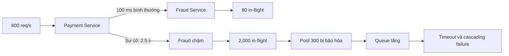


# Định lý 2 — CAP Theorem

## Statement sử dụng

Khi **network partition** xảy ra, một distributed system không thể đồng thời bảo đảm cả:

- **Consistency theo CAP:** atomic consistency/linearizability; các operation phải có thể được sắp vào một lịch sử đơn thống nhất theo real-time order.
- **Availability theo CAP:** mọi request đến non-failing node đều nhận non-error response hữu hạn thời gian.

Partition tolerance không phải một nút tùy chọn khi hệ thống thực sự chạy qua network; câu hỏi là hệ thống phản ứng thế nào khi partition xảy ra.

## Hệ quả thiết kế

Cluster 5 node chia 3–2:

- Ưu tiên consistency: minority 2 node ngừng nhận write.
- Ưu tiên availability: cả hai phía có thể nhận operation, nhưng phải chấp nhận conflict, merge, compensation hoặc invariant yếu hơn.

## Không được suy ra

- Không phải “luôn chọn 2 trong 3” ở mọi thời điểm.
- Không nói database vĩnh viễn là CP hoặc AP độc lập với operation/configuration.
- Không nói consistency nào cũng giống linearizability.
- Không quyết định thay domain rằng conflict nào chấp nhận được.

## Workbook

Phân loại phản ứng phù hợp khi partition cho:

1. Account balance.
2. Shopping cart.
3. Product catalog description.
4. Inventory cuối cùng.
5. Social reaction count.

Với mỗi case, ghi invariant và hậu quả nếu ưu tiên availability.

## Interview answer

> CAP matters specifically during a network partition. If consistency is required, a minority partition must reject some operations. If availability is required on both sides, the system must accept conflicts or weaker invariants and define a resolution model.

---

## Ví dụ thực tế — Cluster 5 node chia 3–2

Một consensus-backed PostgreSQL cluster mất kết nối giữa hai zone. Với balance, phía 2 node không được ghi vì có thể tạo lịch sử số dư mâu thuẫn; phía 3 node có majority và tiếp tục nếu có leader hợp lệ. Minority trả 503/read-only. Với view counter, có thể cho cả hai phía ghi rồi merge cộng dồn. CAP không chọn thay domain; invariant quyết định phản ứng.

### Sơ đồ minh họa

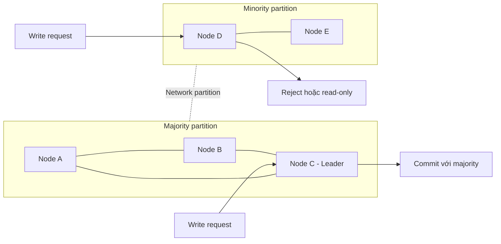


# Nguyên lý 3 — PACELC

## Statement

```text
If Partition: Availability versus Consistency
Else:         Latency versus Consistency
```

Ngay cả khi không có partition, consistency mạnh hơn thường cần thêm coordination hoặc synchronous replication, làm tăng latency.

## Worked example

- Write chỉ ACK tại leader: latency thấp hơn, failure window lớn hơn.
- Write chờ majority replicas: latency cao hơn, authority/durability mạnh hơn theo semantics cụ thể.
- Read local replica: nhanh hơn nhưng có thể stale.
- Read leader/quorum: mới hơn nhưng tốn network hop và coordination.

## Không được suy ra

PACELC không thay thế benchmark. Nó cho biết trục trade-off cần đo, không cung cấp con số latency cụ thể.

## Workbook

Cho một hệ thống có:

```text
Leader RTT: 3ms
Replica cross-zone RTT: 12ms
Cross-region RTT: 85ms
```

So sánh định tính write ACK tại leader, majority trong region và majority cross-region. Chỉ ra dữ liệu nào đáng trả giá cross-region synchronous ACK.

---

## Ví dụ thực tế — Singapore và Frankfurt

Primary ở Singapore, replica Frankfurt, RTT 160–200ms. Chờ ACK cross-region làm write chậm nhưng giảm RPO; ACK trong Singapore rồi replicate async nhanh hơn nhưng có stale window. Payment ledger có thể trả giá latency, product catalog thường chấp nhận stale ngắn. Ngay cả khi không partition vẫn có trade-off latency–consistency.

### Sơ đồ minh họa

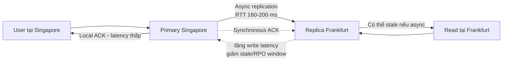


# Nguyên lý 4 — Safety và Liveness

## Safety

> Điều xấu không được xảy ra.

Ví dụ:

- Một payment intent không charge hai lần.
- Inventory không xuống dưới 0.
- Runtime telemetry không mutation Graphic Document.
- Minority partition không commit lịch sử mâu thuẫn nếu ưu tiên consistency.

## Liveness

> Cuối cùng hệ thống phải tiến triển tới một kết quả có ý nghĩa.

Ví dụ:

- Order `PENDING_PAYMENT` cuối cùng thành `CONFIRMED`, `CANCELLED` hoặc `MANUAL_REVIEW`.
- Outbox backlog cuối cùng được drain.
- Compensation thất bại cuối cùng được retry, DLQ hoặc escalated.

## Tension

Từ chối mọi operation có thể giữ safety nhưng phá liveness/availability. Nhận mọi operation có thể giữ tiến triển ngắn hạn nhưng phá safety.

## Workbook bắt buộc cho mọi design

```text
Safety invariants:
1.
2.

Liveness requirements:
1.
2.

Maximum pending duration:
Escalation path:
```

## Interview answer

> I separate safety from liveness. Safety defines what must never happen, while liveness defines how the workflow eventually reaches a terminal or recoverable state. A design that only blocks forever may be safe but operationally useless.

---

## Ví dụ thực tế — Order kẹt `PENDING_PAYMENT`

Safety: một payment intent không charge hai lần và order không confirm trước payment. Liveness: trong 15 phút order phải thành `CONFIRMED`, `CANCELLED` hoặc `MANUAL_REVIEW`. Không retry charge mù để giữ safety, nhưng cũng không để pending vô hạn. Dùng payment intent, query/webhook, reservation TTL, reconciliation và escalation.

### Sơ đồ minh họa

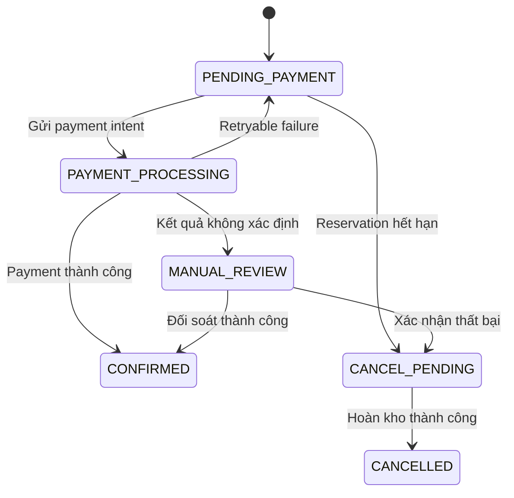


# Nguyên lý 5 — Quorum Intersection

## Statement

Hai write quorum phải giao nhau để tránh hai quyết định mâu thuẫn cùng được xác nhận độc lập.

Điều kiện majority write thường là:

```text
W > N / 2
```

Read-your-latest-write trong mô hình quorum trừu tượng thường xét:

```text
R + W > N
```

## Worked example

Cluster 5 node:

```text
Q1 = {A, B, C}
Q2 = {C, D, E}
Intersection = {C}
```

Không có hai majority 3-node hoàn toàn rời nhau. Điều này chỉ có ý nghĩa khi các node tuân thủ cùng voting/term/configuration rules; thay đổi membership cần protocol như joint consensus để duy trì intersection qua hai configuration.

## Không được suy ra

- Intersection một mình không mô tả toàn bộ semantics của Cassandra, Dynamo-style system, Raft hay một database cụ thể.
- Quorum không tự giải quyết stale client cache, external side effect hoặc business deduplication.
- Node count đủ không có nghĩa các node giao tiếp được đúng lúc.

## Workbook

1. Liệt kê hai quorum size 4 trong cluster 7 và chứng minh chúng phải giao nhau.
2. Với N=5, tìm một cấu hình R/W tối ưu read và một cấu hình tối ưu write, rồi nêu trade-off.

---

## Ví dụ thực tế — etcd 5 member

`Q1={A,B,C}` và `Q2={C,D,E}` giao nhau tại C, nên hai majority không hoàn toàn độc lập. Khi chia 3–2, phía 3 tiếp tục, phía 2 mất quorum. Cluster 4 member vẫn chỉ chịu 1 member lỗi như cluster 3. Vì thế etcd/ZooKeeper thường dùng 3 hoặc 5 member, phân bố qua failure domain.

### Sơ đồ minh họa

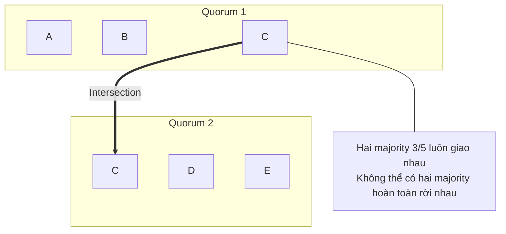


# Nguyên lý 6 — Happens-before và Partial Order

## Statement

Event A `happens-before` B nếu có quan hệ nhân quả:

1. A xảy ra trước B trong cùng process.
2. A là send và B là receive của cùng message.
3. Quan hệ có tính bắc cầu.

Nếu không chứng minh được A→B hoặc B→A, hai event có thể concurrent.

## Hệ quả

- Timestamp máy lớn hơn không chứng minh operation xảy ra sau trong thời gian thực.
- Last-write-wins bằng wall clock có thể chọn sai do clock skew.
- Per-partition ordering không tạo global ordering.
- Causal order có thể quan trọng hơn total order trong nhiều domain.

## Worked example

```text
Node A clock nhanh 5s, ghi X lúc thực tế 10:00:00, timestamp 10:00:05
Node B ghi X lúc thực tế 10:00:02, timestamp 10:00:02
```

LWW theo timestamp chọn A dù B xảy ra sau trong thực tế.

## Workbook

Vẽ causal graph cho:

```text
Client sends OrderCreated
Inventory receives and sends Reserved
Payment receives OrderCreated independently
Order receives Reserved and PaymentSucceeded
```

Chỉ ra event nào ordered và event nào concurrent.

---

## Ví dụ thực tế — Order events

`OrderCreated → InventoryReserved` và `OrderCreated → PaymentSucceeded`, nhưng `InventoryReserved` và `PaymentSucceeded` có thể concurrent. Order có thể nhận hai event theo bất kỳ thứ tự nào và chỉ confirm khi state machine đủ điều kiện. Timestamp của hai máy không tạo global order đáng tin do clock skew.

### Sơ đồ minh họa

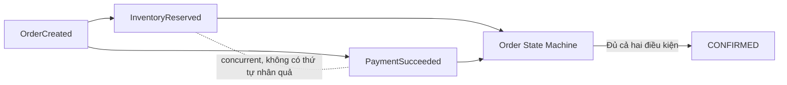


# Kết quả bất khả 7 — FLP Impossibility Result

## Statement sử dụng

Trong mô hình asynchronous hoàn toàn, chỉ cần khả năng một process crash thì không có deterministic consensus algorithm nào bảo đảm luôn kết thúc trong mọi execution.

## Ý nghĩa thực tế

- Timeout không chứng minh node chết; node có thể chỉ rất chậm.
- Raft/Paxos không “phá” FLP. Chúng dựa vào timing assumptions/eventual synchrony để có progress trong thực tế.
- Consensus có thể giữ safety nhưng tạm mất liveness khi network quá bất ổn.

## Không cần học

Không cần proof formal trong sprint này.

## Workbook

Trả lời:

1. Vì sao heartbeat timeout chỉ là suspicion?
2. Vì sao tăng timeout không thể nhận diện failure hoàn hảo?
3. Vì sao leader election có thể chậm hoặc lặp trong network bất ổn?

## Interview answer

> FLP explains why deterministic consensus cannot guarantee termination in a fully asynchronous system with even one possible crash. In practice, protocols use timeouts and eventual synchrony to make progress, while preserving safety during unstable periods.

---

## Ví dụ thực tế — Controller chậm hay đã chết?

Kubernetes control plane không nhận heartbeat đúng timeout. Controller có thể crash, hoặc vẫn sống nhưng GC pause/CPU throttling/network delay. Chờ chắc chắn tuyệt đối làm mất tiến triển; hành động sớm có thể tạo actor cạnh tranh. Protocol dùng timeout, term/epoch và majority để có progress dưới eventual synchrony, không coi timeout là proof.

### Sơ đồ minh họa

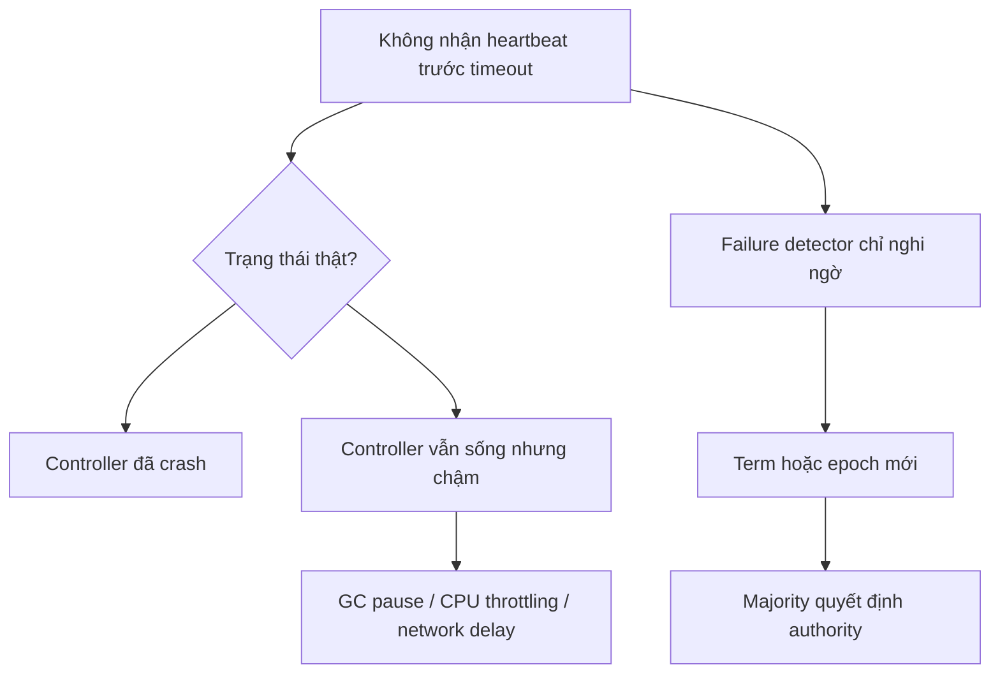


# Bài toán 8 — Two Generals Problem

## Statement sử dụng

Qua một kênh có thể mất message, hai bên không thể đạt common knowledge tuyệt đối chỉ bằng chuỗi request/acknowledgment hữu hạn.

## Timeline

```text
A sends operation
B executes operation
B sends ACK
ACK is lost
```

A không biết B chưa nhận hay B đã thực hiện nhưng ACK bị mất. ACK cho ACK tiếp tục có thể mất.

## Hệ quả

- Payment timeout tạo ambiguous outcome.
- Retry cần operation identity/idempotency.
- Không thể “handshake đến khi chắc chắn tuyệt đối” trên unreliable network.
- Recovery cần query, reconciliation, timeout state hoặc compensation.

## Workbook

Thiết kế protocol cho external payment khi response mất, gồm:

- client transaction ID;
- provider transaction ID;
- status `UNKNOWN/PENDING`;
- query API;
- webhook;
- reconciliation.

---

## Ví dụ thực tế — Payment ACK bị mất

Provider charge `paymentIntentId=P123` thành công nhưng HTTP 200 bị mất. Order không biết request chưa tới hay đã charge. Thiết kế thực tế retry cùng P123, query status, giữ `PAYMENT_UNKNOWN`, nhận webhook có event ID và reconciliation. Không tạo payment intent mới chỉ vì response cũ mất.

### Sơ đồ minh họa

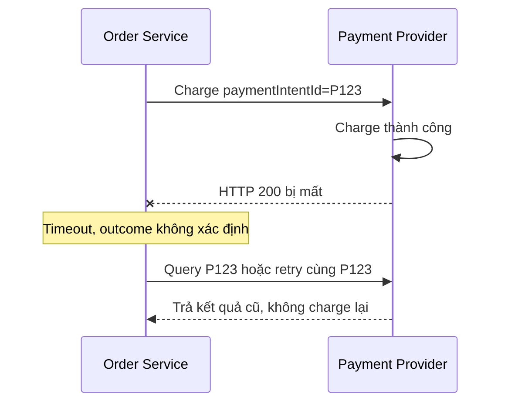


# Bài toán 9 — Byzantine Generals và Failure Model

## Crash failure

Node dừng, mất kết nối hoặc không phản hồi đúng hạn.

## Byzantine failure

Node có thể hành xử **tùy ý**: gửi thông tin sai hoặc mâu thuẫn cho các peer khác nhau, do malicious behavior, bug, memory/data corruption hoặc compromised software. Điểm quyết định là protocol không thể giả định node chỉ crash hoặc im lặng.

## Hệ quả

- Raft/Paxos chuẩn tập trung crash fault, không phải Byzantine fault tolerance.
- Enterprise backend thông thường chủ yếu thiết kế cho crash/omission faults vì các node cùng trust boundary.
- Blockchain/trust-minimized systems có failure model khác và chi phí quorum/cryptographic verification lớn hơn.

## Không được suy ra

Không phải mọi bug đều buộc hệ thống dùng Byzantine consensus. Chỉ nâng failure model lên Byzantine khi correctness phải được giữ ngay cả khi participant có thể hành xử tùy ý hoặc không còn đáng tin. Phải xác định trust model, threat model và impact trước.

---

## Ví dụ thực tế — Broker crash và validator độc hại

Kafka broker mất điện là crash fault. Validator blockchain ký hai block mâu thuẫn là Byzantine behavior. Raft/Paxos chuẩn xử lý crash faults, không xử lý node có chủ ý gửi thông tin khác nhau. Một bug hoặc corruption có thể tạo Byzantine-style behavior, nhưng chỉ cần Byzantine consensus khi protocol phải chịu được participant tùy ý/không đáng tin; phải xác định trust/threat model trước.

### Sơ đồ minh họa

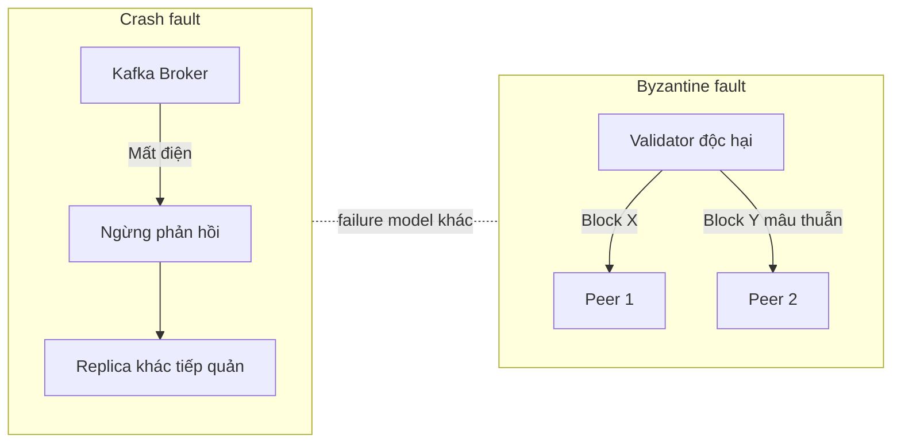


# Định luật 10 — Amdahl’s Law

## Statement

```text
Speedup(N) = 1 / ((1 - P) + P/N)
```

- `P`: phần có thể song song hóa.
- `N`: số worker/node.

## Worked example

90% parallel, 10% serial:

```text
N=10:
Speedup = 1 / (0.1 + 0.9/10)
        = 1 / 0.19
        ≈ 5.26x

N→∞:
Max speedup = 1 / 0.1 = 10x
```

## Hệ quả

- Thêm consumer không giúp nếu global lock chiếm phần lớn thời gian.
- Tăng worker không vượt được serial transaction boundary.
- Thêm partition không giúp operation phải coordination toàn cục.

## Workbook

1. P=0.8, N=8: tính speedup.
2. Nếu cần speedup tối thiểu 6x với N→∞, serial fraction tối đa là bao nhiêu?
3. Liên hệ với main-thread bottleneck trong Graphics/HMI.

---

## Ví dụ thực tế — Thêm consumer nhưng còn global aggregate

Pipeline có 90% parse/enrich song song và 10% update global aggregate tuần tự. Dù worker vô hạn, speedup tối đa `1/0.1=10x`; với 10 worker chỉ khoảng `5.26x`. Muốn scale tiếp phải phân vùng aggregate thay vì chỉ tăng consumer. Trong Graphics, worker không giúp vô hạn nếu final commit/render vẫn ở main thread.

### Sơ đồ minh họa

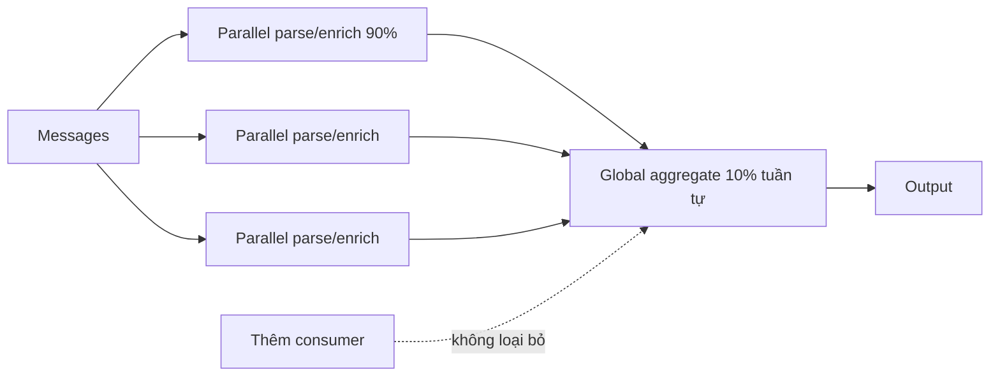


# Mô hình 11 — Universal Scalability Law (USL)

## Statement

```text
C(N) = N / (1 + α(N-1) + βN(N-1))
```

- `α`: contention/serialization.
- `β`: coherency/coordination cost.
- `N`: số processing units.

## Ý nghĩa

- Ban đầu scale gần tuyến tính.
- Sau đó contention làm lợi ích giảm dần.
- Khi coordination cost lớn, thêm node có thể làm throughput giảm.

## Worked example

Với `α=0.03`, `β=0.002`:

```text
C(8)  = 8  / (1 + 0.03×7  + 0.002×8×7)  ≈ 6.05
C(16) = 16 / (1 + 0.03×15 + 0.002×16×15) ≈ 8.29
C(32) = 32 / (1 + 0.03×31 + 0.002×32×31) ≈ 8.18
```

Từ 16 lên 32 units, relative capacity giảm nhẹ vì coordination term chi phối.

## Không được suy ra

- `α` và `β` không lấy từ cảm tính; phải fit từ benchmark/production measurements.
- USL không thay queueing model hoặc capacity test.

## Workbook

Cho benchmark throughput ở 1, 2, 4, 8, 16 workers. Vẽ normalized capacity và xác định vùng scale không còn hiệu quả. Không cần fit α/β thủ công trong lần đầu.

---

## Ví dụ thực tế — 32 instance chậm hơn 16

API scale tốt đến 16 instance nhưng 32 instance không tăng throughput do cùng tranh hot row/index PostgreSQL, cache invalidation broadcast và distributed-lock traffic. `α` phản ánh contention, `β` phản ánh coordination/coherency. Hành động đúng là giảm shared bottleneck hoặc partition hot key, không auto-scale mù.

### Sơ đồ minh họa

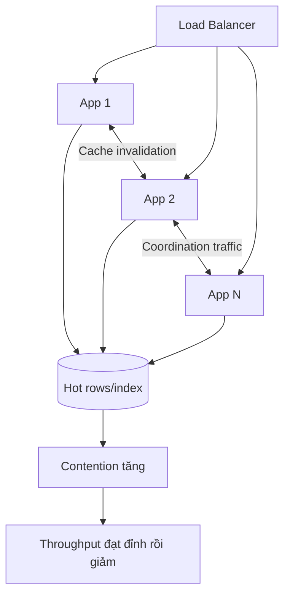


# Nguyên lý 12 — End-to-End Principle

## Statement sử dụng

Correctness cuối cùng phải được bảo vệ tại tầng hiểu business effect. Tầng thấp hỗ trợ reliability nhưng không thay thế end-to-end verification.

## Examples

- TCP retransmission không bảo đảm payment chỉ charge một lần.
- Kafka ACK không bảo đảm Inventory đã reserve đúng.
- Redis lock không khiến PostgreSQL tự từ chối stale writer.
- HTTP 200 không chứng minh toàn Saga hoàn tất.
- Renderer success không được trở thành authority của Graphic Document.

## Workbook

Với mỗi invariant, chỉ ra enforcement boundary cuối cùng:

| Invariant | Enforcement boundary |
|---|---|
| Không duplicate charge | |
| Inventory không âm | |
| Stale writer bị từ chối | |
| Runtime update không dirty document | |

---

## Ví dụ thực tế — TCP đúng nhưng payment vẫn duplicate

Request 1 charge thành công, response mất; client mở connection mới và gửi Request 2. TCP giao cả hai request chính xác nhưng không biết chúng cùng business intent. Payment boundary vẫn phải enforce idempotency bằng payment intent và persistent result. Kafka ACK tương tự không thay invariant `inventory >= 0`.

### Sơ đồ minh họa

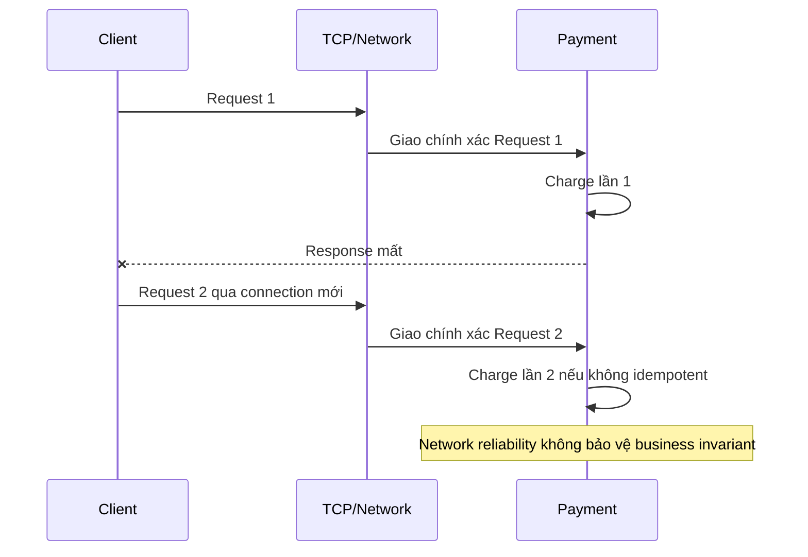


# Nguyên lý 13 — Bounded Resources

## Statement

Mọi resource phải có giới hạn rõ:

- retry attempts;
- timeout;
- queue length;
- connection/thread pool;
- concurrency;
- backlog;
- retention;
- pending duration;
- memory/disk.

Unbounded queue không xóa overload; nó chuyển overload thành latency, memory pressure và recovery time không giới hạn.

## Rule

```text
Bounded queue
+ explicit rejection/load shedding
+ observable threshold
+ recovery plan
```

## Workbook

Cho queue capacity 100,000 message, arrival 20,000/s, service 15,000/s:

1. Bao lâu queue đầy từ rỗng?
2. Sau khi đầy, policy reject/drop/retry nào phù hợp?
3. Retry có làm arrival rate tăng thêm không?

---

## Ví dụ thực tế — Queue không giới hạn gây OOM

Service nhận 20,000 msg/s, xử lý 15,000/s nên queue tăng 5,000/s. Queue 100,000 đầy sau `100,000/5,000=20s`. Không có limit thì memory và latency tăng tới OOM. Cần bounded queue, alert 60/80%, reject/load shedding, durable broker khi cần và retry có budget.

### Sơ đồ minh họa

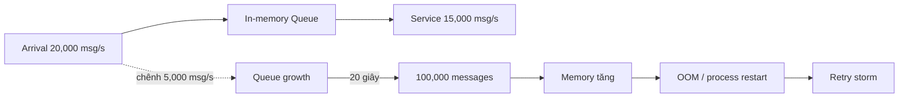


# Nguyên lý 14 — Backpressure

## Statement

Khi downstream chậm hơn upstream, hệ thống phải truyền tín hiệu giảm tốc hoặc giới hạn work:

- producer throttling;
- bounded buffer;
- semaphore/concurrency cap;
- reject/load shedding;
- pull-based consumption;
- adaptive rate limit.

Nếu không:

```text
λ > μ
→ backlog tăng
→ latency tăng
→ timeout
→ retry
→ λ tăng thêm
```

## Không được suy ra

Backpressure không phải mọi retry đều dừng. Nó cần contract/control loop cụ thể và có thể làm giảm availability hoặc throughput ngắn hạn.

---

## Ví dụ thực tế — Kafka lag tăng liên tục

Producer 60,000 msg/s, consumer capacity 48,000/s, lag tăng 12,000/s. Sau 15 phút backlog là `10,800,000` message. Nếu không tăng safe capacity, phải throttle producer, giới hạn API tạo event, ưu tiên traffic critical hoặc tạm dừng workload phụ. Chỉ thêm queue không sửa mismatch dài hạn `λ>μ`.

### Sơ đồ minh họa

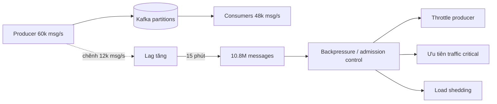


# Nguyên lý 15 — Coordination is Expensive

## Statement

Invariant càng trải rộng qua nhiều node/partition/service, hệ thống càng cần coordination:

- global lock;
- quorum;
- distributed transaction;
- synchronous replication;
- total ordering;
- cross-partition validation.

## Design implication

Cố gắng làm invariant local theo key phù hợp:

- order lifecycle theo `orderId`;
- account invariant theo `accountId`;
- inventory theo `productId` hoặc reservation unit.

Không né coordination khi business thực sự cần; chỉ tránh trả chi phí coordination cho invariant không cần thiết.

## Workbook

Cho ba invariants trong Order–Payment–Inventory. Đánh dấu invariant nào local, invariant nào cross-boundary, và cơ chế coordination/recovery tương ứng.

---

## Ví dụ thực tế — Global inventory lock trong flash sale

Nếu mọi purchase lấy một global lock, product A chặn product B dù không liên quan. Làm invariant local theo `productId` cho phép xử lý song song. Order nhiều product vẫn cần cross-key coordination, reservation và Saga. Partition theo invariant boundary, không chỉ theo kích thước bảng.

### Sơ đồ minh họa

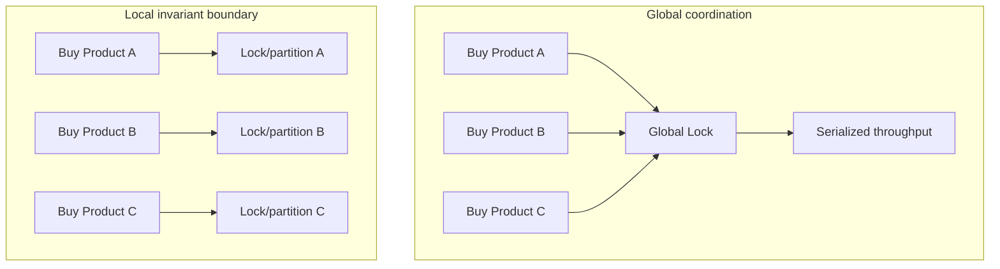


# Nguyên lý 16 — Failure Detection is Suspicion, Not Proof

## Statement

Timeout, missed heartbeat hoặc lease expiry chỉ cho phép nghi ngờ peer không còn hợp lệ; chúng không chứng minh peer đã dừng.

## Hệ quả

- Retry sau timeout có thể trùng operation.
- Leader cũ có thể tỉnh lại.
- Lock owner cũ có thể tiếp tục write.
- Cần term/epoch/fencing token ở authority boundary.

## Graphics/HMI analogy

Evaluation result cũ quay lại sau khi time context đổi không được commit chỉ vì evaluation đã chạy thành công. State authority phải kiểm tra context/version hiện tại.

---

## Ví dụ thực tế — Redis lock hết hạn

A lấy lock TTL 10s rồi GC pause 15s. B lấy lock mới và ghi; A tỉnh lại vẫn tin mình hợp lệ. Lease expiry không dừng A vật lý. Storage phải enforce fencing token: B token 11 được nhận, A token 10 bị từ chối. Trong Graphics, result context v10 cũng phải bị reject khi authority đã ở v11.

### Sơ đồ minh họa

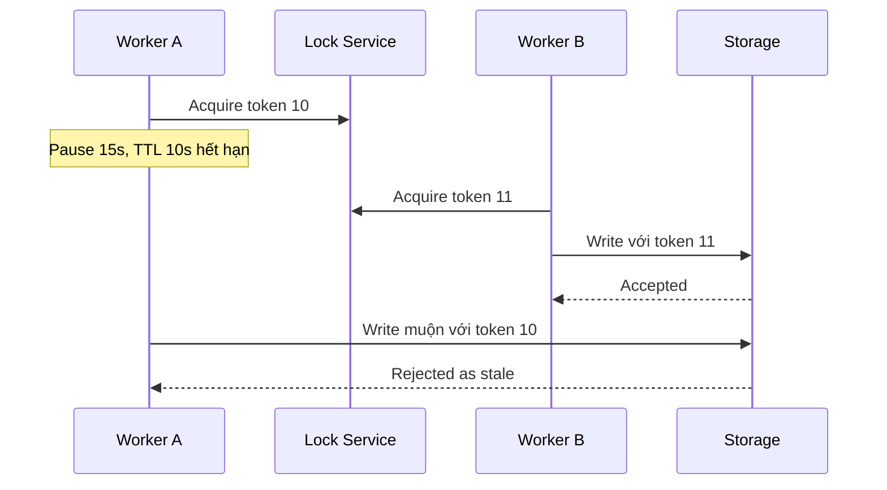


# Checklist 17 — Fallacies of Distributed Computing

Dùng như checklist review:

1. Network is reliable.
2. Latency is zero.
3. Bandwidth is infinite.
4. Network is secure.
5. Topology does not change.
6. There is one administrator.
7. Transport cost is zero.
8. Network is homogeneous.

## Review worksheet

Với một lời gọi Kafka nội bộ, kiểm tra:

- p99 latency và timeout?
- broker leadership/topology change?
- bandwidth/payload/batch limit?
- TLS/ACL/authentication overhead?
- cross-zone/cross-region traffic cost?
- version/protocol compatibility?
- ownership vận hành thuộc team nào?

---

## Ví dụ thực tế — “Kafka cùng cluster nên luôn nhanh”

Khi broker leader đổi và DNS/network policy lỗi, metadata refresh tăng latency, producer timeout/retry, TLS/ACL tốn CPU, cross-zone traffic tăng RTT/chi phí và team app/platform phối hợp chậm. Case này phá nhiều giả định: network reliable, latency zero, bandwidth infinite, topology fixed, transport free và one administrator.

### Sơ đồ minh họa

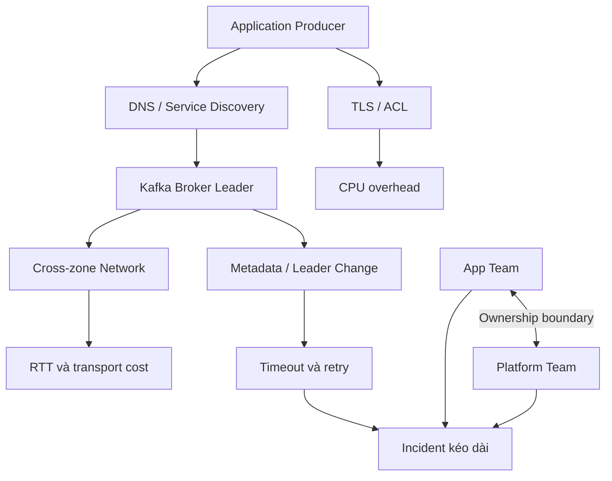


# Bảng ưu tiên học các định luật/nguyên lý

## Bắt buộc vận dụng không cần tra cứu

1. Little’s Law.
2. CAP.
3. PACELC.
4. Safety vs Liveness.
5. Quorum Intersection.
6. Happens-before.
7. End-to-End Principle.
8. Bounded Resources.
9. Backpressure.
10. Failure Detection is Suspicion.
11. Fallacies checklist.

## Hiểu ý nghĩa, chưa cần proof

12. FLP.
13. Two Generals.
14. Byzantine failure model.
15. Amdahl’s Law.
16. Universal Scalability Law.

## Chưa bắt buộc trong sprint 4 tuần

- Formal proof của FLP/Paxos/Raft.
- Vector-clock implementation sâu.
- CRDT algebra.
- Byzantine Fault Tolerance protocol chi tiết.
- Queueing theory nâng cao như M/M/c hoặc Erlang C.

---

# Assessment — Laws and Principles

## Phần A: Nhận diện

Với mỗi tình huống, ghi theorem/principle liên quan:

1. Node timeout nhưng có thể vẫn chạy.
2. Cluster chia 3–2 và minority phải ngừng write.
3. Fraud latency tăng làm in-flight tăng dù traffic không đổi.
4. ACK payment bị mất.
5. Thêm worker nhưng throughput không tăng do global lock.
6. Queue không giới hạn làm memory tăng.
7. TCP retry nhưng payment vẫn duplicate.
8. Timestamp lớn hơn nhưng event thực tế xảy ra trước.

## Phần B: Không được suy ra

Viết một điều **không được kết luận** từ mỗi mục:

- CAP.
- Little’s Law.
- Quorum.
- Amdahl.
- Circuit breaker.
- Kafka exactly-once.

## Phần C: English drill

Trả lời 60–90 giây cho:

1. What does CAP actually say during a network partition?
2. Why is a timeout not proof of failure?
3. How do safety and liveness differ?
4. Why can adding nodes reduce throughput?
5. Why does TCP reliability not guarantee business idempotency?

---


# A18. LAW → PRODUCTION REALITY COVERAGE CHECK

Dùng bảng này khi audit từng mục sau khi học hoặc sửa tài liệu.

| # | Core item | Formal | Boundary | Production question | Failure signature | Prevent/Contain/Recover | Quant/state check | Evidence E1/E2/E3 | Residual risk | Interview card |
|---:|---|---|---|---|---|---|---|---|---|---|
| 1 | Little’s Law |  |  |  |  |  |  |  |  |  |
| 2 | CAP |  |  |  |  |  |  |  |  |  |
| 3 | PACELC |  |  |  |  |  |  |  |  |  |
| 4 | Safety/Liveness |  |  |  |  |  |  |  |  |  |
| 5 | Quorum Intersection |  |  |  |  |  |  |  |  |  |
| 6 | Happens-before |  |  |  |  |  |  |  |  |  |
| 7 | FLP |  |  |  |  |  |  |  |  |  |
| 8 | Two Generals |  |  |  |  |  |  |  |  |  |
| 9 | Byzantine model |  |  |  |  |  |  |  |  |  |
| 10 | Amdahl |  |  |  |  |  |  |  |  |  |
| 11 | USL |  |  |  |  |  |  |  |  |  |
| 12 | End-to-End |  |  |  |  |  |  |  |  |  |
| 13 | Bounded Resources |  |  |  |  |  |  |  |  |  |
| 14 | Backpressure |  |  |  |  |  |  |  |  |  |
| 15 | Coordination Cost |  |  |  |  |  |  |  |  |  |
| 16 | Failure Detection |  |  |  |  |  |  |  |  |  |
| 17 | Distributed Fallacies |  |  |  |  |  |  |  |  |  |

**Audit rule:** ô trống không tự động là defect nếu nội dung tương đương nằm ở lesson khác, nhưng phải có cross-reference rõ. Không được PASS chỉ dựa trên tên mục.

---

# PHẦN B — PAPER-FIRST ENGINEERING

Đối với profile đã có kinh nghiệm backend, transaction, overload và production troubleshooting, không cần dựng demo cho mọi khái niệm. Trọng số học được chốt như sau:

| Hoạt động | Tỷ lệ |
|---|---:|
| Engineering calculation và capacity worksheet | 30% |
| Paper system design, failure timeline, ADR | 25% |
| Technical terminology và interview English | 25% |
| Targeted verification lab | 10% |
| Recall và assessment | 10% |

## 2.1 Quy trình chuẩn cho mỗi bài

```text
1. Invariant       — điều gì tuyệt đối không được sai?
2. Inputs          — traffic, latency, pool, partitions, SLO, payload.
3. Model           — công thức hoặc state/failure timeline.
4. Worst case      — tải, backlog, downtime, duplicate, stale window.
5. Threshold       — ngưỡng buộc phải reject, scale, retry hoặc degrade.
6. Candidates      — các phương án có thể dùng.
7. Decision        — chọn theo domain và hệ thống hiện tại.
8. Verification    — phép đo/lab tối thiểu để xác nhận assumption.
9. Recovery        — nếu assumption sai hoặc failure xảy ra thì làm gì.
```

## 2.2 Khi nào được bỏ lab

Có thể bỏ lab nếu đáp ứng cả ba điều kiện:

- Đã có production case tương đương.
- Dự đoán được failure timeline và invariant bị ảnh hưởng.
- Chỉ rõ metrics/evidence sẽ dùng để verify khi triển khai thật.

Lab vẫn **bắt buộc** với bốn gap đang cần đóng mô hình:

1. Optimistic concurrency conflict.
2. Kafka consumer crash trước offset commit.
3. Fencing token tại storage.
4. Deadline/cancellation propagation qua nhiều service.

---

# PHẦN C — ENGINEERING CALCULATION HANDBOOK

# Công thức 1 — Retry amplification

Nếu các tầng có số **attempt** lần lượt là `A1...An`, và mọi tầng thực sự thực hiện đủ attempt do downstream liên tục thất bại, thì **upper bound** là:

```text
TotalAttempts = A1 × A2 × ... × An
DownstreamRate = OriginalRate × TotalAttempts
```

> Phải làm rõ “retry 3 lần” là tổng 3 attempts hay 1 lần đầu + 3 retry = 4 attempts.

## Worked example

```text
Original rate:        600 operations/s
FE attempts:          2
Gateway attempts:     2
Service attempts:     3
Downstream capacity:  5,000 requests/s
```

```text
Worst-case downstream rate
= 600 × 2 × 2 × 3
= 7,200 requests/s
```

Upper bound vượt capacity `2,200 requests/s`, tương đương 44% so với capacity. Đây không phải throughput luôn xảy ra: retry dừng sớm khi thành công, và các deadline/rate limit có thể làm số attempt thực thấp hơn.

## Workbook 1

1. `R=1,200/s`, attempts lần lượt `2, 1, 3`. Tính downstream rate.
2. Downstream chịu `8,000/s`. Original rate lớn nhất cho phép là bao nhiêu?
3. Nếu user có thể double-click trung bình 1.15 operations/intent, thêm hệ số này vào công thức.

---

# Công thức 2 — Exponential backoff và jitter

```text
Backoff(n) = min(MaxDelay, BaseDelay × 2^(n-1))
FullJitter(n) = random(0, Backoff(n))
```

## Worked example

`BaseDelay=200ms`, `MaxDelay=3,000ms`:

| Retry n | Backoff ceiling |
|---:|---:|
| 1 | 200 ms |
| 2 | 400 ms |
| 3 | 800 ms |
| 4 | 1,600 ms |
| 5 | 3,000 ms |

Full jitter của retry 4 nằm trong `[0, 1,600ms]`. Với phân phối đều liên tục, expected delay xấp xỉ `ceiling / 2`; đây là kỳ vọng thống kê, không phải delay bảo đảm của từng request.

## Workbook 2

Tính ceiling 6 lần retry với base `125ms`, max `2s`. Sau đó tính expected delay gần đúng của full jitter bằng một nửa ceiling.

---

# Công thức 3 — Overall retry budget

```text
TotalTime = Σ AttemptTimeout + Σ BackoffDelay + LocalOverhead
```

## Worked example

```text
3 attempts × 900ms       = 2,700ms
Backoff 150ms + 300ms    =   450ms
Serialization/cleanup    =   200ms
Total                    = 3,350ms
```

Nếu upstream deadline là `3s`, policy không khả thi ngay cả trước khi xét jitter/tail latency.

## Workbook 3

Thiết kế tối đa 3 attempts trong deadline `2.5s`, giữ `300ms` cho cleanup/response. Chọn attempt timeout và hai backoff delay.

---

# Công thức 4 — Deadline propagation

```text
RemainingBudget = AbsoluteDeadline - CurrentTime
DownstreamTimeout + Cleanup + ResponseMargin <= RemainingBudget
```

## Worked example

```text
Client deadline          5,000ms
Gateway overhead           150ms
Order local work           250ms
Response reserve           400ms
Remaining for Payment    4,200ms
```

Payment không được dành toàn bộ `4,200ms` cho Fraud. Nó còn cần local commit, cleanup và response.

## Worksheet 4

Phân bổ SLO `2,000ms` cho `Gateway → Order → Payment → Fraud`. Ghi rõ margin và một retry có còn khả thi không.

---

# Công thức 5 — Little’s Law cho in-flight work

```text
L = λ × W
```

- `L`: số request/message trung bình đang trong hệ thống.
- `λ`: throughput mỗi giây.
- `W`: **thời gian trung bình** trong hệ thống, tính bằng giây. Little’s Law dùng mean/average ở trạng thái ổn định; không được thay trực tiếp bằng p95/p99 rồi gọi đó là average concurrency.

## Worked example

Payment nhận `800 req/s`.

```text
Fraud latency 0.5s → L = 800 × 0.5 = 400 in-flight
Fraud latency 3.0s → L = 800 × 3.0 = 2,400 in-flight
```

Latency tăng 6 lần làm in-flight work tăng 6 lần dù arrival rate không đổi.

## Workbook 5

Một API nhận `1,500 req/s`, **mean latency** `180ms`. Tính average in-flight theo Little’s Law. Nếu mỗi request giữ 48kB memory, ước lượng average memory. Sau đó dùng p95 `240ms` như một stress approximation riêng, ghi rõ đây không phải Little’s Law chuẩn cho average concurrency.

---

# Công thức 6 — Queue growth và drain time

Khi arrival rate lớn hơn service rate:

```text
QueueGrowth = λ - μ
QueueAfter(t) = InitialQueue + (λ - μ) × t
```

Khi service rate lớn hơn arrival rate:

```text
NetDrainRate = μ - λ
DrainTime = Backlog / NetDrainRate
```

## Worked example

```text
Arrival:  1,500/s
Service:  1,000/s
Duration: 20s
Backlog:  (1,500 - 1,000) × 20 = 10,000
```

Sau recovery:

```text
Arrival:  800/s
Service:  1,200/s
Drain:    400/s
Time:     10,000 / 400 = 25s
```

Các công thức trên giả định rate gần như hằng trong khoảng xét, queue chưa chạm giới hạn, và không có drop/retry feedback. Khi queue bounded, phần vượt giới hạn trở thành reject/drop thay vì tiếp tục tăng backlog.

---

# Công thức 7 — Worker capacity và utilization

```text
Capacity = WorkerCount × RatePerWorker
Utilization = ArrivalRate / Capacity
```

## Worked example

`100 workers × 10 req/s = 1,000 req/s` capacity.

Arrival `900/s` → utilization `90%`.

Operating gần 100% thường làm queue latency tăng mạnh. Capacity cực đại không nên là operating point bình thường. `RatePerWorker` phải được đo tại workload và latency distribution thực tế; nó không phải hằng số độc lập với downstream.


## Workbook 7

Tính worker cần thiết để giữ utilization không quá 70% với `2,100 req/s`, mỗi worker xử lý `15 req/s`.

---

# Công thức 8 — Connection pool sizing gần đúng

```text
Connections ≈ RequestRate × TimeHoldingConnection
```

## Worked example

```text
500 req/s × 0.04s = 20 connections
```

Nếu giữ DB transaction mở khi publish Kafka làm thời gian giữ connection tăng lên `0.20s`:

```text
500 × 0.20 = 100 connections
```

Đây là **first-order approximation** để định lượng trade-off của network call trong DB transaction. Công thức Little’s Law chuẩn dùng average hold time; sizing production phải kiểm tra thêm p95/p99 concurrency, burstiness, transaction mix, DB `max_connections`, pool wait time và database capacity. Không được tăng pool chỉ vì phép nhân cho ra số lớn.

## Workbook 8

Với `900 req/s`, DB work `25ms`, Kafka p99 `80ms`, commit `10ms`, ước lượng pool theo p99. Thêm 30% headroom.

---

# Công thức 9 — Availability của chuỗi phụ thuộc

Nếu operation cần mọi component cùng available và tạm giả sử độc lập:

```text
SeriesAvailability = A1 × A2 × ... × An
```

## Worked example

DB và Kafka đều `99.99%`:

```text
0.9999 × 0.9999 = 0.99980001 ≈ 99.98%
```

Failure thực tế có thể tương quan qua region, DNS, network hoặc Kubernetes cluster nên phép nhân chỉ là baseline model. Công thức series chỉ đúng khi operation thất bại nếu **bất kỳ** dependency bắt buộc nào unavailable; fallback, cache, redundancy hoặc graceful degradation sẽ tạo mô hình khác.

## Downtime gần đúng mỗi năm

| Availability | Downtime/năm |
|---:|---:|
| 99% | 3.65 ngày |
| 99.9% | 8 giờ 46 phút |
| 99.99% | 52 phút 34 giây |
| 99.999% | 5 phút 15 giây |

---

# Công thức 10 — Majority quorum

```text
Majority = floor(N / 2) + 1
FaultToleranceForMajority = N - Majority
```

Đây là số node có thể mất mà cluster vẫn còn đủ node tạo majority, không phải bảo đảm toàn hệ thống vẫn đáp ứng mọi SLO hoặc dữ liệu không mất.

| N | Majority | Fault tolerance |
|---:|---:|---:|
| 3 | 2 | 1 |
| 4 | 3 | 1 |
| 5 | 3 | 2 |
| 7 | 4 | 3 |

Với mô hình read/write quorum tổng quát:

```text
R + W > N
W > N / 2
```

Không áp máy móc cho mọi database; phải đọc consistency semantics thực tế của sản phẩm.

## Workbook 10

1. Tính majority cho N = 9.
2. Cluster 7 node chia 4–3: phía nào có authority khi ưu tiên consistency?
3. Với N=5, liệt kê các cặp R/W thỏa `R+W>N` và `W>N/2`.

---

# Công thức 11 — Consumer capacity và lag

```text
ConsumerCapacity = min(ConsumerCount, PartitionCount) × EffectiveRatePerConsumer
LagGrowth = max(0, ProduceRate - ConsumerCapacity)
CatchupRate = ConsumerCapacity - CurrentProduceRate
CatchupTime = Backlog / CatchupRate   # chỉ khi CatchupRate > 0
```

## Worked example

```text
Produce:          20,000 msg/s
Consumers:        6
Per consumer:      2,500 msg/s
Capacity:         15,000 msg/s
Lag growth:        5,000 msg/s
```

Sau 10 phút:

```text
5,000 × 600 = 3,000,000 messages lag
```

Nếu producer giảm còn `10,000/s`, catch-up rate `5,000/s`, cần `600s = 10 phút` để bắt kịp.

## Partition constraint

Trong một consumer group:

```text
ActiveConsumers <= PartitionCount
```

Có 6 partitions và 8 consumers thì tối đa 6 consumer hoạt động, 2 idle. Throughput thực còn bị giới hạn bởi partition nóng nhất, ordering, batch size, downstream I/O và rebalance.

---

# Công thức 12 — Outbox backlog

```text
BacklogGrowth = OutboxWriteRate - RelayPublishRate
BacklogAfter(t) = InitialBacklog + BacklogGrowth × t
```

## Worked example

```text
Write:   5,000 records/s
Relay:   4,000 records/s
Growth:  1,000 records/s
```

Sau một giờ:

```text
1,000 × 3,600 = 3,600,000 records
```

Cần tính thêm dung lượng record, index growth, retention và catch-up capacity. `AverageRowBytes` phải gồm payload thực tế hoặc được tách rõ; raw payload chưa gồm row header, index, WAL/redo, replication và bloat.

---

# Công thức 13 — Cache hit ratio và backend load

```text
BackendRate = IncomingRate × (1 - HitRatio)
```

## Worked example

```text
Incoming: 10,000 req/s
Hit ratio: 95%
Backend:   500 req/s
```

Nếu cache mất hoàn toàn, backend nhận `10,000 req/s`, tức tải tăng 20 lần so với trạng thái bình thường.

---

# Công thức 14 — Modulo partitioning và movement

```text
partition = hash(key) mod N
```

Khi đổi `N`, phần lớn key có thể đổi partition. Với consistent hashing phân bố tốt, khi thêm một node vào N node, lượng key di chuyển thường gần:

```text
1 / (N + 1)
```

Đây là **expected fraction** khi thêm 1 node tương đương vào N node đang cân bằng. Thực tế phụ thuộc virtual nodes, hash distribution, weighting, replication và rebalance strategy.

---

# Công thức 15 — Storage và retention

```text
DailyStorage = EventsPerSecond × AverageEventBytes × 86,400
RetentionStorage = DailyStorage × RetentionDays × ReplicationFactor
```

## Worked example

```text
10,000 events/s
1 kB/event (decimal = 1,000 bytes)
7 days retention
Replication factor 3
```

```text
Raw/day = 10,000 × 1kB × 86,400 ≈ 864GB/day
7 days  ≈ 6.05TB raw
RF=3    ≈ 18.14TB before compression/overhead
```

Phải cộng index/segment overhead, headroom và growth forecast; compression có thể giảm đáng kể nhưng không được giả định khi chưa đo. Nếu dùng KiB/GiB/TiB thì phải tính lại theo 1,024; tài liệu này dùng kB/GB/TB decimal trong ví dụ storage.

---

# PHẦN D — DEPLOYMENT SIZING WORKSHEET

Sao chép worksheet này trước khi xây hoặc review một hệ thống.

## 4.1 Traffic

```text
Average requests/s:
Peak requests/s:
Burst duration:
Growth 6–12 months:
Read/write ratio:
Message produce rate:
Payload p50/p95/p99:
```

## 4.2 Latency/SLO

```text
End-to-end p95:
End-to-end p99:
Per-hop timeout:
Overall deadline:
Retry attempts:
Backoff policy:
```

## 4.3 Resource model

```text
CPU time/request:
DB connection hold time:
Downstream connection hold time:
Memory/in-flight request:
Worker count:
Pool sizes:
Queue limits:
```

## 4.4 Messaging

```text
Partition count:
Consumer count:
Rate/consumer:
Expected lag growth:
Catch-up rate:
Retention days:
Replication factor:
Estimated storage:
```

## 4.5 Correctness

```text
Business invariant:
Operation identity:
Idempotency boundary:
Transaction boundary:
Acceptable inconsistency window:
Reconciliation frequency:
Manual recovery path:
```

## 4.6 Failure budget

```text
Dependency availability:
Series availability estimate:
RTO:
RPO:
Maximum backlog:
Maximum stuck-state duration:
Load-shedding threshold:
```

---

# PHẦN E — PAPER DESIGN EXERCISE PACK

## Exercise A — Order API peak sizing

Input:

```text
Peak user intents:       1,000/s
Double-submit factor:    1.05
FE attempts:             2
Gateway attempts:        1
Order attempts Payment:  2
Payment capacity:        3,000/s
```

Yêu cầu:

1. Tính worst-case Payment call rate.
2. Nếu vượt capacity, đề xuất retry ownership mới.
3. Thiết kế operation identity.
4. Chọn load-shedding threshold.
5. Ghi recovery path khi response bị mất.

## Exercise B — Fraud latency cascade

Input:

```text
Payment arrival:       700/s
Fraud normal latency:  100ms
Fraud incident p95:    4s
Fraud pool:            400 connections
Memory/in-flight:      64kB (decimal)
```

Yêu cầu:

1. Tính in-flight bình thường và khi incident.
2. Pool có đủ không?
3. Ước lượng memory khi incident.
4. Đề xuất timeout, bulkhead và fallback state.

## Exercise C — Kafka lag recovery

Input:

```text
12 partitions
12 consumers
Producer: 60,000 msg/s
Consumer: 4,000 msg/s mỗi consumer
Incident duration: 15 phút
Sau incident producer: 30,000 msg/s
```

Yêu cầu:

1. Tính lag growth và backlog sau incident.
2. Tính catch-up rate sau incident.
3. Tính catch-up time.
4. Nếu cần bắt kịp trong 10 phút, cần capacity bao nhiêu?

## Exercise D — Outbox capacity

Input:

```text
Order writes: 8,000/s
Relay capacity: 7,000/s
Average outbox payload: 1.5kB (decimal)
Incident: 30 phút
```

Yêu cầu:

1. Tính backlog row.
2. Tính raw storage tăng thêm.
3. Tính relay capacity cần thiết để drain trong 20 phút trong khi write rate vẫn giữ nguyên.
4. Đề xuất index/retention/alert threshold.

## Exercise E — Quorum và availability

Input:

```text
Cluster 7 nodes
Partition 4–3
Node availability 99.99% giả định độc lập
```

Yêu cầu:

1. Tính majority và fault tolerance.
2. Xác định authority khi ưu tiên consistency.
3. Nêu response của minority.
4. Giải thích vì sao availability của cluster không thể chỉ suy bằng phép nhân đơn giản của 7 node.

---

# PHẦN F — ANSWER KEY CHO BÀI TÍNH

## Đáp án Workbook 2

Ceiling cho 6 retry với base `125ms`, max `2,000ms`:

```text
125, 250, 500, 1,000, 2,000, 2,000 ms
```

Expected full-jitter delay gần đúng:

```text
62.5, 125, 250, 500, 1,000, 1,000 ms
```

Tổng expected backoff xấp xỉ `2,937.5ms`; worst-case ceiling sum là `5,875ms`.

## Đáp án Workbook 3

Một phương án hợp lệ trong deadline `2,500ms`:

```text
3 attempt timeouts × 600ms = 1,800ms
Backoff 150ms + 250ms      =   400ms
Cleanup/response reserve   =   300ms
Total                      = 2,500ms
```

Đây chỉ là budget trên giấy. Nếu attempt timeout 600ms không phù hợp latency distribution của dependency thì phải giảm số attempts hoặc đổi fallback.

## Đáp án Worksheet 4

Một ví dụ phân bổ cho SLO `2,000ms`:

```text
Gateway overhead             100ms
Order local work             150ms
Order → Payment budget     1,350ms
Response/cleanup reserve      400ms
Total                       2,000ms
```

Bên trong Payment có thể dành, ví dụ:

```text
Payment local work            200ms
Payment → Fraud timeout       700ms
Payment cleanup/commit        250ms
Network/margin                200ms
Total                       1,350ms
```

Một retry Fraud đầy đủ thường không còn phù hợp nếu mỗi attempt có thể dùng 700ms; muốn retry phải giảm per-attempt timeout hoặc chuyển sang pending/manual-review flow.

## Đáp án Workbook 5

Theo mean latency:

```text
Average in-flight = 1,500 × 0.180 = 270 requests
Average memory    = 270 × 48kB = 12.96MB (decimal)
```

Stress approximation dùng p95, **không phải Little’s Law chuẩn cho average**:

```text
1,500 × 0.240 = 360 concurrent-equivalent
360 × 48kB = 17.28MB
```


## Đáp án Workbook 1

1. `1,200 × 2 × 1 × 3 = 7,200/s`.
2. `8,000 / (2×1×3) ≈ 1,333 operations/s`.
3. Nhân thêm `1.15`: `OriginalIntentRate × 1.15 × attempts...`.

## Đáp án Workbook 7

```text
Required raw capacity = 2,100 / 0.70 = 3,000 req/s
Workers = 3,000 / 15 = 200 workers
```

## Đáp án Workbook 8

```text
Hold time p99 = 25ms + 80ms + 10ms = 115ms = 0.115s
Base connections = 900 × 0.115 = 103.5
With 30% headroom = 134.55
Round up: khoảng 135 connections
```

## Đáp án Workbook 10

1. N=9 → majority `5`, fault tolerance `4`.
2. Cluster 7 chia 4–3 → phía 4 node có majority.
3. N=5, W phải >2.5 nên W∈{3,4,5}; với R≥1, các cặp nguyên thỏa là: W=3 → R∈{3,4,5}; W=4 → R∈{2,3,4,5}; W=5 → R∈{1,2,3,4,5}. Đây là bài toán quorum trừu tượng, không phải cấu hình khuyến nghị mặc định.

## Đáp án Exercise A

```text
Worst-case = 1,000 × 1.05 × 2 × 1 × 2 = 4,200 Payment calls/s
```

Vượt capacity 1,200/s. Một candidate là bỏ automatic retry ở FE cho write, giữ một retry owner tại Order, dùng idempotency/payment intent và bounded retry.

## Đáp án Exercise B

```text
Normal in-flight = 700 × 0.1 = 70
Incident in-flight = 700 × 4 = 2,800
```

Pool 400 không đủ. Với quy ước decimal, memory cho 2,800 in-flight ở 64kB là `179.2MB`. Nếu hiểu là 64KiB thì bằng `175MiB` (xấp xỉ `183.5MB`). Chưa tính framework/socket/stack overhead.

## Đáp án Exercise C

```text
Consumer capacity = 12 × 4,000 = 48,000/s
Lag growth = 60,000 - 48,000 = 12,000/s
15 phút = 900s
Backlog = 10,800,000 messages
After incident catch-up rate = 48,000 - 30,000 = 18,000/s
Catch-up time = 10,800,000 / 18,000 = 600s = 10 phút
```

## Đáp án Exercise D

```text
Growth = 8,000 - 7,000 = 1,000 rows/s
30 phút = 1,800s
Backlog = 1,800,000 rows
Raw payload ≈ 1,800,000 × 1.5kB = 2.7GB (decimal), chưa gồm row/index/WAL/replication/bloat
```

Để drain trong 20 phút khi vẫn nhận 8,000/s:

```text
Extra drain = 1,800,000 / 1,200 = 1,500/s
Required relay = 8,000 + 1,500 = 9,500/s
```

## Đáp án Exercise E

```text
N = 7
Majority = floor(7/2) + 1 = 4
FaultToleranceForMajority = 7 - 4 = 3
```

Trong partition 4–3 và khi ưu tiên consistency, phía 4 node có authority kỹ thuật để duy trì/bầu leader và commit; phía 3 node là minority, nên từ chối write nhanh, chuyển read-only nếu semantics cho phép, hoặc trả unavailable/redirect.

Không thể tính availability của cluster chỉ bằng `0.9999^7`, vì cluster không yêu cầu cả 7 node cùng sống; nó cần ít nhất 4 node còn khả dụng **và có thể giao tiếp tạo majority**. Mô hình đúng hơn phải xét phân phối xác suất còn ≥4 node và cả correlated network/region failures. Với giả định node độc lập và chỉ xét node crash, availability majority là tổng xác suất binomial từ k=4 đến 7, nhưng mô hình đó vẫn bỏ qua network partitions và dependency chung.

---


# PHẦN I — TUẦN 1: FAILURE, RETRY, IDEMPOTENCY VÀ CONCURRENCY

# Bài 1. Failure model và ambiguous outcome

## 1.1 Bài toán thực tế

Frontend gọi `POST /orders`. Backend tạo order thành công nhưng response không quay về trước timeout. User bấm lại.

Điều phía frontend quan sát được chỉ là:

```text
Không nhận response đúng hạn
```

Frontend chưa thể kết luận:

```text
Request chưa tới backend
Backend chưa xử lý
Backend đã xử lý nhưng chưa commit
Backend đã commit nhưng response bị mất
```

## 1.2 Mô hình lõi

### Partial failure

Một số thành phần hoặc kết nối lỗi trong khi phần khác vẫn hoạt động. Distributed system không có trạng thái đơn giản “toàn bộ sống” hoặc “toàn bộ chết”.

### Ambiguous outcome

Bên gọi không xác định chắc chắn kết quả nghiệp vụ. Timeout chỉ là observation của caller, không phải business result.

### Process failure và machine failure

```text
Machine / Node
├── Order Process
├── Payment Consumer
└── Outbox Relay
```

- Một process crash: process failure.
- Cả node mất khả năng phục vụ: machine failure.
- Process có thể làm cạn RAM/CPU/disk và gây machine degradation.

## 1.3 Vocabulary map

| English | Nghĩa lõi | Không nên hiểu thành |
|---|---|---|
| partial failure | chỉ một phần hệ thống lỗi | một task chỉ hoàn thành một phần |
| ambiguous outcome | không biết chắc kết quả nghiệp vụ | chắc chắn thất bại |
| transient failure | lỗi có khả năng tạm thời | lỗi nào cũng nên retry |
| permanent failure | retry nguyên điều kiện không sửa được lỗi | vĩnh viễn không bao giờ làm lại được |
| resource saturation | tài nguyên đạt giới hạn | machine nhất thiết đã crash |

## 1.4 Worked example

```text
T0: FE gửi create order
T1: BE insert order
T2: DB commit
T3: Response bị trễ/mất
T4: FE timeout
T5: User retry
```

Invariant:

```text
Một checkout intent chỉ tạo tối đa một order.
```

Các candidate:

- Natural business identity như `checkoutSessionId`.
- Explicit `Idempotency-Key`.
- FE gửi dấu hiệu retry + business identity đủ mạnh.
- Unique constraint/conditional insert để đóng race window.

## 1.5 Failure traps

- `timeout` không có nghĩa request chưa xử lý.
- `retry=true` cho biết loại attempt, nhưng backend vẫn cần cách tìm operation gốc.
- Lock không thay operation identity.
- So sánh toàn payload có thể nhầm hai order hợp lệ giống nhau.

## 1.6 Workbook

### TRY

1. Viết 4 nguyên nhân có thể khiến FE timeout.
2. Với mỗi nguyên nhân, ghi backend có thể đã commit hay chưa.
3. Viết invariant cho tạo order.

### Targeted verification lab

- API timeout: 2 giây.
- Backend delay ngẫu nhiên 0–4 giây.
- Ghi log trước insert, sau commit và trước response.
- Chạy 50 request và đối chiếu timeout với DB state.

### REVISE

Hoàn thành câu:

> Timeout chỉ chứng minh rằng ______; nó không chứng minh rằng ______.

## 1.7 Exit criteria

- Phân biệt observation, possible cause và fact.
- Không suy từ timeout sang business failure.
- Giải thích được partial failure bằng case thật.

---

# Bài 2. Retry strategy và retry amplification

## 2.1 Bài toán

Một user action đi qua:

```text
Frontend → API Gateway → Order Service → Payment Service
```

Nếu mỗi tầng có 3 attempts:

```text
3 × 3 × 3 = 27 downstream attempts
```

Nếu “retry 3 lần” nghĩa là lần đầu + 3 retry:

```text
4 × 4 × 4 = 64 downstream attempts
```

Nếu user click hai lần:

```text
2 × FE attempts × Gateway attempts × Service attempts
```

User duplicate action và automatic retry là hai nguồn tải khác nhau.

## 2.2 Mô hình lõi

Một retry strategy hoàn chỉnh phải trả lời:

1. Operation nào được retry?
2. Failure nào retryable?
3. Tầng nào là retry owner?
4. Tổng attempt là bao nhiêu?
5. Chờ bao lâu?
6. Overall deadline là bao nhiêu?
7. Operation có idempotent không?
8. Hết budget thì fallback thế nào?

### Timing strategies

```text
Immediate:     0s → retry
Fixed delay:   2s → 2s → 2s
Exponential:   1s → 2s → 4s → 8s
With jitter:   random quanh hoặc trong khoảng backoff
```

Công thức đơn giản:

```text
delay = min(maxDelay, baseDelay × 2^(attempt - 1))
```

## 2.3 Retryable vs non-retryable

| Case | Xử lý |
|---|---|
| 503 tạm thời | retry có backoff, giới hạn |
| 429 | theo `Retry-After` nếu có |
| timeout của GET | thường retry được |
| POST payment có idempotency contract | có thể retry |
| 400 validation | không retry nguyên request |
| 401 token hết hạn | refresh/login rồi mới thử lại |
| 403 không có quyền | không retry |
| insufficient balance | không retry nếu điều kiện chưa đổi |

## 2.4 Timeout không phải retry delay

```text
Call lần 1
→ chờ request timeout 3s
→ retry ngay
```

Đây vẫn là immediate retry vì retry delay bằng 0.

## 2.5 Workbook

### TRY

Thiết kế retry policy cho:

1. `GET /products`
2. `POST /orders`
3. `POST /payments`
4. Refresh token

Với mỗi API ghi:

- retryable errors;
- max attempts;
- delay;
- overall deadline;
- idempotency requirement.

### Targeted verification lab

Dùng ApacheBench hoặc k6 tạo overload. So sánh:

- không retry;
- immediate retry;
- fixed delay;
- exponential backoff;
- exponential backoff + jitter.

Ghi:

| Policy | p95 | p99 | Error rate | Recovery time |
|---|---:|---:|---:|---:|
| No retry | | | | |
| Immediate | | | | |
| Fixed | | | | |
| Exponential | | | | |
| Exponential + jitter | | | | |

## 2.6 Exit criteria

- Tách user action repetition và automatic retry.
- Tính được amplification.
- Retry nằm trong overall timeout budget.
- Không retry non-idempotent write một cách mù quáng.

---

# Bài 3. Idempotency và operation identity

## 3.1 Mô hình lõi

Idempotency không có nghĩa request chỉ chạy một lần. Nó có nghĩa:

```text
Cùng một logical operation được thực hiện nhiều lần
→ business effect cuối cùng tương đương thực hiện một lần.
```

### Natural business key

Ví dụ:

- `checkoutSessionId`
- `paymentIntentId`
- `bookingReference`

Nếu domain bảo đảm key này đại diện duy nhất cho một operation, có thể dùng trực tiếp.

### Explicit idempotency key

Dùng khi domain chưa có operation identity đủ rõ hoặc API cần contract tổng quát.

Backend có thể lưu:

```text
principal_id
idempotency_key
request_hash
status: PROCESSING | SUCCEEDED | FAILED
business_result_id
serialized_response
created_at / expires_at
```

Unique constraint:

```text
UNIQUE(principal_id, idempotency_key)
```

## 3.2 Worked example

Hai request cùng đến gần như đồng thời:

```text
R1: INSERT key=K
R2: INSERT key=K
```

Unique constraint cho phép chỉ một request tạo record. Request còn lại đọc trạng thái hiện tại.

Nếu cùng key nhưng payload khác:

```text
Reject: idempotency key reused with different request
```

## 3.3 Idempotency vs lock

| Cơ chế | Giải quyết |
|---|---|
| Lock | ai được thực hiện tại một thời điểm |
| Idempotency | logical operation chạy lại có tạo thêm effect không |
| Unique constraint | correctness boundary ở storage |
| Request identity | các attempt thuộc operation nào |

## 3.4 Workbook

Thiết kế schema cho idempotency store. Sau đó trả lời:

1. Record `PROCESSING` quá lâu thì xử lý thế nào?
2. Key hết hạn sau bao lâu?
3. Có lưu response đầy đủ không?
4. Nếu operation thất bại retryable thì giữ key thế nào?
5. Natural key và explicit key khác nhau ở đâu?

## 3.5 Exit criteria

- Không đồng nhất idempotency với lock.
- Biết khi nào natural business key đủ.
- Đóng được race condition bằng storage invariant.

---

# Bài 4. Optimistic concurrency — gap ưu tiên

## 4.1 Bài toán lost update

Hai request cùng đọc:

```text
quantity = 1
version = 7
```

Nếu cả hai cùng ghi `quantity = 0`, cả hai có thể báo thành công dù chỉ còn một sản phẩm.

## 4.2 Ba cơ chế chính

### Atomic conditional update

```sql
UPDATE inventory
SET quantity = quantity - 1
WHERE product_id = :productId
  AND quantity >= 1;
```

- Updated rows = 1: thành công.
- Updated rows = 0: điều kiện không còn đúng.

### Optimistic concurrency

```sql
UPDATE inventory
SET quantity = quantity - 1,
    version = version + 1
WHERE product_id = :productId
  AND quantity >= 1
  AND version = :expectedVersion;
```

Không giữ lock trong thời gian application xử lý. Conflict được phát hiện khi write.

### Pessimistic locking

```sql
SELECT quantity
FROM inventory
WHERE product_id = :productId
FOR UPDATE;
```

Giữ lock để ngăn transaction khác thay đổi row cho tới commit/rollback.

## 4.3 Decision guide

| Điều kiện | Candidate phù hợp |
|---|---|
| Update ngắn, điều kiện đơn giản | atomic conditional update |
| Contention thấp, xử lý có thời gian | optimistic concurrency |
| Contention cao, cần read–calculate–write ngắn | pessimistic lock |
| Invariant xuyên nhiều service | Saga/reservation/coordination, không chỉ DB lock |

## 4.4 Optimistic concurrency không phải event sourcing

- Version column chỉ phát hiện dữ liệu đã thay đổi.
- Event sourcing lưu chuỗi event làm nguồn trạng thái.
- Audit history có thể đi cùng versioning nhưng không phải điều kiện bắt buộc.

## 4.5 Workbook

### Case A

Một user chỉnh profile. Contention thấp. Chọn cơ chế nào?

### Case B

100 request cùng mua flash-sale item cuối. Chọn cơ chế nào và vì sao?

### Case C

Order update gồm 5 giây gọi external pricing. Có nên giữ row lock suốt 5 giây không?

### Targeted verification lab

Chạy 100 concurrent updates với cả ba cơ chế. Đo:

- success count;
- conflict count;
- lock wait;
- throughput;
- retry count.

## 4.6 Exit criteria

- Giải thích được version check.
- Không xem distributed lock là lựa chọn mặc định.
- Chọn concurrency control theo contention và transaction length.

---

# PHẦN II — TUẦN 2: MESSAGING, DUAL WRITE, SAGA VÀ RECOVERY

# Bài 5. Kafka offset và business completion

## 5.1 Mô hình lõi

```text
Kafka log: message vẫn được giữ theo retention
Offset: vị trí consumer group đã đọc/commit
Business completion: side effect trong DB hoặc external system
```

Ba thứ này độc lập.

## 5.2 Timeline

### Process rồi commit

```text
1. Poll message M
2. Update DB thành công
3. Crash
4. Offset chưa commit
5. M được giao lại
```

Kết quả: at-least-once delivery, business có thể bị lặp.

### Commit rồi process

```text
1. Poll M
2. Commit offset
3. Crash
4. Business update chưa xảy ra
```

Kết quả: message không tự được đọc lại, có thể mất business processing.

## 5.3 Delivery semantics — ranh giới bảo đảm

### At-most-once processing

Commit/acknowledge progress trước business processing có thể làm message không được giao lại sau crash. Ưu điểm là tránh broker redelivery; nhược điểm là có thể mất business processing.

### At-least-once delivery

Process trước, commit progress sau. Crash giữa hai bước làm message được giao lại. Đây là mô hình phổ biến và yêu cầu consumer idempotent.

### Effectively-once business outcome

```text
At-least-once delivery
+ operation identity/message ID
+ idempotent processing
+ atomic local state transition
≈ one business effect
```

### Kafka exactly-once semantics

Kafka transactions có thể atomically consume-process-produce **trong phạm vi Kafka records và offsets** khi dùng đúng transaction APIs/isolation. Chúng không tự bao phủ PostgreSQL, payment provider, email hoặc side effect bên ngoài Kafka. Với external effects vẫn cần idempotency, Outbox/Inbox, query/reconciliation hoặc business recovery.

Không được trộn ba câu hỏi:

1. Message có thể được giao lại không?
2. Consumer code có thể chạy lại không?
3. Business effect có bị tạo lại không?

## 5.4 Idempotent consumer

Trong cùng local DB transaction:

```text
INSERT processed_message(message_id) -- unique
UPDATE business_state
COMMIT
```

Nếu duplicate message:

- unique constraint phát hiện đã xử lý;
- không tạo business effect lần nữa;
- offset vẫn có thể commit sau đó.

## 5.5 External side effect

DB transaction không rollback được email hoặc payment bên ngoài. Cần contract riêng:

- idempotency key với provider;
- provider transaction ID;
- status query;
- webhook deduplication;
- reconciliation.

## 5.6 Poison message, retry topic, DLQ và safe replay

### Poison message là gì?

Một message trở thành **poison message** khi consumer không thể xử lý thành công sau các attempt hợp lý. Cần phân loại trước khi retry:

| Loại lỗi | Ví dụ | Xử lý mặc định |
|---|---|---|
| Transient dependency failure | DB timeout, `503`, rate limit | Bounded retry + backoff/jitter |
| Data/schema invalid | Thiếu field bắt buộc, enum không hỗ trợ | Không retry nóng; quarantine/DLQ |
| Deterministic code bug | Cùng payload luôn gây exception | Dừng retry nóng; alert + fix + controlled replay |
| Business rejection | Order đã hủy, insufficient balance | Ghi kết quả nghiệp vụ; không DLQ như lỗi kỹ thuật |
| Authorization/security failure | Credential hết hạn, principal không còn quyền | Refresh/re-authorize theo policy; không retry vô hạn |

### Retry topology

```text
Main topic
→ Consumer attempt 1
→ retry topic 10s
→ retry topic 1m
→ retry topic 10m
→ DLQ / quarantine
```

Không để poison message chặn toàn partition vô hạn. Có hai hướng, tùy ordering invariant:

- Giữ strict ordering: pause partition và xử lý/remediate message lỗi; availability của partition giảm.
- Cho phép xử lý message sau: chuyển message lỗi sang retry/DLQ, nhưng phải chứng minh việc đi tiếp không phá per-key ordering hoặc invariant.

### DLQ không phải nơi “ném lỗi rồi quên”

DLQ record tối thiểu nên có:

```text
original topic / partition / offset
message key / business identity
schema version
first failure time / last failure time
attempt count
error category / error fingerprint
trace ID / correlation ID
consumer version
redacted payload or payload reference
```

Không đưa secrets/raw credentials vào DLQ. PII phải theo retention/access policy.

### Safe replay runbook

1. Xác định root cause và phạm vi affected messages.
2. Sửa code/schema/config hoặc dependency.
3. Chọn replay identity và idempotency boundary.
4. Re-authorize nếu privileged operation yêu cầu current authorization.
5. Replay theo rate limit nhỏ, không đẩy burst vào downstream.
6. Theo dõi duplicate count, error rate, lag và business invariant.
7. Dừng replay nếu error fingerprint cũ xuất hiện lại.
8. Audit ai replay, range nào, version nào và kết quả gì.

### Metrics và alert

- retry attempts theo error category;
- retry-topic depth và oldest-message age;
- DLQ depth và arrival rate;
- poison-message count theo schema/consumer version;
- replay success/failure/duplicate count;
- partition paused duration;
- remediation lead time.

### Worked example

Consumer Inventory nhận `OrderCreated v3`, nhưng deployment cũ chỉ hiểu schema v2. Retry ngay 100 lần không thay đổi kết quả, chỉ tăng lag. Consumer đưa message vào quarantine với `schema_version=3`, alert team, deploy compatible handler, rồi replay message với cùng `eventId`. Processed-message unique constraint bảo đảm reserve inventory chỉ xảy ra một lần.

### Exit criteria

- Phân loại được transient, permanent, business và security failure.
- Không retry nóng schema/code bug.
- DLQ có owner, retention, remediation và safe replay.
- Quyết định giữ/bỏ ordering được bảo vệ bằng invariant.

## 5.7 Workbook

Vẽ timeline cho 4 điểm crash:

1. trước business update;
2. sau update, trước processed-message insert;
3. sau local commit, trước offset commit;
4. sau offset commit.

Với mỗi timeline, ghi invariant có thể bị phá.

---

# Bài 6. Dual write và Transactional Outbox

## 6.1 Dual-write problem

Order Service cần:

1. ghi order vào PostgreSQL;
2. publish `OrderCreated` vào Kafka.

Không có local transaction duy nhất bao phủ cả hai resource.

## 6.2 Ba phương án

### A. Kafka trước, DB sau

Failure window:

```text
Kafka có event
DB không commit
```

Recovery candidate:

- consumer kiểm tra source record;
- event bù;
- reservation TTL;
- reconciliation.

### B. DB trước, Kafka sau

Failure window:

```text
DB có order
Kafka không có event
```

Recovery candidate:

- scan stuck order;
- replay publish;
- event marker;
- reconciliation job.

### C. Transactional Outbox

```text
BEGIN
INSERT order
INSERT outbox_event
COMMIT
```

Relay:

```text
read outbox → publish Kafka → mark published
```

Relay crash sau publish nhưng trước mark có thể publish lại. Consumer vẫn phải idempotent.

## 6.3 Direct publish không mặc định sai

Có thể phù hợp khi:

- Kafka nội bộ, p99 thấp;
- transaction lock scope nhỏ;
- timeout publish chặt;
- traffic vừa phải;
- failure có thể phát hiện và recovery;
- business chấp nhận temporary inconsistency.

Không nên chỉ nhìn average latency. Cần đo:

- p95/p99/p99.9 publish latency;
- DB transaction duration;
- lock wait;
- connection-pool saturation;
- behavior khi Kafka chậm hoặc unavailable.

## 6.4 Decision workbook

Điền bảng:

| Domain | Lost event impact | Duplicate impact | Recovery cost | Chọn |
|---|---|---|---|---|
| Email notification | | | | |
| Search indexing | | | | |
| Inventory reservation | | | | |
| Payment ledger | | | | |

Không có đáp án duy nhất. Phải bảo vệ lựa chọn bằng invariant và evidence.

---

# Bài 7. Two-Phase Commit (2PC) Foundation

## 7.1 Bài toán

Nhiều resource manager cần quyết định cùng commit hoặc cùng abort một transaction. Ví dụ coordinator điều phối hai database có hỗ trợ prepare/commit protocol.

## 7.2 Hai phase

```text
Phase 1 — Prepare
Coordinator hỏi từng participant: có thể commit không?
Participant ghi durable prepare state và trả YES/NO.

Phase 2 — Decision
Nếu tất cả YES → coordinator ghi COMMIT và thông báo commit.
Nếu có NO → coordinator ghi ABORT và thông báo rollback.
```

## 7.3 Nó bảo đảm gì?

- Atomic commit giữa các participant thực sự hỗ trợ protocol.
- Không participant tự commit trong transaction đó trước global decision.
- Durable prepare/decision log giúp recovery sau crash.

## 7.4 Failure và trade-off

- Participant đã prepare có thể giữ lock/resource trong khi chờ decision.
- Coordinator failure hoặc network partition có thể làm transaction ở trạng thái `in-doubt` và block cho tới khi recovery/timeout policy xử lý.
- Coupling vận hành và yêu cầu participant/driver hỗ trợ.
- Latency tăng do nhiều network rounds và durable log writes.
- 2PC chuẩn là atomic-commit protocol, không phải consensus protocol; coordinator/participant recovery model khác Raft/Paxos.

## 7.5 Khi nào cân nhắc?

- Số resource nhỏ, cùng trust/administrative boundary.
- Hạ tầng database/transaction manager hỗ trợ tốt.
- Atomicity có giá trị cao hơn availability/latency.
- Transaction ngắn và lock scope kiểm soát được.

Trong microservices có external API, long-running workflow hoặc participant không hỗ trợ prepare, Saga/Outbox/reconciliation thường thực dụng hơn.

## 7.6 Workbook

So sánh 2PC, Outbox và Saga theo:

| Tiêu chí | 2PC | Outbox | Saga |
|---|---|---|---|
| Atomicity kỹ thuật | | | |
| Participant support | | | |
| Blocking risk | | | |
| Temporary inconsistency | | | |
| Compensation | | | |
| Phù hợp external provider | | | |

## 7.7 Exit criteria

- Không nói 2PC “không thể dùng”; nêu đúng điều kiện và chi phí.
- Không gọi 2PC là consensus thay thế Raft/Paxos.
- Phân biệt local DB transaction, atomic commit, Outbox và business compensation.

---

# Bài 8. Saga, compensation và state machine

## 8.1 Bài toán

```text
Reserve Inventory
→ Charge Payment
→ Confirm Order
```

Mỗi service có DB riêng. Payment thất bại sau khi giữ hàng.

## 8.2 Compensation không phải rollback

- DB rollback xóa thay đổi chưa commit trong một transaction.
- Compensation là một business action mới để đưa hệ thống về trạng thái hợp lệ.
- Compensation có thể chậm, thất bại hoặc không đảo ngược hoàn toàn.

## 8.3 State machine mẫu

```text
PENDING_PAYMENT
PAYMENT_PROCESSING
CONFIRMED
CANCEL_PENDING
RELEASE_PENDING
CANCELLED
MANUAL_REVIEW
```

### Flow

```text
Reserve success
→ PENDING_PAYMENT
→ retry payment có giới hạn
→ user intervention nếu cần
→ reservation expires
→ CANCEL_PENDING
→ release inventory
→ CANCELLED
```

Nếu release thất bại:

```text
RELEASE_PENDING
→ retry with backoff
→ DLQ/alert
→ reconciliation/manual recovery
```

Root-cause fix không thay recovery cho transaction đang lỗi.

## 8.4 Workbook

Thiết kế transition table:

| Current state | Event | Next state | Side effect | Retry policy |
|---|---|---|---|---|
| PENDING_PAYMENT | PaymentSucceeded | | | |
| PENDING_PAYMENT | ReservationExpired | | | |
| RELEASE_PENDING | ReleaseFailed | | | |

## 8.5 Exit criteria

- Có trạng thái trung gian rõ ràng.
- Compensation idempotent.
- Có đường recovery nếu compensation tiếp tục fail.

---

# PHẦN III — TUẦN 3: REPLICATION, QUORUM, CONSENSUS VÀ FENCING

# Bài 9. Replication consistency

## 9.1 Replication lag

Primary đã commit nhưng follower/replica chưa apply thay đổi. Đọc replica có thể trả stale data.

Dữ liệu thường chưa mất. Điều được quan sát là bản replica chưa bắt kịp.

## 9.2 Read-your-writes

Sau khi user ghi thành công, session đó thấy được dữ liệu mới của chính mình.

Candidate:

1. Đọc primary sau write.
2. Trả dữ liệu ngay trong write response.
3. Sticky read tới primary trong vài giây.
4. Truyền version/commit position và chỉ đọc replica đủ mới.
5. Chờ replica bắt kịp với timeout.

## 9.3 Domain guide

| Data | Stale read? |
|---|---|
| Product description | thường chấp nhận ngắn hạn |
| Social feed | thường chấp nhận |
| Dashboard analytics | thường chấp nhận |
| Balance trước transfer | thường không |
| Permission vừa revoke | không nên |
| Payment status | cần rất thận trọng |
| User vừa sửa địa chỉ | cần read-your-writes cho UX |

## 9.4 Workbook

Thiết kế read strategy riêng cho:

- profile;
- catalog;
- payment;
- inventory;
- reporting.

Không được dùng một rule chung cho tất cả.

---

# Bài 10. Quorum — gap ưu tiên

## 10.1 Majority

```text
Majority = floor(N / 2) + 1
```

| N | Majority | Node có thể mất mà vẫn còn majority |
|---:|---:|---:|
| 3 | 2 | 1 |
| 4 | 3 | 1 |
| 5 | 3 | 2 |
| 7 | 4 | 3 |

4 node không chịu lỗi tốt hơn 3 node theo majority, nhưng tốn thêm một node.

## 10.2 Cluster 5 node chia 3–2

```text
Partition A: 3 nodes → có majority
Partition B: 2 nodes → minority
```

Nếu ưu tiên consistency:

- phía 3 node có thể duy trì/bầu leader và commit;
- phía 2 node không được commit write;
- phía 2 node trả unavailable/redirect hoặc read-only tùy thiết kế.

Domain quyết định consistency requirement. Quorum/consensus quyết định technical authority.

## 10.3 Quorum intersection

Hai majority trong cùng cluster phải giao nhau ít nhất một node. Điều này giúp ngăn hai lịch sử mâu thuẫn cùng được majority commit.

Ví dụ cluster 5:

```text
Majority 1: {A, B, C}
Majority 2: {C, D, E}
Intersection: {C}
```

## 10.4 Read/write quorum

Một mô hình tổng quát dùng:

```text
R + W > N
W > N/2
```

Mục tiêu là read quorum giao với write quorum, và hai write quorum giao nhau. Không phải mọi database đều triển khai đúng công thức này theo cùng cách.

## 10.5 Workbook

1. Vẽ mọi cách chia cluster 5 node thành 3–2.
2. Giải thích vì sao phía 2 node không nên tự ghi balance.
3. Nêu một domain có thể chấp nhận cả hai phía ghi rồi merge.
4. Nêu một domain không thể merge đơn giản.

### English answer

> In a five-node cluster, a majority requires three nodes. During a 3–2 network partition, the three-node side can continue committing writes if consistency is prioritized. The two-node minority must stop accepting writes because it cannot prove that its decisions are part of the authoritative history.

## 10.6 Exit criteria

- Không trả lời “tùy domain” rồi bỏ trống authority mechanism.
- Phân biệt requirement và coordination mechanism.
- Tính majority không cần tra cứu.

---

# Bài 11. Consensus và Raft foundation

## 11.1 Consensus giải quyết gì?

Các node cần thống nhất một lịch sử/quyết định dù có node crash, delay hoặc network partition.

Raft dùng ba vai trò:

- follower;
- candidate;
- leader.

Các khái niệm lõi:

- term;
- leader election;
- replicated log;
- majority acknowledgement;
- committed entry.

## 11.2 Election đơn giản hóa

```text
Follower không nhận heartbeat
→ tăng term
→ trở thành candidate
→ xin vote
→ nhận majority vote
→ trở thành leader
```

Node không tự trở thành leader chỉ vì nó “nghĩ” leader cũ chết.

## 11.3 Log commit

Leader gửi log entry tới followers. Entry chỉ được xem là committed theo quy tắc của protocol, dựa trên majority replication và term rules.

Minority có thể còn sống nhưng không đủ authority để commit.

## 11.4 Không cần học gì ở mức này

- Không cần chứng minh formal safety.
- Không cần tự implement Raft production.
- Cần dự đoán được hành vi leader failure và network partition.

## 11.5 Membership change và joint consensus — practical awareness

Thay đổi membership không được hiểu là sửa một danh sách node tùy ý. Nếu old configuration và new configuration có thể ra quyết định độc lập, quorum intersection có thể bị phá trong quá trình chuyển đổi.

Raft dùng một giai đoạn joint configuration về mặt khái niệm:

```text
C_old = {A, B, C}
C_new = {A, B, D}

Transition:
C_old
→ C_old,new  # quyết định cần quorum theo cả old và new rules
→ C_new
```

Mục tiêu là không để `C_old` và `C_new` cùng tự tạo hai authority độc lập. Chi tiết protocol phụ thuộc implementation; ở mức foundation cần nhớ:

- membership change là replicated state transition;
- không add/remove nhiều node tùy ý ngoài protocol;
- node mới cần catch up trước khi gánh authority;
- failure giữa transition phải recovery theo committed configuration, không theo config file cục bộ.

### Worked example — từ 3 node sang thay thế node C bằng D

1. Cluster `{A,B,C}` đang có leader A.
2. D join dưới dạng learner/non-voting nếu implementation hỗ trợ và catch up log.
3. Leader commit joint configuration `{A,B,C}` + `{A,B,D}`.
4. Trong joint phase, quyết định cần thỏa quorum rules của cả hai configuration.
5. Leader commit final configuration `{A,B,D}`.
6. C không còn voting authority sau final commit.

Không cần học proof của joint consensus trong sprint này; cần hiểu tại sao direct config replacement không an toàn.

## 11.6 Worked sequence — leader failure, partition 3–2 và recovery

### Initial state

```text
Term 7
Leader A
Committed log: [1..100]
Cluster: A B C D E
```

### Failure timeline

1. Network chia `{A,B}` và `{C,D,E}`. A vẫn nghĩ mình là leader term 7 nhưng chỉ có 2/5 node.
2. A có thể nhận client request cục bộ, nhưng không thể commit entry mới vì thiếu majority. Client phải nhận timeout/not-committed result, không được coi write đã committed.
3. `{C,D,E}` có majority. Sau election timeout, C trở thành candidate term 8, nhận vote từ C/D/E và thành leader.
4. C replicate entry mới tới D/E; majority 3/5 xác nhận nên entry term 8 có thể commit theo Raft rules.
5. Network phục hồi. A nhận AppendEntries/heartbeat term 8, nhận ra term của mình cũ và step down thành follower.
6. Các uncommitted entries chỉ tồn tại ở A/B có thể bị log reconciliation ghi đè để khớp authoritative log của leader C.
7. Client của request cũ phải query/retry bằng operation identity; không được suy rằng timeout nghĩa entry đã hoặc chưa áp dụng nếu chưa có committed-result protocol.

### Safety và liveness

- Safety: phía 2 node không commit lịch sử riêng.
- Liveness: phía 3 node có thể bầu leader và tiếp tục khi timing đủ ổn định.
- Recovery: old leader step down theo higher term; log không committed không trở thành authority.

### Calibrated answer

> During a 3–2 partition, the two-node side may still have the old leader, but it cannot commit new entries because it lacks a majority. The three-node side can elect a leader in a higher term and continue. When the partition heals, the old leader observes the higher term, steps down, and reconciles its uncommitted suffix with the authoritative leader log.

## 11.7 Workbook


Vẽ sequence cho:

1. leader bình thường replicate entry;
2. leader chết;
3. election mới;
4. partition 3–2;
5. network phục hồi.

---

# Bài 12. Lease và fencing token — gap ưu tiên

## 12.1 Failure

```text
A lấy lock TTL 10s
A pause 15s
Lock hết hạn
B lấy lock
A tỉnh lại và tiếp tục ghi
```

A và B đều có thể tin mình hợp lệ dựa trên thông tin cục bộ.

Tăng TTL không giải quyết triệt để vì không có TTL nào bảo đảm process không pause lâu hơn.

## 12.2 Fencing token

Mỗi lần cấp lease/lock, coordinator phát token tăng dần:

```text
A → token 10
B → token 11
```

Storage lưu token mới nhất và chỉ nhận write có token không cũ hơn token đã chấp nhận.

```text
Write from B, token 11 → accept
Write from A, token 10 → reject
```

Điểm quan trọng:

> Lock service phát token, nhưng resource cuối cùng phải enforce token.

Nếu storage không kiểm tra, fencing token chỉ là metadata vô nghĩa.

## 12.3 Candidate alternatives

- Renew lease + cancellation: giảm rủi ro, không chứng minh stale process đã dừng.
- Single-writer partition: giảm cạnh tranh writer.
- Version check/conditional update: phù hợp nếu storage hỗ trợ.
- Post-fact reconciliation: dùng khi side effect có thể phát hiện và bù.

## 12.4 Domain decision

| Task | Mức bảo vệ |
|---|---|
| Build temp cache file | có thể chấp nhận overwrite/retry |
| Generate report | versioned output hoặc last successful run |
| Update balance | storage invariant mạnh, ledger/transaction/version |
| Control physical device | fencing/epoch rất quan trọng |

## 12.5 Workbook

Thiết kế schema ghi token tại storage. Mô phỏng A token 10 và B token 11. Chứng minh A bị reject sau khi B đã ghi.

### English answer

> Increasing the lock TTL does not eliminate stale writers. I would use a monotonically increasing fencing token and require the storage layer to reject writes carrying an older token than the latest accepted one.

---

# PHẦN IV — TUẦN 4: TIMEOUT, RESILIENCE VÀ OBSERVABILITY

# Bài 13. Timeout budget và deadline propagation — gap ưu tiên

## 13.1 Chuỗi request

```text
Client → Order → Payment → Fraud
```

Timeout cần có thứ tự:

```text
Client deadline:           5.0s
Order → Payment timeout:   3.0s
Payment → Fraud timeout:   1.0s
```

Downstream timeout phải nằm trong remaining upstream budget để upstream còn thời gian:

- xử lý lỗi;
- rollback local work;
- trả response;
- hoặc chuyển trạng thái pending.

## 13.2 Sai lầm phổ biến

```text
Order timeout Payment: 2s
Payment timeout Fraud: 5s
```

Order bỏ cuộc sau 2s nhưng Payment tiếp tục giữ resource chờ Fraud thêm 3s.

## 13.3 Deadline propagation

Thay vì mỗi service tự chọn timeout độc lập, upstream truyền deadline. Downstream tính remaining time.

```text
remaining = deadline - now
```

Retry cũng phải nằm trong remaining budget.

## 13.4 Cancellation propagation

Khi upstream hủy request, downstream nên cố gắng hủy work không còn giá trị. Cancellation không phải lúc nào cũng chặn được side effect đã bắt đầu, nên vẫn cần idempotency/recovery.

## 13.5 Workbook

Thiết kế timeout cho luồng có SLO 2 giây. Phân bổ thời gian cho:

- gateway;
- Order;
- Payment;
- Fraud;
- response handling;
- một retry nếu phù hợp.

Giải thích tại sao không chia đều một cách máy móc.

---

# Bài 14. Circuit breaker, bulkhead và load shedding

## 14.1 Cascading failure

Fraud chậm:

```text
Fraud chậm
→ Payment giữ connection/thread
→ pool Payment cạn
→ request khác cũng chậm
→ Order giữ resource chờ Payment
→ failure lan rộng
```

## 14.2 Circuit breaker

Trạng thái:

- **Closed:** call bình thường, ghi nhận failure.
- **Open:** từ chối nhanh, không gọi downstream.
- **Half-open:** cho một số probe request kiểm tra phục hồi.

Circuit breaker không sửa Fraud. Nó giới hạn damage lên caller.

## 14.3 Bulkhead

Cô lập resource theo dependency/workload:

- connection pool riêng;
- thread pool riêng;
- semaphore/concurrency limit;
- queue riêng.

Fraud chậm không được chiếm hết resource dành cho các request Payment khác.

## 14.4 Load shedding

Khi quá tải, chủ động từ chối một phần request thay vì nhận hết rồi sập toàn bộ.

Candidate:

- 429/503;
- queue length limit;
- concurrency cap;
- prioritize critical traffic;
- drop optional work.

## 14.5 Graceful degradation

Phụ thuộc domain:

- Giao dịch giá trị thấp dùng rule cục bộ.
- Giao dịch rủi ro cao trả pending/manual review.
- Cho tạo order nhưng chưa capture payment.
- Từ chối tạm thời nếu invariant không cho phép giảm kiểm tra.

## 14.6 Workbook

Thiết kế Payment có:

- pool riêng cho Fraud;
- timeout 500ms;
- circuit breaker threshold;
- half-open probes;
- `PENDING_FRAUD_REVIEW` fallback.

Nêu invariant nào không được phá.

---

# Bài 15. Distributed tracing và observability

## 15.1 Ba loại tín hiệu

- Logs: chi tiết event.
- Metrics: xu hướng và alert.
- Traces: đường đi và latency của một request xuyên service.

## 15.2 Trace model

```text
Trace ID: toàn bộ request
Span: một operation trong request
Parent/child: quan hệ gọi
```

Ví dụ:

```text
Trace: checkout-123
├── Order API 850ms
│   ├── PostgreSQL 20ms
│   └── Payment 800ms
│       └── Fraud 760ms
```

Điểm nghẽn là Fraud span, không cần suy từ timestamp log của nhiều máy.

## 15.3 RED method

- Rate
- Errors
- Duration

Bổ sung business metrics:

- outbox backlog;
- consumer lag;
- duplicate count;
- stuck order count;
- compensation failure;
- manual-review queue.

## 15.4 Telemetry không được thành bottleneck

- asynchronous export;
- bounded queue;
- sampling;
- drop telemetry trước khi block business;
- tách collector;
- monitor chính observability pipeline.

## 15.5 Context propagation qua HTTP, Kafka và background job

### HTTP

- Nhận W3C `traceparent`/`tracestate` nếu hợp lệ.
- Tạo server span, truyền context vào downstream HTTP/RPC call.
- Giữ `operationId`/business identity riêng với trace ID; một operation có thể có nhiều traces qua retry/recovery.

### Kafka/message

Producer inject trace context vào message headers. Consumer extract context và tạo **consumer/process span**. Không giả định trace context là trusted authorization data.

```text
HTTP request trace T1
→ Order span
→ Kafka produce span
→ message header trace context
→ Inventory consume/process span
→ DB span
```

Với delayed retry hoặc DLQ replay, có thể dùng span link thay vì giả tạo parent-child kéo dài nhiều giờ. Business correlation dùng `orderId`, `eventId`, `paymentIntentId` và `operationId`.

### Background job

Job record nên giữ:

```text
jobId
operationId / entityId
enqueuedAt / startedAt / completedAt
attempt
source event/topic/offset hoặc API request reference
trace link
```

## 15.6 Structured logging schema

Minimum fields đề xuất:

```text
timestamp
service.name / service.version / environment
severity
trace_id / span_id
operation_id / message_id / entity_id
state_before / state_after
attempt / retry_owner
error.category / error.code / error.fingerprint
latency_ms
result
```

Không log raw token, cookie, authorization header hoặc uncontrolled payload. PII dùng allowlist/masking.

## 15.7 SLI, SLO và alert policy

Alert không chỉ dựa CPU >80%. Cần gắn symptom và business impact:

| Signal | Example alert |
|---|---|
| Error rate | `5xx > 2%` trong 5 phút với đủ request volume |
| Latency | p99 vượt SLO trong 10 phút |
| Kafka lag | oldest-message age vượt business tolerance |
| Outbox | backlog age > 2 phút hoặc growth liên tục |
| Saga | `RELEASE_PENDING` quá maximum duration |
| DLQ | arrival rate > 0 cho payment/inventory critical event |
| Burn rate | SLO error-budget burn nhanh/chậm theo multi-window policy |

Threshold cụ thể phải lấy từ SLO và traffic thật, không copy máy móc.

## 15.8 Operational runbook

```text
1. Detect      — alert/symptom nào kích hoạt?
2. Triage      — scope, start time, affected tenant/entity/version?
3. Contain     — disable retry, open circuit, rate limit, pause consumer?
4. Mitigate    — failover/degrade/manual review?
5. Recover     — drain backlog, replay, reconcile, compensate?
6. Verify      — invariant, metrics và user impact đã trở lại bình thường?
7. Learn       — root cause, regression test, action owner/due date?
```

Root-cause fix không thay recovery của transaction đang kẹt.

## 15.9 Safe replay và manual correction

- Xác định exact range bằng topic/partition/offset, message ID hoặc entity state.
- Dry-run/count affected records trước replay.
- Recheck authorization/security policy khi cần.
- Replay với rate limit và idempotency.
- Ghi audit actor, reason, range, code version và result.
- Có stop condition nếu duplicate/error rate tăng.
- Verify business invariant sau replay bằng reconciliation query.

## 15.10 Operational drill

Cho trace `Order → Payment → Fraud` và metrics:

```text
Order p99: 2.2s
Payment p99: 2.0s
Fraud p99: 1.8s
Payment pool wait: 600ms
Fraud timeout rate: 18%
```

Yêu cầu:

1. Xác định bottleneck chính và propagation path.
2. Chọn containment: timeout, bulkhead, circuit breaker hoặc pending review.
3. Viết ba structured log records cần tìm.
4. Chọn SLI/SLO alert tốt hơn CPU alert.
5. Viết verify step sau mitigation.

## 15.11 Exit criteria

- Trace context đi qua HTTP và message mà không bị dùng làm authorization.
- Có structured-log schema đủ để tìm một operation xuyên retry.
- Alert gắn SLO/business age, không chỉ resource metric.
- Runbook có containment, recovery và verification.
- Replay/manual correction có idempotency, rate limit và audit.

## 15.12 Workbook


Dùng OpenTelemetry + Jaeger/Tempo trace luồng Order → Payment → Fraud. Tiêm delay Fraud và xác định span gây chậm.

---

# PHỤ LỤC G — CROSS-CUTTING SECURITY, PRIVACY, AND OWNERSHIP

Phần này hỗ trợ trực tiếp **Gate K**. Security không phải một “service phụ” đặt sau kiến trúc; retry, replay, messaging, recovery và observability đều có thể vượt security boundary nếu không được thiết kế cùng lúc.

## G.1 Authentication và authorization boundary

- Authentication xác định caller/subject là ai.
- Authorization xác định subject hiện tại được phép thực hiện operation nào trên resource nào.
- Idempotency key không thay authorization.
- Replay/retry privileged operation có thể cần kiểm tra authorization lại nếu quyền có thể bị thu hồi giữa các attempt.
- Background consumer cần service identity và least privilege, không dùng credential của user vô thời hạn.

### Ví dụ

User gửi lệnh hoàn tiền khi còn quyền. Message nằm trong retry queue 30 phút; sau đó quyền của user đã bị revoke. Consumer không được mặc định message cũ vẫn hợp lệ nếu policy yêu cầu current authorization. Event cần lưu subject, policy/version hoặc authorization decision đủ cho audit, và thiết kế phải chọn rõ **authorize-at-request** hay **re-authorize-at-execution**.

## G.2 Idempotency, replay và security

Idempotency bảo vệ duplicate business effect, nhưng attacker có thể replay request hợp lệ. Cần kết hợp:

- principal-bound idempotency key;
- request fingerprint;
- nonce/timestamp khi protocol yêu cầu;
- expiry window;
- signature/MAC nếu đi qua untrusted channel;
- audit trail và anomaly detection.

Không dùng một idempotency key chung cho nhiều tenant hoặc principal.

## G.3 Message và event data minimization

- Chỉ đưa field downstream thực sự cần.
- Không đặt password, token, private key hoặc raw credential vào Kafka event, DLQ, log hay trace.
- PII cần classification, access control, retention và deletion policy.
- DLQ/Outbox thường giữ dữ liệu lâu hơn luồng chính, nên phải nằm trong data-retention scope.
- Schema evolution không được vô tình mở rộng dữ liệu nhạy cảm cho consumer cũ.

## G.4 Transport và service-to-service security

- TLS/mTLS bảo vệ transport nhưng thêm handshake/CPU/certificate-rotation cost.
- Kafka ACL, database role và cloud IAM cần least privilege.
- Certificate/key rotation phải có overlap window và rollback plan.
- Network policy giảm attack surface nhưng không thay application authorization.
- Timeout, retry và circuit breaker phải xử lý riêng authentication failure; không retry vô hạn `401/403`.

## G.5 Observability privacy

Structured log và trace không được biến thành data leak:

- redact token, cookie, authorization header;
- hash/mask PII khi chỉ cần correlation;
- giới hạn payload capture;
- sampling không thay access control;
- tách retention của security audit và performance trace;
- kiểm soát quyền xem dashboard/log store.

## G.6 Ownership và escalation matrix

| Thành phần | Primary owner | Secondary / escalation | Evidence cần có |
|---|---|---|---|
| Application service |  |  | Runbook, SLO, on-call |
| PostgreSQL |  |  | Backup/restore, capacity, failover |
| Kafka |  |  | Topic/ACL/retention, lag runbook |
| Network/DNS/TLS |  |  | Certificate owner, rotation, incident path |
| Observability |  |  | Collector capacity, retention, access |
| External provider |  |  | Contract, rate limit, escalation contact |

Không giả định “một administrator”. Cross-team ownership là một phần của failure model.

## G.7 Security verification worksheet

```text
Principal / service identity:
Authorization decision point:
Authorize at request or execution:
Replay/idempotency scope:
Sensitive fields:
Encryption in transit / at rest:
Secret source and rotation:
Log/trace redaction:
Retention / deletion:
Audit event:
Incident owner:
```

## G.8 Exit criteria cho Gate K

- Phân biệt authentication, authorization, idempotency và anti-replay.
- Retry/replay không vượt current policy ngoài ý muốn.
- Event/log/trace không chứa secret; PII có retention/access rule.
- Service identity và ACL theo least privilege.
- Có owner và escalation path xuyên application/platform/provider.

---

# PHẦN V — WORKBOOK TỔNG HỢP

# 15. System-design case xuyên suốt

Thiết kế hệ thống:

```text
Client
→ API Gateway
→ Order Service
→ Payment Service
→ Fraud Service
→ Inventory Service
→ Kafka
→ PostgreSQL per service
```

## 15.1 Requirements

- Một checkout intent không tạo hai order.
- Một payment intent không charge hai lần.
- Inventory không xuống dưới 0.
- Order không confirmed nếu payment chưa thành công.
- Reservation không bị giữ vô hạn.
- Duplicate event không tạo duplicate business effect.
- Fraud chậm không kéo sập toàn bộ Payment.

## 15.2 Bảng thiết kế phải hoàn thành

| Area | Decision | Evidence | Remaining risk | Recovery |
|---|---|---|---|---|
| Operation identity | | | | |
| Retry ownership | | | | |
| Inventory concurrency | | | | |
| DB→Kafka dual write | | | | |
| Payment ambiguity | | | | |
| Saga state | | | | |
| Replica read | | | | |
| Timeout hierarchy | | | | |
| Fraud isolation | | | | |
| Observability | | | | |

## 15.3 Failure matrix

| Failure injection | Expected behavior | Invariant |
|---|---|---|
| Response mất sau order commit | Retry trả order cũ | Không duplicate order |
| Gateway và service cùng retry | Bounded attempts | Không retry storm |
| Consumer crash trước offset commit | Message giao lại | Không duplicate effect |
| Relay crash sau publish | Event có thể lặp | Consumer idempotent |
| Payment response mất | Trạng thái UNKNOWN/PENDING | Không charge lại mù |
| Release inventory fail | RELEASE_PENDING + retry/DLQ | Không giữ hàng vô hạn |
| Replica lag | read-your-writes strategy | User thấy update phù hợp SLO |
| Cluster split 3–2 | minority ngừng write | Không split brain |
| Stale lock owner tỉnh lại | token cũ bị reject | Không stale overwrite |
| Fraud latency 5s | timeout/bulkhead/breaker | Không cascade |

---

# 16. Technical English workbook

## 16.1 Mẫu trả lời 60–90 giây

```text
1. Name the concept.
2. Explain the mechanism.
3. Connect it to a real case.
4. State the trade-off.
5. Explain how you would verify it.
```

## 16.2 Ví dụ

### Retry amplification

> This is retry amplification. If the frontend, gateway, and downstream client retry independently, the number of calls multiplies across layers. I would define a retry owner, propagate an overall deadline, use bounded exponential backoff with jitter, and protect write operations with idempotency. I would verify the policy under load using p99 latency, error rate, and recovery time.

### Optimistic concurrency

> I would consider optimistic concurrency when contention is relatively low. Each record carries a version, and the update succeeds only if the version still matches the value read earlier. It avoids holding long locks, but conflicting operations must retry or return a conflict.

### Quorum

> In a five-node cluster, a majority requires three nodes. During a 3–2 network partition, the three-node side can continue committing writes if consistency is prioritized, while the two-node minority must stop accepting writes.

### Fencing token

> A lease timeout alone cannot stop a paused process from writing after it wakes up. I would use a monotonically increasing fencing token and make the storage layer reject stale tokens.

## 16.3 Interview drill bank — 20 câu

Mỗi câu trả lời 60–90 giây theo:

```text
Term → mechanism → real case → trade-off → verification
```

### Foundation và failure

1. What does a timeout prove, and what does it not prove?
2. What is a partial failure? Give a production example.
3. How do retryable and non-retryable failures differ?
4. What is retry amplification, and how would you prevent it?
5. Why is exponential backoff usually combined with jitter?

### Correctness và messaging

6. How would you make a create-order API idempotent?
7. Compare atomic conditional update, optimistic concurrency, and a row lock.
8. What happens if a Kafka consumer crashes after the database commit but before the offset commit?
9. What can Kafka exactly-once semantics guarantee, and what is outside its boundary?
10. When would you use a Transactional Outbox instead of direct publish?

### Workflow và recovery

11. Compare 2PC, Outbox, and Saga.
12. Why is compensation not the same as rollback?
13. How would you handle a payment that succeeded but returned no response?
14. How should a poison message move through retry topics and a DLQ?

### Replication và coordination

15. What does CAP actually say during a network partition?
16. Why can the three-node side of a 3–2 partition continue in a five-node cluster?
17. What happens when an old Raft leader rejoins after a higher-term leader was elected?
18. Why does increasing a lock TTL not eliminate stale writers?

### Resilience và operations

19. How can a slow Fraud Service cause cascading failure, and how would you isolate it?
20. How would you trace one operation across HTTP, Kafka, and a background job?

## 16.4 Scoring key cho từng câu

Chấm 0–2 cho năm trục:

| Trục | 0 | 1 | 2 |
|---|---|---|---|
| Term | Không nhận ra | Nhận ra nhưng dùng lệch | Dùng đúng và giới hạn đúng |
| Mechanism | Sai/không có | Đúng một phần | Timeline/boundary rõ |
| Case | Không có | Ví dụ chung | Case thật hoặc worked scenario cụ thể |
| Trade-off | Không có | Nêu chung | So sánh candidate theo constraint |
| Verification | Không có | “Test/monitor” chung | Metric, failure test hoặc evidence cụ thể |

```text
Maximum per answer = 10
Pass = 8/10 và không sai invariant
20-answer readiness target = ít nhất 16 câu pass, không câu hard-blocker sai
```

### Calibration examples

**Question 8 — 2-point mechanism answer:** consumer có thể nhận lại message vì offset chưa commit; local DB update và processed-message ID phải atomic để duplicate delivery không tạo duplicate business effect.

**Question 16 — hard-blocker error:** nói rằng phía 2 node vẫn ghi vì “cả hai phía đều còn sống”.

**Question 20 — complete verification:** dùng W3C trace context trong HTTP/message headers, operation ID riêng cho recovery, kiểm tra spans, consumer lag, pool wait và structured logs; không dùng trace ID làm authorization data.

## 16.5 Production stories — Situation–Decision–Evidence–Result

Không bịa production scale. Chọn ba case thực sự đã làm.

### Story 1 — ApacheBench làm server quá tải

```text
Situation:
- Workload, symptoms, timeout/error observed.

Decision:
- Cách cô lập bottleneck, giới hạn tải, tuning hoặc thiết kế lại.

Evidence:
- Throughput, latency, CPU/RAM/pool, before/after measurement.

Result:
- Improvement, remaining risk, lesson about retry/backpressure.
```

### Story 2 — Database performance/concurrency

```text
Situation:
- Slow query, lock/blocking/deadlock hoặc race condition.

Decision:
- Execution plan/index/query/transaction boundary/locking change.

Evidence:
- Plan cost, rows scanned, latency, lock wait, regression test.

Result:
- Measured impact và trade-off.
```

### Story 3 — Graphics/HMI architecture correctness

```text
Situation:
- Document state, runtime/evaluated state, interaction hoặc renderer authority bị trộn.

Decision:
- Command boundary, state separation, stale-result rejection hoặc renderer isolation.

Evidence:
- Invariant, design review, benchmark/test, failure scenario.

Result:
- Correctness/performance/maintainability improvement và remaining open risk.
```

### Story review checklist

- [ ] Nói rõ bản thân chịu trách nhiệm gì.
- [ ] Decision dựa trên evidence, không chỉ authority/pattern.
- [ ] Có số đo hoặc artifact thật.
- [ ] Có trade-off và điều chưa giải quyết.
- [ ] Không biến team result thành thành tích cá nhân tuyệt đối.

## 16.6 Daily terminology card


```text
TERM:
VIETNAMESE CORE:
MY CASE:
SOLVES:
DOES NOT SOLVE:
TRADE-OFF:
ONE-SENTENCE ENGLISH:
```

---

# 17. Assessment rubric

Mỗi tình huống chấm theo 5 trục, 0–2 điểm:

| Trục | 0 | 1 | 2 |
|---|---|---|---|
| Invariant | Không xác định | Nêu chung | Nêu rõ và đo được |
| Failure model | Sai | Nhận diện một phần | Timeline/failure window rõ |
| Solution | Pattern mù | Candidate hợp lý | Candidate phù hợp assumptions |
| Trade-off | Không có | Nêu chung | Có impact và evidence |
| Recovery | Không có | Retry chung chung | State/reconciliation/manual path rõ |

**Pass một bài:** ít nhất 8/10 và không sai invariant trọng yếu.

---

# 18. Lịch 4 tuần — paper design trước, lab sau

## Tuần 1

| Ngày | Nội dung | Output |
|---:|---|---|
| 1 | Bài 1 | Failure map + 10 terminology cards |
| 2 | Bài 2 | Retry-policy table + load-test result |
| 3 | Bài 3 | Idempotency API design |
| 4 | Bài 4 | Concurrency benchmark |
| 5 | Bài 5 | Kafka crash timelines |
| 6 | Tổng hợp | Order API + consumer lab |
| 7 | Assessment | 30 scenarios + 20 terms |

## Tuần 2

| Ngày | Nội dung | Output |
|---:|---|---|
| 8 | Bài 6 | Dual-write comparison |
| 9 | Direct publish vs Outbox | Benchmark + decision record |
| 10 | Bài 7 — 2PC foundation | Mechanism + trade-off brief |
| 11 | Bài 8 | Saga state machine |
| 12 | Operational recovery | DLQ/reconciliation runbook |
| 13 | External payment | Ambiguous-outcome protocol |
| 14 | Assessment | Order–Inventory–Payment defense |

## Tuần 3

| Ngày | Nội dung | Output |
|---:|---|---|
| 15 | Bài 9 | Read-strategy matrix |
| 16 | Partition boundary | Invariant-to-key map |
| 17 | Bài 10 | Quorum worksheet |
| 18 | Bài 11 | Raft sequence diagrams |
| 19 | CAP/conflict | Mergeability matrix |
| 20 | Bài 12 | Fencing-token lab |
| 21 | Assessment | 3–2 partition + stale writer demo |

## Tuần 4

| Ngày | Nội dung | Output |
|---:|---|---|
| 22 | Bài 13 | Deadline budget design |
| 23 | Bài 14 | Fraud isolation lab |
| 24 | Bài 15 | Distributed trace |
| 25 | Failure testing | Completed failure matrix |
| 26 | System design | Full decision record |
| 27 | English drill | 30 answers × 60–90 seconds |
| 28 | Final assessment | 50 scenarios + project defense |

---

# 19. Learning log template

```text
DATE:
LESSON:
STATUS: P / M / T / G

READ — Tình huống:

GUESS — Mô hình ban đầu:

TRY — Cách tôi xử lý:

REVISE — Điều đã sửa:

FINALIZE — Mô hình chốt:

TERM → CORE:

BUSINESS INVARIANT:

ASSUMPTIONS:

FAILURE WINDOW:

CANDIDATE SOLUTIONS:

TRADE-OFF:

EVIDENCE TO COLLECT:

RECOVERY PATH:

60-SECOND ENGLISH ANSWER:
```

---


# PHỤ LỤC — PRIMARY REFERENCES ĐÃ DÙNG ĐỂ RÀ SOÁT

1. Gilbert, S.; Lynch, N. — [Brewer’s Conjecture and the Feasibility of Consistent, Available, Partition-Tolerant Web Services](https://www.nosqlsummer.org/papers/cap-theorem/).
2. Abadi, D. — [Consistency Tradeoffs in Modern Distributed Database System Design (PACELC)](https://www.cs.umd.edu/~abadi/papers/abadi-pacelc.pdf).
3. Fischer, M.; Lynch, N.; Paterson, M. — [Impossibility of Distributed Consensus with One Faulty Process](https://groups.csail.mit.edu/tds/papers/Lynch/pods83-flp.pdf).
4. Lamport, L. — [Time, Clocks, and the Ordering of Events in a Distributed System](https://research.cs.wisc.edu/areas/os/Qual/papers/lamport-clocks.pdf).
5. Möding, S. — [Analyze System Scalability with the Universal Scalability Law](https://cran.r-project.org/package=usl/vignettes/usl.pdf).

Các reference này xác nhận phạm vi formal của CAP, PACELC, FLP, happened-before và USL. Các pattern triển khai như Outbox, Saga, retry và fencing vẫn phải được đối chiếu với semantics của product/framework cụ thể khi sử dụng.

---

# PHỤ LỤC H — VERSION HISTORY

## v4.12

- Completed Little’s Law Production Reality example with the learner’s calculation path.
- Added `Lnormal=80` and `Lincident=2,000` derivations.
- Added pool utilization, 1,700-connection deficit, pool-limited throughput `120/s`, and queue growth `680/s`.
- Added total memory `128MB` and active/queued split `19.2MB + 108.8MB` under the stated equal-memory assumption.
- Added explicit first-order-model caveats and E1/E2/E3 verification evidence.


## v4.11

- Added the standard `Law → Production Reality` framework before Core Law 1.
- Added eight reasoning layers and a 12-section authoring structure.
- Added a fillable Production Reality Card and a master map for all 17 core items.
- Added E1 paper, E2 controlled, and E3 operational evidence levels.
- Added anti-pattern checks, a 20-point exit rubric, and a 17-item coverage matrix.
- Added 17 completed Law cards as a required artifact for final sign-off.


## v4.10

- Closed V49-001: poison message, retry topic, DLQ/quarantine, safe replay and metrics.
- Closed V49-002: context propagation, structured logs, SLI/SLO alerts, operational runbook and replay controls.
- Closed V49-003: practical joint-consensus membership-transition example.
- Closed V49-004: calibrated Raft 3–2 partition and old-leader recovery sequence.
- Closed V49-005: 20-question interview bank, scoring calibration and three production-story templates.
- Closed V49-006: predecessor/baseline wording normalized.
- Updated Gate F/H/J/M traceability to the new learning content and evidence.


## v4.9

- Tích hợp Defect & Severity Matrix S0–S4, likelihood, risk score và lifecycle.
- Đối chiếu từng finding DS-001…DS-024 với section/gate/evidence trong baseline.
- Phân biệt finding được ngăn ngừa, finding cũ đã sửa và production risk không phải lỗi tài liệu.
- Chốt baseline: không còn known open S0, S1, S2, S3 hoặc S4 finding.
- Chuẩn hóa version-history heading, loại bỏ các heading `19B` lặp.
- Tách reference defect catalog khỏi actual baseline status; không còn 24 dòng `Open` mâu thuẫn với verification closure.
- Chuyển Version History thành Phụ lục H để không trùng số 19 với Learning Log.

## v4.8

- Thực hiện vòng final consistency audit trên v4.7.
- Sửa Byzantine fault thành arbitrary behavior; phân biệt failure model với nhu cầu dùng BFT consensus.
- Bổ sung Phụ lục G để Gate K có nội dung học thực sự: authn/authz, anti-replay, PII, TLS/ACL, observability privacy và ownership.
- Bổ sung gate-to-content traceability matrix.
- Chuẩn hóa heading hierarchy trong Calculation Handbook.
- Renumber Final Validation Gate thành mục 21 và completion criteria thành mục 22.

## v4.7


- Bổ sung Final Validation Gate gồm 13 nhóm A–M.
- Thêm checklist correctness, failure, retry, sizing, concurrency, Kafka, transaction workflow, consensus, resilience, observability, security, documentation và interview readiness.
- Thêm 19 required artifacts, scoring 26 điểm, hard blockers và sign-off record.
- Gate yêu cầu evidence cụ thể; không cho PASS chỉ vì đã đọc hoặc nhớ tên pattern.

## v4.6


- Rà soát correctness và consistency toàn tài liệu.
- Sửa cấu trúc phần A–F và di chuyển đáp án Workbook 2–5 khỏi Công thức 7.
- Bổ sung bài học 2PC bị thiếu nhưng đã xuất hiện trong lịch.
- Bổ sung delivery semantics và giới hạn Kafka exactly-once.
- Làm chính xác CAP consistency thành atomic consistency/linearizability.
- Bổ sung caveat về quorum intersection qua term/configuration và joint consensus.
- Phân loại USL là mô hình định lượng thay vì theorem tuyệt đối.
- Cập nhật lesson numbering, lịch học và primary references.
- Audit lại lesson/section numbering sau khi chèn 2PC; Bài 1–15 hiện liên tục và section prefix khớp lesson.

## v4.5

- Render-test toàn bộ 17 Mermaid diagrams bằng Mermaid CLI 12.2.0.
- Sửa sơ đồ Little’s Law: bỏ cú pháp mixed dotted edge + pipe label không hợp lệ.
- Kết quả cuối: 17/17 diagrams render thành SVG thành công.

## v4.4

- Thêm 17 sơ đồ Mermaid, mỗi sơ đồ gắn trực tiếp với một ví dụ thực tế.
- Dùng sequence diagram cho ambiguous outcome/stale writer, state diagram cho workflow, flowchart cho capacity/quorum/coordination.
- Sơ đồ chỉ minh họa causal/failure flow; phần text và invariant vẫn là authority.

## v4.3

- Thêm 17 ví dụ thực tế cho toàn bộ laws/theorems/principles/checklists.
- Ví dụ có số liệu, timeline, invariant hoặc recovery path.
- Liên hệ trực tiếp Kafka, PostgreSQL, etcd, ZooKeeper, Kubernetes, Redis và Graphics/HMI.

## v4.2

- Bổ sung phần **Core Laws, Theorems, and Principles** trước công thức/pattern.
- Thêm CAP, PACELC, Safety/Liveness, Quorum Intersection và Happens-before.
- Thêm FLP, Two Generals và Byzantine failure model ở mức thực hành.
- Thêm Amdahl’s Law và Universal Scalability Law với ví dụ tính toán.
- Thêm End-to-End Principle, Bounded Resources, Backpressure, Coordination Cost và Failure Detection.
- Thêm Fallacies checklist, workbook, interview answers và assessment riêng.
- Phân biệt rõ theorem, law/model, principle và implementation pattern.

## v4.1

- Rà soát lại toàn bộ arithmetic của 15 công thức và exercise pack.
- Sửa Little’s Law: dùng mean latency; p95 chỉ là stress approximation có nhãn.
- Làm rõ retry amplification là upper bound.
- Làm rõ connection-pool sizing là first-order estimate, không phải cấu hình cuối.
- Chuẩn hóa đơn vị decimal kB/MB/GB và phân biệt KiB/MiB.
- Bổ sung điều kiện ổn định cho queue/lag formulas.
- Bổ sung answer key còn thiếu cho Workbook 2–5 và Exercise E.

## v4

- Chuyển từ lab-heavy sang **paper-first engineering**.
- Thêm 15 công thức triển khai với worked examples.
- Thêm deployment sizing worksheet.
- Thêm 5 bài paper design và answer key.
- Lab chỉ bắt buộc cho optimistic concurrency, Kafka crash window, fencing token và deadline cancellation.
- Exit criteria yêu cầu có con số, threshold và recovery path, không chỉ gọi đúng pattern.

---

# 20. DEFECT & SEVERITY MATRIX

> Ma trận này là quality-control instrument. Các dòng DS-001…DS-024 là **reference checks** cần ngăn ngừa, không phải danh sách open defects của baseline. Trạng thái closure thực tế nằm ở Chương 21.

## 1. Severity model

| Severity | Tên | Tiêu chí | Hậu quả điển hình | Quyết định |
|---|---|---|---|---|
| **S0** | Critical / Stop-ship | Có thể phá business invariant, tạo irreversible side effect, data loss không khôi phục đáng tin cậy, split brain hoặc security bypass | Duplicate charge, negative inventory, unauthorized replay, stale writer ghi đè, minority commit | Dừng baseline/release; sửa và regression review trước khi tiếp tục |
| **S1** | Major / Baseline blocker | Mô hình cốt lõi sai hoặc thiếu recovery; có thể phục hồi nhưng cần downtime/can thiệp lớn hoặc temporary inconsistency vượt business tolerance | Mất business processing, Saga kẹt, retry storm, Kafka/DB lệch không detector | Sửa trước sign-off; tối đa `CONDITIONAL READY` nếu có containment và due date |
| **S2** | Moderate / Conditional | Thiếu assumption, evidence, threshold, edge condition hoặc product-specific caveat; chưa chứng minh phá invariant ngay | Sizing chỉ dùng average, thiếu hot-partition analysis, thiếu membership-change caveat | Cho phép conditional pass có owner, evidence plan và due date |
| **S3** | Minor / Quality | Không đổi kết luận kỹ thuật nhưng giảm consistency, traceability hoặc khả năng học | Heading sai level, answer key sai vị trí, terminology không nhất quán | Không chặn technical baseline; sửa theo batch |
| **S4** | Editorial / Cosmetic | Chính tả, format hoặc style không ảnh hưởng semantics | Typo, spacing, punctuation | Editorial backlog |

### Quy tắc không hạ severity

Severity phản ánh **hậu quả xấu nhất hợp lý** nếu người học hoặc kỹ sư áp dụng assertion sai. Một lỗi S0/S1 không được hạ thành non-blocking chỉ vì xác suất thấp. Likelihood chỉ dùng để sắp thứ tự trong cùng severity.

---

## 2. Likelihood và risk score

| Likelihood | Mô tả |
|---:|---|
| 1 | Hiếm, cần nhiều điều kiện đặc biệt |
| 2 | Không thường xuyên nhưng có thể xảy ra trong lifecycle |
| 3 | Có thể xảy ra dưới load/failure hợp lý |
| 4 | Dễ xảy ra nếu không có control |
| 5 | Gần như chắc chắn hoặc đã tái hiện |

```text
Impact mapping:
S0 = 5
S1 = 4
S2 = 3
S3 = 2
S4 = 1

RiskScore = Impact × Likelihood
```

| Risk score | Priority | Hành động |
|---:|---|---|
| 20–25 | P0 | Xử lý ngay, stop-ship |
| 12–19 | P1 | Xử lý trước sign-off hoặc trong sprint hiện tại |
| 6–11 | P2 | Có owner, due date và evidence plan |
| 1–5 | P3 | Backlog/editorial pass |

---

## 3. Defect matrix chuẩn

| ID | Area | Finding | Failure / hậu quả | Sev. | Likelihood | Risk | Gate | Evidence cần có | Corrective action | Status |
|---|---|---|---|---|---:|---:|---|---|---|---|
| DS-001 | Business invariant | Retry write không có operation identity | Duplicate order/payment khi response mất | S0 | 4 | 20 | A/C | Failure timeline | Natural business key hoặc idempotency key + storage uniqueness | Reference check |
| DS-002 | Payment | Timeout bị coi là thất bại nghiệp vụ | Charge lại khi provider đã xử lý | S0 | 3 | 15 | B/G | Provider trace, reconciliation | Payment intent, `UNKNOWN/PENDING`, query/webhook/reconciliation | Reference check |
| DS-003 | Authorization | Replay dùng authorization cũ ngoài policy | Privileged operation chạy sau khi quyền bị revoke | S0 | 2 | 10 | K | Security worksheet | Chọn authorize-at-request/execution; audit subject/policy version | Reference check |
| DS-004 | Inventory | Read-check-write không atomic | Bán âm kho hoặc hai request đều thành công | S0 | 4 | 20 | E | Concurrent test | Conditional update, version check hoặc row lock theo contention | Reference check |
| DS-005 | Consensus | Minority partition vẫn nhận write | Split brain và lịch sử mâu thuẫn | S0 | 3 | 15 | H | Partition 3–2 flow | Enforce quorum, term, configuration; reject minority write | Reference check |
| DS-006 | Lease/lock | Storage không reject stale writer | Writer cũ ghi đè kết quả mới | S0 | 3 | 15 | E/H | Fencing lab | Monotonic fencing token/epoch tại storage | Reference check |
| DS-007 | Kafka consumer | Commit offset trước business processing | Business operation bị mất sau crash | S1 | 3 | 12 | F | Crash timeline | Process trước, commit sau; recovery phù hợp | Reference check |
| DS-008 | Kafka consumer | Business commit xong nhưng không deduplicate redelivery | Duplicate business effect | S0 | 4 | 20 | F | Kill-before-offset-commit lab | Message/business ID + atomic processed-message/business update | Reference check |
| DS-009 | Dual write | DB/Kafka lệch nhưng không detector/recovery | Order kẹt hoặc downstream không nhận event | S1 | 3 | 12 | G | Failure matrix | Outbox hoặc direct publish + reconciliation có evidence | Reference check |
| DS-010 | Saga | Compensation fail không có pending/escalation | Reservation giữ vô hạn, workflow mất liveness | S1 | 3 | 12 | A/G | State machine | `RELEASE_PENDING`, bounded retry, DLQ, reconciliation/manual review | Reference check |
| DS-011 | Retry | FE, gateway và service retry chồng | Retry amplification vượt capacity | S1 | 4 | 16 | C/D | Amplification worksheet | Retry owner, bounded attempts, backoff/jitter, load shedding | Reference check |
| DS-012 | Timeout | Downstream timeout dài hơn upstream budget | Orphan work, pool exhaustion, cascading failure | S1 | 4 | 16 | C/I | Deadline worksheet | Absolute deadline/cancellation + cleanup margin | Reference check |
| DS-013 | Capacity | Little’s Law dùng p99 như mean | Sizing pool/memory sai | S2 | 3 | 9 | D | Calculation review | Mean cho average; p95/p99 chỉ stress approximation có nhãn | Reference check |
| DS-014 | Kafka sizing | Consumer count không xét partition/hot key | Capacity ảo, lag tăng | S2 | 4 | 12 | D/F | Lag worksheet | `min(consumers, partitions)` + skew analysis | Reference check |
| DS-015 | Outbox sizing | Chỉ tính payload, bỏ index/WAL/bloat/replication | Storage/catch-up estimate thấp | S2 | 3 | 9 | D/G | Storage worksheet | Overhead, retention, cleanup, headroom, benchmark | Reference check |
| DS-016 | Replication | Mọi read đi replica khi cần read-your-writes | User thấy stale state hoặc quyết định trên dữ liệu cũ | S1 | 3 | 12 | H | Read-consistency matrix | Primary/sticky/version-aware read theo domain | Reference check |
| DS-017 | CAP | Dùng “chọn 2 trong 3” ngoài partition | Chọn kiến trúc/database sai lý do | S2 | 3 | 9 | H/L | Interview answer | Giới hạn CAP vào partition; PACELC cho normal operation | Reference check |
| DS-018 | 2PC | Gọi 2PC là consensus hoặc mặc định không thể dùng | Chọn sai coordination mechanism | S2 | 2 | 6 | G/L | Comparison table | Tách atomic commit khỏi consensus; nêu support/blocking trade-off | Reference check |
| DS-019 | Kafka EOS | Claim exactly-once cho PostgreSQL/payment/email | Duplicate/lost external effect bị che giấu | S0 | 3 | 15 | F/G | Boundary analysis | Giới hạn claim trong Kafka records/offsets; external recovery | Reference check |
| DS-020 | Resilience | Circuit-breaker fallback phá invariant | Fraud/payment/authorization bị bypass | S0 | 2 | 10 | I/K | Degraded-mode record | Pending/manual review/reject theo domain | Reference check |
| DS-021 | Observability | Log/trace chứa token hoặc PII | Data leak hoặc compliance incident | S0 | 3 | 15 | J/K | Log sample review | Redaction, field allowlist, retention và access control | Reference check |
| DS-022 | Terminology | Kafka partition và network partition dùng lẫn | Hiểu sai câu hỏi hoặc implementation | S2 | 3 | 9 | L/M | Terminology audit | Glossary chuẩn + contrast examples | Reference check |
| DS-023 | Documentation | Answer key đặt sai section/heading | Khó học/trace, không đổi semantics | S3 | 5 | 10 | L | Structure audit | Chuyển về Answer Key, chuẩn hóa hierarchy | Reference check |
| DS-024 | Arithmetic | Đơn vị kB/KiB hoặc mean/p99 không rõ | Kết quả sizing lệch | S2 | 3 | 9 | D/L | Calculation audit | Gắn unit, percentile và assumption cho mọi số | Reference check |

---

## 4. Mapping severity sang quyết định

| Severity | Baseline / release | Sign-off |
|---|---|---|
| S0 | Stop-ship | `NOT READY` bất kể tổng điểm |
| S1 | Block phần liên quan | Tối đa `CONDITIONAL READY`; không được còn hard blocker trong target scope |
| S2 | Baseline có condition | Có thể Ready/Conditional Ready tùy target role và evidence plan |
| S3 | Không chặn technical baseline | Improvement backlog |
| S4 | Không chặn | Editorial backlog |

### Hard-blocker examples

- Không xác định được business invariant.
- Retry write không có operation identity/idempotency.
- Không phân tích ambiguous outcome.
- Không có recovery cho dual write/compensation failure.
- Nhầm Kafka offset với business completion.
- Không hiểu minority authority trong quorum partition.
- Stale writer vẫn được storage chấp nhận ở domain critical.
- Downstream timeout vượt upstream budget mà không có cancellation/recovery.
- Degraded mode phá payment/inventory/authorization invariant.
- Claim exactly-once vượt khỏi boundary thực tế.

---

## 5. Defect lifecycle

```text
NEW
→ TRIAGED
→ ASSIGNED
→ IN PROGRESS
→ FIXED
→ VERIFIED
→ CLOSED
```

Trạng thái bổ sung:

- `ACCEPTED RISK`: có authority, rationale, containment, expiry/review date.
- `DUPLICATE`: trỏ tới defect gốc.
- `NOT A DEFECT`: có evidence/rationale.
- `DEFERRED`: chỉ dùng cho S2–S4; không dùng cho S0/S1 còn trong target scope.

### Closure criteria

Một defect chỉ được `CLOSED` khi:

1. Corrective action đã hoàn tất.
2. Verification method đã chạy.
3. Regression scope đã kiểm tra.
4. Artifact/document liên quan đã cập nhật.
5. Không còn contradiction trong text, diagram, formula và answer key.
6. Có closure evidence.

---

## 6. Defect record có thể điền

```text
Defect ID:
Title:
Detected date:
Detected by:
Area / Gate:

Context / assumptions:
Expected invariant / behavior:
Observed or modeled behavior:
Failure timeline:
Impact:
Likelihood evidence:
Severity:
Risk score:
Priority:

Reproduction / calculation:
Evidence links:
Affected artifacts / sections:
Root cause:

Containment:
Corrective action:
Verification method:
Regression scope:
Owner:
Due date:
Status:
Closure evidence:
```

---

## 7. Lịch sử finding của handbook

| Finding | Bản phát hiện | Severity | Resolution | Trạng thái tại v4.8 |
|---|---:|---|---|---|
| Little’s Law dùng p95 như mean | v4.0 | S1 | Dùng mean; p95 chỉ stress approximation | Closed |
| Mermaid mixed dotted-edge + pipe label không render | v4.4 | S3 | Sửa syntax, render-test 17/17 | Closed |
| Thiếu bài 2PC nhưng lịch có 2PC | v4.5 | S1 | Thêm Bài 7 và update numbering | Closed |
| Kafka exactly-once thiếu boundary | v4.5 | S1 | Thêm delivery-semantics section | Closed |
| CAP consistency chưa đủ formal | v4.5 | S2 | Ghi atomic consistency/linearizability | Closed |
| Quorum thiếu membership/configuration caveat | v4.5 | S2 | Thêm term/configuration/joint-consensus caveat | Closed |
| Answer key đặt nhầm trong Formula 7 | v4.5 | S3 | Chuyển về Phần F | Closed |
| Lesson numbering lệch sau khi chèn 2PC | v4.6 draft | S3 | Audit tự động Bài 1–15 | Closed |
| Byzantine fault mô tả quá hẹp | v4.7 | S2 | Sửa thành arbitrary behavior do malicious/bug/corruption | Closed |
| Gate K có checklist nhưng thiếu nội dung học | v4.7 | S1 | Thêm Phụ lục Security/Privacy/Ownership | Closed |
| Heading hierarchy lệch | v4.7 | S3 | Chuẩn hóa heading level | Closed |

### Trạng thái baseline v4.8

```text
Open known S0: 0
Open known S1: 0
Open known S2: 0
Open known S3/S4: 0
```

Điều này không có nghĩa tài liệu không thể còn lỗi chưa phát hiện. Mọi finding mới phải được thêm vào ma trận, triage và verify theo lifecycle trên.

---

## 8. Blank defect register

| ID | Title | Area | Severity | Likelihood | Risk | Owner | Due date | Status | Closure evidence |
|---|---|---|---|---:|---:|---|---|---|---|
|  |  |  |  |  |  |  |  |  |  |
|  |  |  |  |  |  |  |  |  |  |
|  |  |  |  |  |  |  |  |  |  |
|  |  |  |  |  |  |  |  |  |  |
|  |  |  |  |  |  |  |  |  |  |

---

# 21. VERIFICATION OF v4.8 FINDINGS IN v4.10

## Detailed verification — carried forward and integrated into v4.10

| ID | Finding | Sev. | Evidence in v4.8 | Verification | Status |
|---|---|---:|---|---|---|
| DS-001 | Retry write không có operation identity | S0 | Bài 1 nêu natural business identity, explicit `Idempotency-Key`, `retry=true + business identity`, unique constraint; Bài 3 dành riêng cho operation identity/idempotency; Gate C bắt buộc write retry có identity | Corrective action đã được dạy và kiểm định. Tài liệu không khuyến nghị retry write mù | **CLOSED — Prevented** |
| DS-002 | Timeout bị coi là payment thất bại | S0 | Ambiguous outcome ở Bài 1; Two Generals/payment ACK lost; payment intent, `UNKNOWN/PENDING`, query API, webhook và reconciliation | Tài liệu phân biệt caller timeout với business result và có recovery protocol | **CLOSED — Prevented** |
| DS-003 | Replay dùng authorization cũ ngoài policy | S0 | Phụ lục G.1 yêu cầu chọn authorize-at-request hay re-authorize-at-execution; lưu subject/policy version cho audit; Gate K chặn privileged replay không authorization/audit | Corrective action hiện đầy đủ và có worksheet | **CLOSED — Prevented** |
| DS-004 | Inventory read-check-write không atomic | S0 | Bài 4 có atomic conditional update `quantity >= 1`, optimistic version và `FOR UPDATE`; decision guide theo contention/transaction duration; Gate E | Storage invariant và ba candidate concurrency controls được trình bày đúng | **CLOSED — Prevented** |
| DS-005 | Minority partition vẫn nhận write | S0 | CAP example 5 nodes 3–2; Bài 10 ghi minority không commit; Bài 11 chỉ leader/majority commit; Gate H bắt buộc authority 3–2 | Nội dung nhất quán: domain quyết định consistency requirement, protocol quyết định authority | **CLOSED — Prevented** |
| DS-006 | Storage không reject stale writer | S0 | Failure Detection principle; Bài 12 fencing token; storage phải enforce token; Redis-lock sequence; Gate E | Authority boundary đặt đúng tại resource/storage cuối | **CLOSED — Prevented** |
| DS-007 | Commit offset trước business processing | S1 | Bài 5 timeline “commit rồi process” chỉ ra mất business processing; delivery-semantics section; crash-window workbook | Tài liệu nhận diện đúng failure và không đề xuất thứ tự này cho at-least-once business processing | **CLOSED — Prevented** |
| DS-008 | Business commit xong nhưng không deduplicate redelivery | S0 | Bài 5 timeline process rồi crash trước offset commit; processed-message unique + business update cùng local transaction; Gate F yêu cầu kill test | Corrective action và lab bắt buộc đều có | **CLOSED — Prevented** |
| DS-009 | DB/Kafka lệch, không detector/recovery | S1 | Bài 6 phân tích Kafka-before-DB và DB-before-Kafka; recovery candidates; Outbox; direct publish chỉ khi có evidence/reconciliation; Gate G | Cả failure window và recovery path đều được bao phủ | **CLOSED — Prevented** |
| DS-010 | Compensation fail không pending/escalation | S1 | Bài 8 có `RELEASE_PENDING`, bounded retry, DLQ/alert, reconciliation/manual recovery; liveness principle và Gate G | Có state, deadline/escalation và recovery | **CLOSED — Prevented** |
| DS-011 | Retry chồng FE/Gateway/service | S1 | Retry amplification formula; Bài 2 phân biệt user duplicate và automatic retry; retry owner; bounded attempts/backoff/jitter/load shedding; Gate C | Corrective action đầy đủ, có calculation và lab | **CLOSED — Prevented** |
| DS-012 | Downstream timeout dài hơn upstream budget | S1 | Formula 4; Bài 13 absolute deadline, remaining budget và cancellation; worked example Order 2s vs Fraud 5s; Gate C | Nội dung đúng và nhất quán xuyên formula, lesson, gate | **CLOSED — Prevented** |
| DS-013 | Little’s Law dùng p99 như mean | S2 | Little’s Law section và Formula 5 đều yêu cầu mean; workbook gọi p95 là stress approximation, không phải average; changelog ghi correction | Đây là lỗi cũ đã sửa; arithmetic và terminology hiện nhất quán | **CLOSED — Corrected** |
| DS-014 | Kafka capacity bỏ partition/hot key | S2 | Formula 11 dùng `min(ConsumerCount, PartitionCount)`; nêu hot partition, ordering, I/O, rebalance; Gate D/F | Corrective action đầy đủ ở paper sizing và gate | **CLOSED — Prevented** |
| DS-015 | Outbox sizing chỉ tính payload | S2 | Formula 12 nêu row header, index, WAL/redo, replication, bloat; Exercise D phân biệt raw payload; Gate D yêu cầu overhead và drain plan | Tài liệu không còn đánh đồng payload với physical storage | **CLOSED — Corrected** |
| DS-016 | Mọi read đi replica khi cần read-your-writes | S1 | Bài 9 đưa 5 strategy: primary, write response, sticky primary, version/commit-position, wait-for-replica; domain matrix; Gate H | Corrective action được chọn theo domain, không áp một rule chung | **CLOSED — Prevented** |
| DS-017 | CAP dùng “chọn 2 trong 3” ngoài partition | S2 | CAP section nói rõ khi partition; “không phải luôn chọn 2 trong 3”; PACELC dùng cho normal operation; Gate H | Lỗi diễn giải phổ biến đã được chặn rõ | **CLOSED — Prevented** |
| DS-018 | Gọi 2PC là consensus hoặc mặc định không thể dùng | S2 | Bài 7 nêu 2PC là atomic-commit protocol, không phải consensus; điều kiện phù hợp, blocking/in-doubt/support trade-off; Gate G | Ranh giới 2PC/Raft/Saga/Outbox đúng và cân bằng | **CLOSED — Prevented** |
| DS-019 | Claim Kafka exactly-once cho external effects | S0 | Bài 5.3 giới hạn Kafka EOS trong records/offsets; nêu PostgreSQL/payment/email không được bao phủ; Gate F và hard blocker | Boundary được nói trực tiếp và nhất quán | **CLOSED — Prevented** |
| DS-020 | Circuit-breaker fallback phá invariant | S0 | Safety/Liveness; Bài 14 graceful degradation theo domain; high-risk transaction pending/manual review/reject; Gate I hard blocker | Tài liệu không khuyên bypass Fraud/payment/authorization để giữ availability | **CLOSED — Prevented** |
| DS-021 | Log/trace chứa token hoặc PII | S0 | Phụ lục G.3/G.5: không đưa secrets vào event/DLQ/log/trace, redact token/cookie/header, mask PII, retention/access control; Gate K | Corrective controls và verification scope đầy đủ | **CLOSED — Prevented** |
| DS-022 | Kafka partition và network partition dùng lẫn | S2 | Failure/vocabulary sections mô tả network partition; Kafka sections mô tả topic partition/offset/consumer group; Gate L cấm trộn hai khái niệm | Không thấy usage mâu thuẫn trong v4.8; có contrast ở content + gate, dù chưa có glossary table riêng | **CLOSED — Prevented** |
| DS-023 | Answer key sai section/heading | S3 | Toàn bộ đáp án nằm trong `PHẦN F — ANSWER KEY`; heading `## Đáp án ...`; structural audit không còn heading jump | Đây là lỗi cấu trúc cũ đã sửa | **CLOSED — Corrected** |
| DS-024 | Đơn vị/percentile/assumption không rõ | S2 | Calculation audit dùng `kB/KB` decimal và `KiB/MiB` binary rõ; mean/p95/p99 tách biệt; Gate D/L yêu cầu unit + assumption | Nội dung hiện nhất quán; ví dụ storage và memory đều có convention | **CLOSED — Corrected** |

---

## Aggregate result

| Kết quả | S0 | S1 | S2 | S3 | Tổng |
|---|---:|---:|---:|---:|---:|
| Closed — Prevented | 10 | 6 | 4 | 0 | 20 |
| Closed — Corrected | 0 | 0 | 3 | 1 | 4 |
| Partial | 0 | 0 | 0 | 0 | 0 |
| Open | 0 | 0 | 0 | 0 | 0 |
| **Tổng findings** | **10** | **6** | **7** | **1** | **24** |

> Counting note: severity distribution is based on the defect catalog. Some S0 risks have lower numerical risk scores because likelihood is low, but they remain S0 blockers by impact.

## Baseline decision

```text
Known open S0: 0
Known open S1: 0
Known open S2: 0
Known open S3/S4: 0

Decision: BASELINE ACCEPTABLE
```

`BASELINE ACCEPTABLE` means all 24 known findings are either explicitly prevented by the content/gates or were corrected in v4.8. It does **not** mean no undiscovered defect exists.

For v4.10, the v4.8 findings and the v4.9 closure findings are integrated into the handbook itself; future findings must be added here before sign-off.

---

## Residual observations, not defects

1. **Product semantics remain external dependencies.** Kafka, PostgreSQL, Redis, etcd, OpenTelemetry and cloud SDK behavior must be checked against exact product/version documentation.
2. **Examples are first-order models.** Production sizing still requires workload-specific benchmark, latency distribution and failure injection.
3. **Formal proofs are intentionally out of scope.** CAP/FLP/Raft/Paxos are taught at practical-foundation depth.
4. **DS-022 could be made even easier to search** by adding a one-page glossary contrast table, but current content is sufficient and not inconsistent.
5. **The defect matrix is an audit instrument.** The 24 example rows are hypothetical failure checks; they do not mean v4.8 currently contains those defects.

---

---

## v4.9 checklist-finding closure

| Finding | Resolution in v4.10 | Verification status |
|---|---|---|
| V49-001 | Bài 5.6 adds poison-message classification, retry topics, DLQ/quarantine, remediation, safe replay and metrics | CLOSED |
| V49-002 | Bài 15.5–15.11 adds HTTP/Kafka/job context propagation, log schema, SLI/SLO alerts, runbook and replay controls | CLOSED |
| V49-003 | Bài 11.5 adds a practical joint-consensus membership-transition example | CLOSED |
| V49-004 | Bài 11.6 adds a calibrated 3–2 partition and old-leader recovery answer | CLOSED |
| V49-005 | Bài 16.3–16.5 adds 20 questions, scoring calibration and three actual-experience story templates | CLOSED |
| V49-006 | Chapter wording now distinguishes predecessor findings from the integrated v4.10 baseline | CLOSED |

```text
Open V49 S0: 0
Open V49 S1: 0
Open V49 S2: 0
Open V49 S3: 0
```

---

# 22. COVERAGE TRACEABILITY — GATE TO CONTENT

| Gate | Nội dung học chính | Artifact/evidence chính |
|---|---|---|
| A | Phần A0, Core Laws 1–17, Bài 1, 3, 6–8 | 17 Production Reality Cards, invariant map, transaction boundary, state machine |
| B | Bài 1, FLP, Two Generals, Failure Detection principle | Failure timeline, ambiguous-outcome answer |
| C | Bài 2, 13–14; Calculation 1–4, 6–8 | Retry matrix, deadline budget, overload calculation |
| D | Phần C–E | Calculation workbook, sensitivity analysis |
| E | Bài 4, 12 | Concurrency comparison, fencing design |
| F | Bài 5.1–5.7; Calculation 11, 15 | Kafka crash timeline, poison/DLQ runbook, lag/capacity sheet |
| G | Bài 6–8, 2PC/Outbox/Saga material | ADR, comparison matrix, recovery runbook |
| H | Bài 9–11.7; CAP/PACELC/Quorum/FLP | Read matrix, quorum worksheet, joint-consensus case, calibrated Raft recovery flow |
| I | Bài 13–14; Backpressure/Bounded resources | Resilience policy, degraded-mode record |
| J | Bài 15.1–15.12 | Cross-protocol trace, log schema, SLO alert policy, runbook and replay drill |
| K | Phụ lục G | Security worksheet, ownership matrix |
| L | Toàn tài liệu, Learning log | Terminology review, diagram/text audit |
| M | Bài 16.1–16.6, 20-question bank and production-story templates | 30 cards, 20 scored answers, 3 evidence-based production stories |

Nếu một gate không có content và artifact tương ứng, không được dùng checklist để đánh giá gate đó.

---

# 23. FINAL VALIDATION GATE — CHECKLIST KIỂM ĐỊNH CUỐI CÙNG

Checklist này là **quality gate cuối** trước khi coi chương trình 4 tuần hoàn tất. Nó không kiểm tra khả năng nhớ tên pattern; nó kiểm tra khả năng sở hữu một thiết kế từ invariant, sizing, failure handling đến verification và recovery.

## 23.1 Cách sử dụng gate

Mỗi mục được đánh dấu theo một trong bốn trạng thái:

- `[x] PASS` — có artifact/evidence và giải thích độc lập được.
- `[~] CONDITIONAL PASS` — hiểu đúng nhưng còn assumption hoặc evidence phải bổ sung.
- `[ ] NOT TESTED` — chưa kiểm tra.
- `[!] FAIL` — mô hình sai, invariant chưa được bảo vệ hoặc solution không có recovery path.

Không được đánh dấu PASS chỉ vì “đã đọc”. Mỗi PASS phải trỏ tới ít nhất một evidence:

- calculation worksheet;
- failure timeline;
- state machine/sequence diagram;
- ADR/decision record;
- benchmark/load-test result;
- targeted lab;
- runbook/reconciliation procedure;
- câu trả lời interview 60–90 giây không nhìn tài liệu.

---

## 23.2 Gate A — Scope, assumptions và business correctness

### A1. Scope và boundary

- [ ] System boundary được chỉ rõ: thành phần nào nằm trong scope, thành phần nào là external dependency.
- [ ] Data ownership của từng service/database/topic được nêu rõ.
- [ ] Transaction boundary được đánh dấu trên sequence hoặc component flow.
- [ ] Assumption được tách khỏi fact và requirement.
- [ ] Điều chưa biết được ghi `UNKNOWN/TBC`, không bị biến thành fact.

### A2. Business invariant

- [ ] Có ít nhất 3 safety invariants viết dưới dạng kiểm chứng được.
- [ ] Có liveness requirement cho mọi trạng thái trung gian.
- [ ] Mỗi invariant có authority/enforcement boundary cuối cùng.
- [ ] Phân biệt invariant local và cross-service/cross-partition.
- [ ] Không dùng pattern name thay cho invariant.

### A3. Terminal và recovery states

- [ ] Mọi workflow có terminal state hoặc recoverable state.
- [ ] `PENDING`, `UNKNOWN`, `RELEASE_PENDING`, `MANUAL_REVIEW` có maximum duration.
- [ ] Có escalation khi quá maximum duration.
- [ ] Recovery operation có idempotency/audit trail.

**Blocker A:** Không xác định được invariant hoặc không biết thành phần nào chịu trách nhiệm enforce invariant.

---

## 23.3 Gate B — Failure model

- [ ] Phân biệt process failure, machine failure, dependency failure và network partition.
- [ ] Timeout được coi là observation, không phải proof rằng operation thất bại.
- [ ] Mỗi request ghi có ambiguous-outcome analysis.
- [ ] Có failure timeline tại mọi điểm `before/after commit`, `before/after publish`, `before/after offset commit`.
- [ ] Phân biệt crash fault và Byzantine fault; không dùng Byzantine terminology sai threat model.
- [ ] Có phân tích correlated failure: region, DNS, network, Kubernetes cluster, shared DB hoặc shared operator.
- [ ] Failure detector được coi là suspicion; stale owner/writer được xử lý tại authority boundary.

**Bài kiểm tra bắt buộc:** giải thích trong 90 giây vì sao timeout không chứng minh peer đã chết và vì sao tăng TTL không loại bỏ stale writer.

---

## 23.4 Gate C — Retry, timeout và overload

### Retry policy

- [ ] Phân biệt user-generated duplicate action và automatic retry.
- [ ] Tính upper-bound retry amplification xuyên toàn tuyến.
- [ ] Chỉ rõ retry owner; không để FE, gateway và service retry chồng ngoài ý muốn.
- [ ] Retryable và non-retryable failures được phân loại theo operation/domain.
- [ ] Write operation retry có operation identity/idempotency contract.
- [ ] Backoff, jitter, maximum attempts và stop condition được nêu rõ.

### Deadline policy

- [ ] Có absolute deadline hoặc overall timeout budget.
- [ ] Downstream timeout nhỏ hơn remaining upstream budget.
- [ ] Cleanup/commit/response margin được giữ lại.
- [ ] Retry nằm trong deadline, không cộng thời gian vượt SLO.
- [ ] Cancellation propagation được kiểm tra; side effect đã bắt đầu vẫn có recovery/idempotency.

### Overload control

- [ ] Queue, pool, concurrency và pending duration đều bounded.
- [ ] Có reject/load-shedding behavior khi vượt threshold.
- [ ] Không dùng tăng pool/worker như giải pháp duy nhất.
- [ ] Có backpressure/admission control nếu `arrival rate > service rate` kéo dài.

**Blocker C:** Retry policy có thể nhân tải vượt downstream capacity nhưng không có rate limit, deadline hoặc load shedding.

---

## 23.5 Gate D — Calculation và capacity model

### Input quality

- [ ] Average, peak và burst traffic được tách riêng.
- [ ] Mean, p95, p99 và max/timeout không bị dùng lẫn.
- [ ] Decimal `kB/MB/GB` và binary `KiB/MiB/GiB` được ghi rõ.
- [ ] Growth forecast 6–12 tháng có trong sizing.
- [ ] Mọi con số giả định đều có nhãn `ASSUMPTION` và cần measurement để xác nhận.

### Công thức bắt buộc

- [ ] Retry amplification được tính đúng.
- [ ] Retry budget không vượt deadline.
- [ ] Little’s Law dùng mean latency cho average in-flight.
- [ ] Queue growth/drain time chỉ dùng khi rate assumptions hợp lệ.
- [ ] Worker utilization có operating headroom, không chạy sát 100%.
- [ ] Connection-pool estimate không vượt DB capacity và không chỉ dựa trên phép nhân.
- [ ] Consumer capacity dùng `min(consumers, partitions)` và xét hot partition.
- [ ] Lag catch-up chỉ được tính khi `catch-up rate > 0`.
- [ ] Outbox backlog có storage, index/WAL/replication overhead và drain plan.
- [ ] Retention storage có replication factor, compression assumption và headroom.
- [ ] Series availability chỉ dùng khi dependency đều bắt buộc và failure tạm giả định độc lập.
- [ ] Majority/quorum calculation đúng với N=3,4,5,7.
- [ ] Amdahl/USL không được dùng thay benchmark; USL parameters phải fit từ measurement.

### Sensitivity analysis

- [ ] Có ít nhất 3 biến sensitivity: traffic ×2, latency ×5, dependency unavailable.
- [ ] Có threshold buộc scale, reject, degrade hoặc chuyển async.
- [ ] Có worst-case và expected-case, không chỉ một con số trung bình.

**Bài kiểm tra bắt buộc:** Paper sizing cho một luồng `Gateway → Order → Payment → Fraud`, gồm throughput, in-flight, timeout hierarchy, pool pressure và degraded mode.

---

## 23.6 Gate E — Concurrency và storage correctness

- [ ] Lost-update scenario được tái hiện hoặc mô hình hóa.
- [ ] Chọn được atomic conditional update, optimistic concurrency hoặc pessimistic lock theo contention/transaction length.
- [ ] Optimistic concurrency dùng version/compare-and-swap đúng, không nhầm với event sourcing.
- [ ] Unique constraint được dùng khi invariant có thể enforce tại storage.
- [ ] External/distributed lock không được coi là thay thế mặc định cho DB invariant.
- [ ] Lease expiry có stale-writer analysis.
- [ ] Fencing token/epoch được resource cuối cùng enforce nếu stale writer có impact cao.
- [ ] Balance/ledger có auditability và idempotent transaction identity.

**Blocker E:** Correctness chỉ dựa vào “đã lấy lock”, nhưng storage vẫn chấp nhận writer cũ hoặc race window còn mở.

---

## 23.7 Gate F — Messaging, Kafka và event processing

### Delivery và offset

- [ ] Phân biệt Kafka retention, partition offset và business completion.
- [ ] Phân biệt at-most-once, at-least-once và effectively-once outcome.
- [ ] Vẽ được crash window trước/sau business commit và trước/sau offset commit.
- [ ] Consumer chịu được duplicate delivery bằng message ID/business key và atomic local state transition.
- [ ] Poison message có retry limit, DLQ/quarantine và remediation path.

### Kafka exactly-once

- [ ] Chỉ claim exactly-once trong boundary mà Kafka transaction thực sự bao phủ.
- [ ] Không claim Kafka EOS bảo vệ PostgreSQL/payment/email external side effect.
- [ ] Transactional consume-process-produce có isolation/configuration phù hợp nếu được sử dụng.

### Capacity

- [ ] Partition key bảo vệ ordering requirement cần thiết.
- [ ] Partition count đáp ứng parallelism và growth, nhưng không tạo hot partition.
- [ ] Consumer capacity, lag growth và catch-up time được tính.
- [ ] Rebalance và partition skew được đưa vào risk list.

**Lab bắt buộc:** kill consumer sau DB commit nhưng trước offset commit; chứng minh message được giao lại và business effect không lặp.

---

## 23.8 Gate G — Dual write, Outbox, 2PC và Saga

### Dual write

- [ ] Phân tích cả hai thứ tự: Kafka-before-DB và DB-before-Kafka.
- [ ] Mỗi order có failure window và recovery mechanism.
- [ ] Direct publish chỉ được chọn khi có latency/lock/pool evidence và reconciliation.

### Transactional Outbox

- [ ] Business record và outbox record nằm trong cùng local transaction.
- [ ] Relay crash sau publish nhưng trước mark được xử lý như duplicate publication.
- [ ] Có backlog capacity, cleanup/retention và monitoring.
- [ ] Consumer vẫn idempotent.

### 2PC

- [ ] Phân biệt prepare và decision phase.
- [ ] Biết participant `in-doubt` có thể giữ lock/resource.
- [ ] Không gọi 2PC là consensus protocol.
- [ ] Participant/driver support và administrative boundary được kiểm tra.
- [ ] Có lý do rõ khi chọn hoặc loại 2PC, không mặc định “luôn xấu”.

### Saga

- [ ] Compensation được hiểu là business action, không phải DB rollback.
- [ ] State machine có pending, compensation, failure và manual-review states.
- [ ] Compensation idempotent.
- [ ] Có recovery khi compensation tiếp tục thất bại.
- [ ] Irreversible effects được nhận diện trước khi thiết kế Saga.

**Blocker G:** Có trạng thái lệch đã biết nhưng không có detector, timeout, reconciliation hoặc manual recovery path.

---

## 23.9 Gate H — Replication, quorum và consensus

### Replication

- [ ] Phân biệt synchronous và asynchronous replication.
- [ ] Replication lag và stale-read impact được phân loại theo domain.
- [ ] Read-your-writes strategy được chọn cho user action quan trọng.
- [ ] Không bắt mọi read đi primary nếu domain không yêu cầu.

### CAP/PACELC

- [ ] CAP chỉ được áp dụng trong network partition.
- [ ] CAP consistency được hiểu là atomic consistency/linearizability trong theorem.
- [ ] PACELC được dùng để chỉ ra latency–consistency trade-off khi không partition.
- [ ] Không dán nhãn database `CP/AP` mà không nêu operation/configuration.

### Quorum/consensus

- [ ] Tính majority không cần tra cứu.
- [ ] Giải thích được vì sao partition 3–2 trong cluster 5 cho authority phía 3 khi ưu tiên consistency.
- [ ] Quorum intersection được hiểu cùng term/configuration/voting rules.
- [ ] Membership change có awareness về joint consensus/configuration transition.
- [ ] Phân biệt quorum arithmetic với Raft/Paxos protocol rules.
- [ ] FLP được hiểu là giới hạn termination trong asynchronous model, không phải “consensus không thể làm”.

**Bài kiểm tra bắt buộc:** vẽ election/log-replication flow và giải thích safety/liveness khi cluster 5 node bị partition 3–2 rồi phục hồi.

---

## 23.10 Gate I — Resilience và graceful degradation

- [ ] Circuit breaker có closed/open/half-open behavior và threshold đo được.
- [ ] Bulkhead cô lập pool/concurrency của dependency chậm.
- [ ] Rate limit và load shedding bảo vệ service trước overload.
- [ ] Async/message broker chỉ được dùng khi business cho phép thay đổi semantics.
- [ ] Fallback/degraded mode không phá invariant.
- [ ] Manual review được coi là một recovery mode hợp lệ và có audit.
- [ ] Auto-scaling assumptions gồm scale-up delay và shared bottleneck.
- [ ] Cache failure có backend amplification analysis.

**Blocker I:** Degraded mode “trả kết quả tạm” nhưng có thể gây charge sai, bán âm kho hoặc bỏ qua authorization.

---

## 23.11 Gate J — Observability và operations

- [ ] Trace/correlation ID đi xuyên HTTP, Kafka message và background job.
- [ ] Logs có structured fields: operation ID, entity ID, state, attempt, error category.
- [ ] Metrics có RED signals và business metrics.
- [ ] Có metric cho consumer lag, Outbox backlog, stuck states, compensation failure và DLQ depth.
- [ ] Alert threshold gắn với SLO/business impact, không chỉ CPU > 80%.
- [ ] Telemetry export asynchronous/bounded; observability failure không block business flow.
- [ ] Runbook ghi detection → triage → mitigation → recovery → verification.
- [ ] Replay/manual correction có audit trail và authorization.
- [ ] Root-cause fix được tách khỏi recovery của transaction đang lỗi.

**Operational drill:** từ một distributed trace chậm, xác định bottleneck; từ metrics, tính backlog drain time; từ logs, truy ra operation identity và recovery action.

---

## 23.12 Gate K — Security, privacy và operational ownership

Distributed Systems correctness không đủ nếu thiếu security/ownership:

- [ ] Authentication và authorization boundary được nêu rõ.
- [ ] Retry/replay không vượt qua authorization check hiện tại.
- [ ] Message/event không chứa secret hoặc PII ngoài nhu cầu.
- [ ] TLS, ACL và key rotation impact được tính vào latency/operations.
- [ ] External provider có timeout, rate limit, credential rotation và audit.
- [ ] Data retention/deletion policy bao phủ log, trace, DLQ và Outbox.
- [ ] Team ownership và escalation path của DB, Kafka, network, service và observability được ghi rõ.
- [ ] Không giả định “có một administrator” hoặc topology không đổi.

**Blocker K:** Recovery/replay có thể tái thực hiện privileged operation mà không kiểm tra authorization hoặc audit.

---

## 23.13 Gate L — Documentation và communication consistency

- [ ] Thuật ngữ Anh–Việt được dùng nhất quán.
- [ ] `Retry`, `recovery`, `rollback`, `compensation`, `reconciliation` không dùng thay nhau.
- [ ] `Kafka partition` và `network partition` không bị trộn.
- [ ] `Offset commit` và `business commit` không bị trộn.
- [ ] `Atomicity`, `consistency`, `durability`, `availability` không bị dùng như từ đồng nghĩa.
- [ ] Diagram phù hợp mục đích: sequence cho timing, state machine cho lifecycle, flowchart cho propagation.
- [ ] Text là authority; diagram không đưa thêm assertion mâu thuẫn text.
- [ ] Mọi con số có đơn vị và giả định.
- [ ] Mọi recommendation chỉ rõ điều kiện áp dụng và trade-off.
- [ ] FACT / INFERENCE / ASSUMPTION / UNKNOWN tách rõ.

---

## 23.14 Gate M — Interview readiness

### Technical English

- [ ] Giải thích 30 terms mà không dịch word-by-word.
- [ ] Mỗi term có `core meaning`, case thực tế, solves, does-not-solve và trade-off.
- [ ] Trả lời 20 câu trong 60–90 giây theo `term → mechanism → case → trade-off → verification`.
- [ ] Khi không biết, nói rõ assumption và cách verify; không đoán thành fact.

### System design

- [ ] Trong 10 phút đầu xác định requirements, invariant, traffic và SLO.
- [ ] Tính sizing first-order trên giấy.
- [ ] Nêu ít nhất 3 failure windows.
- [ ] Chọn candidate theo domain, không tuyệt đối hóa pattern.
- [ ] Nêu metrics/experiment để verify decision.
- [ ] Nêu remaining risk và recovery path.

### Experience honesty

- [ ] Phân biệt rõ `đã làm production`, `đã prototype`, `đã học mô hình`, `chưa làm`.
- [ ] Có ít nhất 3 câu chuyện production theo Situation–Decision–Evidence–Result.
- [ ] Không claim distributed infrastructure depth chưa có evidence.
- [ ] Biết khi nào cần specialist review.

---

## 23.15 Required artifact pack

Chỉ được coi là hoàn tất khi có đủ artifact sau:

**Required artifact count:** 19

1. [ ] Failure map cho FE → BE timeout/ambiguous outcome.
2. [ ] Retry-policy matrix và amplification calculation.
3. [ ] Idempotency/operation-identity design.
4. [ ] Concurrency comparison: conditional update vs version vs row lock.
5. [ ] Kafka four-crash-window timeline.
6. [ ] Dual-write decision record: direct publish vs Outbox.
7. [ ] 2PC vs Outbox vs Saga comparison.
8. [ ] Saga state machine và compensation-recovery runbook.
9. [ ] Read-consistency matrix theo domain.
10. [ ] Quorum worksheet và Raft partition flow.
11. [ ] Fencing-token storage-enforcement design.
12. [ ] End-to-end deadline budget.
13. [ ] Circuit-breaker/bulkhead/load-shedding policy.
14. [ ] Distributed trace và observability dashboard specification.
15. [ ] Full failure matrix.
16. [ ] Full system-design ADR.
17. [ ] 30 terminology cards.
18. [ ] 20 recorded or written English answers 60–90 giây.
19. [ ] 17 Law → Production Reality Cards đạt ít nhất 16/20 mỗi card.

---

## 23.16 Scoring rubric

Mỗi gate A–M chấm `0–2`:

- `0` — thiếu hoặc sai mô hình.
- `1` — hiểu đúng nhưng thiếu evidence/coverage/recovery.
- `2` — đúng, có artifact và bảo vệ được trước follow-up.

```text
Maximum score = 13 gates × 2 = 26
```

### Kết quả

| Score | Kết luận |
|---:|---|
| 23–26 | Ready: Senior Backend / Hands-on Technical Lead foundation tốt |
| 19–22 | Conditional Ready: có thể phỏng vấn, phải đóng các gap được chỉ rõ |
| 15–18 | Not Ready: kiến thức rời rạc hoặc thiếu evidence ở các failure-critical areas |
| <15 | Rebuild Required: quay lại model/invariant trước khi luyện mẹo phỏng vấn |

### Hard blockers bất kể tổng điểm

Chỉ cần một mục dưới đây FAIL thì chưa được baseline-ready:

- [ ] Không xác định được business invariant.
- [ ] Retry write không có operation identity/idempotency strategy.
- [ ] Không phân tích ambiguous outcome.
- [ ] Không có recovery cho dual write/compensation failure.
- [ ] Không phân biệt Kafka offset và business completion.
- [ ] Không hiểu minority authority trong quorum partition.
- [ ] Lock expiry nhưng resource không chặn stale writer ở domain critical.
- [ ] Timeout hierarchy có downstream timeout dài hơn upstream budget mà không có cancellation/recovery.
- [ ] Degraded mode phá payment/inventory/authorization invariant.
- [ ] Claim exactly-once vượt khỏi boundary bảo đảm thực tế.

---

## 23.17 Final sign-off record

```text
Candidate / Learner:
Assessment date:
Target role:
System-design case:

Gate scores:
A__ B__ C__ D__ E__ F__ G__ H__ I__ J__ K__ L__ M__
Total: __ / 26

Hard blockers:
- None / List:

Production-proven strengths:
- 

Model-only strengths:
- 

Remaining gaps:
- 

Required follow-up evidence:
- 

Final decision:
- READY
- CONDITIONAL READY
- NOT READY

Reviewer / self-review signature:
Next reassessment date:
```

---

# 24. Tiêu chí hoàn thành

Sau 4 tuần, được coi là đạt foundation tốt cho Senior Backend / Hands-on Technical Lead khi:

- Dùng đúng thuật ngữ nhưng không lấy thuật ngữ thay mô hình.
- Xác định invariant trước khi chọn pattern.
- Tách rõ fact, inference và unknown.
- Dự đoán được failure window trong tình huống mới.
- Biết phần nào cần technical atomicity, phần nào có thể business recovery.
- Giải thích được optimistic concurrency, quorum, deadline propagation và fencing token.
- Có thể bảo vệ decision bằng benchmark, load test, failure test hoặc operational evidence.
- Biết khi nào cần review từ chuyên gia infrastructure sâu.

> Mục tiêu không phải biết hết. Mục tiêu là có thể ownership bài toán, nhận diện đúng phần chưa biết, nghiên cứu có kiểm chứng và hoàn thành công việc mà không approve mù quáng theo authority, AI hoặc pattern name.
