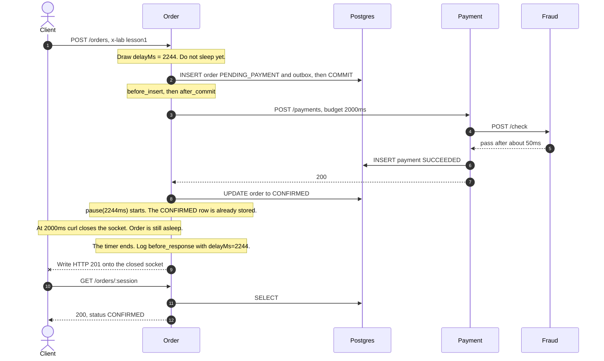
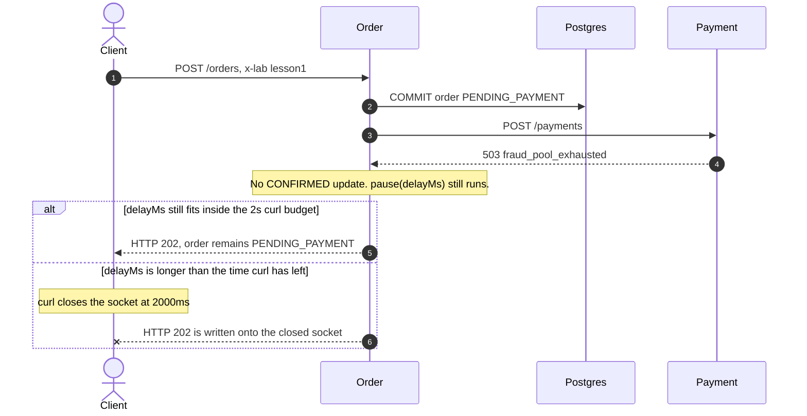
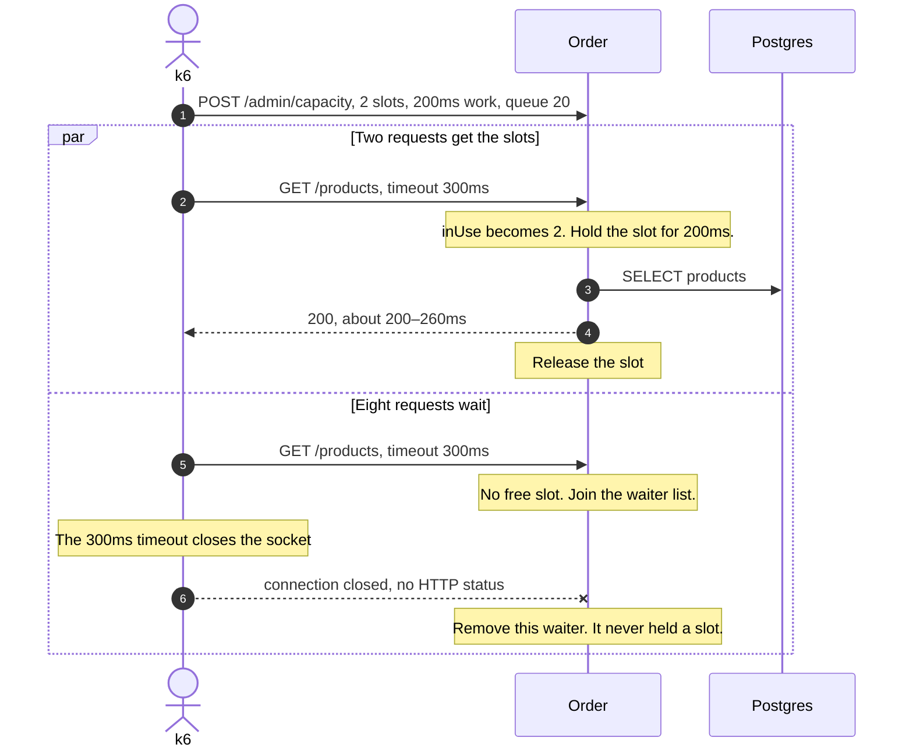
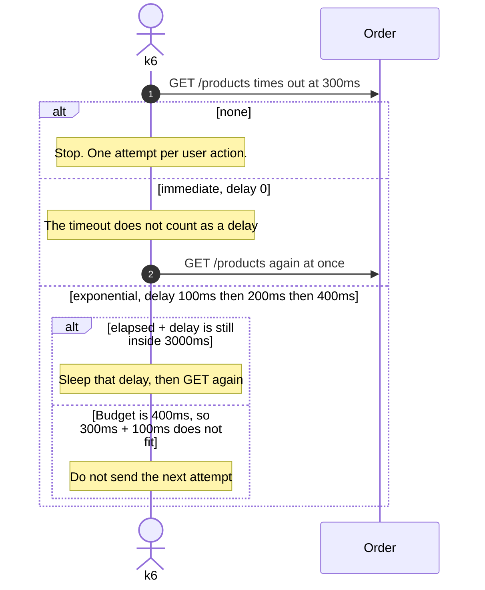
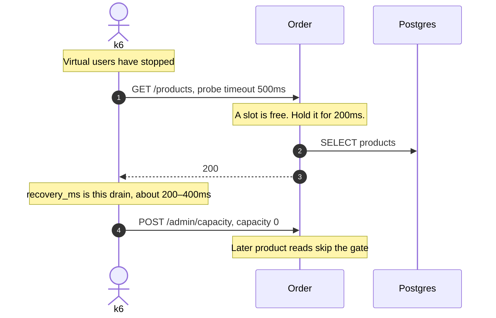

# Distributed Systems Engineering Workbook v4.13 (English)

**Pair:** `distributed-systems-engineering-handbook-v4.13.en.md`
**Lab:** `lab/docker-compose.yml`. From `lab/`, run `docker compose up --build`. Paper exercises stay on paper. The runtime covers the process labs: timeout, retry, concurrency, Kafka offset, Outbox, fencing, and Fraud isolation.

Do the exercise before you read the Handbook section it names, when the prompt says TRY. Worked examples stay in the Handbook. The answer key for the calculations is the last chapter of this file. Do not open it while solving Calculations 1–10 and 13–15, or Exercises A–E.

The validation gates and the defect history are not study tasks. They are Appendix M of the Handbook.

# 0. How to use this workbook

Each lesson has 8 parts:

1. **Real problem** — the failure or decision to resolve.
2. **Core model** — the system mechanism, not a definition to memorize.
3. **Terminology** — the precise English term and the mistake to avoid.
4. **Worked example** — a timeline, state, or calculation.
5. **Failure traps** — conclusions that are easy to get wrong.
6. **Decision guide** — when to use which option.
7. **Workbook** — questions and labs you must do yourself.
8. **Exit criteria** — what must be true before the next lesson.

## Study rules

- Before reading the explanation, answer the **TRY** prompt.
- After reading, rewrite the idea in the **REVISE** prompt in your own words.
- Write a long-term note only after **FINALIZE**.
- Do not judge a pattern by its name. Always identify:
  - the business invariant;
  - the assumptions;
  - the failure window;
  - the recovery path;
  - the evidence you must measure.

## Four knowledge-state labels

- **P — Production:** you have built or debugged this directly.
- **M — Model:** you can explain and predict it, but you have not shipped it.
- **T — Terminology:** you know the phenomenon and are adding the standard name.
- **G — Gap:** you do not yet have a model solid enough to use.

---

# 1. Personal baseline

## Strengths already in place

- Analysis by domain, business invariant, and trade-off.
- Hands-on experience with transactions, locks, blocking, deadlocks, and database performance.
- Has seen frontend–backend timeouts, server overload, and load testing with ApacheBench.
- Recovery, reconciliation, and verification come before approval.
- Does not treat Outbox, a distributed lock, or any single pattern as absolute.
- Can derive models close to idempotency, Outbox, Saga, and stale-writer protection.

## Gaps to prioritize

| Level | Topic | Why it matters |
|---|---|---|
| G1 | Technical terminology | Can reason about a case but cannot match interview questions quickly |
| G1 | Optimistic concurrency | Version check is not yet clearly separated from event sourcing |
| G1 | Quorum and consensus | Authority of a 3/5 group during a network partition is not yet solid |
| G1 | Deadline propagation | Knows a timeout is needed, but not how timeouts relate across a call chain |
| G1 | Fencing token | Understands that storage must reject a stale writer, but not the standard mechanism |
| G2 | Kafka offset vs business completion | Needs a clean boundary between broker progress and business effect |
| G2 | Circuit breaker, bulkhead, load shedding | Has overload intuition, but not the mechanism and terminology |
| G2 | Replication consistency | Knows to read the primary; still needs read-your-writes and session guarantees |

---

# 2. Paper-first study plan

For a profile that already has backend, transaction, overload, and production-troubleshooting experience, do not build a demo for every concept. The study weights are:

| Activity | Share |
|---|---:|
| Engineering calculation and capacity worksheet | 30% |
| Paper system design, failure timeline, ADR | 25% |
| Technical terminology and interview English | 25% |
| Targeted verification lab | 10% |
| Recall and assessment | 10% |

## 2.1 Standard loop for each lesson

```text
1. Invariant       — what must not be wrong?
2. Inputs          — traffic, latency, pool, partitions, SLO, payload.
3. Model           — formula, or a state/failure timeline.
4. Worst case      — load, backlog, downtime, duplicates, stale window.
5. Threshold       — the point that forces reject, scale, retry, or degrade.
6. Candidates      — options that could be used.
7. Decision        — choose for this domain and this system.
8. Verification    — the minimum measurement or lab that checks the assumption.
9. Recovery        — what happens if the assumption is wrong or the failure occurs.
```

## 2.2 When a lab may be skipped

A lab may be skipped only when all three are true:

- An equivalent production case already exists.
- The failure timeline and the affected invariant can be predicted.
- The metrics or evidence that will verify the real rollout are named.

A lab is still **mandatory** for four gaps whose model still needs to be closed:

1. Optimistic-concurrency conflict.
2. Kafka consumer crash before the offset commit.
3. Fencing token at storage.
4. Deadline and cancellation propagation across services.

# 3. Four-week calendar

Theme groupings in the Handbook are not the same cut as this calendar. Lesson 5 is a Part II model and is delivered on day 5, inside calendar week 1.

## Week 1

| Day | Content | Output |
|---:|---|---|
| 1 | Lesson 1 | Failure map + 10 terminology cards |
| 2 | Lesson 2 | Retry-policy table + load-test result |
| 3 | Lesson 3 | Idempotency API design, including PROCESSING takeover |
| 4 | Lesson 4 | Concurrency benchmark, including the event-sourcing boundary |
| 5 | Lesson 5 (Part II) | Kafka crash timelines, including the atomic-transaction note |
| 6 | Synthesis | Order API + consumer lab |
| 7 | Assessment | 30 scenarios + 20 terms + Law cards 1–6 |

## Week 2

| Day | Content | Output |
|---:|---|---|
| 8 | Lesson 6 | Dual-write comparison, including both failure windows |
| 9 | Direct publish vs Outbox | Benchmark + decision record |
| 10 | Lesson 7 — 2PC foundation | Mechanism + trade-off brief |
| 11 | Lesson 8 | Saga state machine, including isolation |
| 12 | Operational recovery | DLQ / reconciliation runbook |
| 13 | External payment | Ambiguous-outcome protocol |
| 14 | Assessment | Order–Inventory–Payment defense + Law cards 7–12 |

## Week 3

| Day | Content | Output |
|---:|---|---|
| 15 | Lesson 9 | Read-strategy matrix |
| 16 | Partition boundary | Invariant-to-key map + Calculation 14 |
| 17 | Lesson 10 | Quorum worksheet, including N=4 and a 2–2 split |
| 18 | Lesson 11 | Raft sequences, previous-term commit, and joint consensus |
| 19 | CAP / conflict | Mergeability matrix |
| 20 | Lesson 12 | Fencing-token lab |
| 21 | Assessment | 3–2 partition + stale-writer demo + Law cards 13–17 |

## Week 4

| Day | Content | Output |
|---:|---|---|
| 22 | Lesson 13 | Deadline budget, including cancellation |
| 23 | Lesson 14 | Fraud isolation lab |
| 24 | Lesson 15 | Distributed trace |
| 25 | Failure testing | Completed failure matrix |
| 26 | System design | Full decision record |
| 27 | English drill | 30 answers × 60–90 seconds |
| 28 | Final assessment | 50 scenarios + project defense |

---

# 4. Completion criteria

After 4 weeks, the foundation is in good shape for a Senior Backend or hands-on technical lead role when you can:

- Use the correct term without letting the term replace the model.
- Identify the invariant before choosing a pattern.
- Separate fact, inference, and unknown.
- Predict the failure window in a new situation.
- Know which part needs technical atomicity and which part can use business recovery.
- Explain optimistic concurrency, quorum, deadline propagation, and the fencing token.
- Defend a decision with a benchmark, a load test, a failure test, or operational evidence.
- Know when a deep infrastructure specialist has to review the design.
- Separate unconstrained Little’s Law demand from a saturated queue.
- State Saga isolation, not only compensation.
- State what a 4-node 2–2 partition does.
- Separate a crash or omission fault from a Byzantine fault, and say when that does not force Byzantine consensus.
- Name a backpressure control when arrival stays above service, and say what short-term availability it gives up.
- Compute availability of a chain that needs every dependency, and say when a fallback makes that product the wrong model.

The goal is not to know everything. The goal is to own the problem, recognize what you do not yet know, research it in a way that can be checked, and finish the work without approving blindly on authority, on an AI answer, or on a pattern name.

The validation gate that scores this program is Appendix M of the Handbook. It is not the next page of this workbook.

# 5. Law card template

Handbook reference: A0.

## A0.3 Production Reality Card — blank template

```text
NAME:
CLASSIFICATION:

FORMAL CORE:

MODEL / ASSUMPTIONS:

PRODUCTION QUESTION:

INVARIANT / AUTHORITY / RESOURCE:

FAILURE SIGNATURE:
- Metrics:
- Logs/traces:
- Business symptom:

WORKED SCENARIO:

PREVENT:

CONTAIN:

RECOVER:

CALCULATION / STATE / AUTHORITY CHECK:

DOES NOT GUARANTEE:

VERIFICATION EVIDENCE:
- Paper:
- Test:
- Production:
- Exit threshold:

RESIDUAL RISK:

DECISION:

60–90 SECOND ENGLISH ANSWER:
```

## A0.7 Exit criteria for one Law card

A card PASSes only when the learner can:

- [ ] State the claim without distorting its scope.
- [ ] Name at least two assumptions.
- [ ] Turn it into one concrete production question.
- [ ] Point to an observable failure signature.
- [ ] Give candidates as Prevent / Contain / Recover.
- [ ] Do the calculation, state, or authority check.
- [ ] State what the law does not guarantee.
- [ ] Point to E1/E2/E3 evidence.
- [ ] Name the residual risk and the escalation trigger.
- [ ] Answer for 60–90 seconds in English.

Scoring:

```text
0 = Missing, or the model is wrong
1 = The concept is right, but production evidence is missing
2 = Right, with a scenario, a response, evidence, and a limit

10 criteria × 2 = 20
Pass = 16/20, and no invariant or hard-blocker error
```

## A0.8 One card for each core item

The short exercises in the next section are the warm-up. The sign-off artifact is one filled card per core item, using the template above. A Handbook example is not a substitute for the card.

| Week | Day | Cards |
|---|---:|---|
| 1 | 7 | 1 Little’s Law, 2 CAP, 3 PACELC, 4 Safety/Liveness, 5 Quorum intersection, 6 Happens-before |
| 2 | 14 | 7 FLP, 8 Two Generals, 9 Byzantine failure model, 10 Amdahl, 11 USL, 12 End-to-end |
| 3 | 21 | 13 Bounded resources, 14 Backpressure, 15 Coordination cost, 16 Failure detection, 17 Fallacies |

A card still fails when a cell only names the item. Items 9, 14, and 16 have their own exercises below. Those exercises do not replace the card.

# 6. Law and principle exercises

## Law 1

Handbook reference: Law 1 — Little’s Law.

## Workbook

A service receives `1,250 req/s` with mean latency `160ms`.

1. Compute average in-flight.
2. If each request holds 40kB, compute average memory.
3. If latency rises to 800ms but the pool has only 500 slots, separate unconstrained demand from pool-limited throughput and queue growth. Do not report one steady in-flight number for both regimes.

## CAP

Handbook reference: Theorem 2 — CAP.

## Workbook

Classify a suitable partition reaction for:

1. Account balance.
2. Shopping cart.
3. Product catalog description.
4. Final inventory.
5. Social reaction count.

For each case, write the invariant and the consequence of preferring availability.

## PACELC

Handbook reference: Principle 3 — PACELC.

## Workbook

Given:

```text
Leader RTT: 3ms
Replica cross-zone RTT: 12ms
Cross-region RTT: 85ms
```

Compare, qualitatively, a write ACK at the leader, a majority inside the region, and a cross-region majority. Name which data is worth a synchronous cross-region ACK.

---

## Safety and liveness

Handbook reference: Principle 4 — Safety and Liveness.

## Workbook required for every design

```text
Safety invariants:
1.
2.

Liveness requirements:
1.
2.

Maximum pending duration:
Escalation path:
```

## Quorum intersection

Handbook reference: Principle 5 — Quorum Intersection.

## Workbook

1. List two quorums of size 4 in a cluster of 7 and show that they must intersect.
2. For N=5, find one R/W configuration that favors reads and one that favors writes, then state the trade-off.

---

## Happens-before

Handbook reference: Principle 6 — Happens-before.

## Workbook

Draw the causal graph for:

```text
Client sends OrderCreated
Inventory receives it and sends Reserved
Payment receives OrderCreated independently
Order receives Reserved and PaymentSucceeded
```

Mark which events are ordered and which are concurrent.

---

## FLP

Handbook reference: Impossibility result 7 — FLP.

## Workbook

Answer:

1. Why is a heartbeat timeout only a suspicion?
2. Why can increasing the timeout not produce perfect failure detection?
3. Why can leader election be slow or repeat while the network is unstable?

## Two Generals

Handbook reference: Problem 8 — Two Generals.

## Workbook

Design a protocol for an external payment when the response is lost. Include:

- client transaction ID;
- provider transaction ID;
- status `UNKNOWN/PENDING`;
- query API;
- webhook;
- reconciliation.

---

## Byzantine failure model

Handbook reference: Problem 9.

## Workbook

Classify each case as a crash or omission fault, or as Byzantine behavior. For a Byzantine case, say whether the nodes still share a trust boundary. Do not design a Byzantine Fault Tolerance protocol.

1. A Kafka broker loses power.
2. A validator signs two conflicting blocks and sends a different block to each peer.
3. A bug corrupts one in-memory counter, then the process crashes.
4. A compromised payment worker tells Order the charge succeeded and tells the ledger the charge failed.

Then answer: why does a bug that can send contradictory messages not, by itself, put the system on Byzantine consensus?

---

## Amdahl

Handbook reference: Law 10 — Amdahl’s Law.

## Workbook

1. P=0.8, N=8: compute the speedup.
2. If the minimum speedup as N→∞ is 6x, what is the maximum serial fraction?
3. **Domain transfer — Graphics/HMI.** Relate this to a main-thread bottleneck: extra workers do not remove a final commit or render that still runs on one thread.

---

## USL

Handbook reference: Model 11 — Universal Scalability Law.

## Workbook

Given benchmark throughput at 1, 2, 4, 8, and 16 workers, plot normalized capacity and mark where scaling stops paying. You do not need to fit α/β by hand the first time.

---

## End-to-end principle

Handbook reference: Principle 12 — End-to-End Principle.

## Workbook

For each invariant, name the final enforcement boundary:

| Invariant | Enforcement boundary |
|---|---|
| No duplicate charge | |
| Inventory does not go negative | |
| A stale writer is rejected | |
| A runtime update does not dirty the document | |

The last row is the Graphics/HMI transfer of the same rule: the authority that owns the document must check the update. The network, the renderer, or a cache ACK is not that authority.

---

## Bounded resources

Handbook reference: Principle 13 — Bounded Resources.

## Workbook

Queue capacity 100,000 messages, arrival 20,000/s, service 15,000/s:

1. How long until the queue fills from empty?
2. After it fills, which reject, drop, or retry policy fits?
3. Can retries increase the arrival rate further?

---

## Backpressure

Handbook reference: Principle 14. The backlog arithmetic is Exercise C. Use that result here.

## Workbook

The producer stays at `60,000 msg/s`. Consumer capacity stays at `48,000 msg/s` for 15 minutes.

1. Why does a larger retention not remove a long-term `λ > μ` mismatch?
2. Choose a control for a flash-sale order stream and a different control for a search-index stream. Candidates are producer throttle, admission or load shedding, and pausing secondary workload. For each choice, name the short-term availability or throughput you give up.
3. What happens to arrival rate if shed clients retry with no deadline and no attempt budget?

---

## Coordination cost

Handbook reference: Principle 15 — Coordination Is Expensive.

## Workbook

For three invariants in Order–Payment–Inventory, mark which are local, which cross a boundary, and which coordination or recovery mechanism matches each one.

---

## Failure detection

Handbook reference: Principle 16. The storage schema is Lesson 12. This exercise is the suspicion rule.

## Workbook

A holds token 10 with a 10-second TTL, then pauses for 15 seconds. B acquires token 11 and writes. A wakes and writes with token 10.

1. What did the timeout prove about A?
2. Which component must reject A’s write? Why is lease expiry at the lock service not that rejection?
3. **Domain transfer — Graphics/HMI.** An evaluation stamped v10 returns after the document authority is already at v11. Which component rejects it, and which component must not declare itself current?

---

## Fallacies review worksheet

Handbook reference: Checklist 17 — Fallacies of Distributed Computing.

## Review worksheet

For one internal Kafka call, check:

- p99 latency and timeout?
- broker leadership or topology change?
- bandwidth, payload, and batch limits?
- TLS, ACL, and authentication overhead?
- cross-zone or cross-region traffic cost?
- version and protocol compatibility?
- which team owns operations?

---

# 7. Assessment — laws and principles

Handbook reference: Part A and the study-priority list.

## Part A: Identify

For each situation, name the related theorem or principle:

1. A node times out and may still be running.
2. A cluster splits 3–2 and the minority must stop writing.
3. Fraud latency rises and in-flight work rises even though traffic does not, while the system can still absorb the arrivals.
4. A payment ACK is lost.
5. Adding workers does not raise throughput because of a global lock.
6. An unbounded queue makes memory grow.
7. TCP retries and the payment is still duplicated.
8. The timestamp is larger, but the event actually happened earlier.
9. A broker stops after power loss. A validator sends two peers two conflicting blocks.
10. Consumers stay at 48,000/s while the producer stays at 60,000/s, and lag grows for 15 minutes.
11. A lock TTL expires. The old owner writes after a newer token has already been stored.

## Part B: Do not infer

Write one conclusion you must **not** draw from each item:

- CAP.
- Little’s Law.
- Quorum.
- Amdahl.
- Circuit breaker.
- Kafka exactly-once.
- Byzantine consensus.
- Backpressure.
- Failure detection.

## Part C: English drill

Answer for 60–90 seconds:

1. What does CAP actually say during a network partition?
2. Why is a timeout not proof of failure?
3. How do safety and liveness differ?
4. Why can adding nodes reduce throughput?
5. Why does TCP reliability not guarantee business idempotency?

---

# 8. Calculation exercises

Handbook reference: the formula with the same number. Use the mean for Little’s Law. Do not open the answer key yet.

Formulas 6, 11, and 12 are practiced in the design exercises, not as a second numbered sheet:

| Formula | Where you practice it |
|---|---|
| 6 Queue growth and drain time | Law 1 question 3, Bounded resources, Exercise B question 3, Exercise C |
| 11 Consumer capacity and lag | Exercise C |
| 12 Outbox backlog | Exercise D |

## Calculation 1 — Retry amplification

Handbook reference: Formula 1.

## Workbook 1

1. `R=1,200/s`, attempts `2, 1, 3`. Compute the downstream rate.
2. Downstream can take `8,000/s`. What is the largest allowed original rate?
3. If a user double-clicks at an average of 1.15 operations per intent, add that factor to the formula.

---

## Calculation 2 — Backoff and jitter

Handbook reference: Formula 2.

## Workbook 2

Compute the ceiling for 6 retries with base `125ms` and max `2s`. Then compute the approximate expected full-jitter delay as half the ceiling.

---

## Calculation 3 — Retry budget

Handbook reference: Formula 3.

## Workbook 3

Design at most 3 attempts inside a `2.5s` deadline, keeping `300ms` for cleanup and response. Choose the attempt timeout and the two backoff delays.

---

## Worksheet 4 — Deadline propagation

Handbook reference: Formula 4.

## Worksheet 4

Allocate an SLO of `2,000ms` across `Gateway → Order → Payment → Fraud`. Record the margin, and whether one retry is still feasible.

---

## Calculation 5 — Little’s Law

Handbook reference: Formula 5 and Law 1.

## Workbook 5

An API receives `1,500 req/s` with **mean latency** `180ms`. Compute average in-flight with Little’s Law. If each request holds 48kB, estimate average memory. Then use p95 `240ms` as a separate stress approximation, and state that it is not standard Little’s Law for average concurrency.

---

## Calculation 7 — Worker capacity

Handbook reference: Formula 7.

## Workbook 7

Compute the workers required to keep utilization at or below 70% for `2,100 req/s`, with each worker handling `15 req/s`.

---

## Calculation 8 — Connection pool

Handbook reference: Formula 8.

## Workbook 8

For `900 req/s`, database work `25ms`, Kafka p99 `80ms`, and commit `10ms`, estimate the pool from a stress hold time. Add 30% headroom.

State explicitly that `25 + 80 + 10 = 115ms` is the sum of a mean-or-typical database step, a Kafka p99, and a commit step. It is not the p99 of the sum. Use it only as a conservative stress input.

---

## Calculation 9 — Dependent-chain availability

Handbook reference: Formula 9. This is a series product. Exercise E is a majority cluster, and that product does not answer this question.

## Workbook 9

An order call needs Gateway `99.99%`, Order `99.95%`, and Payment `99.9%`. Assume independence for the baseline, and use a 365-day year.

1. Compute the series availability.
2. Compute the approximate downtime per year for that series.
3. Compute the downtime per year of a single `99.9%` dependency and compare it with the chain.
4. Payment can accept the order into `PENDING_PAYMENT` when Payment itself is unavailable, so the caller no longer fails every time Payment is down. Why does the three-factor product stop describing that operation?

---

## Calculation 10 — Majority quorum

Handbook reference: Formula 10.

## Workbook 10

1. Compute the majority for N = 9.
2. A 7-node cluster splits 4–3. Which side has authority when consistency is preferred?
3. For N=5, list the integer R/W pairs that satisfy `R+W>N` and `W>N/2`.
4. For N=4, describe a 2–2 partition. Which side may commit?

---

## Calculation 13 — Cache hit ratio

Handbook reference: Formula 13.

## Workbook 13

A catalog receives `8,000 req/s` with a `92%` cache hit ratio.

1. Compute the backend request rate.
2. The cache is flushed and the hit ratio becomes 0. What rate reaches the backend, and what multiple is that of the normal backend rate?

---

## Calculation 14 — Modulo partitioning and movement

Handbook reference: Formula 14. Day 16 of the calendar pairs this with the invariant-to-key map. The map chooses the key. This calculation is what happens to keys when the node count changes.

## Workbook 14

1. Keys use `hash(key) mod 8`. The cluster grows from 8 nodes to 9. What happens to most keys?
2. Under balanced consistent hashing, one equivalent node is added to 8 nodes. What expected fraction of keys moves?
3. Name two reasons the real moved fraction can differ from that expectation.

---

## Calculation 15 — Storage and retention

Handbook reference: Formula 15. Use decimal units: `2 kB = 2,000 bytes`.

## Workbook 15

`4,000 events/s`, average event `2 kB`, retention `14 days`, replication factor `2`.

1. Compute raw storage per day.
2. Compute raw storage for the retention window.
3. Multiply by the replication factor.
4. State what this total still excludes. Do not assume compression.

---

# 9. Deployment sizing worksheet

Copy this before you build or review a system. Handbook reference: Formulas 1–15 and the design loop. Fill Calculations 9, 13, 14, and 15 before you treat sections 4.4 and 4.6 as done.

## 4.1 Traffic

```text
Average requests/s:
Peak requests/s:
Burst duration:
Growth 6–12 months:
Read/write ratio:
Message produce rate:
Payload p50/p95/p99:
```

## 4.2 Latency and SLO

```text
End-to-end p95:
End-to-end p99:
Per-hop timeout:
Overall deadline:
Retry attempts:
Backoff policy:
```

## 4.3 Resource model

```text
CPU time/request:
DB connection hold time:
Downstream connection hold time:
Memory/in-flight request:
Worker count:
Pool sizes:
Queue limits:
```

## 4.4 Messaging

```text
Partition count:
Consumer count:
Rate/consumer:
Expected lag growth:
Catch-up rate:
Retention days:
Replication factor:
Estimated storage:
```

## 4.5 Correctness

```text
Business invariant:
Operation identity:
Idempotency boundary:
Transaction boundary:
Acceptable inconsistency window:
Reconciliation frequency:
Manual recovery path:
```

## 4.6 Failure budget

```text
Dependency availability:
Series availability estimate:
RTO:
RPO:
Maximum backlog:
Maximum stuck-state duration:
Load-shedding threshold:
```

---

# 10. Paper design exercises

Handbook reference: the formula or law named by each exercise.

## Exercise A — Order API peak sizing

Input:

```text
Peak user intents:       1,000/s
Double-submit factor:    1.05
FE attempts:             2
Gateway attempts:        1
Order attempts Payment:  2
Payment capacity:        3,000/s
```

Required:

1. Compute the worst-case Payment call rate.
2. If it exceeds capacity, propose a new retry owner.
3. Design the operation identity.
4. Choose a load-shedding threshold.
5. Record the recovery path when the response is lost.

## Exercise B — Fraud latency cascade

Input:

```text
Payment arrival:              700/s
Fraud normal mean latency:    100ms
Fraud incident mean latency:  4s
Fraud pool:                   400 connections
Memory/in-flight:             64kB (decimal)
```

The incident input is the **mean** service latency, not p95. If the only measurement you have is p95 = 4s, do not call `700 × 4` average in-flight. Label that product as a stress approximation and say which mean you still need to measure.

Required:

1. Compute steady-state in-flight in the normal regime.
2. Compute unconstrained incident demand if mean sojourn stayed 4s and 700/s were still absorbed.
3. Show that the pool cannot provide that steady state. Compute `λmax` and `QueueGrowth`.
4. Estimate memory for the unconstrained demand, and write `Memory(t)` after saturation. Do not present one stable queued population.
5. Propose a timeout, a bulkhead, and a fallback state.

## Exercise C — Kafka lag recovery

Input:

```text
12 partitions
12 consumers
Producer: 60,000 msg/s
Consumer: 4,000 msg/s per consumer
Incident duration: 15 minutes
Producer after the incident: 30,000 msg/s
```

Required:

1. Compute lag growth and the backlog after the incident.
2. Compute the catch-up rate after the incident.
3. Compute catch-up time.
4. If the backlog must be caught up in 10 minutes while the producer stays at 30,000/s, what capacity is required?

## Exercise D — Outbox capacity

Input:

```text
Order writes: 8,000/s
Relay capacity: 7,000/s
Average outbox payload: 1.5kB (decimal)
Incident: 30 minutes
```

Required:

1. Compute the backlog in rows.
2. Compute the extra raw storage.
3. Compute the relay capacity required to drain in 20 minutes while the write rate stays the same.
4. Propose an index, retention, and alert threshold.

## Exercise E — Quorum and availability

Input:

```text
Cluster of 7 nodes
Partition 4–3
Node availability 99.99%, assumed independent
```

Required:

1. Compute the majority and the fault tolerance.
2. Name the authority when consistency is preferred.
3. State the minority response.
4. Explain why cluster availability cannot be inferred from a simple product of 7 nodes.
5. Separately, for a 4-node cluster, explain a 2–2 partition.

---

# 11. Lesson exercises

## Lesson 1 — Failure model

Handbook reference: Lesson 1.

## 1.6 Workbook

### TRY

1. Write 4 causes that can make the frontend time out.
2. For each cause, say whether the backend may already have committed.
3. Write the invariant for creating an order.

### Targeted verification lab

- API timeout: 2 seconds.
- Backend delay, random, 0–4 seconds.
- Log before insert, after commit, and before the response.
- Run 50 requests and compare timeouts with database state.

The delay is one `pause` on that request, after the order and the payment decision are already durable. `x-lab: lesson1` draws `delayMs` once with `Math.floor(Math.random() * 4000)`, so the value is an integer from 0 through 3999. The request does not sleep at the start. Fraud stays at about 50ms. Each request awaits its own timer, so one pause does not stop the other requests on the Node event loop.



Requests in the same batch share the Fraud pool of 2 slots. A request that finds the pool full still reaches the same pause, and the order stays `PENDING_PAYMENT`.



### REVISE

Finish the sentence:

> A timeout only proves that ______; it does not prove that ______.

## 1.7 Exit criteria

- Separate observation, possible cause, and fact.
- Do not infer business failure from a timeout.
- Explain partial failure with a real case.

---

## Lesson 2 — Retry

Handbook reference: Lesson 2.

## 2.5 Workbook

### TRY

Design a retry policy for:

1. `GET /products`
2. `POST /orders`
3. `POST /payments`
4. Refresh token

For each API record:

- retryable errors;
- max attempts;
- delay;
- overall deadline;
- idempotency requirement.

### Targeted verification lab

k6 sends 80 user actions, 10 at a time, at `GET /products`. Order accepts only 2 of those requests at once and holds each accepted request for 200ms, including the catalog query. Twenty more may wait. Past that, Order returns `503`. A request that is still waiting when the client timeout fires is a timeout, not a `503`. The client timeout for one attempt is 300ms. The retry budget for one user action is 3000ms.

A `503` or a client timeout is a failed attempt. The 300ms timeout is time spent in that attempt. It is not the delay before the next attempt. `immediate` waits 0ms before trying again. `fixed` waits 200ms. `exponential` waits 100ms, then 200ms, then 400ms. `jitter` waits a random value below that ceiling. A policy does not start another attempt when the delay no longer fits in the budget.

Ten user actions are in flight. Two hold the only slots. The other eight wait. The queue limit is 20, so this run does not return `503`. A waiter that is still queued at 300ms is a client timeout. Order drops that waiter and does not spend a slot on it.



`none` stops after that one attempt. The other policies may try again, up to 4 attempts, only while the next delay still fits in the 3000ms budget. The 300ms already spent is the attempt timeout. It is not the retry delay.



After the 80 actions stop, the two in-flight slots finish their 200ms. The next probe can take a free slot.



Compare `none`, `immediate`, `fixed`, `exponential`, and `exponential + jitter` on the same 80 user actions. Record:

| Policy | Attempts | p95 | p99 | Error rate | Recovery time |
|---|---:|---:|---:|---:|---:|
| No retry | | | | | |
| Immediate | | | | | |
| Fixed | | | | | |
| Exponential | | | | | |
| Exponential + jitter | | | | | |

Then repeat `exponential` and `immediate` with a 400ms budget and the same 300ms attempt timeout. After a timeout, 100ms of backoff no longer fits, so exponential does not send another attempt. Immediate still does, because its delay is 0. A fast `503` is different: the attempt itself was short, so both policies may still have room for another try.

## 2.6 Exit criteria

- Separate a repeated user action from an automatic retry.
- Compute amplification.
- Keep the retry inside the overall timeout budget.

---

## Lesson 3 — Idempotency

Handbook reference: Lesson 3.

## 3.5 Workbook

Design the idempotency-store schema. Then answer:

1. What happens to a `PROCESSING` record that lasts too long? Name the takeover rule.
2. How long until the key expires, and what must be true before expiry?
3. Do you store the full response?
4. If the operation fails in a retryable way, what happens to the key?
5. How does a natural key differ from an explicit key?

## 3.6 Exit criteria

- Do not treat idempotency as a lock.
- Know when a natural business key is enough.
- Close the race with a storage invariant.
- A crashed `PROCESSING` row has a takeover rule. It does not block retries forever, and it does not start a second effect.
- Lease expiry does not authorize a second external side effect. The same operation identity is queried first.

---

## Lesson 4 — Optimistic concurrency

Handbook reference: Lesson 4.

## 4.5 Workbook

### Case A

One user edits a profile. Contention is low. Which mechanism?

### Case B

100 requests buy the last flash-sale unit at the same time. Which mechanism, and why? Explain why “high contention” does not automatically mean a row lock.

### Case C

An order update includes a 5-second call to external pricing. Should the row lock be held for those 5 seconds?

### Case D

A profile update uses `WHERE version = $expected` and, in the same transaction, inserts an audit row.

1. What does the version check guarantee?
2. Why is the audit row not event sourcing?
3. What would have to be true before the event log is the source of state?

### Targeted verification lab

Run 100 concurrent updates with all three mechanisms. Measure:

- success count;
- conflict count;
- lock wait;
- throughput;
- retry count.

## 4.6 Exit criteria

- Explain a version check.
- Do not treat a distributed lock as the default.
- Choose concurrency control from contention and from how long the transaction is.
- A one-statement conditional update is distinct from a version check and from `FOR UPDATE`.
- A version check is distinct from event sourcing. An audit row stored beside the current row does not make the event log the source of state.

---

## Lesson 5 — Kafka offset and business completion

Handbook reference: Lesson 5.

## 5.7 Workbook

Draw a timeline for these crash points:

1. Before the local transaction commits. Both the business update and `processed_message` roll back. The message will be delivered again. No durable business effect yet.
2. After the business update statement and before the `processed_message` insert, **only if those writes are not in one transaction**. Name the invariant this split can break. Then state that the recommended design removes this window by committing them together.
3. After the local commit and before the offset commit. The message is delivered again. The unique `processed_message` row prevents a second business effect.
4. After the offset commit. The message is not redelivered by the broker. The business effect must already be durable, or it can be lost.

For each timeline, say which invariant can break.

---

## Lesson 6 — Dual write and Outbox

Handbook reference: Lesson 6.

## 6.4 Decision workbook

Draw the two write sequences before you fill the table.

1. Kafka accepts `OrderCreated`, then the database commit fails. Name the invariant that can break and one recovery candidate.
2. The database commits the order, then the Kafka publish fails. Name the invariant that can break and one recovery candidate.
3. Which of those windows does one local transaction that inserts the order and the outbox row close?
4. The relay publishes, then crashes before it marks the row published. What must the consumer still guarantee?

Fill in the table:

| Domain | Impact of a lost event | Impact of a duplicate | Recovery cost | Choice |
|---|---|---|---|---|
| Email notification | | | | |
| Search indexing | | | | |
| Inventory reservation | | | | |
| Payment ledger | | | | |

There is no single answer. Defend the choice with the invariant and with evidence.

---

## Lesson 7 — 2PC

Handbook reference: Lesson 7.

## 7.6 Workbook

Compare 2PC, Outbox, and Saga:

| Criterion | 2PC | Outbox | Saga |
|---|---|---|---|
| Technical atomicity | | | |
| Participant support | | | |
| Blocking risk | | | |
| Temporary inconsistency | | | |
| Isolation across concurrent workflows | | | |
| Compensation | | | |
| Fit for an external provider | | | |

## 7.7 Exit criteria

- Do not say 2PC “cannot be used”. State the conditions and the cost.
- Do not call 2PC a consensus protocol that replaces Raft or Paxos.
- Separate a local database transaction, atomic commit, Outbox, and business compensation.

---

## Lesson 8 — Saga

Handbook reference: Lesson 8.

## 8.5 Workbook

Design the transition table:

| Current state | Event | Next state | Side effect | Retry policy |
|---|---|---|---|---|
| PENDING_PAYMENT | PaymentSucceeded | | | |
| PENDING_PAYMENT | ReservationExpired | | | |
| RELEASE_PENDING | ReleaseFailed | | | |

Also name the isolation mechanism that stops two concurrent checkouts from driving inventory below 0.

## 8.6 Exit criteria

- Intermediate states are explicit.
- Compensation is idempotent.
- There is a recovery path if compensation keeps failing.
- Isolation is stated: reservation, semantic lock, or a commutative update. Concurrent sagas are not assumed to be isolated.

---

## Lesson 9 — Replication consistency

Handbook reference: Lesson 9.

## 9.4 Workbook

Design a separate read strategy for:

- profile;
- catalog;
- payment;
- inventory;
- reporting.

For each one, name which of the four session guarantees it needs, and which readers outside that session may still see stale data. Do not use one rule for all of them.

## 9.5 Exit criteria

- Read-your-writes, monotonic reads, monotonic writes, and writes-follow-reads are four different promises.
- A session guarantee is not described as linearizability for every client.
- The enforcement mechanism is named: primary, sticky session, or a version the replica must have caught up to.

---

## Lesson 10 — Quorum

Handbook reference: Lesson 10. The model answer for the spoken explanation is in the Handbook, directly after Lesson 10..

## 10.5 Workbook

1. Draw every way to split a 5-node cluster into 3–2.
2. Explain why the 2-node side should not write a balance on its own.
3. Name a domain that can accept writes on both sides and then merge.
4. Name a domain that cannot be merged simply.
5. Explain a 4-node 2–2 partition.

## 10.6 Exit criteria

- Do not answer “it depends on the domain” and then leave the authority mechanism blank.
- Separate the requirement from the coordination mechanism.
- Compute a majority without looking it up.
- State that N=4 still tolerates one crash and that a 2–2 partition stalls both sides.

## Lesson 11 — Raft

Handbook reference: Lesson 11.

## 11.7 Workbook

Draw the sequence for:

1. a normal leader replicating an entry;
2. the leader dying;
3. a new election;
4. a 3–2 partition;
5. the network recovering;
6. an entry from the previous term that a majority has already stored. Say whether that acknowledgement commits it, and what else has to happen under the term rules;
7. replacing C with D in `{A, B, C}`. Say why writing `{A, B, D}` directly can create two authorities, what a decision must satisfy during the joint phase, and why D catches up before it votes. The proof is not required.

---

## Lesson 12 — Fencing token

Handbook reference: Lesson 12. The model sentence is in the Handbook, directly after Lesson 12..

## 12.5 Workbook

Design the schema that records the token at storage. Simulate A with token 10 and B with token 11. Show that A is rejected after B has written.

## Lesson 13 — Deadline propagation

Handbook reference: Lesson 13.

## 13.5 Workbook

Design timeouts for a flow with a 2-second SLO. Allocate time for:

- the gateway;
- Order;
- Payment;
- Fraud;
- response handling;
- one retry, if it fits.

Explain why an even split is the wrong default.

The caller closes the connection after Payment has already called Fraud.

1. What should Payment and Fraud do with work whose caller is gone?
2. Name one side effect that cancellation cannot roll back.
3. Which operation identity is queried before that side effect is repeated?

---

## Lesson 14 — Circuit breaker, bulkhead, load shedding

Handbook reference: Lesson 14.

## 14.6 Workbook

Design Payment with:

- a pool reserved for Fraud;
- a 500ms timeout;
- a circuit-breaker threshold;
- half-open probes;
- a `PENDING_FRAUD_REVIEW` fallback.

Name the invariant that must not be broken.

---

## Lesson 15 — Tracing and operations

Handbook reference: Lesson 15.

## 15.10 Operational drill

Given the trace `Order → Payment → Fraud` and these metrics:

```text
Order p99: 2.2s
Payment p99: 2.0s
Fraud p99: 1.8s
Payment pool wait: 600ms
Fraud timeout rate: 18%
```

Required:

1. Name the main bottleneck and the propagation path.
2. Choose containment: timeout, bulkhead, circuit breaker, or pending review.
3. Write the three structured log records you would look for.
4. Choose an SLI/SLO alert that is better than a CPU alert.
5. Write the verify step after mitigation.

## 15.11 Exit criteria

- Trace context crosses HTTP and messages and is not used as authorization.
- The structured-log schema is enough to find one operation across retries.
- Alerts are tied to SLO or business age, not only to a resource metric.
- The runbook has containment, recovery, and verification.
- Replay and manual correction have idempotency, a rate limit, and an audit.

## 15.12 Workbook

Use OpenTelemetry plus Jaeger or Tempo to trace Order → Payment → Fraud. Inject Fraud delay and identify the span that causes the slowness.

---

# 12. Security verification worksheet

Handbook reference: Appendix G.

## G.7 Security verification worksheet

```text
Principal / service identity:
Authorization decision point:
Authorize at request or at execution:
Replay/idempotency scope:
Sensitive fields:
Encryption in transit / at rest:
Secret source and rotation:
Log/trace redaction:
Retention / deletion:
Audit event:
Incident owner:
```

# 13. End-to-end system-design case

Handbook reference: Lessons 1–15 and Appendix G. This case is not Lesson 15.

This section number matches the original workbook’s case number. It is not Lesson 15. Lesson 15 is distributed tracing.

Design the system:

```text
Client
→ API Gateway
→ Order Service
→ Payment Service
→ Fraud Service
→ Inventory Service
→ Kafka
→ PostgreSQL per service
```

## 15.1 Requirements

- One checkout intent does not create two orders.
- One payment intent is not charged twice.
- Inventory does not go below 0.
- An order is not confirmed before payment succeeds.
- A reservation is not held forever.
- A duplicate event does not create a duplicate business effect.
- Slow Fraud does not take down all of Payment.
- Concurrent checkouts do not both succeed against the last unit. Name the isolation mechanism.

## 15.2 Design table to complete

| Area | Decision | Evidence | Remaining risk | Recovery |
|---|---|---|---|---|
| Operation identity | | | | |
| Retry ownership | | | | |
| Inventory concurrency | | | | |
| Saga isolation | | | | |
| DB→Kafka dual write | | | | |
| Payment ambiguity | | | | |
| Saga state | | | | |
| Replica read | | | | |
| Timeout hierarchy | | | | |
| Fraud isolation | | | | |
| Observability | | | | |

## 15.3 Failure matrix

| Failure injection | Expected behavior | Invariant |
|---|---|---|
| Response lost after the order commits | Retry returns the old order | No duplicate order |
| Gateway and service both retry | Attempts stay bounded | No retry storm |
| Consumer crash before the offset commit | Message is delivered again | No duplicate effect |
| Relay crash after publish | The event may repeat | Consumer is idempotent |
| Payment response is lost | State is UNKNOWN/PENDING | No blind second charge |
| Inventory release fails | RELEASE_PENDING + retry/DLQ | Stock is not held forever |
| Two checkouts see the same stock | One conditional reserve or one reservation wins | Inventory does not go negative |
| Replica lag | a read-your-writes strategy | The user sees an update inside the SLO |
| Cluster splits 3–2 | the minority stops writing | No split brain |
| 4-node cluster splits 2–2 | neither side commits | No split brain |
| Stale lock owner wakes up | the old token is rejected | No stale overwrite |
| Fraud latency 5s | timeout / bulkhead / breaker | No cascade |
| Idempotency row stuck in PROCESSING | Take over only after lease expiry; query an external effect before repeating it | One business effect, retries not blocked forever |

---

# 14. Technical English drill

Answer each question in 60–90 seconds before you read the calibration notes in the answer key. Sample answers for four topics are in the Handbook under “Sample interview answers”.

## 16.3 Interview drill bank — 20 questions

Answer each question in 60–90 seconds using:

```text
Term → mechanism → real case → trade-off → verification
```

### Foundation and failure

1. What does a timeout prove, and what does it not prove?
2. What is a partial failure? Give a production example.
3. How do retryable and non-retryable failures differ?
4. What is retry amplification, and how would you prevent it?
5. Why is exponential backoff usually combined with jitter?

### Correctness and messaging

6. How would you make a create-order API idempotent?
7. Compare atomic conditional update, optimistic concurrency, and a row lock.
8. What happens if a Kafka consumer crashes after the database commit but before the offset commit?
9. What can Kafka exactly-once semantics guarantee, and what is outside its boundary?
10. When would you use a Transactional Outbox instead of direct publish?

### Workflow and recovery

11. Compare 2PC, Outbox, and Saga. Include isolation.
12. Why is compensation not the same as rollback?
13. How would you handle a payment that succeeded but returned no response?
14. How should a poison message move through retry topics and a DLQ?

### Replication and coordination

15. What does CAP actually say during a network partition?
16. Why can the three-node side of a 3–2 partition continue in a five-node cluster? What changes in a four-node 2–2 split?
17. What happens when an old Raft leader rejoins after a higher-term leader was elected?
18. Why does increasing a lock TTL not eliminate stale writers?

### Resilience and operations

19. How can a slow Fraud Service cause cascading failure, and how would you isolate it?
20. How would you trace one operation across HTTP, Kafka, and a background job?

Questions 21–23 are required practice. They sit outside the 20-answer readiness score.

21. When is a contradictory message a Byzantine fault, and when does that still leave Raft or Paxos as the crash-fault protocol?
22. Producer rate stays above consumer rate. Which backpressure control do you apply, and what does it give up?
23. A dependent call needs Gateway, Order, and Payment. When is series availability the right baseline, and when does a fallback make that product the wrong model?

## 16.5 Production stories — Situation, Decision, Evidence, Result

Do not invent production scale. Choose three cases you actually did.

### Story 1 — ApacheBench overloads the server

```text
Situation:
- Workload, symptoms, timeout or error observed.

Decision:
- How you isolated the bottleneck, limited load, tuned, or redesigned.

Evidence:
- Throughput, latency, CPU/RAM/pool, before/after measurement.

Result:
- Improvement, remaining risk, and the lesson about retry or backpressure.
```

### Story 2 — Database performance and concurrency

```text
Situation:
- Slow query, lock, blocking, deadlock, or a race.

Decision:
- Execution plan, index, query, transaction boundary, or locking change.

Evidence:
- Plan cost, rows scanned, latency, lock wait, regression test.

Result:
- Measured impact and the trade-off.
```

### Story 3 — Domain transfer: Graphics/HMI architecture correctness

Use this story only if you have actually worked on that system. It transfers the same correctness rules: one authority, no stale writer, and a renderer that is not the document owner.

```text
Situation:
- Document state, runtime or evaluated state, interaction, or renderer authority were mixed together.

Decision:
- A command boundary, state separation, stale-result rejection, or renderer isolation.

Evidence:
- The invariant, a design review, a benchmark or test, and a failure scenario.

Result:
- The correctness, performance, or maintainability change, and the risk still open.
```

### Story review checklist

- [ ] Say what you personally were responsible for.
- [ ] The decision rests on evidence, not only on authority or a pattern name.
- [ ] There is a real measurement or artifact.
- [ ] There is a trade-off and something still unresolved.
- [ ] A team result is not turned into an absolute personal achievement.

## 16.6 Daily terminology card

```text
TERM:
CORE MEANING:
MY CASE:
SOLVES:
DOES NOT SOLVE:
TRADE-OFF:
ONE-SENTENCE ENGLISH:
```

---

# 15. Assessment rubric

# 17. Assessment rubric

Score each situation on 5 axes, 0–2 points:

| Axis | 0 | 1 | 2 |
|---|---|---|---|
| Invariant | Not identified | Stated vaguely | Stated clearly and checkable |
| Failure model | Wrong | Partly identified | Timeline and failure window are clear |
| Solution | Pattern by name only | A reasonable candidate | A candidate that fits the assumptions |
| Trade-off | Missing | Stated vaguely | Impact and evidence are present |
| Recovery | Missing | A generic retry | State, reconciliation, or a manual path is clear |

**Pass one lesson:** at least 8/10, and no error on a critical invariant.

---

# 16. Learning-log template

# 19. Learning-log template

```text
DATE:
LESSON:
STATUS: P / M / T / G

READ — Situation:

GUESS — Initial model:

TRY — What I would do:

REVISE — What I corrected:

FINALIZE — Model I will keep:

TERM → CORE:

BUSINESS INVARIANT:

ASSUMPTIONS:

FAILURE WINDOW:

CANDIDATE SOLUTIONS:

TRADE-OFF:

EVIDENCE TO COLLECT:

RECOVERY PATH:

60-SECOND ENGLISH ANSWER:
```

# Answer key

Use this only after the matching exercise is written.

# PART F — ANSWER KEY FOR THE CALCULATIONS

## Workbook 2 answers

Ceilings for 6 retries with base `125ms` and max `2,000ms`:

```text
125, 250, 500, 1,000, 2,000, 2,000 ms
```

Approximate expected full-jitter delays:

```text
62.5, 125, 250, 500, 1,000, 1,000 ms
```

Expected backoff sum is about `2,937.5ms`. The worst-case ceiling sum is `5,875ms`.

## Workbook 3 answers

One valid budget inside a `2,500ms` deadline:

```text
3 attempt timeouts × 600ms = 1,800ms
Backoff 150ms + 250ms      =   400ms
Cleanup/response reserve   =   300ms
Total                      = 2,500ms
```

This is a paper budget. If a 600ms attempt timeout does not fit the dependency’s latency distribution, reduce the attempt count or change the fallback.

## Worksheet 4 answers

One allocation for an SLO of `2,000ms`:

```text
Gateway overhead             100ms
Order local work             150ms
Order → Payment budget     1,350ms
Response/cleanup reserve      400ms
Total                       2,000ms
```

Inside Payment, for example:

```text
Payment local work            200ms
Payment → Fraud timeout       700ms
Payment cleanup/commit        250ms
Network/margin                200ms
Total                       1,350ms
```

A full Fraud retry usually no longer fits if each attempt may use 700ms. To retry, shorten the per-attempt timeout or move to a pending / manual-review flow.

## Workbook 5 answers

Using mean latency:

```text
Average in-flight = 1,500 × 0.180 = 270 requests
Average memory    = 270 × 48kB = 12.96MB (decimal)
```

Stress approximation using p95, **not** standard Little’s Law for the average:

```text
1,500 × 0.240 = 360 concurrent-equivalent
360 × 48kB = 17.28MB
```

## Workbook 1 answers

1. `1,200 × 2 × 1 × 3 = 7,200/s`.
2. `8,000 / (2×1×3) ≈ 1,333 operations/s`.
3. Also multiply by `1.15`: `OriginalIntentRate × 1.15 × attempts...`.

## Workbook 7 answers

```text
Required raw capacity = 2,100 / 0.70 = 3,000 req/s
Workers = 3,000 / 15 = 200 workers
```

## Workbook 8 answers

```text
Stress hold time = 25ms + 80ms + 10ms = 115ms = 0.115s
```

This is the **sum of component figures**, one of which is a Kafka p99. It is not `p99(database + Kafka + commit)`. It is a conservative stress input only.

```text
Stress connections = 900 × 0.115 = 103.5
With 30% headroom = 134.55
Round up: about 135 connections
```

Use 135 as a stress ceiling to discuss with database `max_connections`, not as the measured p99 pool size. Average pool demand still needs the mean hold time.

## Workbook 10 answers

1. N=9 → majority `5`, fault tolerance `4`.
2. A 7-node split of 4–3 → the side of 4 nodes has the majority.
3. For N=5, W must be greater than 2.5, so W∈{3,4,5}. With R≥1, the integer pairs are: W=3 → R∈{3,4,5}; W=4 → R∈{2,3,4,5}; W=5 → R∈{1,2,3,4,5}. This is an abstract quorum exercise, not a default recommended configuration.
4. N=4, partition 2–2: majority is 3, so neither side can commit. Both sides must reject writes or go read-only. Crash tolerance is still 1, the same as N=3, and the even split is an availability regression.

## Workbook 9 answers

Independent baseline on a 365-day year:

```text
0.9999 × 0.9995 × 0.999 = 0.99840064995 ≈ 99.840%
Unavailable fraction = 0.00159935005
Downtime = 0.00159935005 × 365 × 24 × 3,600 ≈ 50,437 seconds
         ≈ 14 hours 0 minutes 37 seconds
```

A single 99.9% dependency:

```text
0.001 × 365 × 24 = 8.76 hours ≈ 8 hours 46 minutes
```

The chain is worse than its weakest named input because every required dependency can fail the call. Once Payment unavailability becomes `PENDING_PAYMENT` instead of a failed call, user-facing success no longer requires Payment to be up. The product still describes the synchronous path. It does not describe the degraded path. Correlation through a region, DNS, or a shared cluster can also make the independent product too optimistic.

## Workbook 13 answers

```text
Backend = 8,000 × (1 − 0.92) = 640 req/s
Flushed cache = 8,000 req/s
Multiple = 8,000 / 640 = 12.5×
```

## Workbook 14 answers

1. `hash(key) mod N` changes the partition of most keys when N changes from 8 to 9. The mapping is not stable.
2. Adding one equivalent node to 8 balanced nodes moves about `1 / (8 + 1) = 1/9` of the keys. That is the expected fraction, about 11.1%.
3. The real fraction depends on virtual nodes, hash distribution, weighting, replication, and the rebalance strategy. Any two of those are enough.

## Workbook 15 answers

Decimal units, `2 kB = 2,000 bytes`:

```text
Per day = 4,000 × 2,000 × 86,400 = 691,200,000,000 bytes = 691.2 GB
14 days = 691.2 × 14 = 9,676.8 GB = 9.6768 TB
Replication factor 2 = 19.3536 TB
```

This is raw replicated payload before compression. It excludes index and segment overhead, headroom, and growth. Compression is not included until it is measured. Binary KiB/GiB/TiB would be a different result and must be labeled as such.

## Exercise A answers

```text
Worst-case = 1,000 × 1.05 × 2 × 1 × 2 = 4,200 Payment calls/s
```

That exceeds capacity by 1,200/s. One candidate is to drop automatic retries on the frontend for the write, keep a single retry owner in Order, use idempotency or a payment intent, and bound the retry.

## Exercise B answers

Normal regime, steady state, pool not saturated:

```text
Lnormal = 700 × 0.1 = 70
Pool utilization = 70 / 400 = 17.5%
```

Unconstrained incident demand, only if 700/s is still absorbed at a 4s mean sojourn:

```text
Ldemand = 700 × 4 = 2,800
```

The pool cannot provide that steady state:

```text
λmax = 400 / 4 = 100 requests/second
QueueGrowth = 700 − 100 = 600 requests/second
Q(t) ≈ 600 × t
```

`2,800 − 400 = 2,400` is the connection deficit, not a stable queue depth.

Memory for the unavailable demand case, decimal 64kB:

```text
2,800 × 64kB = 179.2MB
```

If 64KiB was intended instead, that is `175MiB` (about `183.5MB` decimal). Framework, socket, and stack overhead are not included.

After saturation, with the equal-memory assumption:

```text
Active = 400 × 64kB = 25.6MB
Memory(t) = 25.6MB + Q(t) × 64kB
```

There is no single stable incident memory. If the queue starts empty at saturation and the rates stay constant, then at `t = W = 4s`:

```text
Occupancy = Pool + Q(W) = 400 + 2,400 = 2,800 = Ldemand
```

Memory at that instant equals the 179.2MB demand figure because `Pool + (λ − Pool/W) × W = λW`. After that instant the queue still grows at 600/s, so occupancy and memory move past `Ldemand`. Equality at `t = W` is not a steady state.

If the input had been p95 = 4s rather than the mean, `700 × 4` would be a stress approximation only, and it would still not be average in-flight.

## Exercise C answers

```text
Consumer capacity = 12 × 4,000 = 48,000/s
Lag growth = 60,000 − 48,000 = 12,000/s
15 minutes = 900s
Backlog = 10,800,000 messages
After the incident, catch-up rate = 48,000 − 30,000 = 18,000/s
Catch-up time = 10,800,000 / 18,000 = 600s = 10 minutes
```

Question 4, catch up in 10 minutes while produce stays at 30,000/s:

```text
Required drain rate = 10,800,000 / 600 = 18,000/s
Required capacity = 30,000 + 18,000 = 48,000/s
```

Current capacity already equals that requirement, which is why catch-up time is exactly 10 minutes. Any lower capacity misses the 10-minute target. This still assumes no hot partition: one slow partition can miss the target even when the sum is 48,000/s.

## Exercise D answers

```text
Growth = 8,000 − 7,000 = 1,000 rows/s
30 minutes = 1,800s
Backlog = 1,800,000 rows
Raw payload ≈ 1,800,000 × 1.5kB = 2.7GB (decimal), excluding row/index/WAL/replication/bloat
```

To drain in 20 minutes while still receiving 8,000/s:

```text
Extra drain = 1,800,000 / 1,200 = 1,500/s
Required relay = 8,000 + 1,500 = 9,500/s
```

## Exercise E answers

```text
N = 7
Majority = floor(7/2) + 1 = 4
FaultToleranceForMajority = 7 − 4 = 3
```

In a 4–3 partition, when consistency is preferred, the side of 4 nodes has the technical authority to keep or elect a leader and to commit. The side of 3 is the minority. It should reject writes quickly, go read-only if the semantics allow, or return unavailable / redirect.

Cluster availability cannot be computed as `0.9999^7`, because the cluster does not need all 7 nodes alive. It needs at least 4 nodes available **and able to communicate as a majority**. A better model is the probability that at least 4 nodes remain, plus correlated network and region failures. Under an independent crash-only assumption, majority availability is the binomial sum from k=4 to k=7, and that model still ignores network partitions and shared dependencies.

For a 4-node cluster, majority is 3 and crash tolerance is 1. In a 2–2 partition neither side has authority.

---

## Interview scoring calibration

Handbook reference: the 20-question drill above.

## 16.4 Scoring key for each answer

Score 0–2 on five axes:

| Axis | 0 | 1 | 2 |
|---|---|---|---|
| Term | Not recognized | Recognized, used loosely | Used correctly, with the right limit |
| Mechanism | Wrong or missing | Partly right | Timeline or boundary is clear |
| Case | Missing | A generic example | A real case or a specific worked scenario |
| Trade-off | Missing | Stated in general | Candidates compared under a constraint |
| Verification | Missing | A generic “test/monitor” | A metric, a failure test, or specific evidence |

```text
Maximum per answer = 10
Pass = 8/10, and the invariant is not wrong
20-answer readiness target = at least 16 answers pass, and no hard-blocker answer is wrong
```

### Calibration examples

**Question 8 — 2-point mechanism answer:** the consumer can receive the message again because the offset was not committed. The local database update and the processed-message ID must be atomic so a duplicate delivery does not create a duplicate business effect.

**Question 16 — hard-blocker error:** saying the 2-node side may still write because “both sides are still alive”. Also a hard-blocker: saying a 4-node 2–2 split can commit on both sides.

**Question 20 — complete verification:** use W3C trace context in HTTP and message headers, a separate operation ID for recovery, and check spans, consumer lag, pool wait, and structured logs. Do not use the trace ID as authorization data.
