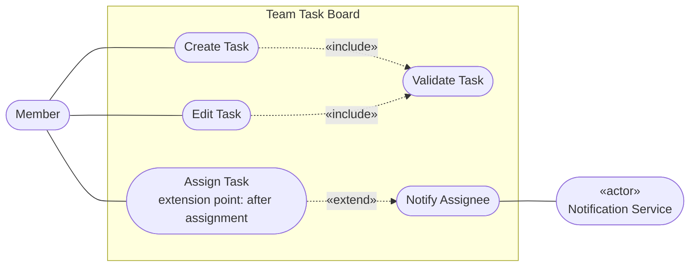
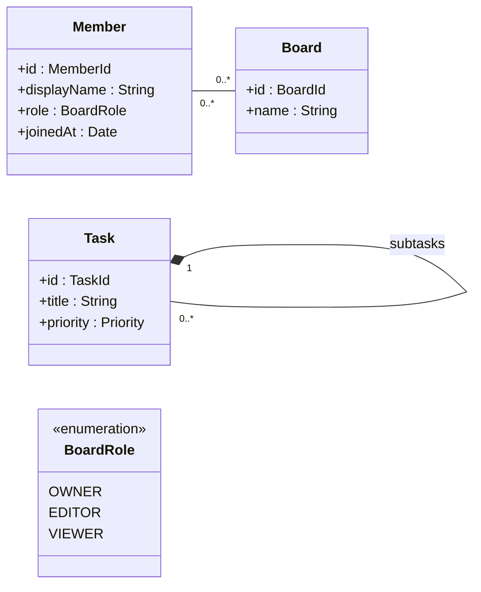
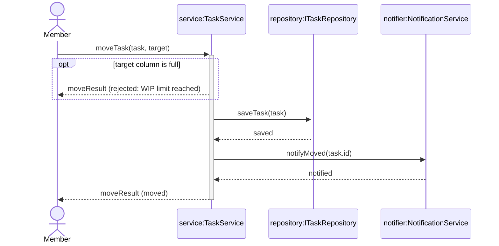

# UML MODELING WORKBOOK — v2.0.3

Hands-on exercises on the Team Task Board

| Field | Value |
|---|---|
| Document type | Hands-on workbook |
| Running example | Team Task Board (Handbook Section 2) |
| Prerequisite | UML Modeling Handbook v2.0.4: Part I for Exercises 0–6; Parts I and II for Exercises 7–10 |
| Status | **Baseline approved for training.** Learner distribution permitted. |
| Version / date | v2.0.3 / 5 November 2026 |
| Baseline ID | UML-TRAINING-2.0 |

> **Workbook rule.** Do not invent requirements or behavior to make a diagram look complete. Use only the evidence given in each exercise and the **Handbook requirement register (Section 2.4)**. Mark unresolved matters and keep every Sequence Diagram consistent with its Class Diagram.

---

## How to use this workbook

Read the **UML Modeling Handbook** first. Requirement IDs and baseline evidence status are authoritative in **Handbook Section 2.4**; this workbook gives exercises that apply that content.

Every exercise uses the Team Task Board from Handbook Section 2. The Handbook already shows Create Task, Assign Task and Move Task as worked examples. The exercises ask you to build the parts the Handbook does not show, so you cannot copy a solution from it. The **Answer Guide** is for trainers only; it is not part of the learner pack.

| Exercises | Level | Before you start, read |
|---|---|---|
| 0–6 | Level 1 – Core | Handbook Part I (Sections 1–9), Appendix A, Appendix B |
| 7–10 | Level 2 – Extended | Handbook Part II (Sections 10–14) |

### Writing diagrams

Exercises 0–9 are written in **Mermaid** in Markdown, so diagrams are quick to write and easy to review. Appendix A lists the Mermaid conventions and limitations used in the course. Use Mermaid v10.3.0 or later. Exercise 10 reproduces the model in Enterprise Architect where available; Mermaid remains an accepted submission format.

### Tool policy: Mermaid and Enterprise Architect

The course assesses **UML meaning**, not drawing-tool syntax. Mermaid is the baseline authoring and review format for Workbook exercises and Answer Guide solutions. Handbook figures use Mermaid where it preserves the required UML meaning; canonical SVG is used where Mermaid cannot represent the required standard notation reliably. Enterprise Architect (EA) is the preferred Capstone tool for reproducing the same model with complete UML notation. Mermaid remains an accepted submission format when EA is unavailable.

- A Mermaid diagram is authoritative for its stated UML meaning, relationships, direction, multiplicity, roles, guards and messages.
- When Mermaid cannot render a standard UML notation, the figure carries a limitation note and Appendix A defines the workaround. The workaround is not taught as standard UML notation.
- In EA, the learner replaces each workaround with the corresponding standard notation without changing the model meaning or inventing new elements or behavior.
- Assessment compares semantic content and cross-diagram consistency, not layout, colors or tool-specific appearance.
- Lack of EA does not block learning or submission; Mermaid is accepted. EA completion is preferred for the Capstone because the learner can demonstrate the full notation.


### Submission structure

Use the file names listed under each exercise, in one folder per exercise:

```text
exercise-XX/
  01-....md
  02-....mmd
```

### Working rules

- Trace every important element to a requirement or to evidence given in the exercise.
- Use exactly the names of Handbook Part I. Do not rename `TaskService`, `TaskInput` or any other existing classifier.
- An unmarked element is not automatically Confirmed. Show its traceability to an approved requirement or explicit decision before treating it as Confirmed. Mark every open matter «TBC» and every unapproved design choice «Proposed».
- If a Sequence Diagram needs a participant or an operation that the Class Diagram does not have, update the Class Diagram first.
- Keep answers short. The goal is modeling quality, not document volume.
- Check your work against the **L1** items of the Handbook review checklist (Section 17) before submitting.

---

## Exercise 0. Read the diagrams `L1`

**Handbook references:** Sections 6, 7, 8, 9; Appendix A.
**Learning objectives:** L1-1 (Handbook, start of Part I).  
**Suggested time:** 30 minutes.

Read **Handbook Figure 7.1** (data model) and **Figure 9.2** (Move Task sequence) with **Figure 9.1** (its classifiers). Answer the questions. Do not change the diagrams.

### Questions on Figure 7.1

1. Read the Board–Column relationship in both directions. What does the filled diamond assert, and which requirement supports it?
2. Read the Column–Task relationship in both directions. Why is it not drawn as Composition, although each task is in exactly one column?
3. What does `wipLimit : Integer [0..1]` tell you about a column? What does `dueDate : Date [0..1]` tell you about a task?
4. Can a task exist without an assignee? Can one member be the assignee of several tasks? What does the arrowhead on Task → Member show?
5. Which values can `Task.priority` take? Why is there no separate line between `Task` and `Priority`?

### Questions on Figures 9.1 and 9.2

6. List every message in Figure 9.2 and say whether it is a call or a reply. For each call, name the operation and the classifier that declares it.
7. Which requirement does the `alt` fragment express? What is the guard of each operand?
8. Why is there no repository call in the `[else]` operand? Which postcondition of the scenario (Handbook Section 9.1) does this protect?
9. `moveTask` returns `MoveResult` in both operands. What would go wrong if it returned `Task` instead?
10. Figure 9.1 suppresses most features of `Column` and `Task`. Does that mean the classes have no other attributes? Explain.

**Reading hints.** Question 3: **WIP** = Work In Progress limit (Handbook Appendix B). Illustration 2.1 shows a column at its WIP limit and a task with no due date. Question 8: link the missing repository call to alternative flow **2a** and the postcondition that the task stays in its original column (Handbook Section 9.1). Question 10: the diagram is a **view** for one purpose; suppressed features still belong on the classifier’s **authoritative definition** elsewhere (Handbook Section 6.1; full data model in Figure 7.1).

### Deliverable

`exercise-00/01-reading-answers.md`

---

## Exercise 1. Classify requirement evidence `L1`

**Handbook references:** Sections 2.4, 3.
**Learning objectives:** L1-2 (Handbook, start of Part I).  
**Suggested time:** 30–40 minutes.

### Evidence

The **canonical** requirement statements and baseline evidence status are in **Handbook Section 2.4**. The table below reproduces the workshop wording for convenience while you work the exercise; if anything differs, Section 2.4 wins.

| ID | Statement |
|---|---|
| R1 | A member creates a task in a column with a title, a priority (Low, Medium, High) and an optional due date. |
| R2 | A member edits a task. The title is required. |
| R3 | A member moves a task to another column. If the target column has a WIP limit and is full, the move is rejected. |
| R4 | A member assigns a task to one member. The external Notification Service informs the assignee. |
| R5 | A board has one or more columns. Deleting a board deletes its columns. |
| R6 | Each task is in exactly one column at a time. |
| R7 | A member joins a board with a role (Owner, Editor, Viewer) and a join date. |
| R8 | A board owner can do everything a member can, and can also archive the board. A new board is not archived. |
| R9 | A task may have subtasks; each subtask has exactly one parent task. When a task is moved, its subtasks move to the same column. |
| R10 | Changes made by other members appear on the board asynchronously, in real time. |
| R11 | Nobody has decided yet what happens to the tasks of a column that is deleted. |
| R12 | The team expects problems when two members move the same task at the same time, and would like undo and redo, but nothing has been agreed. |
| R13 | A developer suggests keeping all tasks of all boards in one global store. |
| R14 | Recurring tasks and file attachments are out of scope for this release. |
| R15 | The team has not decided whether subtasks count against the WIP limit of the target column. |

Product-owner approval for **R1–R10** is recorded in Handbook Section 2.4.

### Tasks

1. Classify each statement as «Confirmed», «TBC», «Proposed» or «Excluded». Give a one-line reason for each.
2. List the candidate actors, domain concepts and implementation details you find in the statements.
3. Write one clarification question for each «TBC» statement.
4. Name the statements that must **not** be used as evidence for Composition, and explain why.

### Deliverable

`exercise-01/01-requirement-notes.md`

---

## Exercise 2. Use Cases and the Assign Task scenario `L1`

**Handbook references:** Sections 3.2, 5; Figure 5.1.
**Learning objectives:** L1-3 (Handbook, start of Part I).  
**Suggested time:** 45–60 minutes.

### Evidence

- R1, R2, R3 and R4 (Exercise 1).
- Notify Assignee runs only when the task is assigned to a member other than the one who assigns it.
- No other Use Case is confirmed for Level 1.

### Starter

The starter reproduces Handbook Figure 5.1 in Mermaid. **It contains one relationship drawn in the wrong direction.**



### Tasks

1. Find and correct the relationship drawn in the wrong direction. Explain the rule you applied.
2. Add the Use Case for R3. Handbook Section 9.1 already explains why it needs neither «include» nor «extend»; draw it consistently with that decision and connect it to the right actor.
3. Write the scenario for **Assign Task** with the template of Handbook Section 5.3 (all seven fields).
4. In the scenario, state **at which main-flow step** the extension point *after assignment* sits, and **under which condition** Notify Assignee runs.
5. State what the member sees in each outcome. Do not add behavior that the evidence does not give.

### Deliverables

- `exercise-02/01-use-case.mmd`
- `exercise-02/02-assign-task-scenario.md`

---

## Exercise 3. Identify classifiers for Edit Task `L1`

**Handbook references:** Sections 6, 8.3; Figure 8.1.
**Learning objectives:** L1-4 (Handbook, start of Part I).  
**Suggested time:** 45 minutes.

### Evidence

- R2: a member edits a task; the title is required.
- The member edits a task on a board that has been loaded from storage.
- Editing changes the title, the priority or the due date. The same input rules apply as for creating a task.
- Storage is reached only through the repository contract.

### Tasks

Start from **Handbook Figure 8.1**, which shows the classifiers for Create Task and Assign Task.

1. Decide on which classifier the edit operation belongs. Write its full signature in UML notation (`name(param : Type) : ReturnType`).
2. Which existing classifiers and operations from Figure 8.1 can Edit Task reuse unchanged? For each, explain why it fits.
3. Edit Task works on a board loaded from storage. Which classifier is responsible for loading it, and what operation does it need? Write the signature.
4. Should Edit Task have its own input or result classes, or reuse existing ones? Justify your answer with the evidence.
5. List anything you considered and rejected, with the reason.

### Deliverable

`exercise-03/01-edit-task-classifiers.md`

---

## Exercise 4. Choose relationships by meaning `L1`

**Handbook references:** Sections 7.1–7.3.
**Learning objectives:** L1-5 (Handbook, start of Part I).  
**Suggested time:** 30 minutes.

Handbook Section 7.3 shows the reasoning for Board–Column and Column–Task. Handbook Figures 7.1 and 8.1 also draw pairs a–d below, but without the reasoning. The exercise is the reasoning: apply the questions Q1–Q6 of Section 7.3 to each pair and justify the result from the evidence, without relying on the figures.

| # | Pair | Evidence |
|---|---|---|
| a | Task – Member | R4: a task is assigned to one member. A member may be assigned many tasks. The task must be able to find its assignee. |
| b | ApiTaskRepository – ITaskRepository | `ApiTaskRepository` provides the operations declared by `ITaskRepository`. |
| c | TaskService – ITaskRepository | `TaskService` calls the repository to save tasks. It does not keep a reference between calls. |
| d | TaskService – NotificationService | `TaskService` sends a notification when a task is assigned. |
| e | TaskService – TaskInput | `TaskInput` is only a parameter of `createTask` and of the edit operation. |
| f | Task – Priority | `Task.priority` is typed by `Priority`. |

### Tasks

1. For each pair, give the Q1–Q6 path and the result, as in the table of Section 7.3.
2. Where you choose an Association, give the multiplicities and role names that the evidence supports, and only those.
3. For pairs e and f, explain whether a connector should be drawn at all.
4. Draw all pairs for which you chose a connector in one diagram.

### Deliverables

- `exercise-04/01-relationship-decisions.md`
- `exercise-04/02-relationships.mmd`

---

## Exercise 5. Build the Level 1 Class Diagram `L1`

**Handbook references:** Sections 6, 7, 8.3, 9.2; Figures 7.1, 8.1, 9.1.
**Learning objectives:** L1-4, L1-5 (Handbook, start of Part I).  
**Suggested time:** 60 minutes.

Combine the Handbook figures and your results from Exercises 3 and 4 into **one complete Level 1 Class Diagram** of the Team Task Board.

### Tasks

1. Include every data model, enumeration, service, interface and implementation needed by Create Task, Edit Task, Move Task and Assign Task.
2. Give each operation its full signature and one declared return type for all outcomes.
3. Show visibility only where it carries meaning.
4. Show the relationships decided in Section 7.3 and in Exercise 4, with evidence-based multiplicities and role names.
5. Do not draw Dependencies for every parameter type.
6. In the design notes, list each element you added beyond the Handbook figures, with its evidence.

### Deliverables

- `exercise-05/01-class-diagram.mmd`
- `exercise-05/02-design-notes.md`

---

## Exercise 6. Edit Task sequence `L1`

**Handbook references:** Sections 4, 8, 9; Figures 8.2, 9.2.
**Learning objectives:** L1-6 (Handbook, start of Part I).  
**Suggested time:** 60 minutes.

### Evidence

- The evidence of Exercise 3.
- The member opens a board; the board is loaded from storage before any task can be edited.
- If the edited input is invalid, nothing is saved and the member sees the validation errors.
- If it is valid, the task is saved and the member sees the updated task.

### Tasks

1. Before drawing, check your Class Diagram from Exercise 5. If the sequence needs any participant or operation that is missing, revise the Class Diagram first and record each change in a change log.
2. Draw the Sequence Diagram for **Edit Task**, from loading the board to the final outcome. Start from the actor `Member`; Level 1 has no UI lifeline.
3. Use `alt` for the valid and invalid outcomes. Make sure no repository call happens when the input is invalid.
4. Label every reply with a value or outcome, never as an operation call.
5. Check every call message against an operation in your Class Diagram, with the exact name.

### Deliverables

- `exercise-06/01-class-diagram-revised.mmd`
- `exercise-06/02-change-log.md`
- `exercise-06/03-edit-task-sequence.mmd`

---

## Exercise 7. Audit defective diagrams `L2`

**Handbook references:** Sections 7.3, 8, 10.3, 10.4, 12, 16, 17.
**Learning objectives:** L2-1, L2-3, L2-4 (Handbook, start of Part II).  
**Suggested time:** 60 minutes.

### Evidence

- R1–R9 and R15 (Exercise 1).
- `TaskService.moveTask(task : Task, target : Column) : MoveResult` and `ITaskRepository.saveTask(task : Task) : void`, as in Handbook Figure 9.1.
- `NotificationService` is external and receives notifications asynchronously.

### Defective Class Diagram

The feature signatures already use canonical UML notation. Audit relationship semantics, classifier responsibilities, multiplicities and unsupported assumptions; code-style feature syntax is not an intended defect.



### Defective Sequence Diagram – Move Task



### Tasks

1. Find every defect in both diagrams. Classify each one as **consistency**, **semantic**, **notation** or **unsupported assumption**.
2. For each defect, name the requirement or Handbook rule it breaks.
3. Correct both diagrams so that they agree with each other and with the evidence.
4. For the rejected move, choose between `alt` and `break` and justify your choice.

### Deliverables

- `exercise-07/01-review-findings.md`
- `exercise-07/02-class-diagram-corrected.mmd`
- `exercise-07/03-move-task-corrected.mmd`

---

## Exercise 8. Map UML to TypeScript `L2`

**Handbook references:** Sections 6.2, 6.3, 10.1, 10.3, 13.1, 13.4.
**Learning objectives:** L2-1, L2-5 (Handbook, start of Part II).  
**Suggested time:** 45 minutes.

Write TypeScript for the classifiers below, following the construct table of Handbook Section 13.4.

| Classifier | Source |
|---|---|
| `Priority` | Handbook Section 6.3 |
| `WorkItem`, `Task`, `Bug` with `{complete, disjoint}` | Handbook Figure 10.1 |
| `Member`, `Board`, `Membership`, `BoardRole` | Handbook Figures 7.1 and 10.2 |
| `ITaskRepository`, `ApiTaskRepository` | Handbook Figure 8.1 and your Exercise 5 |

### Tasks

1. Choose a construct for each classifier and justify it in one line.
2. Represent `WorkItem` / `Task` / `Bug` so that code handling a work item must handle both kinds. Show this with one stateless function that uses exhaustive handling.
3. Represent `Membership` so that the role and join date belong to the link between a member and a board, not to either of them.
4. Map optional attributes such as `dueDate : Date [0..1]` and multi-valued attributes.
5. Explain how Generalization, Realization, Association and Dependency appear in your code, and which UML meaning the code cannot express on its own.
6. The repository is synchronous in UML. Decide how its TypeScript signature handles asynchronous storage and explain the mapping.

### Deliverables

- `exercise-08/01-typescript-mapping.md`
- `exercise-08/02-model-types.ts`

---

## Exercise 9. Edit Task with draft in Vue `L2`

**Handbook references:** Sections 12.2, 13; Figures 12.1, 13.1, 13.2.
**Learning objectives:** L2-3, L2-5 (Handbook, start of Part II).  
**Suggested time:** 60 minutes.

### Evidence

- The evidence of Exercises 3 and 6.
- The edit form keeps unsaved changes in a `TaskDraft`. Closing the form without saving discards the draft.
- Several components show the selected board.
- `TaskDraft`, `useTaskBoard`, `BoardStore` and `TaskBoardView` are defined in Handbook Figures 12.1 and 13.1. Extend them; do not redefine them.

### Tasks

1. Allocate the responsibilities of Edit Task with draft to `TaskBoardView`, `useTaskBoard`, `BoardStore`, `TaskService` and `ITaskRepository`. One line per classifier.
2. Add the operations each Vue classifier needs for Edit Task. Write full signatures.
3. `TaskDraft(column : Column)` was designed for a new task. Decide what an edit draft needs instead, and update `TaskDraft` without breaking Create Task with draft (Handbook Figure 12.2).
4. Draw the Class Diagram for Edit Task with draft in the Vue layers.
5. Draw the Sequence Diagram with creation and destruction of the draft and balanced activations. Show both outcomes of saving. You may use `ref` for interactions already drawn in the Handbook or in Exercise 6.
6. Answer: is `BoardStore` a persistence boundary? Do `ref`, `reactive` or `computed` belong in the model?

### Deliverables

- `exercise-09/01-vue-responsibilities.md`
- `exercise-09/02-class-diagram.mmd`
- `exercise-09/03-edit-task-with-draft.mmd`

---

## Exercise 10. Capstone `L2`

> **Assessment scope.** This Capstone assesses Level 2 objectives. Its proposal work prepares learners for Level 3 topics, but Level 3 is orientation only and is not assessed in this course.

**Handbook references:** All sections; Section 15 for Part D.
**Learning objectives:** L2-2, L2-3, L2-6 (Handbook, start of Part II).  
**Suggested time:** 3–4 hours.
**Tool:** Enterprise Architect is preferred for reproducing complete UML notation; Mermaid is accepted. If EA is used, export each diagram as an image and replace every Mermaid workaround with the corresponding standard UML notation without changing the model meaning.

The Capstone extends the Team Task Board with three features and asks for a proposal on the open requirements.

### Evidence

| Feature | Evidence |
|---|---|
| Archive Board | R8. Only a board owner can archive a board. A new board is not archived (`Board.isArchived : Boolean = false`). An archived board cannot be edited. Archiving an already archived board is rejected. |
| Assign and refresh | R4. After an assignment is saved, the view is updated and the assignee is notified. The two do not depend on each other. |
| Real-time changes | R10. Changes made by other members arrive asynchronously from an external Realtime Channel and appear on the open board. |
| Open requirements | R11, R12 and R15 remain «TBC». |

### Part A – Archive Board

1. Write the Archive Board scenario with the template of Handbook Section 5.3. The actor and the Use Case are already in Handbook Figure 11.1; do not redraw them.
2. Update the Class Diagram for what archiving needs. Mark every attribute or operation that the evidence does not fully support as «TBC».
3. Draw the Archive Board sequence. Show the rejected case.

### Part B – Assign and refresh

4. Draw the sequence from the member's intent in the view to the end of both the view update and the notification. Use `par` only when those two continuations are independent operands under your responsibility split. When they are not, draw the asynchronous notification and explain why `par` does not apply.
5. State what a `par` fragment allows and what it does not guarantee, whether or not your sequence uses one.

### Part C – Real-time changes

6. Add the Realtime Channel to the Use Case and Class Diagrams with the correct stereotype.
7. Draw the sequence of a remote change arriving and updating the open board. Decide which classifier receives it.
8. Explain what happens when a remote change arrives while the member has an open draft. If the evidence does not decide it, mark it «TBC».

### Part D – Proposal for open requirements

9. For R11, R12 and R15, give two options each, marked «Proposed».
10. For each option, name the evidence needed to confirm it and list the diagrams that would change (Handbook Section 15.1).
11. Confirm that R13 remains `«Proposed»`. Explain why the Capstone model must not move all tasks into `BoardStore` unless that proposal is explicitly approved.

### Part E – Consistency and traceability

12. Build a traceability matrix from R4, R8, R10, R11, R12 and R15 to every Capstone model element.
13. Complete the Handbook review checklist (Section 17) for all Capstone diagrams.

### Deliverables

```text
capstone/
  01-requirement-notes.md
  02-use-case-diagram.png
  03-scenarios.md
  04-class-diagram.png
  05-archive-board-sequence.png
  06-assign-and-refresh-sequence.png
  07-remote-change-sequence.png
  08-proposals.md
  09-traceability-matrix.md
  10-review-checklist.md
  model.qea              (or .mmd files if Mermaid is used)
```

---


## Open Decisions Register

This register is the canonical status summary for unresolved or proposed requirement decisions in this baseline. Items listed here must not be treated as adopted behavior until their status is changed through an approved decision.

| ID | Status | Open question | Baseline treatment | Closure condition |
|---|---|---|---|---|
| R11 | `«TBC»` | What happens to the tasks of a deleted column? | `Column`–`Task` remains a plain Association. The baseline does not assume cascade deletion or lifecycle ownership. | The product owner approves delete, move-to-fallback, reject-deletion or archive behavior, including subtask and undo/audit effects. |
| R12 | `«TBC»` | What happens when two members move the same task at the same time, and are undo and redo in this release? | No concurrency, undo, or redo behavior is modeled. Exercises and the Capstone may propose options, but must not model any option as adopted behavior. | The product owner decides which move wins, what the other member is told, and whether undo and redo are in this release. |
| R13 | `«Proposed»` | Should one global store keep all tasks of all boards? | The active board remains in `useTaskBoard.board`; `BoardStore` keeps the selected board identity. The proposal is outside the adopted architecture. | A use case, ownership boundary, permission model, cache invalidation strategy and eviction/performance approach are approved. |
| R15 | `«TBC»` | Do subtasks count against the target-column WIP limit? | Figure 12.3 checks the moved task only and does not decide subtask counting. | The product owner confirms whether subtasks occupy independent WIP slots and defines counting, atomic move and concurrency behavior. |


## Assessment for Exercises 0–6

### Rubric

| Category | Weight |
|---|---:|
| Requirement understanding and evidence | 20% |
| Use Case correctness | 15% |
| Classifier responsibilities | 20% |
| Relationship semantics | 15% |
| Sequence consistency | 20% |
| Clarity and presentation | 10% |

### Blocking conditions

A submission fails the exercise if any of the following is true:

- A Sequence Diagram uses a classifier or an operation that is not in the Class Diagram.
- An operation returns different types in different outcomes.
- An unconfirmed statement is modeled as approved behavior.
- Composition is used without both ownership and lifecycle evidence.
- A data model receives behavior it does not define.
- A Handbook classifier is renamed or redefined.

---

## Assessment for Exercises 7–10

The rubric and blocking conditions of Exercises 0–6 apply. In addition:

| Additional blocking condition | Applies to |
|---|---|
| A diagram decides a «TBC» requirement without marking it «Proposed». | Ex7, Ex10 |
| Activations are unbalanced, or a destroyed lifeline continues. | Ex7, Ex9, Ex10 |
| A component calls a service or repository directly, or a store is used as a persistence boundary. | Ex9, Ex10 |
| An asynchronous message is followed by a reply. | Ex7, Ex10 |


---

## Passing a level

Your work is assessed against the learning objectives at the start of Handbook Parts I and II. Each objective is rated **Met**, **Partly met** or **Not met**.

| Level | You pass when |
|---|---|
| **Level 1** | All objectives L1-1 to L1-6 are Met or Partly met, with at most one Partly met, and **L1-6 is Met** (your Sequence Diagrams are consistent with your Class Diagram). |
| **Level 2** | Level 1 is passed; all objectives L2-1 to L2-6 are Met or Partly met, with at most two Partly met, and **L2-4 and L2-6 are Met** (you find the semantic defects in Exercise 7, and you keep «TBC» requirements open in the Capstone). |

A blocking condition in an exercise means the objectives of that exercise are Not met. "Partly met" means one item needed correcting after one review. The rubric weights are used for feedback; the pass decision uses the objectives.

---

## Appendix A. Mermaid conventions for this workbook

The Handbook defines what each element means. This appendix only shows how the exercises write it in Mermaid. Where Mermaid cannot draw a UML element, the workaround below is used; it does not change the UML meaning.

### A.1. Class Diagram

| UML meaning | Mermaid in this workbook |
|---|---|
| Attribute | `+title : String` |
| Optional or multi-valued attribute | `+dueDate : Date [0..1]`, `+errors : String [0..*]` |
| Operation | `+moveTask(task : Task, target : Column) : MoveResult` |
| Abstract operation | Use the abstract notation supported by the selected renderer and record the intended UML meaning in the Figure specification or submission notes. |
| Stereotype or keyword | `<<service>>`, `<<interface>>`, `<<enumeration>>` |
| Association, navigable Association | `Column "1" -- "0..*" Task : tasks`, `Task "0..*" --> "0..1" Member : assignee` |
| Composition | `Board "1" *-- "1..*" Column : columns` |
| Realization | `ITaskRepository <|.. ApiTaskRepository` |
| Dependency with keyword | `TaskService ..> ITaskRepository : «use»` |
| Status or explanatory annotation | Place an external **Open modeling point**, **Evidence-status note**, **Modeling note** or **Mermaid limitation** immediately below the diagram. Do not put explanatory Mermaid notes inside the diagram. |

| UML element Mermaid cannot draw reliably | Workbook treatment |
|---|---|
| Role name at an Association end | The connector label carries the target-end role name. Add a **Mermaid limitation** below the diagram stating the canonical end placement and multiplicity. |
| Association Class | Draw the intermediate classifier required for the exercise and add a **Mermaid limitation** below the diagram stating that it represents a standard UML Association Class. In Enterprise Architect, replace the workaround with the Association Class connector. |
| `{complete, disjoint}` | Keep the constraint visible in the Figure specification or external modeling text. In Enterprise Architect, attach it to the Generalization Set using standard UML notation. |

### A.2. Sequence Diagram

| UML (Handbook) | Mermaid in this workbook |
|---|---|
| Lifeline `service:TaskService` | `participant Service as service:TaskService` |
| Synchronous call, asynchronous message, reply | `->>`, `-)`, `-->>` |
| Activation | `->>+` on the call and `-->>-` on the reply, or `activate` / `deactivate` |
| Creation, destruction | Place `create participant …` immediately before the synchronous constructor call and draw that creation message with `->>`. Place `destroy …` immediately before the final `-x` message. The X is a UML destruction occurrence that ends the lifeline; it is not an ordinary operation named `destroy()` (Mermaid v10.3.0 or later). |
| `alt`, `opt`, `loop`, `par`, `break` | `alt …` / `else …` / `end`; `opt … end`; `loop … end`; `par … and … end`; `break … end` |
| `ref` | Mermaid has no native UML Interaction Use frame. Keep the referenced interaction and covered lifelines in an external **Mermaid limitation**; use a standard `ref` frame in Enterprise Architect. |

### A.3. Use Case Diagram

Mermaid has no Use Case diagram type; the exercises use a flowchart.

| UML (Handbook) | Mermaid in this workbook |
|---|---|
| Actor; external system actor | `Member(["Member"])`; `Notifier(["«actor»<br/>Notification Service"])` |
| Subject boundary | `subgraph Subject["Team Task Board"] … end` |
| Use Case with extension point | `Assign(["Assign Task<br/>extension point: after assignment"])` |
| «include», «extend» | `Create -.->\|«include»\| Validate`; `Notify -.->\|«extend»\| Assign` |
| Actor Generalization | Workaround: `Owner -->\|generalizes\| Member`. The arrowhead points at the general actor. In Enterprise Architect, use a hollow triangle. |

### A.4. Syntax pitfalls

- Do not use `;` or `#` inside message text; use a full stop or `<br/>`.
- Do not use the word `end` on its own inside message text.
- Do not name a class after a Mermaid keyword such as `style`.
- Every activation must be closed.

Official syntax: https://mermaid.ai/open-source/syntax/classDiagram.html and https://mermaid.ai/open-source/syntax/sequenceDiagram.html (links checked on 29 October 2026).

---

## Revision history

| Version | Date | Changes |
|---|---|---|
| v1.7.1 | 3 November 2026 | Last version of the v1.x Workbook. |
| v2.0 | baseline, 3 November 2026 | Training baseline approved after tool-policy alignment, evidence-status normalization, Exercise 10 scope clarification and cross-document consistency audit. |
| v2.0.1 | 4 November 2026 | Consistency fixes: Exercise 10 asks for `par` only when the operands are independent; actor generalization is documented as a Mermaid workaround; R12 is in the Open Decisions Register. |
| v2.0.2 | 4 November 2026 | R8 includes that a new board is not archived, and Exercise 10 names `Board.isArchived : Boolean = false`. |
| v2.0.3 | 5 November 2026 | Exercise 1 evidence points to Handbook Section 2.4 as the canonical requirement register. Title, prerequisite (Handbook v2.0.4), and workbook rule aligned. |
