# UML MODELING HANDBOOK — v2.0.3

General guidance for Use Case, Class and Sequence Diagrams

_Recommended modeling profile for Vue 3 and TypeScript_

| Field           | Value                                                                                                                                                                                                                                                           |
| --------------- | --------------------------------------------------------------------------------------------------------------------------------------------------------------------------------------------------------------------------------------------------------------- |
| Document type   | Reusable handbook                                                                                                                                                                                                                                               |
| Basis           | UML 2.5.1 semantics and project modeling conventions                                                                                                                                                                                                            |
| Running example | Team Task Board (Section 2)                                                                                                                                                                                                                                     |
| Status          | **Baseline approved for training.** All 17 required figures are inserted and render-verified. Canonical UML notation that Mermaid cannot express reliably is embedded as inline SVG; Mermaid remains the source format where it preserves the taught semantics. |
| Version / date  | v2.0.3 / 4 November 2026                                                                                                                                                                                                                                        |
| Baseline ID     | UML-TRAINING-2.0                                                                                                                                                                                                                                                |

> **Important status.** This handbook explains general modeling practice. It does not define the approved scope, architecture or detailed design of any product, module or release. All examples use an illustrative training case.

---

## How to use this handbook

The handbook is organised in three levels plus a reference part. Sections in Parts I–III are marked `L1`, `L2` or `L3`; tables in Part IV and the appendices have a Level column.

| You are…                                     | Read                                                                        |
| -------------------------------------------- | --------------------------------------------------------------------------- |
| New to UML                                   | Part I (Sections 1–9), then Appendix A (notation) and Appendix B (glossary) |
| Already able to read and draw basic diagrams | Part II (Sections 10–14)                                                    |
| Looking for what to learn next               | Part III (Section 15)                                                       |
| Reviewing a diagram                          | Part IV (Sections 16–17)                                                    |

Every example uses one running case, the **Team Task Board** (Section 2), so you learn the domain once and can focus on UML.

### Kinds of guidance

| Kind                 | Meaning                                                                                                  |
| -------------------- | -------------------------------------------------------------------------------------------------------- |
| UML semantics        | Meaning defined by UML 2.5.1, such as Association, Dependency or Message.                                |
| Recommended practice | A useful way of working that improves clarity, traceability or collaboration.                            |
| Project profile      | How this project maps UML to Vue 3 and TypeScript, and which tool it uses. It is not a general UML rule. |

These kinds must not be treated as interchangeable. When a rule in this handbook is a recommended practice or a project profile, it is labelled as such.

---

# PART I — LEVEL 1: CORE

### Learning objectives

After Part I and Workbook Exercises 0–6, you can:

| #    | Objective                                                                                               | Taught in                | Practised in |
| ---- | ------------------------------------------------------------------------------------------------------- | ------------------------ | ------------ |
| L1-1 | Read a Use Case, Class or Sequence Diagram of the Team Task Board and explain what each element means   | Sections 5–8; Appendix A | Ex0          |
| L1-2 | Classify requirements as «Confirmed», «TBC», «Proposed» or «Excluded», and keep open items visible      | Sections 2–3             | Ex1          |
| L1-3 | Draw a Use Case Diagram with correct «include» and «extend», and write a scenario with the template     | Section 5                | Ex2          |
| L1-4 | Assign responsibilities to classifiers and write attributes and operations in UML syntax                | Section 6; Section 8.3   | Ex3, Ex5     |
| L1-5 | Choose a relationship and its multiplicity from the evidence, using the decision guide                  | Section 7                | Ex4, Ex5     |
| L1-6 | Derive a Sequence Diagram from the Class Diagram, with `alt` / `opt`, and keep both diagrams consistent | Sections 4, 8, 9         | Ex6          |

## 1. Purpose, scope and status `L1`

This handbook gives reusable guidance for producing consistent Use Case, Class and Sequence Diagrams. It is written for teams that need diagrams from different authors to remain understandable, traceable and mergeable.

It focuses on modeling discipline, not on product requirements. It does not replace a requirements specification, an architecture decision record, a detailed design or a coding standard.

Diagrams in this handbook follow UML semantics. Mermaid is used where it preserves the taught meaning without replacing standard UML notation. Where Mermaid cannot represent the required notation reliably, the handbook uses an embedded canonical SVG; the figure states the limitation and Workbook Appendix A defines any accepted Mermaid submission workaround.

### Tool policy: Mermaid and Enterprise Architect

The course assesses **UML meaning**, not drawing-tool syntax. Mermaid is the baseline authoring and review format for Workbook exercises and Answer Guide solutions. Handbook figures use Mermaid where it preserves the required UML meaning; canonical SVG is used where Mermaid cannot represent the required standard notation reliably. Enterprise Architect (EA) is the preferred Capstone tool for reproducing the same model with complete UML notation. Mermaid remains an accepted submission format when EA is unavailable.

- A Mermaid diagram is authoritative for its stated UML meaning, relationships, direction, multiplicity, roles, guards and messages.
- When Mermaid cannot render a standard UML notation, the figure carries a limitation note and Appendix A defines the workaround. The workaround is not taught as standard UML notation.
- In EA, the learner replaces each workaround with the corresponding standard notation without changing the model meaning or inventing new elements or behavior.
- Assessment compares semantic content and cross-diagram consistency, not layout, colors or tool-specific appearance.
- Lack of EA does not block learning or submission; Mermaid is accepted. EA completion is preferred for the Capstone because the learner can demonstrate the full notation.

## 2. The running example: Team Task Board `L1`

### 2.1. Context

A small team uses a web application to manage its work on boards. A board has columns such as _To do_, _In progress_ and _Done_. Members create tasks in a column, move tasks between columns and assign tasks to each other. An external notification service informs a member when a task is assigned to them by someone else; no notification is sent when members assign a task to themselves.

**Illustration 2.1 – One open board**

This picture shows one possible board so the requirements below are easier to picture. It is not a UML diagram, not a screen specification, and not one of the 17 UML figures. The board name, column names, task titles, priorities, dates, member names and the WIP limit of 2 are examples.

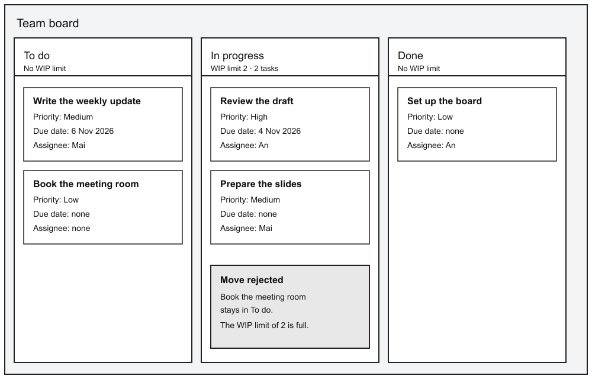

_How to read the picture:_

| What you can see                                                                                   | Which requirement it illustrates                                                                                   |
| -------------------------------------------------------------------------------------------------- | ------------------------------------------------------------------------------------------------------------------ |
| One board contains the columns To do, In progress and Done.                                        | R5. Deleting a board is not drawn.                                                                                 |
| Each task is drawn inside exactly one column.                                                      | R6. A column may also contain no tasks; in this example every column has at least one.                             |
| Every task has a title and a priority. _Book the meeting room_ has no due date and no assignee.    | R1 and R2.                                                                                                         |
| In progress already holds 2 tasks, which is its WIP limit. _Book the meeting room_ stays in To do. | R3. The limit 2 is an example of a column that has a limit. To do and Done are examples of columns that have none. |
| _Review the draft_ has one assignee. The Notification Service is not on the picture.               | R4, as described in the paragraph above. A task may also have no assignee.                                         |

Login, attachments, deleting a column, undo and real-time updates are not part of this picture. Subtasks and archiving are introduced in Part II.

### 2.2. Requirements used in Part I

| ID  | Requirement                                                                                                      |
| --- | ---------------------------------------------------------------------------------------------------------------- |
| R1  | A member creates a task in a column with a title, a priority (Low, Medium, High) and an optional due date.       |
| R2  | A member edits a task. The title is required.                                                                    |
| R3  | A member moves a task to another column. If the target column has a WIP limit and is full, the move is rejected. |
| R4  | A member assigns a task to one member. The external Notification Service informs the assignee.                   |
| R5  | A board has one or more columns. Deleting a board deletes its columns.                                           |
| R6  | Each task is in exactly one column at a time.                                                                    |

Further requirements are introduced in Part II. Classifying requirements by evidence status is practised in Workbook Exercise 1.

### 2.3. Who interacts with the system

| Actor                | Kind                                           |
| -------------------- | ---------------------------------------------- |
| Member               | A person using the board                       |
| Notification Service | An external system that delivers notifications |

## 3. Modeling principles and evidence `L1`

### 3.1. Principles

- Model only what helps answer the purpose of the diagram.
- Base the model on confirmed requirements, evidence and explicit decisions. Mark unresolved matters instead of filling gaps with assumptions.
- Choose relationships by their meaning, not by visual preference or programming habit.
- Define each classifier in one place. Other diagrams may show it without redefining it.
- Treat the Class Diagram as the baseline for Sequence Diagrams.
- Use colour only as a supplement. The meaning must remain clear without colour.
- Prefer a small, consistent model over a complete-looking but speculative one.

### 3.2. Evidence status

Every requirement and every modeled element has an evidence status.

| Status      | Meaning                                                                                               |
| ----------- | ----------------------------------------------------------------------------------------------------- |
| «Confirmed» | Traceable to an approved requirement or an explicit decision.                                         |
| «TBC»       | Mentioned or expected, but evidence or detail is incomplete.                                          |
| «Proposed»  | A design choice that has not yet been approved.                                                       |
| «Excluded»  | Explicitly outside the applicable scope. Do not infer exclusion only because confirmation is missing. |

- An unmarked element is not automatically Confirmed. Treat it as Confirmed only when its traceability to an approved requirement or explicit decision is shown. Otherwise, mark it «TBC» or «Proposed», or report an evidence-status defect.
- A «TBC» item must stay visibly open. Do not draw it as if it were decided.
- When an open item is decided, update its status and every affected diagram together.

These markings are written in guillemets for readability; they are not stereotypes (Section 14.3).

## 4. From requirements to diagrams `L1`

This is a recommended workflow, not a rule of UML.

| Step | Activity                                         | Result                                     |
| ---- | ------------------------------------------------ | ------------------------------------------ |
| 1    | State the purpose and audience of the diagram.   | Scope of the model                         |
| 2    | Trace each element to a requirement or decision. | Evidence for every element                 |
| 3    | Identify actors and their goals.                 | Use Case Diagram and scenarios (Section 5) |
| 4    | Identify concepts and responsibilities.          | Class Diagram (Sections 6–7)               |
| 5    | Derive interactions from the Class Diagram.      | Sequence Diagrams (Section 8)              |
| 6    | Check consistency and leave open items visible.  | Reviewed model (Section 17)                |

> **Direction of correction.** If an interaction needs a participant or an operation that the Class Diagram does not have, update the Class Diagram first, then the Sequence Diagram.

Section 9 follows these steps for one requirement from start to finish.

## 5. Use Case Diagram `L1`

A Use Case Diagram shows **which goals** actors reach through the system. It does not show how the system works inside.

### 5.1. Elements

| Element          | UML drawing                                                                 | Guideline                                                                                         |
| ---------------- | --------------------------------------------------------------------------- | ------------------------------------------------------------------------------------------------- |
| Actor            | Stick figure with a role name; an external system may be a box with «actor» | Name a role, not a person or a screen control.                                                    |
| Use Case         | Ellipse with a verb phrase                                                  | Name a goal that has value for the actor, such as _Create Task_, not a step such as _Click Save_. |
| Subject boundary | Rectangle with the system name                                              | Shows which system owns the Use Cases.                                                            |
| Association      | Solid line between actor and Use Case                                       | The actor takes part in the Use Case.                                                             |

### 5.2. «include», «extend» and extension points

| Relationship | UML drawing                                                          | Use when                                                                                               |
| ------------ | -------------------------------------------------------------------- | ------------------------------------------------------------------------------------------------------ |
| «include»    | Dashed arrow **from the base** Use Case **to the included** Use Case | The included behavior **always** happens and is shared or worth separating.                            |
| «extend»     | Dashed arrow **from the extension to the base** Use Case             | The extension happens **only under a condition**, at a named **extension point** in the base Use Case. |

**Figure 5.1 – «include» and «extend» in the Team Task Board**

Member uses Create Task, Edit Task and Assign Task. Create Task and Edit Task include Validate Task. Notify Assignee extends Assign Task at after assignment and communicates with Notification Service. Team Task Board Member «actor»Notification Service Create Task Edit Task Validate Task Assign Taskextension pointsafter assignment Notify Assignee «include» «include» «extend»

_Rendering note:_ this inline SVG uses the canonical Use Case notation required by the specification: actors, subject boundary, Use Case ellipses, extension-point compartment and stereotyped Dependencies.

_Figure specification:_

| Item                   | Content                                                                                                |
| ---------------------- | ------------------------------------------------------------------------------------------------------ |
| Subject                | "Team Task Board"                                                                                      |
| Actors                 | Member (left, stick figure); Notification Service (right, box with «actor»)                            |
| Use Cases              | Create Task, Edit Task, Validate Task, Assign Task, Notify Assignee                                    |
| Associations           | Member — Create Task; Member — Edit Task; Member — Assign Task; Notify Assignee — Notification Service |
| «include»              | Create Task → Validate Task; Edit Task → Validate Task                                                 |
| «extend»               | Notify Assignee → Assign Task                                                                          |
| Extension point        | Compartment in Assign Task: `after assignment`                                                         |
| Deliberately not shown | Move Task (completed in Workbook Exercise 2)                                                           |

How to read it:

- Validate Task is shared by Create Task and Edit Task and always runs, so it is an «include» (R1, R2: the title is required).
- Notify Assignee runs only when a task is assigned to another member, so it is an «extend» at the extension point _after assignment_ (R4).

### 5.3. Scenario template

The diagram shows which goals exist. A scenario describes how one goal is reached. Write one scenario per Use Case.

| Field             | Content                                                                                                |
| ----------------- | ------------------------------------------------------------------------------------------------------ |
| Use Case          | The verb-phrase name used in the diagram                                                               |
| Actors            | Primary actor and any supporting actors                                                                |
| Preconditions     | What must be true before the Use Case starts                                                           |
| Main flow         | Numbered steps of the normal path, alternating actor actions and system responses                      |
| Alternative flows | Variations and errors. Each one names the main-flow step where it starts and where it ends or rejoins. |
| Postconditions    | What is true after success, and after each alternative where it differs                                |
| Status            | «Confirmed», «TBC» or «Proposed»                                                                       |

**Example – Create Task**

| Field             | Content                                                                                                                                                                                                                                                |
| ----------------- | ------------------------------------------------------------------------------------------------------------------------------------------------------------------------------------------------------------------------------------------------------ |
| Use Case          | Create Task                                                                                                                                                                                                                                            |
| Actors            | Member                                                                                                                                                                                                                                                 |
| Preconditions     | The member has opened a board that has at least one column.                                                                                                                                                                                            |
| Main flow         | 1. The member chooses a column and enters a title, a priority and, optionally, a due date. 2. The system validates the input (included Use Case Validate Task). 3. The system creates the task in the chosen column. 4. The system shows the new task. |
| Alternative flows | 2a. The title is empty: the system shows the validation error; the member corrects the input and the flow returns to step 2.                                                                                                                           |
| Postconditions    | A new task exists in the chosen column. After 2a with no correction, no task is created.                                                                                                                                                               |
| Status            | «Confirmed» (R1)                                                                                                                                                                                                                                       |

## 6. Class Diagram `L1`

A Class Diagram shows the classifiers of a model, their features and their relationships.

### 6.1. Classifiers and compartments

A class is drawn as a rectangle with up to three compartments: **name**, **attributes**, **operations**.

- An empty or omitted compartment means the details are **not shown in this diagram**. It does not mean the classifier has no features.
- Show the compartment that serves the purpose of the diagram. Data models mainly need attributes; services mainly need operations.
- Use a stable, singular name, such as `Task`, not `Tasks` or `TaskItem` in another diagram.
- A label in guillemets above the name says what kind of classifier it is. `«interface»` and `«enumeration»` are UML keywords. `«data model»`, `«service»` and `«external»` are project stereotypes used from Section 8 on; Section 13.1 defines them.

### 6.2. Attribute and operation syntax

UML writes the **name first and the type after a colon**.

| Element                | UML notation                                 | Example from the case                                                    |
| ---------------------- | -------------------------------------------- | ------------------------------------------------------------------------ |
| Attribute              | `visibility name : Type`                     | `+ title : String`                                                       |
| Optional attribute     | `name : Type [0..1]`                         | `+ dueDate : Date [0..1]` — a task may have no due date                  |
| Multi-valued attribute | `name : Type [0..*]`                         | `+ errors : String [0..*]` in `ValidationResult`                         |
| Operation              | `visibility name(param : Type) : ReturnType` | `+ assignTask(task : Task, assignee : Member, assigner : Member) : void` |

| Visibility | Meaning   |
| ---------- | --------- |
| `+`        | Public    |
| `-`        | Private   |
| `#`        | Protected |
| `~`        | Package   |

Show visibility when it matters to the design, for example `- validate(input : TaskInput) : ValidationResult` is private because only the service calls it. Do not add marks mechanically.

### 6.3. Enumeration

An enumeration is a closed, named set of values with no behavior of its own. It is drawn as a class with the keyword `«enumeration»` and one literal per line.

In the case, `Priority` has the literals `LOW`, `MEDIUM` and `HIGH`, and `Task.priority` is typed by it.

## 7. Relationships `L1`

### 7.1. The six relationships

| Relationship                        | UML drawing                                           | Meaning                                                                                               | Example in this case                                        |
| ----------------------------------- | ----------------------------------------------------- | ----------------------------------------------------------------------------------------------------- | ----------------------------------------------------------- |
| Generalization                      | Solid line, hollow triangle at the general classifier | A more specific classifier is a kind of a more general one.                                           | Shown in Part II (Section 10)                               |
| Realization                         | Dashed line, hollow triangle at the interface         | A classifier fulfils an interface contract.                                                           | `ApiTaskRepository` realizes `ITaskRepository` (Figure 8.1) |
| Association                         | Solid line; an open arrowhead shows navigability      | Instances are structurally linked.                                                                    | Column — Task; Task → Member                                |
| Composite aggregation (Composition) | Solid line, filled diamond at the whole               | A part belongs to at most one whole at a time, and the whole is responsible for the part's lifecycle. | Board ◆— Column                                             |
| Shared aggregation                  | Solid line, hollow diamond at the whole               | A weak whole–part link with little extra meaning.                                                     | Not used in this case; prefer plain Association.            |
| Dependency                          | Dashed line, open arrowhead at the supplier           | A change to the supplier may affect the client. May be labelled with a keyword such as «use».         | `TaskService` «use» `ITaskRepository` (Figure 8.1)          |

**Figure 7.1 – Data model of the Team Task Board**

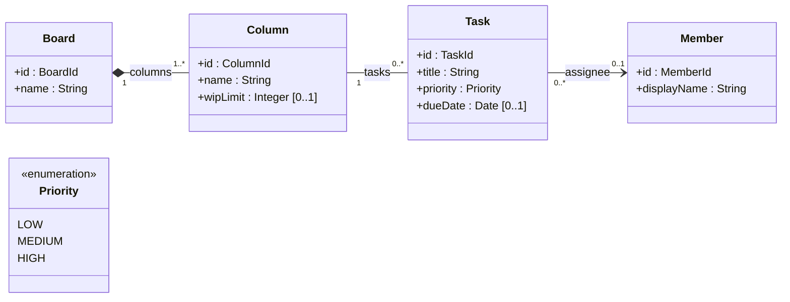

_Modeling note:_ Composition is used only for `Board`–`Column`, where R5 explicitly assigns lifecycle ownership. `Column`–`Task` remains a plain Association.

_Mermaid limitation:_ `columns`, `tasks` and `assignee` are association-end role names. Mermaid places these labels near the center of a connector; the Figure specification below defines their canonical end placement and multiplicity.

_Figure specification:_

| Item                           | Content                                                                                                                                                                                                                                                                                 |
| ------------------------------ | --------------------------------------------------------------------------------------------------------------------------------------------------------------------------------------------------------------------------------------------------------------------------------------- |
| Classes                        | `Board` (`+ id : BoardId`, `+ name : String`); `Column` (`+ id : ColumnId`, `+ name : String`, `+ wipLimit : Integer [0..1]`); `Task` (`+ id : TaskId`, `+ title : String`, `+ priority : Priority`, `+ dueDate : Date [0..1]`); `Member` (`+ id : MemberId`, `+ displayName : String`) |
| Enumeration                    | `Priority` «enumeration»: `LOW`, `MEDIUM`, `HIGH`                                                                                                                                                                                                                                       |
| Composition                    | Board `1` ◆— `1..*` Column, role `columns`                                                                                                                                                                                                                                              |
| Association                    | Column `1` — `0..*` Task, role `tasks`                                                                                                                                                                                                                                                  |
| Navigable Association          | Task `0..*` → `0..1` Member, role `assignee`                                                                                                                                                                                                                                            |
| Attribute typed by enumeration | `Task.priority : Priority` (no separate line needed)                                                                                                                                                                                                                                    |
| Note                           | On Column — Task: "«TBC»: what happens to the tasks of a deleted column is not decided." (Section 7.3)                                                                                                                                                                                  |
| Deliberately not shown         | Services, repository, input and result classes (Section 8; Workbook Exercises 3–5). `Board.isArchived` is added with R8 in Section 10.2; its absence here is not a statement that a new board has no archive state.                                                                    |

### 7.2. Multiplicity and reading in both directions

| Notation      | Meaning      |
| ------------- | ------------ |
| `1`           | Exactly one  |
| `0..1`        | Zero or one  |
| `*` or `0..*` | Zero or more |
| `1..*`        | One or more  |

Multiplicity is read **at the far end**. An Association is read twice, once from each end.

| Relationship in Figure 7.1  | From the left                                        | From the right                                                                                        |
| --------------------------- | ---------------------------------------------------- | ----------------------------------------------------------------------------------------------------- |
| Board `1` ◆— `1..*` Column  | Each board has one or more columns.                  | Each column belongs to exactly one board.                                                             |
| Column `1` — `0..*` Task    | Each column holds zero or more tasks.                | Each task is in exactly one column (R6).                                                              |
| Task `0..*` → `0..1` Member | Each task has at most one assignee and can reach it. | A member may be the assignee of any number of tasks; navigation from Member to Task is not specified. |

Generalization, Realization and Dependency are read in one direction only: from the specific, implementing or client element to the general, interface or supplier element.

Show multiplicity only when the evidence supports it. Do not invent precision.

### 7.3. Choosing a relationship

Ask the questions in order and stop at the first "yes".

| #   | Question                                                                                         | If yes                       | Otherwise         |
| --- | ------------------------------------------------------------------------------------------------ | ---------------------------- | ----------------- |
| Q1  | Is one classifier a more specific kind of the other?                                             | Generalization               | Q2                |
| Q2  | Does one classifier fulfil an interface contract of the other?                                   | Realization                  | Q3                |
| Q3  | Are instances structurally linked?                                                               | Association — refine with Q4 | Q6                |
| Q4  | Is a part owned by at most one whole, **and** is the whole responsible for the part's lifecycle? | Composition                  | Q5                |
| Q5  | Is a weak whole–part meaning intentionally useful and agreed?                                    | Shared aggregation           | Plain Association |
| Q6  | Is there only a usage or change dependency that is important to show?                            | Dependency                   | No connector      |

Applied to two pairs of the case:

| Pair           | Path                   | Result      | Why                                                                                                                                                                                                                     |
| -------------- | ---------------------- | ----------- | ----------------------------------------------------------------------------------------------------------------------------------------------------------------------------------------------------------------------- |
| Board – Column | Q3 yes → Q4 yes        | Composition | R5 states both ownership and lifecycle: deleting a board deletes its columns.                                                                                                                                           |
| Column – Task  | Q3 yes → Q4 no → Q5 no | Association | R6 states that a task is in one column, but what happens to tasks of a deleted column is not decided. Lifecycle responsibility is not established, so Composition would assert something the evidence does not support. |

The remaining pairs are practised in Workbook Exercise 4.

## 8. Sequence Diagram `L1`

A Sequence Diagram shows how participants exchange messages over time to reach one goal. It is derived from the Class Diagram.

### 8.1. Elements

| Element              | UML drawing                                       | Guideline                                                                                                                |
| -------------------- | ------------------------------------------------- | ------------------------------------------------------------------------------------------------------------------------ |
| Lifeline             | Box `name:Classifier` with a vertical dashed line | The classifier must exist in the Class Diagram or be marked «external».                                                  |
| Actor                | Stick figure                                      | The actor that starts the interaction.                                                                                   |
| Synchronous call     | Solid line, filled arrowhead                      | The caller waits. The message names an operation declared on the receiver, with the exact name.                          |
| Asynchronous message | Solid line, open arrowhead                        | The sender does not wait and no reply follows. Used for signals and asynchronous calls.                                  |
| Reply                | Dashed line; open or filled arrowhead             | Optional. Label it with the returned value or outcome, never as an operation call. This handbook uses an open arrowhead. |
| Self-message         | Arrow back to the same lifeline                   | A participant calls one of its own operations.                                                                           |

### 8.2. alt and opt

| Fragment | UML drawing                                                                          | Meaning                                                                            |
| -------- | ------------------------------------------------------------------------------------ | ---------------------------------------------------------------------------------- |
| `alt`    | Frame with operands separated by a dashed line, each with a guard in square brackets | **At most one** operand runs: the one whose guard holds, or `[else]` if none does. |
| `opt`    | Frame with one guarded operand                                                       | The operand runs only if its guard holds.                                          |

### 8.3. Classifiers used by the interactions

**Figure 8.1 – Classifiers for Create Task and Assign Task**

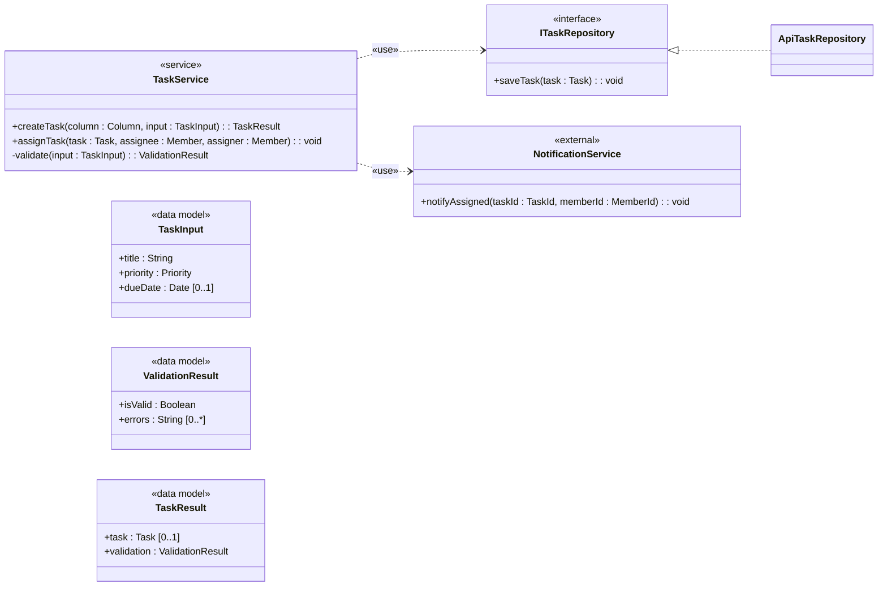

_Modeling note:_ `Column`, `Task`, `Member` and `Priority` are defined in Figure 7.1 and intentionally suppressed here. Operations not needed for the illustrated interactions are also suppressed.

_Figure specification:_

| Item                             | Content                                                                                                                                                                                                                                                                                                                         |
| -------------------------------- | ------------------------------------------------------------------------------------------------------------------------------------------------------------------------------------------------------------------------------------------------------------------------------------------------------------------------------- |
| `TaskService` «service»          | `+ createTask(column : Column, input : TaskInput) : TaskResult`; `+ assignTask(task : Task, assignee : Member, assigner : Member) : void`; `- validate(input : TaskInput) : ValidationResult`                                                                                                                                   |
| `TaskInput` «data model»         | `+ title : String`, `+ priority : Priority`, `+ dueDate : Date [0..1]`                                                                                                                                                                                                                                                          |
| `ValidationResult` «data model»  | `+ isValid : Boolean`, `+ errors : String [0..*]`                                                                                                                                                                                                                                                                               |
| `TaskResult` «data model»        | `+ task : Task [0..1]`, `+ validation : ValidationResult`                                                                                                                                                                                                                                                                       |
| `ITaskRepository` «interface»    | `+ saveTask(task : Task) : void`                                                                                                                                                                                                                                                                                                |
| `ApiTaskRepository`              | Realizes `ITaskRepository`                                                                                                                                                                                                                                                                                                      |
| `NotificationService` «external» | `+ notifyAssigned(taskId : TaskId, memberId : MemberId) : void`                                                                                                                                                                                                                                                                 |
| Relationships                    | `ApiTaskRepository` ⋯▷ `ITaskRepository`; `TaskService` ⋯> `ITaskRepository` «use»; `TaskService` ⋯> `NotificationService` «use»                                                                                                                                                                                                |
| Note                             | "Only the operations used in Figures 8.2 and 8.3 are shown. `Column`, `Task`, `Member` and `Priority` are defined in Figure 7.1 and suppressed here. Other operations of `TaskService` are also suppressed. Parameter and return types such as `TaskInput`, `TaskResult` and `ValidationResult` are not drawn as Dependencies." |

`TaskResult` lets `createTask` return one declared type for both outcomes: the new task when the input is valid, or the validation errors when it is not.

### 8.4. Example – Create Task (alt)

_Interaction abstraction and activation convention:_ Figures 8.2, 8.3 and 9.2 are service-level interactions. Their actor-to-service messages intentionally suppress the UI and coordination layers that Figure 13.2 later expands. These Level 1 figures also suppress execution specifications so learners can focus on messages, replies and combined fragments. Section 12 introduces explicit activation where object lifetime and nested coordination require it.

**Figure 8.2 – Create Task**

> **Class–Sequence consistency rule.** The scenario determines message order, guards and alternatives. The corresponding Class Diagram determines valid lifelines, receiver operations, parameter types and return values. A completion reply for a `void` operation carries no value.

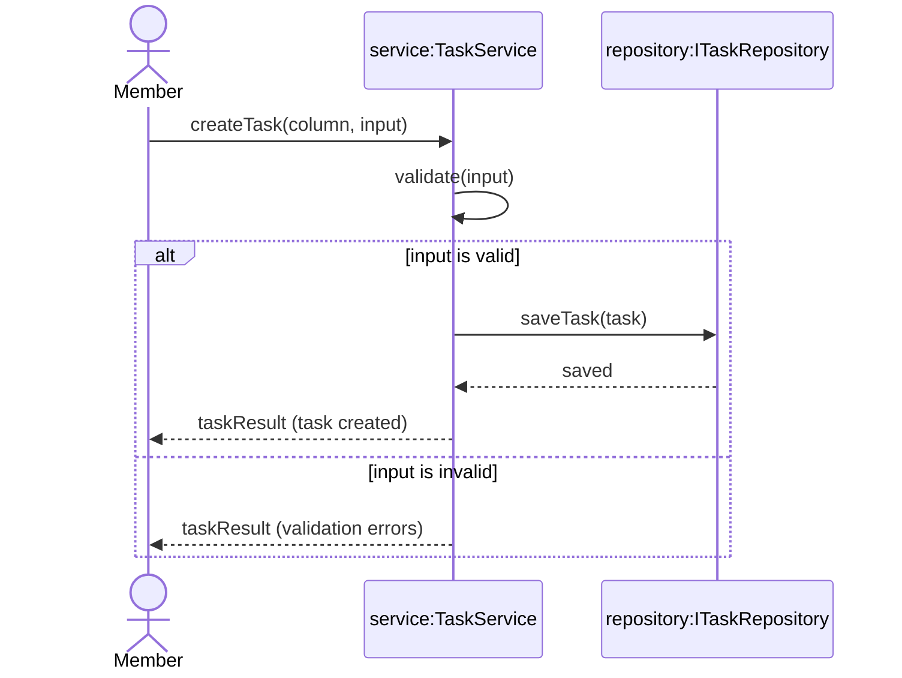

_Figure specification, in message order:_

| #   | From → To                                | Message                          | Kind             |
| --- | ---------------------------------------- | -------------------------------- | ---------------- |
| 1   | `Member` → `service:TaskService`         | `createTask(column, input)`      | Synchronous call |
| 2   | `service` → `service`                    | `validate(input)`                | Self-message     |
| —   | `alt [valid]`                            |                                  |                  |
| 3   | `service` → `repository:ITaskRepository` | `saveTask(task)`                 | Synchronous call |
| 4   | `repository` → `service`                 | `saved`                          | Reply            |
| 5   | `service` → `Member`                     | `taskResult (task created)`      | Reply            |
| —   | `[else]`                                 |                                  |                  |
| 6   | `service` → `Member`                     | `taskResult (validation errors)` | Reply            |
| —   | end `alt`                                |                                  |                  |

The included Use Case _Validate Task_ (Figure 5.1) appears as the self-message `validate`. Alternative flow 2a of the scenario (Section 5.3) appears as the `[else]` operand. When validation fails, no repository call is made.

### 8.5. Example – Assign Task (opt and asynchronous message)

**Figure 8.3 – Assign Task**

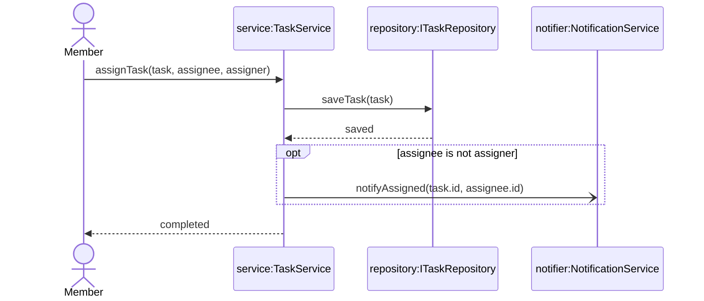

_Figure specification, in message order:_

| #   | From → To                                  | Message                                | Kind                                                                    |
| --- | ------------------------------------------ | -------------------------------------- | ----------------------------------------------------------------------- |
| 1   | `Member` → `service:TaskService`           | `assignTask(task, assignee, assigner)` | Synchronous call                                                        |
| 2   | `service` → `repository:ITaskRepository`   | `saveTask(task)`                       | Synchronous call                                                        |
| 3   | `repository` → `service`                   | `saved`                                | Reply                                                                   |
| —   | `opt [assignee is not assigner]`           |                                        |                                                                         |
| 4   | `service` → `notifier:NotificationService` | `notifyAssigned(task.id, assignee.id)` | **Asynchronous** message; no reply                                      |
| —   | end `opt`                                  |                                        |                                                                         |
| 5   | `service` → `Member`                       | `completed`                            | Completion reply; no value is returned because `assignTask(...) : void` |

The extension _Notify Assignee_ (Figure 5.1) appears as the `opt` fragment. `assigner` is the member who performs the assignment, so the guard compares the two parameters of `assignTask`. The service does not wait for the Notification Service, so the message is asynchronous and has no reply.

### 8.6. Keeping Class and Sequence Diagrams consistent

- Every lifeline has a declared classifier or is marked «external».
- Every call message names an operation declared on the receiver, with the exact name.
- Data-model lifelines do not receive operations their classifiers do not define.
- Alternative paths do not introduce hidden participants or responsibilities.
- When the Class Diagram changes, the affected Sequence Diagrams are checked in the same change.

## 9. Worked example: Move Task `L1`

This section follows the workflow of Section 4 for requirement R3.

**R3.** A member moves a task to another column. If the target column has a WIP limit and is full, the move is rejected.

### 9.1. Step 1 – Use Case and scenario

The actor is the Member and the goal is _Move Task_. The WIP check is part of the goal, not a separate shared behavior, so no «include» or «extend» is needed.

| Field             | Content                                                                                                                                                                                                       |
| ----------------- | ------------------------------------------------------------------------------------------------------------------------------------------------------------------------------------------------------------- |
| Use Case          | Move Task                                                                                                                                                                                                     |
| Actors            | Member                                                                                                                                                                                                        |
| Preconditions     | The task is in a column of the open board.                                                                                                                                                                    |
| Main flow         | 1. The member chooses a task and a target column. 2. The system checks the WIP limit of the target column. 3. The system moves the task to the target column. 4. The system shows the task in its new column. |
| Alternative flows | 2a. The target column has a WIP limit and is full: the system rejects the move and shows the reason. The Use Case ends.                                                                                       |
| Postconditions    | The task is in the target column. After 2a, the task stays in its original column.                                                                                                                            |
| Status            | «Confirmed» (R3)                                                                                                                                                                                              |

### 9.2. Step 2 – Class Diagram

Each scenario step needs a responsible classifier and operation. The data model already has `Column.wipLimit` and the Column — Task Association (Figure 7.1). The interaction needs one new operation and one result type.

**Figure 9.1 – Classifiers for Move Task**

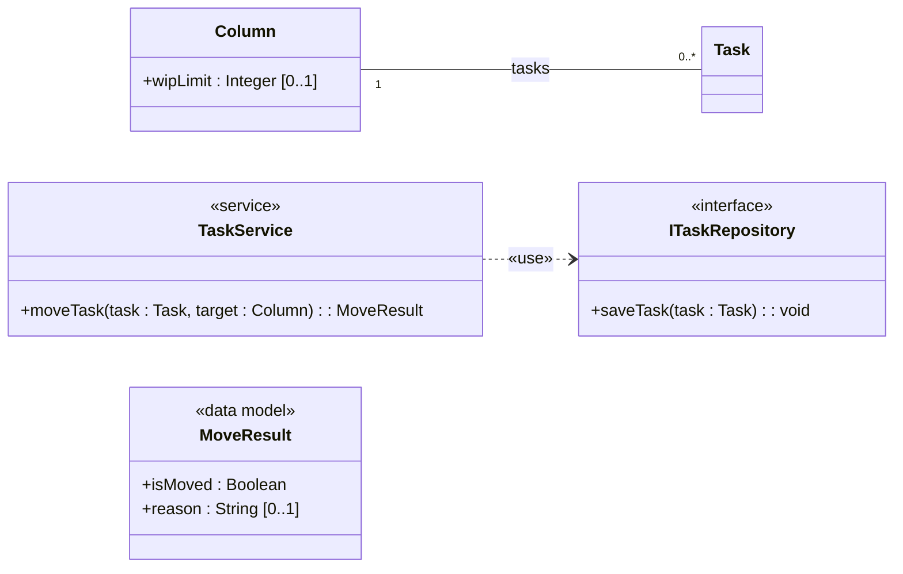

_Modeling note:_ Operations not required for this Move Task view are intentionally suppressed.

_Figure specification:_

| Item                          | Content                                                                                                                                                 |
| ----------------------------- | ------------------------------------------------------------------------------------------------------------------------------------------------------- |
| `TaskService` «service»       | `+ moveTask(task : Task, target : Column) : MoveResult`                                                                                                 |
| `MoveResult` «data model»     | `+ isMoved : Boolean`, `+ reason : String [0..1]`                                                                                                       |
| `ITaskRepository` «interface» | `+ saveTask(task : Task) : void`                                                                                                                        |
| `Column`, `Task`              | As in Figure 7.1 (attributes suppressed except `Column.wipLimit`)                                                                                       |
| Relationships                 | `TaskService` ⋯> `ITaskRepository` «use»; Column `1` — `0..*` Task                                                                                      |
| Note                          | "Other operations of `TaskService` are suppressed. Parameter and return types such as `Task`, `Column` and `MoveResult` are not drawn as Dependencies." |

### 9.3. Step 3 – Sequence Diagram

**Figure 9.2 – Move Task**

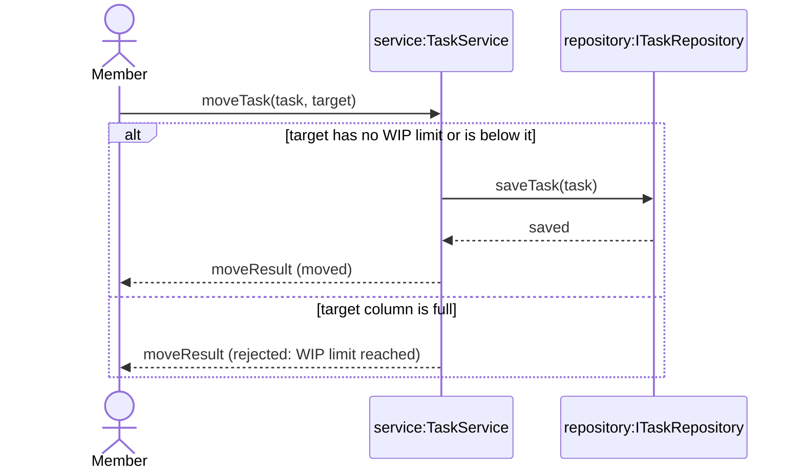

_Figure specification, in message order:_

| #   | From → To                                      | Message                                    | Kind             |
| --- | ---------------------------------------------- | ------------------------------------------ | ---------------- |
| 1   | `Member` → `service:TaskService`               | `moveTask(task, target)`                   | Synchronous call |
| —   | `alt [target has no WIP limit or is below it]` |                                            |                  |
| 2   | `service` → `repository:ITaskRepository`       | `saveTask(task)`                           | Synchronous call |
| 3   | `repository` → `service`                       | `saved`                                    | Reply            |
| 4   | `service` → `Member`                           | `moveResult (moved)`                       | Reply            |
| —   | `[else]`                                       |                                            |                  |
| 5   | `service` → `Member`                           | `moveResult (rejected: WIP limit reached)` | Reply            |
| —   | end `alt`                                      |                                            |                  |

### 9.4. Traceability

| R3 statement                            | Use Case                         | Class                                     | Sequence                             |
| --------------------------------------- | -------------------------------- | ----------------------------------------- | ------------------------------------ |
| A member moves a task to another column | Actor Member; Use Case Move Task | `TaskService.moveTask`; Column — Task     | `moveTask(task, target)`             |
| The target column may have a WIP limit  | Main flow step 2                 | `Column.wipLimit : Integer [0..1]`        | `alt` guard                          |
| A full column rejects the move          | Alternative flow 2a              | `MoveResult.isMoved`, `MoveResult.reason` | `[else]` operand; no repository call |

### 9.5. What to check

- Every message maps to an operation in Figure 9.1.
- The rejected path makes no repository call, so nothing changes (postcondition of 2a).
- `MoveResult` is one return type for both outcomes, so the reply in each operand matches the declared operation.

---

# PART II — LEVEL 2: EXTENDED

### Learning objectives

After Part II and Workbook Exercises 7–10, you can:

| #    | Objective                                                                                                                               | Taught in            | Practised in   |
| ---- | --------------------------------------------------------------------------------------------------------------------------------------- | -------------------- | -------------- |
| L2-1 | Recognise and use abstract classifiers, Generalization Sets, association classes and reflexive associations where their meaning applies | Section 10           | Ex7, Ex8       |
| L2-2 | Use actor Generalization only where it removes repetition                                                                               | Section 11           | Ex10           |
| L2-3 | Show activation, creation and destruction, and use `loop`, `par`, `break` and `ref`                                                     | Section 12           | Ex7, Ex9, Ex10 |
| L2-4 | Find and correct semantic, consistency and notation defects in existing diagrams                                                        | Sections 7.3, 12, 16 | Ex7            |
| L2-5 | Map the model to TypeScript and allocate responsibilities to Vue components, composables, stores, services and repositories             | Section 13           | Ex8, Ex9       |
| L2-6 | Model a complete feature end to end and keep «TBC» decisions open with «Proposed» options                                               | All sections         | Ex10           |

Part II adds one idea at a time to the model built in Part I. The Level 1 classifiers keep their names, features and relationships.

### Requirements added in Part II

Requirement IDs follow the full case list; IDs not shown here are used in the Workbook or in Section 15.

| ID  | Requirement                                                                                                                     |
| --- | ------------------------------------------------------------------------------------------------------------------------------- |
| R7  | A member joins a board with a role (Owner, Editor, Viewer) and a join date.                                                     |
| R8  | A board owner can do everything a member can, and can also archive the board. A new board is not archived.                      |
| R9  | A task may have subtasks; each subtask has exactly one parent task. When a task is moved, its subtasks move to the same column. |
| R13 | Keep all tasks of all boards in one global store. («Proposed», see Section 13.3)                                                |
| R15 | Whether subtasks count against the WIP limit of the target column. («TBC», see Section 12.3)                                    |

## 10. More class notation `L2`

### 10.1. Abstract classifiers and Generalization Sets

A classifier is **abstract** when it is not instantiated directly and exists to be specialized. An operation is abstract when each concrete specialization must provide it. UML shows an abstract name in _italics_ or with `{abstract}`.

A **Generalization Set** groups the specializations of one general classifier. Two constraints make it a closed set:

| Constraint   | Meaning                                                                                        |
| ------------ | ---------------------------------------------------------------------------------------------- |
| `{complete}` | Every instance of the general classifier is an instance of at least one listed specialization. |
| `{disjoint}` | No instance belongs to more than one specialization.                                           |

_Illustrative extension: the requirements do not mention bugs or estimates. For this section only, assume that every work item on a board is either a task or a bug, never both and never something else, and that each kind estimates its effort differently._

**Figure 10.1 – WorkItem, Task and Bug**

Abstract WorkItem is specialized by concrete Task and Bug in a complete and disjoint Generalization Set. WorkItem+ id : TaskId+ title : String+ estimate() : Integer{abstract} Task+ priority : Priority+ dueDate : Date [0..1]+ estimate() : Integer Bug+ severity : Priority+ estimate() : Integer {complete, disjoint}

_Rendering note:_ the shared triangle and `{complete, disjoint}` constraint represent one UML Generalization Set. Italics and `{abstract}` identify the abstract classifier and operation.

_Figure specification:_

| Item                                   | Content                                                                              |
| -------------------------------------- | ------------------------------------------------------------------------------------ |
| `WorkItem` (abstract, name in italics) | `+ id : TaskId`, `+ title : String`, `+ estimate() : Integer {abstract}`             |
| `Task`                                 | `+ priority : Priority`, `+ dueDate : Date [0..1]`, `+ estimate() : Integer`         |
| `Bug`                                  | `+ severity : Priority`, `+ estimate() : Integer`                                    |
| Generalization                         | `Task` → `WorkItem`; `Bug` → `WorkItem`, both arrows joined into one hollow triangle |
| Generalization Set                     | Label `{complete, disjoint}` on the shared arrow                                     |

Reading the figure:

- `id` and `title` are now declared once on `WorkItem` and inherited by `Task` and `Bug`. `Task` still has every Level 1 feature.
- `Task` and `Bug` each declare `estimate()` without italics, so each provides the behavior and is concrete.

### 10.2. More feature notation

| Notation          | UML drawing           | Example from the case                                                                                                                                                                                                 |
| ----------------- | --------------------- | --------------------------------------------------------------------------------------------------------------------------------------------------------------------------------------------------------------------- |
| Derived attribute | `/name : Type`        | `+ /taskCount : Integer` on `Column` is a notation example: a derived count of the tasks in the column, not stored. It is not an attribute of `Column` in Figure 7.1. The WIP check in R3 is the guard on `moveTask`. |
| Default value     | `name : Type = value` | `+ isArchived : Boolean = false` on `Board`. A new board is not archived (R8). `+ priority : Priority = MEDIUM` is not used: R1 does not define a default. |
| Static feature    | Name underlined       | Belongs to the classifier, not to each instance. Not needed in this case.                                                                                                                                             |

Show these markers only when they carry design meaning.

`Board.isArchived` is the default drawn for this case:

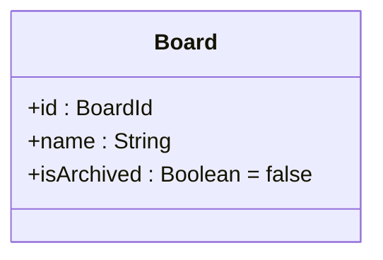

The attribute always holds one Boolean. R8 gives it the initial value `false`: a new board is not archived. The case adds no Create Board operation; the default is that initial value. On the success path of `archiveBoard`, the attribute becomes `true` and that board is saved. A rejected archive leaves it unchanged. This is not `[0..1]`: `[0..1]` means the value may be absent, as with `wipLimit` and `dueDate`.

Figure 7.1 does not show `isArchived`. Exercise 8 maps `Board` from that figure. The Capstone class diagram includes this default. `Task.priority` has no default.

### 10.3. Association class

An **association class** is an Association that is also a class. Use it when the **link itself** has attributes.

R7 states that a member joins a board **with a role and a join date**. The role belongs neither to the member (a member may be Owner of one board and Viewer of another) nor to the board. It belongs to the link between them.

**Figure 10.2 – Membership**

Member and Board have a many-to-many Association qualified by Association Class Membership. Member Board 0.._0.._ Membership+ role : BoardRole+ joinedAt : Date «enumeration»BoardRole OWNEREDITORVIEWER

_Rendering note:_ `Membership` is attached by a dashed line to the middle of the `Member`–`Board` Association. It is therefore an Association Class, not an intermediate domain class replacing the Association. `BoardRole` is a separate Enumeration classifier; `Membership.role : BoardRole` provides the type usage.

_Figure specification:_

| Item              | Content                                                                                                                 |
| ----------------- | ----------------------------------------------------------------------------------------------------------------------- |
| Association       | `Member` `0..*` — `0..*` `Board`                                                                                        |
| Association class | `Membership` (`+ role : BoardRole`, `+ joinedAt : Date`), joined by a dashed line to the middle of the Association line |
| Enumeration       | `BoardRole` «enumeration»: `OWNER`, `EDITOR`, `VIEWER`                                                                  |

The multiplicity `0..*` at both ends reflects R7: a member may join several boards, and a board may have several members. R7 does not say whether a board must have at least one owner, so no lower bound above `0` is shown.

### 10.4. Reflexive association

A **reflexive association** connects a classifier to itself. Role names at both ends are essential, because both ends have the same type.

**Figure 10.3 – Subtasks**

A Task has zero or one parent and zero or more subtasks. Task parent0..1 subtasks0..

_Rendering note:_ role names and multiplicities are placed at their respective Association ends. The relationship is a plain reflexive Association, not Composition.

_Figure specification:_

| Item        | Content                                                                  |
| ----------- | ------------------------------------------------------------------------ |
| Association | `Task` — `Task`                                                          |
| Ends        | Role `parent`, multiplicity `0..1`; role `subtasks`, multiplicity `0..*` |

Read it as: each task has at most one parent; a task may have any number of subtasks (R9). It is a plain Association, not Composition: R9 does not say what happens to subtasks when the parent is deleted.

### 10.5. Interface in ball (lollipop) notation

A provided interface may be drawn as a small circle on a line attached to the class that realizes it. It means the same as a Realization arrow.

**Figure 10.4 – ITaskRepository as a provided interface**

ApiTaskRepository provides interface ITaskRepository using UML lollipop notation. ApiTaskRepository ITaskRepository

_Rendering note:_ the circle is UML provided-interface (lollipop) notation. It has the same contract meaning as the Interface Realization shown in Figure 8.1, while intentionally suppressing interface operations.

_Figure specification:_ `ApiTaskRepository` with a line ending in a small circle labelled `ITaskRepository`. Same meaning as `ApiTaskRepository` ⋯▷ `ITaskRepository` in Figure 8.1.

Use the lollipop form when the interface's operations are already shown elsewhere and only the fact of realization matters.

## 11. More Use Case notation `L2`

### 11.1. Generalization between actors

An actor may specialize another actor. The specialized actor takes part in **every** Use Case of the general actor, and may have Use Cases of its own. It is drawn as a solid line with a hollow triangle at the general actor.

R8 states that a board owner can do everything a member can, and can also archive the board. A new board is not archived (`Board.isArchived : Boolean = false`, Section 10.2).

**Figure 11.1 – Board Owner**

Board Owner specializes Member. Member uses Create Task; Board Owner uses Archive Board. Team Task Board Member Board Owner Create Task Archive Board generalization

_Rendering note:_ the hollow triangle points to the general actor `Member`; therefore `Board Owner` inherits Member's Use Case associations.

_Figure specification:_

| Item           | Content                                                                           |
| -------------- | --------------------------------------------------------------------------------- |
| Subject        | "Team Task Board"                                                                 |
| Actors         | Member; Board Owner                                                               |
| Generalization | Board Owner → Member                                                              |
| Use Cases      | Create Task (associated with Member); Archive Board (associated with Board Owner) |
| Note           | "Other Member Use Cases are suppressed."                                          |

Board Owner is not connected to Create Task directly; the Generalization already gives Board Owner every Use Case of Member. Drawing the line again would be redundant.

Use actor Generalization only when it removes repetition. If the difference between two roles is unclear, keep separate actors.

### 11.2. Generalization between Use Cases

A Use Case may also specialize another. This is rarely needed; prefer «include», «extend» or scenario alternatives. The Team Task Board does not use it.

## 12. More sequence notation `L2`

### 12.1. Notation

| Element                              | UML drawing                                                                                   | Meaning                                                                                                                                          |
| ------------------------------------ | --------------------------------------------------------------------------------------------- | ------------------------------------------------------------------------------------------------------------------------------------------------ |
| Activation (execution specification) | Thin rectangle on a lifeline                                                                  | The participant is executing behavior, from receiving a call until it completes. Show it when it clarifies who is busy and when control returns. |
| Creation message                     | Dashed line, open arrowhead, ending at the head of a new lifeline drawn lower than the others | A new instance starts here. Label it with the creating operation.                                                                                |
| Destruction                          | X at the bottom of a lifeline                                                                 | The instance ends; the lifeline does not continue.                                                                                               |
| `loop`                               | Frame with a guard or bounds, for example `loop [for each subtask]`                           | The operand repeats while the guard holds.                                                                                                       |
| `par`                                | Frame with operands separated by dashed lines                                                 | Operands may run concurrently. Order is guaranteed only within each operand.                                                                     |
| `break`                              | Frame with one guarded operand                                                                | If the guard holds, the operand runs and the rest of the enclosing fragment is skipped.                                                          |
| `ref` (interaction use)              | Frame labelled `ref` with the name of another diagram                                         | A shared interaction drawn once and referenced. Figure 13.2 shows an example.                                                                    |
| Found / lost message                 | Message starting from, or ending at, a filled circle                                          | Sender unknown or receiver never reached. When the sender can be identified, prefer an «external» lifeline.                                      |

Asynchronous messages were introduced in Section 8 (Figure 8.3).

### 12.2. Creation, destruction and activation: Create Task with draft

When the member opens the form to create a task, the application keeps the unsaved input in a `TaskDraft`. The draft is created when the form opens and destroyed when the task is saved.

The coordinating participant here is `useTaskBoard`, a «composable» (Section 13). For this section, read it as the classifier that coordinates the form.

**Figure 12.1 – Classifiers for Create Task with draft**

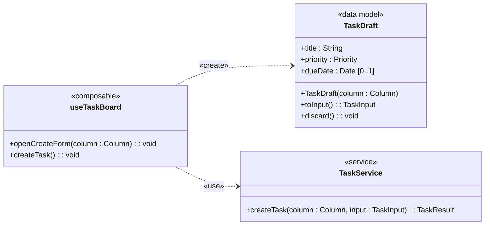

_Figure specification:_

| Item                        | Content                                                                                                                                                 |
| --------------------------- | ------------------------------------------------------------------------------------------------------------------------------------------------------- |
| `useTaskBoard` «composable» | `+ openCreateForm(column : Column) : void`; `+ createTask() : void` — submits the open draft                                                            |
| `TaskDraft` «data model»    | `+ title : String`, `+ priority : Priority`, `+ dueDate : Date [0..1]`; `+ TaskDraft(column : Column)`; `+ toInput() : TaskInput`; `+ discard() : void` |
| `TaskService` «service»     | `+ createTask(column : Column, input : TaskInput) : TaskResult` (as in Figure 8.1)                                                                      |
| Relationships               | `useTaskBoard` ⋯> `TaskDraft` «create»; `useTaskBoard` ⋯> `TaskService` «use»                                                                           |

**Figure 12.2 – Create Task with draft**

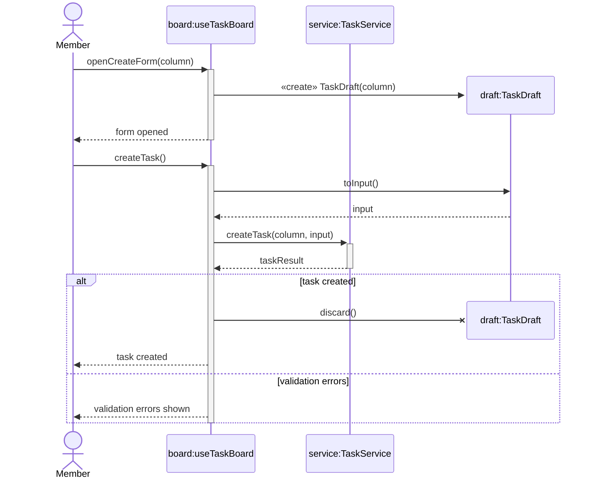

_Interaction note:_ The member edits `draft:TaskDraft` through the form between `openCreateForm(column)` and `createTask()`. This UI editing activity is explanatory context, not an additional message.

_Modeling note:_ constructor creation is synchronous and each synchronous request has a balanced activation. `discard()` is shown as a destruction message: it invokes the declared operation and the X terminates the `draft:TaskDraft` lifeline. The draft remains alive in the validation-error branch.

_Figure specification, in message order:_

| #   | From → To                       | Message                         | Kind                                                               |
| --- | ------------------------------- | ------------------------------- | ------------------------------------------------------------------ |
| 1   | `Member` → `board:useTaskBoard` | `openCreateForm(column)`        | Synchronous call                                                   |
| 2   | `board` → `draft:TaskDraft`     | `«create» TaskDraft(column)`    | **Synchronous creation** message; the `draft` lifeline starts here |
| —   | Note on `Member`                | "The member fills in the form." |                                                                    |
| 3   | `Member` → `board`              | `createTask()`                  | Synchronous call; `board` activation starts                        |
| 4   | `board` → `draft`               | `toInput()`                     | Synchronous call                                                   |
| 5   | `draft` → `board`               | `input`                         | Reply                                                              |
| 6   | `board` → `service:TaskService` | `createTask(column, input)`     | Synchronous call; `service` activation starts                      |
| 7   | `service` → `board`             | `taskResult`                    | Reply; `service` activation ends                                   |
| —   | `alt [task created]`            |                                 |                                                                    |
| 8   | `board` → `draft`               | `discard()`                     | **Destruction message**; X marks the end of the `draft` lifeline   |
| 9   | `board` → `Member`              | `task created`                  | Reply                                                              |
| —   | `[else]`                        |                                 |                                                                    |
| 10  | `board` → `Member`              | `validation errors shown`       | Reply; the draft is kept so the member can correct it              |
| —   | end `alt`                       |                                 | `board` activation ends                                            |

The service's own behavior (validation and saving) is the one shown in Figure 8.2 and is not repeated. If the member closes the form without saving, the draft is also discarded; that path is not drawn.

### 12.3. loop: Move Task with subtasks

When a task is moved, its subtasks are moved to the same column. Each subtask is saved in turn.

**Figure 12.3 – Move Task with subtasks**

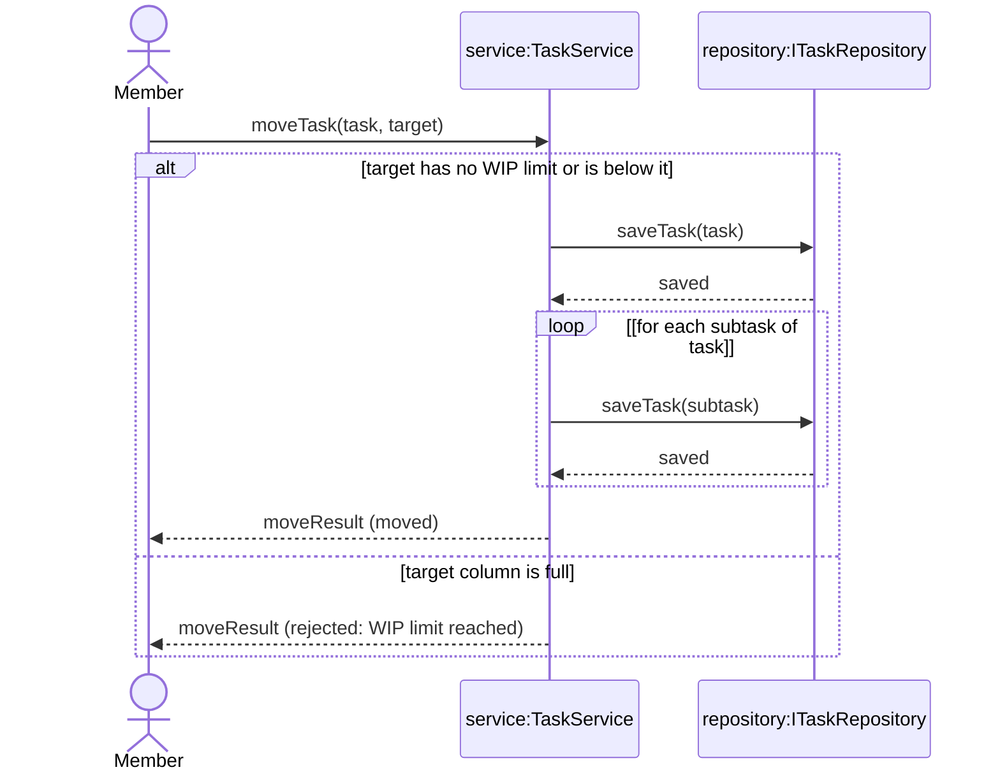

_Open modeling point:_ R15 remains TBC: whether subtasks count against the target column WIP limit. This unresolved rule is documented outside the interaction because it does not change the messages currently shown.

_Activation convention:_ Figure 12.3 suppresses execution specifications to keep the nested `alt` and `loop` readable; synchronous calls and replies retain the execution order defined in the Figure specification.

_Figure specification, in message order:_

| #   | From → To                                      | Message                                                       | Kind             |
| --- | ---------------------------------------------- | ------------------------------------------------------------- | ---------------- |
| 1   | `Member` → `service:TaskService`               | `moveTask(task, target)`                                      | Synchronous call |
| —   | `alt [target has no WIP limit or is below it]` |                                                               |                  |
| 2   | `service` → `repository:ITaskRepository`       | `saveTask(task)`                                              | Synchronous call |
| 3   | `repository` → `service`                       | `saved`                                                       | Reply            |
| —   | `loop [for each subtask of task]`              |                                                               |                  |
| 4   | `service` → `repository`                       | `saveTask(subtask)`                                           | Synchronous call |
| 5   | `repository` → `service`                       | `saved`                                                       | Reply            |
| —   | end `loop`                                     |                                                               |                  |
| 6   | `service` → `Member`                           | `moveResult (moved)`                                          | Reply            |
| —   | `[else]`                                       |                                                               |                  |
| 7   | `service` → `Member`                           | `moveResult (rejected: WIP limit reached)`                    | Reply            |
| —   | end `alt`                                      |                                                               |                  |
| —   | Open modeling point                            | R15 remains `«TBC»`; this example checks the moved task only. |                  |

The `loop` sits inside the valid operand, so subtasks are never saved when the move is rejected. The open question about the WIP limit stays visible as «TBC» instead of being decided by the diagram. The loop follows the `subtasks` end in Figure 10.3: each direct subtask of the moved task.

## 13. Vue 3 and TypeScript profile `L2`

> **Status.** This section is a **project profile**. It preserves UML semantics but is not a general rule of UML 2.5.1.

### 13.1. Project stereotypes

| Concern                       | UML representation                        | Vue 3 / TypeScript mapping                                               | In this case                           |
| ----------------------------- | ----------------------------------------- | ------------------------------------------------------------------------ | -------------------------------------- |
| Data model                    | Classifier with «data model»              | TypeScript interface; mainly attributes                                  | `Board`, `Task`, `Column`, `TaskDraft` |
| Closed variant set            | Generalization Set `{complete, disjoint}` | Discriminated union with exhaustive handling                             | `WorkItem` → `Task`, `Bug`             |
| Behavior contract             | UML Interface                             | TypeScript interface realized by an implementation                       | `ITaskRepository`                      |
| Infrastructure implementation | Class + Realization                       | Class for a repository, adapter or connector                             | `ApiTaskRepository`                    |
| Application operations        | Classifier with «service»                 | Framework-independent functions or service operations                    | `TaskService`                          |
| Reactive coordination         | Classifier with «composable»              | Vue-aware coordination for a screen or use-case concern                  | `useTaskBoard`                         |
| Shared application state      | Classifier with «store»                   | Pinia state, derived state and actions                                   | `BoardStore`                           |
| UI contract                   | Class with «component»                    | Props and emitted events; slots or exposed operations only when material | `TaskBoardView`                        |
| External participant          | Classifier with «external»                | Not implemented in this codebase                                         | `NotificationService`                  |

- `«component»` here is a project stereotype on a class that represents a Vue component. It is not the UML Component classifier.
- Vue reactivity wrappers such as `ref`, `reactive` and `computed` are implementation mechanisms. Do not show them in data models; show reactive state as attributes of composables and stores only when it matters.
- A Pinia store is not automatically a persistence boundary. Persistence stays behind `ITaskRepository`.

### 13.2. Example: Move Task in the Vue layers

**Figure 13.1 – Vue classifiers for Move Task**

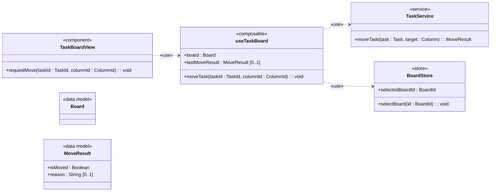

_Figure specification:_

| Item                        | Content                                                                                                                                                                        |
| --------------------------- | ------------------------------------------------------------------------------------------------------------------------------------------------------------------------------ |
| `TaskBoardView` «component» | `+ requestMove(taskId : TaskId, columnId : ColumnId) : void`                                                                                                                   |
| `useTaskBoard` «composable» | `+ board : Board`; `+ lastMoveResult : MoveResult [0..1]`; `+ moveTask(taskId : TaskId, columnId : ColumnId) : void`                                                           |
| `BoardStore` «store»        | `+ selectedBoardId : BoardId`; `+ selectBoard(id : BoardId) : void`                                                                                                            |
| `TaskService` «service»     | `+ moveTask(task : Task, target : Column) : MoveResult` (as in Figure 9.1)                                                                                                     |
| `Board` «data model»        | `id` and `name` are as in Figure 7.1. `isArchived : Boolean = false` is defined in Section 10.2. All of these attributes are suppressed in this Move Task view. `useTaskBoard.board` holds the loaded board. |
| `MoveResult` «data model»   | `+ isMoved : Boolean`, `+ reason : String [0..1]` (as in Figure 9.1)                                                                                                           |
| Typed properties            | `useTaskBoard.board : Board`; `useTaskBoard.lastMoveResult : MoveResult [0..1]`                                                                                                |
| Dependencies                | `TaskBoardView` ⋯> `useTaskBoard` «use»; `useTaskBoard` ⋯> `TaskService` «use»; `useTaskBoard` ⋯> `BoardStore` «use»                                                           |
| Note                        | "`Task`, `Column`, `TaskId`, `ColumnId` and `BoardId` are defined in earlier figures and suppressed here. Loading the board into `useTaskBoard.board` is outside this figure." |

**Figure 13.2 – Move Task in the Vue layers**

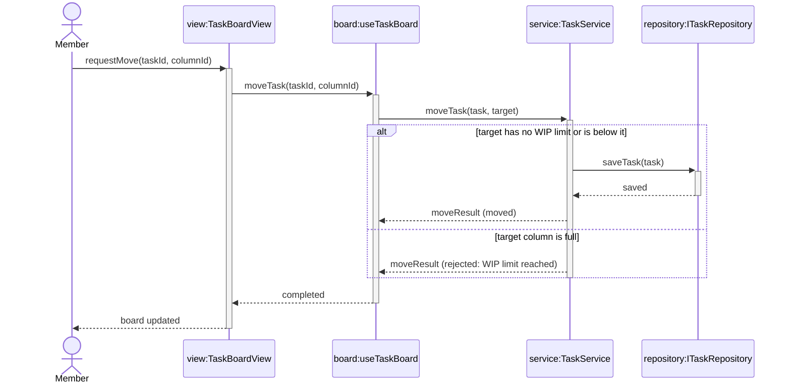

_Interaction note:_ After `moveResult` returns, `board:useTaskBoard.lastMoveResult` is updated and Vue re-renders through reactivity. This is state/rendering context rather than a separate UML message.

_Mermaid limitation:_ Mermaid has no native UML Interaction Use frame. The shaded region spans the same `service` and `repository` lifelines as the canonical `ref` frame required by the specification; reproduce it as a standard `ref` frame in Enterprise Architect.

_Figure specification, in message order:_

| #   | From → To                                             | Message                                                                | Kind                                                                               |
| --- | ----------------------------------------------------- | ---------------------------------------------------------------------- | ---------------------------------------------------------------------------------- |
| 1   | `Member` → `view:TaskBoardView`                       | `requestMove(taskId, columnId)`                                        | Synchronous call                                                                   |
| 2   | `view` → `board:useTaskBoard`                         | `moveTask(taskId, columnId)`                                           | Synchronous call                                                                   |
| 3   | `board` → `service:TaskService`                       | `moveTask(task, target)`                                               | Synchronous call                                                                   |
| —   | `ref` over `service` and `repository:ITaskRepository` | "Move Task (Figure 9.2)"                                               | Interaction use                                                                    |
| 4   | `service` → `board`                                   | `moveResult`                                                           | Reply matching `TaskService.moveTask(...) : MoveResult`                            |
| —   | Note on `board`                                       | "`lastMoveResult` is updated; the view re-renders through reactivity." |                                                                                    |
| 5   | `board` → `view`                                      | `completed`                                                            | Completion reply; no value is returned because `useTaskBoard.moveTask(...) : void` |
| 6   | `view` → `Member`                                     | `board updated`                                                        | Completion reply; the visible update is produced through Vue reactivity            |

How the layers divide the work:

| Layer           | Responsibility in Move Task                                                                          |
| --------------- | ---------------------------------------------------------------------------------------------------- |
| `TaskBoardView` | Receives the member's intent; displays the result                                                    |
| `useTaskBoard`  | Turns ids into the `Task` and `Column` of the loaded board; keeps `lastMoveResult` as reactive state |
| `TaskService`   | Applies R3: WIP check and saving (Figure 9.2)                                                        |
| `BoardStore`    | Holds which board is selected, shared by several components                                          |

`useTaskBoard` never calls the repository directly, and `TaskBoardView` never calls `TaskService` directly.

### 13.3. A «Proposed» design choice: R13

R13 proposes keeping all tasks of all boards in one global store. It is marked «Proposed», not adopted. Figure 13.1 therefore keeps only `selectedBoardId` in `BoardStore`, and the tasks of the open board in `useTaskBoard.board`.

If R13 is approved later, `BoardStore` changes and Figures 13.1–13.2 are updated together (Section 3.2).

### 13.4. Choosing a TypeScript construct

| Construct               | Use when…                                                                     |
| ----------------------- | ----------------------------------------------------------------------------- |
| `interface`             | Representing a data model or an extensible object structure                   |
| Discriminated union     | Representing a closed set that needs exhaustive handling                      |
| Behavior `interface`    | Defining a contract that a class genuinely realizes                           |
| `class`                 | Behavior and lifetime are intentionally combined, typically in infrastructure |
| `function`              | Implementing stateless or framework-independent operations                    |
| Literal union or `enum` | Representing a named closed set of values                                     |

Example for the Move Task classifiers:

```typescript
interface Column {
  id: ColumnId;
  name: string;
  wipLimit?: number;
}

interface MoveResult {
  isMoved: boolean;
  reason?: string;
}

function moveTask(task: Task, target: Column): MoveResult;
```

The UML attribute `wipLimit : Integer [0..1]` maps to an optional property; `reason : String [0..1]` likewise. A default is different: `isArchived : Boolean = false` maps to a required `isArchived: boolean` whose initial value is `false`, not to `isArchived?: boolean`. Exercise 8 still maps `Board` from Figure 7.1, so that exercise's `Board` type does not include `isArchived` yet.

## 14. Naming, organization and collaboration `L2`

### 14.1. Naming

| Element           | Pattern                              | Example from the case          |
| ----------------- | ------------------------------------ | ------------------------------ |
| Classifier        | PascalCase, singular                 | `Task`, `Column`, `Membership` |
| Behavior contract | Project convention                   | `ITaskRepository`              |
| Service           | PascalCase + Service                 | `TaskService`                  |
| Composable        | use + PascalCase                     | `useTaskBoard`                 |
| Store             | PascalCase + Store                   | `BoardStore`                   |
| Component         | PascalCase                           | `TaskBoardView`                |
| Operation         | camelCase, verb first                | `moveTask`, `assignTask`       |
| Boolean property  | is / has / can prefix                | `isMoved`, `isValid`           |
| Event or signal   | Past tense or meaningful noun phrase | `taskMoved`, `taskAssigned`    |

### 14.2. Organization

- Define each classifier once. Other diagrams show it without redefining it, and may suppress features it does not need.
- Name each diagram by subject and type, for example "Move Task – Sequence".
- Keep a legend near the diagram when stereotypes or status markings are used.
- Mark or archive superseded exports so nobody reviews the wrong version.

### 14.3. Status markings and tagged values

Status markings (Section 3.2) are not stereotypes. Place them in a note or in a **tagged value**: a named property attached to a model element, written `{name = value}`.

Example: the «TBC» note on the Column — Task Association in Figure 7.1 can also be recorded as the tagged value `{status = TBC}`. The open question is why the Association is not Composition (Section 7.3); Section 15.1 lists it as R11.

**Project profile:** in Enterprise Architect, project stereotypes and tagged values are defined once in the project's UML profile.

### 14.4. Collaboration

- Reuse the authoritative classifier instead of redefining it in another area.
- Do not freeze a shared element while decisions that change its structure remain open.
- When an open item is decided, update its status and every affected diagram in the same change.

---

# PART III — LEVEL 3: NEXT STEPS

### Learning objectives

Part III is orientation, not assessed content. After reading it, you can:

| #    | Objective                                                                                          | Section   |
| ---- | -------------------------------------------------------------------------------------------------- | --------- |
| L3-1 | Explain how deciding an open requirement would change the existing diagrams                        | 15.1      |
| L3-2 | Name the next diagram types or practices to learn, and what each adds to the Team Task Board model | 15.2–15.5 |

## 15. Beyond this course `L3`

This course covers Use Case, Class and Sequence Diagrams. The topics below are the natural next steps. Each one starts from the Team Task Board, so you do not need a new domain. This section points the way; it does not teach the notation.

### 15.1. Resolving open decisions

Three requirements are still «TBC»:

| ID  | Open question                                                  | What a decision would change                                                                                                                                                          |
| --- | -------------------------------------------------------------- | ------------------------------------------------------------------------------------------------------------------------------------------------------------------------------------- |
| R11 | What happens to the tasks of a deleted column                  | If the column is responsible for deleting its tasks, Column–Task may become Composition (Section 7.3). If tasks move elsewhere, it stays Association and a new interaction is needed. |
| R12 | Two members move the same task at the same time; undo and redo | Concurrency and history rules; possibly new classifiers for commands or versions.                                                                                                     |
| R15 | Whether subtasks count against the WIP limit                   | The guard of the `alt` in Figure 12.3, including how that guard counts tasks in the target column.                                                                                    |

Practising this means: write the options, mark each as «Proposed», name the evidence needed to confirm one, and list the diagrams that would change. The Capstone (Workbook Exercise 10) asks for this.

### 15.2. State Machine Diagram

A State Machine Diagram shows the states of one object and the events that move it between them. A board has a simple lifecycle: _Active_ → _Archived_ (R8). _Active_ is `isArchived = false`, the default of a new board. _Archived_ is `isArchived = true`, set by a successful `archiveBoard`. A natural question follows: which operations are still allowed on an archived board?

### 15.3. Activity Diagram

An Activity Diagram shows a flow of actions with decisions and parallel branches. Move Task with its WIP check and subtasks is a good candidate when business readers need the flow without the participants.

### 15.4. Package and Component structure

Packages group model elements; Components show deployable parts and their interfaces. The case could be split into _board_, _task_ and _notification_ areas, with `ITaskRepository` and the Notification Service as interfaces between them.

### 15.5. Team modeling in Enterprise Architect

**Project profile.** Working on one shared EA repository introduces practices beyond this handbook: package ownership, baselines before reviews, and comparing a model with its baseline.

### 15.6. Where to read more

Section 18 lists the normative specification and free references for each topic.

---

# PART IV — REFERENCE

Part IV has no learning objectives of its own. Use it while working: Section 16 to avoid common mistakes, Section 17 to check a diagram before submitting it, Section 18 to read further.

## 16. Common pitfalls

The **Level** column shows when a learner meets each pitfall.

### 16.1. Use Case Diagram

| Pitfall                                                                                 | Why it causes problems                                               | Preferred correction                                                                                                                                   | Level |
| --------------------------------------------------------------------------------------- | -------------------------------------------------------------------- | ------------------------------------------------------------------------------------------------------------------------------------------------------ | ----- |
| Use Case named after a UI step or internal function, such as "Click Save" or "Call API" | The diagram no longer shows a goal of value to the actor.            | Name the goal with a verb phrase, such as _Create Task_; keep steps in the scenario.                                                                   | L1    |
| Actor named after a person or a screen control                                          | Behavior is tied to an individual or a UI element instead of a role. | Name the role, such as _Member_ or _Notification Service_.                                                                                             | L1    |
| «include» used for optional behavior, or «extend» drawn in the wrong direction          | Readers draw wrong conclusions about what always happens.            | «include» for behavior that always runs, from base to included. «extend» for conditional behavior, from extension to base, at a named extension point. | L1    |
| Use Case Diagram used to break down internal steps                                      | External goals are mixed with design detail.                         | Keep only actor goals in the diagram; put steps in scenarios and internal behavior in Class and Sequence Diagrams.                                     | L1    |
| Specialized actor connected again to every Use Case of the general actor                | Redundant lines hide the Generalization.                             | Draw only the Generalization and the specialized actor's own Use Cases (Figure 11.1).                                                                  | L2    |

### 16.2. Class Diagram

| Pitfall                                                    | Why it causes problems                                         | Preferred correction                                                                                 | Level |
| ---------------------------------------------------------- | -------------------------------------------------------------- | ---------------------------------------------------------------------------------------------------- | ----- |
| Treating a code field as the definition of an Association  | Implementation syntax is mistaken for UML meaning.             | Model the structural relationship first.                                                             | L1    |
| Composition without lifecycle evidence                     | The diagram asserts something the requirements do not support. | Keep plain Association until ownership **and** lifecycle are established (Column–Task, Section 7.3). | L1    |
| Shared aggregation used as a default container link        | The distinction adds little meaning.                           | Prefer plain Association.                                                                            | L1    |
| Multiplicity more precise than the evidence                | Invented constraints become requirements.                      | Show only multiplicities the requirements support.                                                   | L1    |
| An operation returns different types in different outcomes | The reply in one branch does not match the declared operation. | Use one result type for all outcomes, such as `TaskResult` or `MoveResult`.                          | L1    |
| Every interface is given a realizing class                 | Data models are confused with behavior contracts.              | Require Realization only for behavior contracts such as `ITaskRepository`.                           | L1    |
| Attributes of a link placed on one end                     | `role` on `Member` cannot vary per board.                      | Use an association class such as `Membership` (Section 10.3).                                        | L2    |
| Reflexive association without role names                   | Readers cannot tell which end is the parent.                   | Name both ends, such as `parent` and `subtasks` (Section 10.4).                                      | L2    |

### 16.3. Sequence Diagram

| Pitfall                                               | Why it causes problems                                     | Preferred correction                                                                         | Level |
| ----------------------------------------------------- | ---------------------------------------------------------- | -------------------------------------------------------------------------------------------- | ----- |
| A participant or operation not in the Class Diagram   | The interaction no longer matches the structural baseline. | Update the Class Diagram first (Section 4).                                                  | L1    |
| A reply labelled as an operation call                 | Readers look for an operation that does not exist.         | Label replies with a value or outcome.                                                       | L1    |
| An asynchronous message followed by a reply           | Contradicts "the sender does not wait".                    | Remove the reply, or make the call synchronous.                                              | L1    |
| A data model receives an operation it does not define | Behavior is assigned to the wrong classifier.              | Call a service, or declare the operation on the data model.                                  | L1    |
| Messages continue after a rejected path               | The diagram shows changes that must not happen.            | Put later messages inside the valid operand of `alt`, or end the rejected path with `break`. | L2    |
| Unbalanced activations                                | The diagram misstates who is busy.                         | Every activation ends when its call completes.                                               | L2    |

### 16.4. Profile and collaboration

| Pitfall                                            | Why it causes problems                            | Preferred correction                                                     | Level |
| -------------------------------------------------- | ------------------------------------------------- | ------------------------------------------------------------------------ | ----- |
| Unmarked assumption appears approved               | Reviewers treat speculation as scope.             | Mark it «TBC» or «Proposed» and keep its evidence (Section 3.2).         | L1    |
| Framework detail in the data model                 | The model becomes hard to reuse and reason about. | Keep `ref`, `reactive` and `computed` out of data models (Section 13.1). | L2    |
| A Pinia store treated as a persistence boundary    | Persistence responsibility becomes unclear.       | Keep persistence behind `ITaskRepository`.                               | L2    |
| A component calls a service or repository directly | Layer responsibilities blur.                      | Component → composable → service → repository (Section 13.2).            | L2    |

## Open Decisions Register

This register is the canonical status summary for unresolved or proposed requirement decisions in this baseline. Items listed here must not be treated as adopted behavior until their status is changed through an approved decision.

| ID  | Status       | Open question                                                                                             | Baseline treatment                                                                                                                                    | Closure condition                                                                                                                    |
| --- | ------------ | --------------------------------------------------------------------------------------------------------- | ----------------------------------------------------------------------------------------------------------------------------------------------------- | ------------------------------------------------------------------------------------------------------------------------------------ |
| R11 | `«TBC»`      | What happens to the tasks of a deleted column?                                                            | `Column`–`Task` remains a plain Association. The baseline does not assume cascade deletion or lifecycle ownership.                                    | The product owner approves delete, move-to-fallback, reject-deletion or archive behavior, including subtask and undo/audit effects.  |
| R12 | `«TBC»`      | What happens when two members move the same task at the same time, and are undo and redo in this release? | No concurrency, undo, or redo behavior is modeled. Exercises and the Capstone may propose options, but must not model any option as adopted behavior. | The product owner decides which move wins, what the other member is told, and whether undo and redo are in this release.             |
| R13 | `«Proposed»` | Should one global store keep all tasks of all boards?                                                     | The active board remains in `useTaskBoard.board`; `BoardStore` keeps the selected board identity. The proposal is outside the adopted architecture.   | A use case, ownership boundary, permission model, cache invalidation strategy and eviction/performance approach are approved.        |
| R15 | `«TBC»`      | Do subtasks count against the target-column WIP limit?                                                    | Figure 12.3 checks the moved task only and does not decide subtask counting.                                                                          | The product owner confirms whether subtasks occupy independent WIP slots and defines counting, atomic move and concurrency behavior. |

## 17. Review checklist

Learners at Level 1 must pass every **L1** item. Learners at Level 2 must pass all items.

### 17.1. Purpose and evidence

| ☐   | Item                                                               | Level |
| --- | ------------------------------------------------------------------ | ----- |
| ☐   | The diagram purpose and audience are clear.                        | L1    |
| ☐   | Each element traces to a requirement or an explicit decision.      | L1    |
| ☐   | Open matters are marked «TBC» or «Proposed», not drawn as decided. | L1    |

### 17.2. Use Case Diagram

| ☐   | Item                                                                                                                                                      | Level |
| --- | --------------------------------------------------------------------------------------------------------------------------------------------------------- | ----- |
| ☐   | Actors are roles, not persons or screen controls.                                                                                                         | L1    |
| ☐   | Each Use Case names an actor goal with a verb phrase.                                                                                                     | L1    |
| ☐   | «include» is used only for behavior that always runs; «extend» only for conditional behavior at a named extension point; both arrows point the right way. | L1    |
| ☐   | Each Use Case has a scenario with preconditions, main flow, alternative flows and postconditions.                                                         | L1    |
| ☐   | Actor Generalization is used only when it removes repetition.                                                                                             | L2    |

### 17.3. Class Diagram

| ☐   | Item                                                                                                                                 | Level |
| --- | ------------------------------------------------------------------------------------------------------------------------------------ | ----- |
| ☐   | Classifier names are stable and singular.                                                                                            | L1    |
| ☐   | Each relationship follows the decision guide (Section 7.3).                                                                          | L1    |
| ☐   | Multiplicities, role names and navigability are supported by evidence.                                                               | L1    |
| ☐   | Composition has both ownership and lifecycle evidence.                                                                               | L1    |
| ☐   | Each operation has one declared return type for all outcomes.                                                                        | L1    |
| ☐   | Abstract classifiers, Generalization Sets, association classes and reflexive associations are used only where their meaning applies. | L2    |

### 17.4. Sequence Diagram

| ☐   | Item                                                                                                       | Level |
| --- | ---------------------------------------------------------------------------------------------------------- | ----- |
| ☐   | Every lifeline has a declared classifier or is marked «external».                                          | L1    |
| ☐   | Every call message matches an operation on the receiver, with the exact name.                              | L1    |
| ☐   | Synchronous, asynchronous and reply notation is used correctly.                                            | L1    |
| ☐   | `alt` and `opt` guards match the scenario's alternative flows.                                             | L1    |
| ☐   | Activations, creation and destruction are shown where they clarify control or lifecycle, and are balanced. | L2    |
| ☐   | `loop`, `par` and `break` are used only where they matter; shared interactions use `ref`.                  | L2    |

### 17.5. Vue 3 and TypeScript profile

| ☐   | Item                                                                                       | Level |
| --- | ------------------------------------------------------------------------------------------ | ----- |
| ☐   | Data models contain no reactivity wrappers.                                                | L2    |
| ☐   | Components, composables, stores, services and repositories have distinct responsibilities. | L2    |
| ☐   | A store is not used as a persistence boundary without an explicit decision.                | L2    |

### 17.6. Collaboration

| ☐   | Item                                                                   | Level |
| --- | ---------------------------------------------------------------------- | ----- |
| ☐   | Each classifier has one authoritative definition.                      | L1    |
| ☐   | Affected diagrams are updated together.                                | L1    |
| ☐   | Shared elements are not frozen while structural decisions remain open. | L2    |

## 18. References and related documents

Only free, publicly accessible sources are listed. Links were checked on 29 October 2026; recheck them before each release.

### 18.1. Normative source

The OMG specification is the authority for UML semantics. Where any other source differs from it, follow the specification.

| Source                                                                                           | Link                                          |
| ------------------------------------------------------------------------------------------------ | --------------------------------------------- |
| OMG Unified Modeling Language (OMG UML), Version 2.5.1, document formal/17-12-05 (December 2017) | https://www.omg.org/spec/UML/2.5.1/About-UML/ |

### 18.2. Reference material by topic

uml-diagrams.org is an independent site, not published by OMG. Some pages use UML 2.4 wording. Where it differs from the specification, follow the specification.

| Handbook topic                                               | Read more                                                                                            |
| ------------------------------------------------------------ | ---------------------------------------------------------------------------------------------------- |
| Use Cases, «include», «extend» (Sections 5, 11)              | https://www.uml-diagrams.org/use-case-include.html https://www.uml-diagrams.org/use-case-extend.html |
| Class Diagrams and relationships (Sections 6, 7, 10)         | https://www.uml-diagrams.org/class-diagrams.html https://www.uml-diagrams.org/class-reference.html   |
| Sequence Diagrams (Sections 8, 12)                           | https://www.uml-diagrams.org/sequence-diagrams-reference.html                                        |
| Combined fragments (Sections 8.2, 12)                        | https://www.uml-diagrams.org/sequence-diagrams-combined-fragment.html                                |
| Vue composables (Section 13)                                 | https://vuejs.org/guide/reusability/composables.html                                                 |
| Pinia stores (Section 13)                                    | https://pinia.vuejs.org/introduction.html https://pinia.vuejs.org/core-concepts/                     |
| TypeScript narrowing and discriminated unions (Section 13.4) | https://www.typescriptlang.org/docs/handbook/2/narrowing.html                                        |

### 18.3. Related documents

This handbook is part of a training set of three documents. Tool-specific guidance is kept outside the handbook so that the UML guidance does not depend on a drawing tool.

| Document                             | Purpose                               |
| ------------------------------------ | ------------------------------------- |
| UML Modeling Workbook                | Exercises 0–10 on the running example |
| UML Modeling Workbook — Answer Guide | Reference solutions for trainers      |

### 18.4. Project sources and interpretation

Apply the project's requirements, architecture decisions and coding standards to the work being modeled.

Where this handbook conflicts with an approved project decision, record the exception explicitly. A project convention may constrain how UML is used, but it must not redefine UML semantics without clearly identifying the deviation.

> **End note.** A useful diagram is not the one with the most notation. It is the one whose meaning is clear, whose evidence is visible and whose related diagrams remain consistent.

---

# APPENDIX A — NOTATION CHEAT SHEET

The **Level** column shows where each element is taught. The figures are those of Parts I and II; no new figure is drawn for this appendix.

## A.1. Use Case Diagram

Figures: 5.1, 11.1.

| Element          | UML drawing                                                | Meaning                                                            | Level | Section |
| ---------------- | ---------------------------------------------------------- | ------------------------------------------------------------------ | ----- | ------- |
| Actor            | Stick figure; an external system may be a box with «actor» | A role outside the subject                                         | L1    | 5.1     |
| Use Case         | Ellipse with a verb phrase                                 | A goal the actor reaches                                           | L1    | 5.1     |
| Subject boundary | Rectangle with the system name                             | The system that owns the Use Cases                                 | L1    | 5.1     |
| Association      | Solid line                                                 | The actor takes part in the Use Case                               | L1    | 5.1     |
| «include»        | Dashed arrow from base to included                         | Always runs                                                        | L1    | 5.2     |
| «extend»         | Dashed arrow from extension to base                        | Runs under a condition                                             | L1    | 5.2     |
| Extension point  | Listed in a compartment of the base Use Case               | Where an extension may be inserted                                 | L1    | 5.2     |
| Generalization   | Solid line, hollow triangle at the general element         | Specialized actor takes part in all Use Cases of the general actor | L2    | 11.1    |

## A.2. Class Diagram

Figures: 7.1, 8.1, 9.1, 10.1–10.4, 12.1, 13.1.

### Relationships

| Relationship          | UML drawing                                                           | Read as                                       | Level | Section |
| --------------------- | --------------------------------------------------------------------- | --------------------------------------------- | ----- | ------- |
| Association           | Solid line; open arrowhead for navigability                           | Column holds Tasks                            | L1    | 7.1     |
| Composition           | Solid line, filled diamond at the whole                               | Board owns its Columns and their lifecycle    | L1    | 7.1     |
| Shared aggregation    | Solid line, hollow diamond at the whole                               | Weak whole–part; use sparingly                | L1    | 7.1     |
| Dependency            | Dashed line, open arrowhead; optional keyword such as «use», «create» | `TaskService` uses `ITaskRepository`          | L1    | 7.1     |
| Realization           | Dashed line, hollow triangle at the interface                         | `ApiTaskRepository` fulfils `ITaskRepository` | L1    | 7.1     |
| Generalization        | Solid line, hollow triangle at the general classifier                 | `Task` is a kind of `WorkItem`                | L2    | 10.1    |
| Association class     | Class joined by a dashed line to an Association                       | `Membership` describes Member–Board           | L2    | 10.3    |
| Reflexive association | Association from a classifier to itself, roles at both ends           | `parent` / `subtasks`                         | L2    | 10.4    |
| Lollipop              | Small circle on a line from the realizing class                       | Provided interface                            | L2    | 10.5    |

### Multiplicity

| Notation      | Meaning      | Level |
| ------------- | ------------ | ----- |
| `1`           | Exactly one  | L1    |
| `0..1`        | Zero or one  | L1    |
| `*` or `0..*` | Zero or more | L1    |
| `1..*`        | One or more  | L1    |

Multiplicity is read at the far end (Section 7.2).

### Features and markers

| Marker                              | Meaning                                | Level | Section   |
| ----------------------------------- | -------------------------------------- | ----- | --------- |
| `+` `-` `#` `~`                     | Public, private, protected, package    | L1    | 6.2       |
| `name : Type [0..1]`                | Optional attribute                     | L1    | 6.2       |
| `name : Type [0..*]`                | Multi-valued attribute                 | L1    | 6.2       |
| «enumeration»                       | Closed set of literal values           | L1    | 6.3       |
| «interface»                         | Behavior contract                      | L1    | 7.1       |
| Name in italics or `{abstract}`     | Abstract classifier or operation       | L2    | 10.1      |
| `{complete, disjoint}`              | Closed set of specializations          | L2    | 10.1      |
| `/name`                             | Derived attribute                      | L2    | 10.2      |
| `name : Type = value`               | Default value                          | L2    | 10.2      |
| Underlined name                     | Static feature                         | L2    | 10.2      |
| «data model», «service», «external» | Project stereotypes met in Part I      | L1    | 6.1, 13.1 |
| «composable», «store», «component»  | Project stereotypes of the Vue profile | L2    | 13.1      |

## A.3. Sequence Diagram

Figures: 8.2, 8.3, 9.2, 12.2, 12.3, 13.2.

| Element              | UML drawing                                   | Meaning                                            | Level | Section |
| -------------------- | --------------------------------------------- | -------------------------------------------------- | ----- | ------- |
| Lifeline             | Box `name:Classifier` with a dashed line      | One participating instance                         | L1    | 8.1     |
| Actor                | Stick figure                                  | Starts the interaction                             | L1    | 8.1     |
| Synchronous call     | Solid line, filled arrowhead                  | The caller waits                                   | L1    | 8.1     |
| Asynchronous message | Solid line, open arrowhead                    | The sender does not wait; no reply                 | L1    | 8.1     |
| Reply                | Dashed line; open or filled arrowhead         | Returned value or outcome                          | L1    | 8.1     |
| Self-message         | Arrow back to the same lifeline               | Calls its own operation                            | L1    | 8.1     |
| `alt` / `[else]`     | Frame with guarded operands                   | At most one operand runs                           | L1    | 8.2     |
| `opt`                | Frame with one guarded operand                | Runs only if the guard holds                       | L1    | 8.2     |
| Activation           | Thin rectangle on a lifeline                  | The participant is executing                       | L2    | 12.1    |
| Creation             | Dashed line to the head of a new lifeline     | A new instance starts                              | L2    | 12.1    |
| Destruction          | X at the end of a lifeline                    | The instance ends                                  | L2    | 12.1    |
| `loop`               | Frame with a guard or bounds                  | The operand repeats                                | L2    | 12.1    |
| `par`                | Frame with operands separated by dashed lines | Operands may run concurrently                      | L2    | 12.1    |
| `break`              | Frame with one guarded operand                | Runs instead of the rest of the enclosing fragment | L2    | 12.1    |
| `ref`                | Frame labelled `ref`                          | A shared interaction drawn elsewhere               | L2    | 12.1    |
| Found / lost message | Message from or to a filled circle            | Unknown sender or receiver                         | L2    | 12.1    |

---

# APPENDIX B — GLOSSARY

| Term                                 | Meaning                                                                                                                | Level |
| ------------------------------------ | ---------------------------------------------------------------------------------------------------------------------- | ----- |
| Abstract                             | A classifier not instantiated directly, or an operation each concrete specialization must provide.                     | L2    |
| Activation (execution specification) | A thin rectangle on a lifeline showing when a participant is executing.                                                | L2    |
| Actor                                | A role outside the subject that interacts with it, such as a user or an external system.                               | L1    |
| Association                          | A structural relationship between instances of classifiers.                                                            | L1    |
| Association class                    | An Association that also has attributes or operations of its own.                                                      | L2    |
| Attribute                            | A structural feature of a classifier that holds a value.                                                               | L1    |
| Classifier                           | A model element that classifies instances, such as a class, interface or enumeration.                                  | L1    |
| Combined fragment                    | A frame in a Sequence Diagram, such as `alt` or `loop`, that structures part of an interaction.                        | L1    |
| Composition (composite aggregation)  | An Association in which a part belongs to at most one whole at a time, and the whole is responsible for its lifecycle. | L1    |
| Dependency                           | A relationship in which a change to the supplier may affect the client, without a structural link.                     | L1    |
| Extension point                      | A named place in a base Use Case where an extending Use Case may add behavior.                                         | L1    |
| Feature                              | An attribute or operation of a classifier.                                                                             | L1    |
| Generalization                       | A relationship in which a more specific classifier specializes a more general one and inherits its features.           | L2    |
| Generalization Set                   | A group of specializations of one general classifier, optionally `{complete}` and `{disjoint}`.                        | L2    |
| Guard                                | A condition in square brackets that decides whether an operand runs.                                                   | L1    |
| Instance                             | A concrete object described by a classifier. A lifeline represents one instance.                                       | L1    |
| Interaction use (`ref`)              | A frame that refers to another Sequence Diagram instead of repeating it.                                               | L2    |
| Interface (behavior contract)        | A classifier that declares operations an implementing classifier must provide.                                         | L1    |
| Keyword                              | A reserved UML label in guillemets, such as «interface», «enumeration», «include» or «extend».                         | L1    |
| Lifeline                             | A participant in a Sequence Diagram, representing one instance.                                                        | L1    |
| Message                              | A communication between lifelines: a synchronous or asynchronous call, a signal or a reply.                            | L1    |
| Multiplicity                         | The allowed number of instances at one end of an Association.                                                          | L1    |
| Navigability                         | Whether one end of an Association can efficiently reach the other end.                                                 | L1    |
| Operand                              | One section of a combined fragment.                                                                                    | L1    |
| Operation                            | A behavioral feature that can be invoked, with a name, parameters and a return type.                                   | L1    |
| Realization                          | A relationship in which a classifier fulfils the contract of an interface.                                             | L1    |
| Role name                            | A name at an Association end describing how the instance participates.                                                 | L1    |
| Scenario                             | The text that describes how one Use Case goal is reached.                                                              | L1    |
| Stereotype                           | A label such as «service» or «data model» that gives an element a project- or profile-defined meaning.                 | L1    |
| Subject                              | The system that owns the Use Cases, shown by the boundary.                                                             | L1    |
| Tagged value                         | A named property attached to a model element, written `{name = value}`.                                                | L2    |
| Use Case                             | A goal an actor achieves through the subject.                                                                          | L1    |

---

# REVISION HISTORY

| Version | Date                      | Changes                                                                                                                                                                                                                                                                                      |
| ------- | ------------------------- | -------------------------------------------------------------------------------------------------------------------------------------------------------------------------------------------------------------------------------------------------------------------------------------------- |
| v1.8.1  | 3 November 2026           | Last version before the running example.                                                                                                                                                                                                                                                     |
| v2.0    | baseline, 3 November 2026 | Training baseline approved after figure completion, UML semantic review, Class–Sequence consistency audit, tool-policy alignment and evidence-status normalization.                                                                                                                          |
| v2.0.1  | 4 November 2026           | Consistency fixes: `assignTask` gains `assigner`; Figure 8.1 and 9.1 specifications no longer list parameter dependencies; `Board` uses «data model» and Figure 13.1 keeps reactivity on `useTaskBoard.board`; `/taskCount` stays a notation example; R12 is in the Open Decisions Register. |
| v2.0.2  | 4 November 2026           | Added Illustration 2.1, a picture of one open board. It is not a UML figure and it does not add requirements.                                                                                                                                                                                |
| v2.0.3  | 4 November 2026           | R8 now says a new board is not archived. Section 10.2 draws `Board.isArchived : Boolean = false`. Figure 7.1, Figure 13.1, Section 13.4 and Section 15.2 record where that attribute is suppressed or how it maps. Priority, `wipLimit` and `dueDate` still have no default. |
