# UML MODELING WORKBOOK — ANSWER GUIDE v2.0.3

Reference solutions for trainers

| Field | Value |
|---|---|
| Document type | Trainer answer guide |
| Running example | Team Task Board. The complete assessed evidence is contained in the Handbook and Workbook; no external case document is required. |
| Applies to | UML Modeling Workbook v2.0.2 (Exercises 0–10), UML Modeling Handbook v2.0.3 |
| Status | **Baseline approved for training. Trainer-only. Not for distribution to learners.** |
| Version / date | v2.0.3 / 4 November 2026 |
| Baseline ID | UML-TRAINING-2.0 |

> **How to use these solutions.** They are reference solutions, not the only valid answers. Accept an alternative when it uses the evidence correctly, applies UML semantics correctly and stays consistent across the learner's own diagrams. Every reference solution passes the Workbook blocking conditions. Each solution ends with **Review in the Handbook**: the sections to point a learner to after a mistake.

> **Diagrams.** Reference diagrams are given in Mermaid so they can be pasted into a viewer. Mermaid is the baseline review format. For an Enterprise Architect Capstone submission, compare UML meaning and cross-diagram consistency, not layout; require Mermaid workarounds to be replaced with complete UML notation where EA supports it.

### Tool policy: Mermaid and Enterprise Architect

The course assesses **UML meaning**, not drawing-tool syntax. Mermaid is the baseline authoring and review format for Workbook exercises and Answer Guide solutions. Handbook figures use Mermaid where it preserves the required UML meaning; canonical SVG is used where Mermaid cannot represent the required standard notation reliably. Enterprise Architect (EA) is the preferred Capstone tool for reproducing the same model with complete UML notation. Mermaid remains an accepted submission format when EA is unavailable.

- A Mermaid diagram is authoritative for its stated UML meaning, relationships, direction, multiplicity, roles, guards and messages.
- When Mermaid cannot render a standard UML notation, the figure carries a limitation note and Appendix A defines the workaround. The workaround is not taught as standard UML notation.
- In EA, the learner replaces each workaround with the corresponding standard notation without changing the model meaning or inventing new elements or behavior.
- Assessment compares semantic content and cross-diagram consistency, not layout, colors or tool-specific appearance.
- Lack of EA does not block learning or submission; Mermaid is accepted. EA completion is preferred for the Capstone because the learner can demonstrate the full notation.

### Evidence-status assessment rule

Do not infer confirmation from the absence of a marker. Verify traceability to an approved requirement or explicit decision. If an unmarked element lacks approved evidence, record an evidence-status defect. Treat the defect as blocking when it causes an open requirement or an unapproved design choice to be modeled as decided behavior.


---

## Learning objectives and evidence

The learning objectives are defined at the start of Handbook Parts I and II. This table shows where each objective is assessed and what to look for in the learner's work. The evidence column only summarises the reference solutions below; it adds no new criteria. Pass thresholds follow the table.

| Objective | Assessed in | Evidence that the objective is met |
|---|---|---|
| L1-1 Read the three diagram types | RS0 | Reads multiplicity in both directions; explains why Column–Task is not Composition; maps every call to a declared operation |
| L1-2 Classify requirement evidence | RS1 | Correct status for R1–R15; one clarification question per «TBC»; names the statements that are not evidence for Composition |
| L1-3 Use Cases and scenarios | RS2 | Corrects the reversed «extend»; Move Task drawn without «include» or «extend»; Assign Task scenario with all seven fields, extension point placed after the save step |
| L1-4 Responsibilities and UML syntax | RS3, RS5 | `updateTask` on `TaskService`, reusing `TaskInput`, `validate`, `TaskResult`; full signatures in UML syntax; one return type per operation |
| L1-5 Relationships from evidence | RS4, RS5 | Q1–Q6 path argued from the evidence, not copied from Handbook figures; no invented multiplicity; no connector for parameter or attribute types |
| L1-6 Class–Sequence consistency | RS6 | Class Diagram revised first; every call declared; no repository call in the invalid operand; replies labelled as outcomes |
| L2-1 Less common class notation | RS7, RS8 | Finds D1–D5; models `Membership` as the link; WorkItem / Task / Bug as a closed set with exhaustive handling |
| L2-2 Actor Generalization | RS10 | Board Owner specializes Member without redrawing Member's Use Cases |
| L2-3 Sequence notation | RS7, RS9, RS10 | Balanced activations; draft created and destroyed correctly; `loop`, `par` and `break` / `alt` used where the evidence allows |
| L2-4 Audit defective diagrams | RS7 | Finds and classifies D1–D10; semantic defects D1, D3, D4, D6, D10 are required |
| L2-5 TypeScript and Vue allocation | RS8, RS9 | Code compiles; component → composable → service → repository; store not a persistence boundary |
| L2-6 Model a feature end to end | RS10 | Parts A–E complete; «TBC» kept open with «Proposed» options; traceability and checklist complete |

### Pass thresholds

Each objective is rated **Met**, **Partly met** or **Not met** from the learner's submissions for the exercises listed in "Assessed in".

| Rating | Rule |
|---|---|
| **Met** | All evidence in the row above is present, and no blocking condition is violated in the exercises for that objective. |
| **Partly met** | No blocking condition is violated, but one evidence item is missing or wrong, and the learner corrects it after one review. |
| **Not met** | A blocking condition is violated, or more than one evidence item is missing, or the correction after review still fails. |

Exceptions where one item is decisive:

| Objective | Rated Not met if |
|---|---|
| L1-6 | A Sequence Diagram uses an undeclared classifier or operation, or the invalid operand calls the repository |
| L2-4 | Any of the semantic defects D1, D3, D4, D6, D10 is not found |
| L2-6 | A «TBC» requirement is decided without being marked «Proposed» |

| Level | Passed when |
|---|---|
| **Level 1** | L1-1 to L1-6 are all Met or Partly met, with **at most one** Partly met, and **L1-6 is Met**. |
| **Level 2** | Level 1 is passed; L2-1 to L2-6 are all Met or Partly met, with **at most two** Partly met; **L2-4 and L2-6 are Met**. |
| Level 3 | Not assessed. |

The Workbook rubric weights are used for feedback on each submission. The pass decision uses the objective ratings above, not a total score.

These thresholds are the baseline for the first course. Review them after the pilot session.

---

## Reference solution 0. Read the diagrams

**Learning objectives:** L1-1

| # | Answer |
|---|---|
| 1 | Each board has one or more columns; each column belongs to exactly one board. The filled diamond asserts Composition: a column belongs to at most one board, and the board is responsible for its lifecycle. R5 supports both: "Deleting a board deletes its columns." |
| 2 | Each column holds zero or more tasks; each task is in exactly one column (R6). R6 gives ownership, but what happens to the tasks of a deleted column is open (R11). Lifecycle responsibility is not established, so Composition would assert more than the evidence supports (Handbook Section 7.3, Q4). The open modeling point below Figure 7.1 records that Column–Task deletion behavior remains «TBC». |
| 3 | `wipLimit : Integer [0..1]`: a column may have no WIP limit. `dueDate : Date [0..1]`: a task may have no due date (R1: "optional due date"). |
| 4 | Yes: the `0..1` end allows a task with no assignee. Yes: `0..*` at the Task end allows many tasks per member. The arrowhead shows navigability: a task can reach its assignee; navigation from Member to Task is not specified. |
| 5 | `LOW`, `MEDIUM`, `HIGH`. The attribute `priority : Priority` already states the typing; a separate line would repeat it. |
| 6 | Calls: `moveTask(task, target)` → `TaskService.moveTask`; `saveTask(task)` → `ITaskRepository.saveTask`. Replies: `saved`, `moveResult (moved)`, `moveResult (rejected: WIP limit reached)`. |
| 7 | R3. Guards: `[target has no WIP limit or is below it]` and `[else]`. |
| 8 | A rejected move must change nothing. The `[else]` operand has no `saveTask`, which protects the postcondition of alternative flow 2a: "the task stays in its original column". |
| 9 | The `[else]` operand has no task to return. Its reply would not match the declared return type `Task`. One result type, `MoveResult`, covers both outcomes. |
| 10 | No. An omitted feature is suppressed in that diagram, not absent from the classifier. Figure 7.1 shows the full attributes. |

**Review in the Handbook:** Sections 6.1, 7.2, 7.3, 8.1, 8.2, 9.

---

## Reference solution 1. Classify requirement evidence

**Learning objectives:** L1-2

### Task 1. Classification

| ID | Status | Reason |
|---|---|---|
| R1–R10 | «Confirmed» | Approved by the product owner. R10 is confirmed but used only in the Capstone. |
| R11 | «TBC» | "Nobody has decided yet." |
| R12 | «TBC» | "Expects problems … would like … nothing has been agreed." |
| R13 | «Proposed» | A design suggestion by a developer, not an approved requirement. |
| R14 | «Excluded» | Explicitly out of scope for this release. |
| R15 | «TBC» | "Has not decided." |

### Task 2. Candidates

| Kind | Candidates |
|---|---|
| Actors | Member, Board Owner (R8), Notification Service (R4). R10 implies an external source of changes but does not name it. |
| Domain concepts | Board, Column, Task, Member, Priority, WIP limit, due date, role and join date (R7), subtask (R9) |
| Implementation details | Global store (R13), real-time delivery mechanism (R10) |

### Task 3. Clarification questions

| ID | Question |
|---|---|
| R11 | When a column that still holds tasks is deleted, are its tasks deleted, moved to another column, or is the deletion rejected? |
| R12 | When two members move the same task at the same time, which move wins, and is the other member told? Is undo and redo required for this release, and for which actions? |
| R15 | When a task with subtasks is moved, do its subtasks count towards the WIP limit of the target column? |

### Task 4. Not evidence for Composition

| ID | Why not |
|---|---|
| R6 | States that a task is in one column (ownership), but not that the column controls the task's lifecycle. |
| R11 | Is exactly the open lifecycle question for Column–Task. |
| R9 | States a parent, but not what happens to subtasks when the parent is deleted. |
| R7 | Describes a link with attributes between independent members and boards. |

R5 **is** evidence for Composition of Board–Column.

**Review in the Handbook:** Sections 2.2, 3.2, 7.3.

---

## Reference solution 2. Use Cases and the Assign Task scenario

**Learning objectives:** L1-3

### Tasks 1–2. Corrected and completed diagram

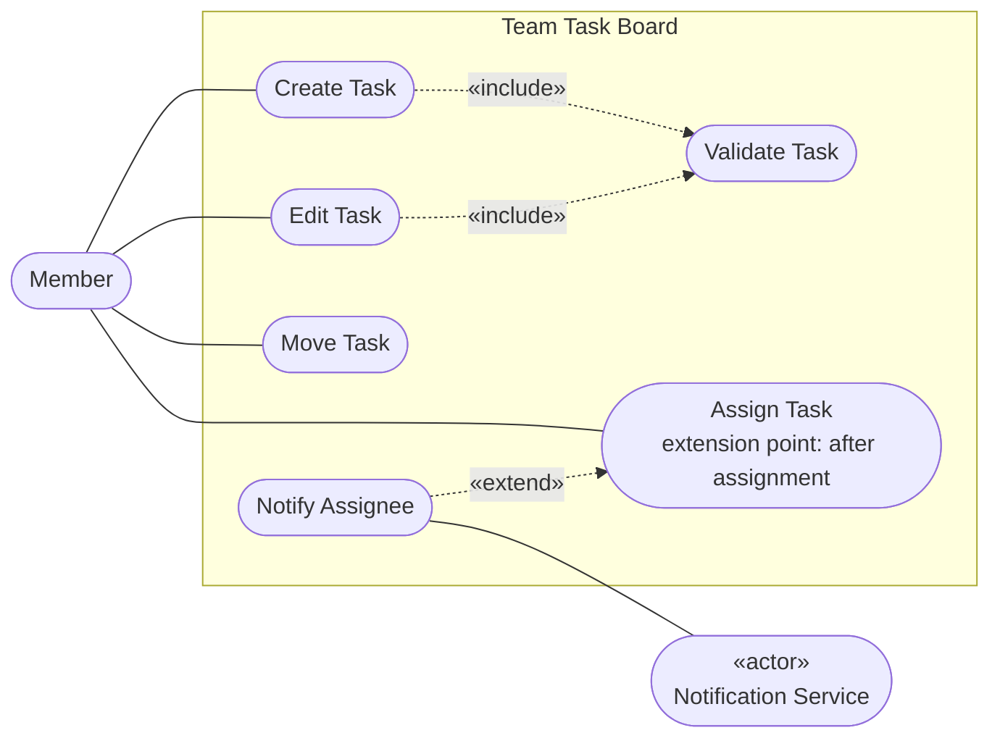

1. **Reversed arrow:** the starter drew `Assign -.->|«extend»| Notify`. An «extend» arrow points **from the extension to the base** Use Case, so it must be `Notify -.->|«extend»| Assign`.
2. **Move Task** is drawn as a plain Use Case associated with Member, with neither «include» nor «extend», as decided in Handbook Section 9.1. Reject a solution that adds «include» Validate Task or an «extend» for the WIP check: the WIP check is part of the goal, not shared behavior or an optional extension.

### Tasks 3–5. Assign Task scenario

| Field | Content |
|---|---|
| Use Case | Assign Task |
| Actors | Member (primary); Notification Service (supporting, through the extension Notify Assignee) |
| Preconditions | The member has opened a board that contains the task. |
| Main flow | 1. The member chooses a task and the member to assign it to. 2. The system saves the assignment. 3. The system shows that the assignment is saved. |
| Alternative flows | At extension point *after assignment* (after step 2): if the assignee is another member than the one assigning, Notify Assignee extends the flow and the Notification Service informs the assignee. The flow then continues at step 3. |
| Postconditions | The task is assigned to the chosen member. When the assignee is another member, a notification has been sent to the Notification Service. |
| Status | «Confirmed» (R4) |

- **Where:** after step 2, once the assignment is saved.
- **Condition:** the assignee is another member than the one assigning. `TaskService.assignTask` receives that member as `assigner`, and the guard compares `assignee` with `assigner`.
- **What the member sees:** that the assignment is saved, in both cases. The evidence gives no failure outcome, so none is invented.

Accept a scenario that places the extension point between steps 2 and 3 in other words. Reject a scenario that adds unsupported failures, such as "assignee not found".

**Review in the Handbook:** Sections 5.1–5.3; Figure 5.1; Section 16.1.

---

## Reference solution 3. Identify classifiers for Edit Task

**Learning objectives:** L1-4

| # | Answer |
|---|---|
| 1 | `TaskService`, as the classifier that applies task rules: `+ updateTask(task : Task, input : TaskInput) : TaskResult`. |
| 2 | Reused unchanged: `TaskInput` (same fields as creation: title, priority, due date); `- validate(input : TaskInput) : ValidationResult` (same input rules); `TaskResult` (one return type for valid and invalid outcomes); `ITaskRepository.saveTask(task : Task) : void` (storage through the contract). |
| 3 | Storage is reached only through the repository contract, so `ITaskRepository` loads the board: `+ loadBoard(id : BoardId) : Board`. Because Level 1 interactions start from the member and call `TaskService` (Handbook Section 8), `TaskService` also offers `+ loadBoard(id : BoardId) : Board`, which delegates to the repository. |
| 4 | No new input or result class. The evidence says editing uses the same input rules as creating, and `TaskResult` already covers both outcomes. |
| 5 | Typical rejected candidates: a separate `EditTaskInput` (duplicates `TaskInput`); `updateTask` on `Task` (a data model would receive behavior and storage access); a direct call from the member to the repository (bypasses the service). |

Accept a solution in which only `ITaskRepository` declares `loadBoard`, provided the learner's Exercise 6 sequence does not let the actor call the repository directly.

**Review in the Handbook:** Sections 6.1, 8.3, 8.6; Figure 8.1.

---

## Reference solution 4. Choose relationships by meaning

**Learning objectives:** L1-5

Handbook Figures 7.1 and 8.1 already show the results for pairs a–d, so assess the **reasoning**: each path must follow Q1–Q6 from the evidence in the exercise. Reject an answer that only cites the figures.

| Pair | Path | Result | Notes |
|---|---|---|---|
| a. Task – Member | Q1 no → Q2 no → Q3 yes → Q4 no → Q5 no | Navigable Association | Task `0..*` → `0..1` Member, role `assignee`. `0..1` because a task is created without an assignee (R1) and has at most one (R4). |
| b. ApiTaskRepository – ITaskRepository | Q1 no → Q2 yes | Realization | |
| c. TaskService – ITaskRepository | Q3 no (no reference kept between calls) → Q6 yes | Dependency «use» | |
| d. TaskService – NotificationService | Q3 no → Q6 yes | Dependency «use» | The message is asynchronous; there is no structural link. |
| e. TaskService – TaskInput | Q3 no → Q6: parameter use only, not important to show | No connector | Handbook Section 7.1: do not draw every parameter as a Dependency. |
| f. Task – Priority | Typing of an attribute | No connector | `priority : Priority` already states it (Figure 7.1). |

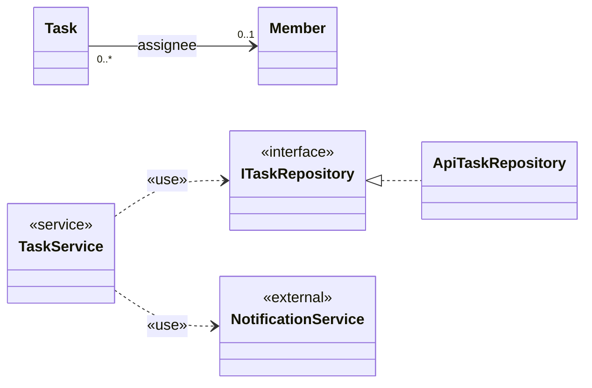

Reject `1` at the Member end (contradicts R1), Composition for any pair, and Dependency lines to `TaskInput` or `Priority`.

**Review in the Handbook:** Sections 7.1–7.3; Section 16.2.

---

## Reference solution 5. Build the Level 1 Class Diagram

**Learning objectives:** L1-4, L1-5

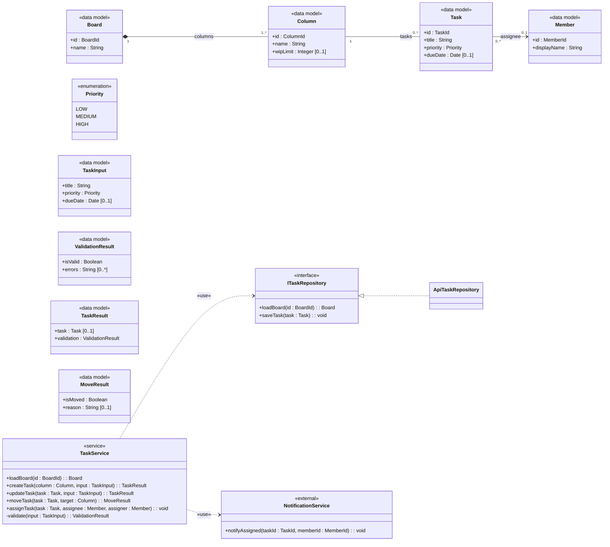

*Open modeling point:* R11 remains «TBC»: deleting a column does not yet define what happens to its tasks. Therefore `Column`–`Task` remains a plain Association.

*Level 1 scope:* `Board` here has `id` and `name` only. `isArchived : Boolean = false` belongs to R8 and is drawn in Handbook Section 10.2 and in Reference solution 10. It is not added to this diagram.

### Design notes

| Element added beyond Handbook Figures 7.1, 8.1, 9.1 | Evidence |
|---|---|
| `TaskService.updateTask(task, input) : TaskResult` | R2; Exercise 3 |
| `TaskService.loadBoard(id) : Board`, delegating to `ITaskRepository.loadBoard(id) : Board` | Exercise 3 evidence: the board is loaded from storage before editing |
| Task → Member navigable Association | R4; Exercise 4 |
| Dependency `TaskService` → `NotificationService` «use» | R4; Exercise 4 |

- `-validate` is private: only `TaskService` calls it.
- Every operation has one declared return type for all outcomes.
- No Dependency lines to `TaskInput`, `ValidationResult`, `TaskResult`, `MoveResult` or `Priority`: they appear as parameter, return or attribute types.

**Review in the Handbook:** Sections 6–7, 8.3, 9.2; Section 17.3.

---

## Reference solution 6. Edit Task sequence

**Learning objectives:** L1-6

### Class Diagram revision and change log

If the learner's Exercise 5 diagram already matches Reference solution 5, no change is needed and the change log says so. Typical entries:

| Change | Reason |
|---|---|
| Added `TaskService.loadBoard(id : BoardId) : Board` | The sequence starts by loading the board and the actor calls `TaskService` only |
| Added `ITaskRepository.loadBoard(id : BoardId) : Board` | Storage is reached only through the repository contract |

### Sequence

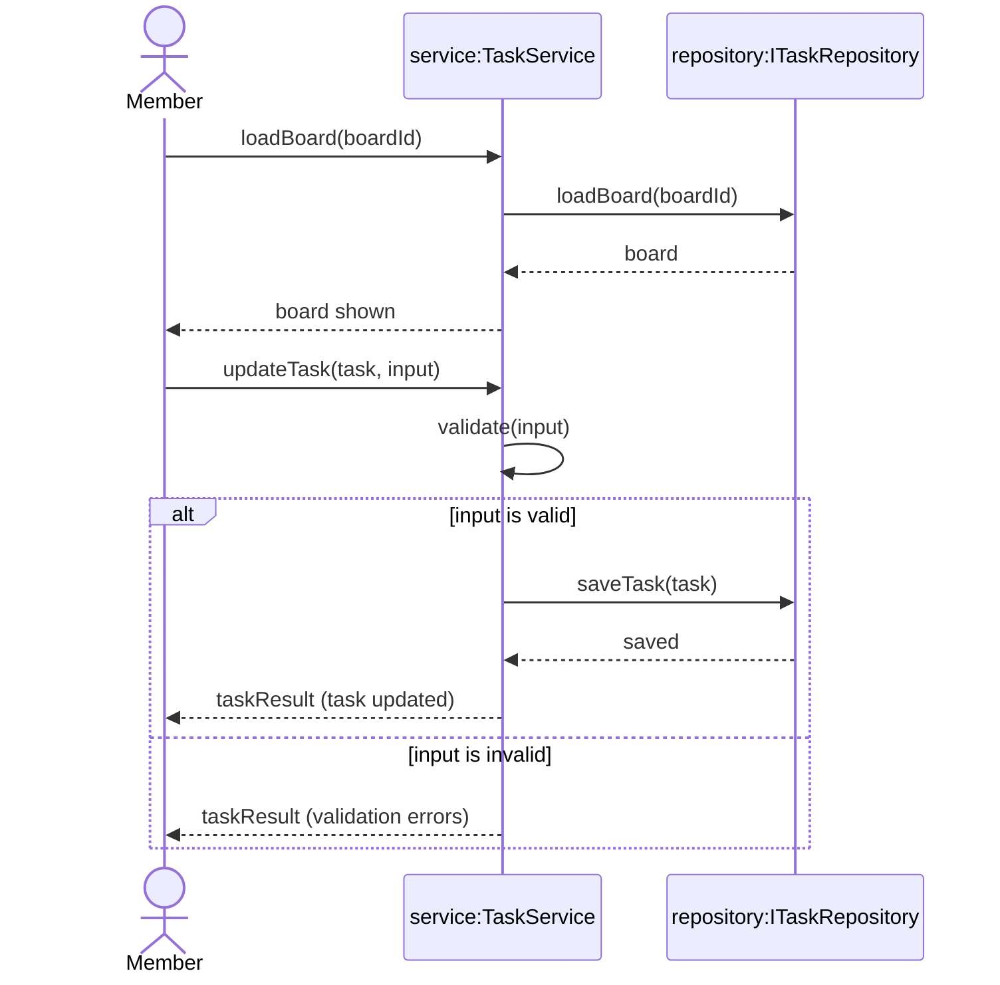

*Interaction note:* Between `board shown` and `updateTask(task, input)`, the member changes the title, priority or due date. This UI activity is explanatory context, not an additional UML message.

| Check | Result |
|---|---|
| Every call maps to a declared operation | `TaskService.loadBoard`, `ITaskRepository.loadBoard`, `TaskService.updateTask`, `TaskService.validate`, `ITaskRepository.saveTask` |
| No repository call when invalid | The `else` operand has no `saveTask` |
| Replies are outcomes | `board`, `board shown`, `saved`, `taskResult (…)` |
| Level 1: no UI lifeline | Starts from the actor `Member` |

Accept a sequence that omits the reply `board shown`, or that draws loading as a separate `ref` frame named "Load Board".

**Review in the Handbook:** Sections 4, 8.1–8.2, 8.6; Figures 8.2, 9.2.

---
## Reference solution 7. Audit defective diagrams

**Learning objectives:** L2-1, L2-3, L2-4

### Findings

| # | Diagram | Defect | Category | Broken rule | Correction |
|---|---|---|---|---|---|
| D1 | Class | `role` and `joinedAt` on `Member` | Semantic | R7: the role belongs to the link between a member and a board | Association class `Membership` |
| D2 | Class | `BoardRole` not connected to any classifier | Consistency | Follows from D1 | Type of `Membership.role` |
| D3 | Class | Subtasks drawn as Composition | Unsupported assumption | R9 states a parent but no lifecycle (Handbook Section 7.3, Q4) | Plain reflexive Association |
| D4 | Class | Parent end `1`: every task would need a parent | Semantic | R9: a task *may* have subtasks | `0..1` at the parent end |
| D5 | Class | No role name at the parent end | Notation | Handbook Section 10.4 | Roles `parent` and `subtasks` |
| D6 | Sequence | `opt` on rejection lets the save run after a rejected move | Semantic | R3 | `alt`, or `break` |
| D7 | Sequence | `notifyMoved` is not declared, and no requirement asks for a notification on move | Consistency and unsupported assumption | Handbook Section 8.6; R4 covers assignment only | Remove the call and the lifeline |
| D8 | Sequence | Reply after an asynchronous message to `NotificationService` | Notation | Handbook Section 8.1 | Removed with D7 |
| D9 | Sequence | `Repo` activation never closed | Notation | Handbook Section 12.1 | Balance every activation |
| D10 | Sequence | Subtasks are not moved | Semantic | R9 | `loop` inside the valid operand; keep R15 «TBC» |

A learner who finds D1–D10 except one notation item (D5, D8 or D9) still meets the expected level. Missing any semantic defect (D1, D3, D4, D6, D10) needs a review.

### Corrected Class Diagram

The canonical Association Class notation is shown in Handbook Figure 10.2: `Membership` is attached by a dashed line to the middle of the `Member`–`Board` Association. For a Mermaid submission, the intermediate-class workaround from Workbook Appendix A is accepted only when its note states the intended Association Class meaning. For an EA submission, require the standard Association Class connector.

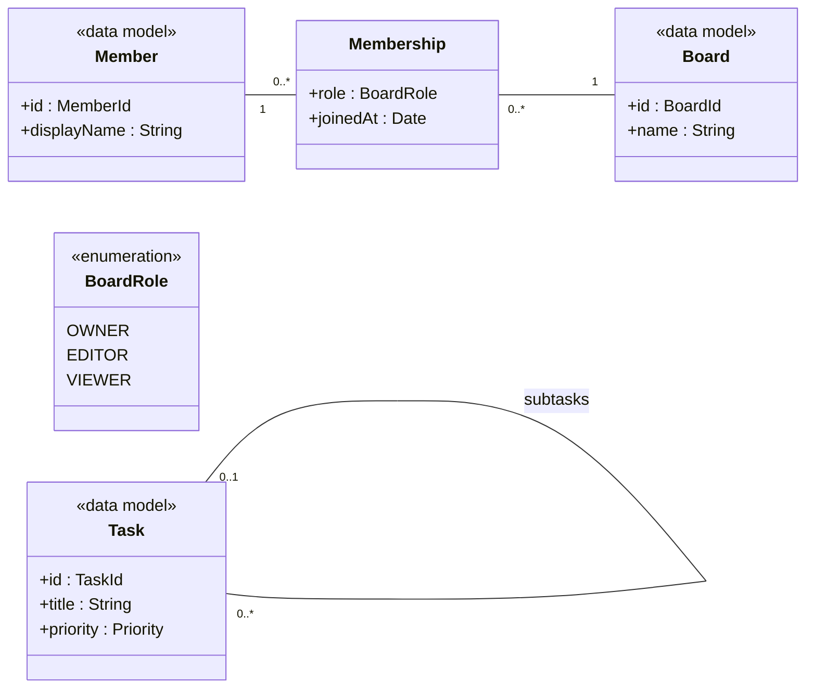

*Mermaid limitation:* The intermediate `Membership` classifier represents the Association Class attached to the `Member`–`Board` association. In Enterprise Architect, use the standard Association Class connector.

*Modeling note:* The `Task` self-association is reflexive. Its parent end role is `parent` with multiplicity `0..1`; the opposite role is `subtasks` with multiplicity `0..*`.

### Corrected Move Task sequence

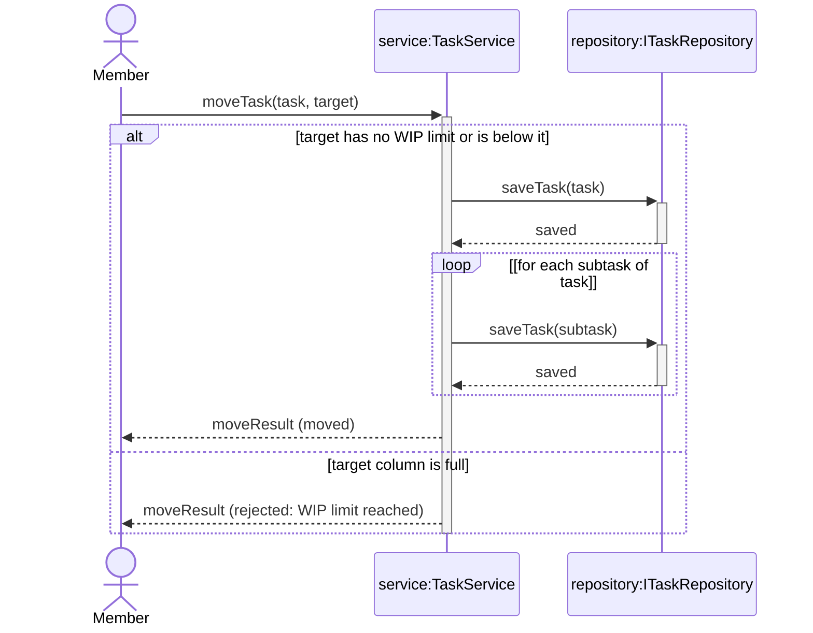

*Open modeling point:* R15 remains «TBC»: whether subtasks count against the target-column WIP limit. The loop follows the `subtasks` end in Handbook Figure 10.3: each direct subtask of the moved task.

**`alt` or `break`:** both are correct here. `alt` makes the two outcomes symmetrical and matches the scenario's alternative flow. `break` fits when the rejection is an early exit from a longer interaction, with the normal path drawn after the frame. Reject any solution in which a save can still follow the rejection.

**Review in the Handbook:** Sections 7.3, 8.1, 8.6, 10.3, 10.4, 12.1; Section 16.

---

## Reference solution 8. Map UML to TypeScript

**Learning objectives:** L2-1, L2-5

### Task 1. Constructs

| Classifier | Construct | Reason |
|---|---|---|
| `Priority`, `BoardRole` | Literal union | Closed set of values with no behavior |
| `WorkItem`, `Task`, `Bug` | `interface` per kind plus a discriminated union | `{complete, disjoint}` is a closed set that needs exhaustive handling |
| `Member`, `Board` | `interface` | Data models |
| `Membership` | Its own `interface` with both ids | The link carries the attributes |
| `ITaskRepository` | Behavior `interface` | A contract that a class realizes |
| `ApiTaskRepository` | `class … implements` | Infrastructure with behavior |

### Tasks 2–4, 6. Code

```typescript
// Identifiers
type TaskId = string;
type BoardId = string;
type MemberId = string;

// «enumeration» → literal union
type Priority = 'LOW' | 'MEDIUM' | 'HIGH';
type BoardRole = 'OWNER' | 'EDITOR' | 'VIEWER';

// Abstract WorkItem with {complete, disjoint} specializations → discriminated union
interface WorkItemBase {
  id: TaskId;
  title: string;
}

interface Task extends WorkItemBase {
  kind: 'task';
  priority: Priority;
  dueDate?: Date;            // dueDate : Date [0..1]
  parentId?: TaskId;         // reflexive Association, parent end 0..1
  estimate(): number;        // Figure 10.1 concrete operation; illustrative, not R1–R10
}

interface Bug extends WorkItemBase {
  kind: 'bug';
  severity: Priority;
  estimate(): number;        // Figure 10.1 concrete operation; illustrative, not R1–R10
}

type WorkItem = Task | Bug;  // {complete, disjoint}

// Stateless function with exhaustive handling
function describeWorkItem(item: WorkItem): string {
  switch (item.kind) {
    case 'task':
      return `Task "${item.title}" (${item.priority})`;
    case 'bug':
      return `Bug "${item.title}" (severity ${item.severity})`;
    default: {
      const unreachable: never = item;
      return unreachable;
    }
  }
}

// Data models
interface Member {
  id: MemberId;
  displayName: string;
}

interface Board {
  id: BoardId;
  name: string;
}

// Association class: the link itself carries role and joinedAt
interface Membership {
  memberId: MemberId;
  boardId: BoardId;
  role: BoardRole;
  joinedAt: Date;
}

// Behavior contract: storage is asynchronous in TypeScript
interface ITaskRepository {
  loadBoard(id: BoardId): Promise<Board>;
  saveTask(task: Task): Promise<void>;
}

// Realization
class ApiTaskRepository implements ITaskRepository {
  loadBoard(_id: BoardId): Promise<Board> {
    throw new Error('Reference skeleton only');
  }
  saveTask(_task: Task): Promise<void> {
    throw new Error('Reference skeleton only');
  }
}

export { describeWorkItem, ApiTaskRepository };
export type { WorkItem, Task, Bug, Member, Board, Membership, ITaskRepository, Priority, BoardRole };
```

The code compiles with `tsc --strict`. `estimate()` on `Task` and `Bug` maps the concrete operations in illustrative Figure 10.1. The Team Task Board requirements do not define the effort formula.

### Task 5. How the relationships appear

| UML | In the code | What the code cannot express on its own |
|---|---|---|
| Generalization | `Task` and `Bug` extend `WorkItemBase`; `WorkItem = Task \| Bug` | `{abstract}`: nothing stops code from building a `WorkItemBase` value |
| Realization | `class ApiTaskRepository implements ITaskRepository` | — |
| Association | `Task.parentId`, `Membership.memberId` / `boardId` | Multiplicity at the other end, navigability, and that a property means a structural link rather than a value |
| Dependency | Parameter and return types, imports | Whether the dependency is important enough to model |

**Task 6.** UML shows `loadBoard(id) : Board`; TypeScript returns `Promise<Board>` because storage is asynchronous. The contract is the same; the `Promise` wrapper is a mapping decision and is not drawn in the Class Diagram.

Accept a TypeScript `enum` instead of a literal union, and `null` instead of an optional property, if the learner applies the choice consistently.

**Review in the Handbook:** Sections 6.2–6.3, 10.1, 10.3, 13.1, 13.4.

---

## Reference solution 9. Edit Task with draft in Vue

**Learning objectives:** L2-3, L2-5

### Task 1. Responsibilities

| Classifier | Responsibility in Edit Task with draft |
|---|---|
| `TaskBoardView` | Receives the member's intents (open, save, close); displays the result |
| `useTaskBoard` | Finds the task in the loaded board; creates, submits and discards the draft; keeps the result as reactive state |
| `TaskDraft` | Holds unsaved changes and turns them into a `TaskInput` |
| `BoardStore` | Holds the selected board shared by several components; not involved in saving |
| `TaskService` | Validates and updates the task (Exercise 6) |
| `ITaskRepository` | Stores the task |

### Tasks 2–3. Operations and the updated `TaskDraft`

| Classifier | Added for Edit Task |
|---|---|
| `TaskBoardView` | `+ requestEdit(taskId : TaskId) : void`; `+ requestSaveEdit() : void`; `+ requestCloseForm() : void` |
| `useTaskBoard` | `+ lastTaskResult : TaskResult [0..1]`; `+ openEditForm(taskId : TaskId) : void`; `+ editTask() : void`; `+ closeForm() : void` |
| `TaskDraft` | `+ editedTask : Task [0..1]`; `+ TaskDraft(task : Task)` |

`TaskDraft(column : Column)` stays for Create Task with draft; `editedTask` is empty in that case. The edit constructor copies the task's title, priority and due date into the draft and keeps the task in `editedTask`. Handbook Figure 12.2 is unaffected.

### Task 4. Class Diagram

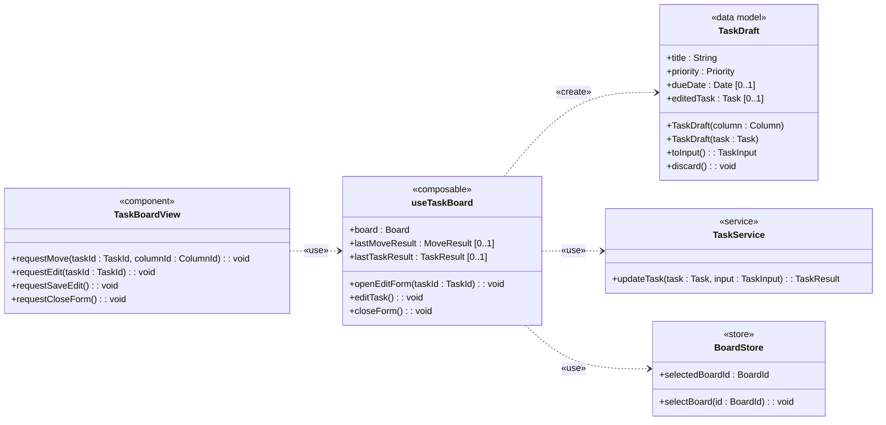

*Modeling note:* Create and Move operations from Handbook Figures 12.1 and 13.1 are intentionally suppressed in this Edit Task view.

### Task 5. Sequence

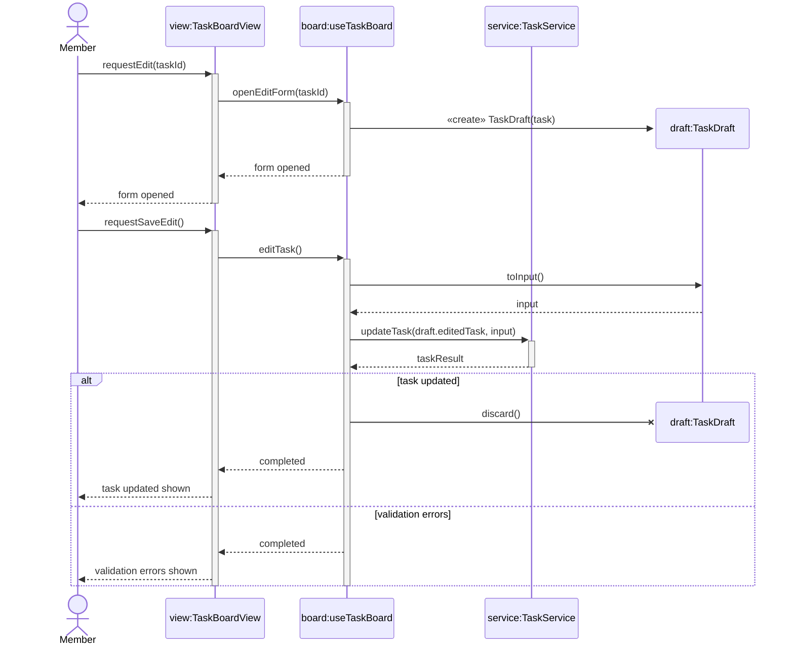

*Interaction note:* The member edits the form after the draft is created and before `requestSaveEdit()`. This UI activity is explanatory context, not an additional UML message. `editTask()` and `requestSaveEdit()` return `void`, so `completed`, `task updated shown` and `validation errors shown` are completion replies. `Board` replies to `View` before `View` replies to `Member`. `lastTaskResult` is updated from `taskResult` before those replies; that state is what selects the member-visible outcome.

*Mermaid limitation:* The service behavior corresponds to the Edit Task interaction from Exercise 6, including validation and saving. In Enterprise Architect, represent this as a standard Interaction Use (`ref`) frame where appropriate.

- `discard()` is shown as a destruction message: it invokes the declared operation and the X terminates the `draft:TaskDraft` lifeline.
- On validation errors the draft is kept so the member can correct it.
- Closing the form without saving (`requestCloseForm` → `closeForm` → `discard`) also destroys the draft; that path is not drawn.
- The view never calls `TaskService`; `useTaskBoard` never calls the repository.

### Task 6

- `BoardStore` is **not** a persistence boundary. It holds which board is selected; storage stays behind `ITaskRepository`.
- `ref`, `reactive` and `computed` do not belong in the model. Reactive state appears as attributes of the composable, such as `lastTaskResult`.

**Review in the Handbook:** Sections 12.1–12.2, 13.1–13.2; Section 16.4.

---

## Reference solution 10. Capstone

**Learning objectives:** L2-2, L2-3, L2-6

The reference names used in this solution are defined in the Handbook, Workbook and this Answer Guide. Learners may choose different names when they preserve the same meaning and remain consistent across diagrams.

### Part A – Archive Board

**Scenario**

| Field | Content |
|---|---|
| Use Case | Archive Board |
| Actors | Board Owner |
| Preconditions | The board is open. |
| Main flow | 1. The board owner requests to archive the board. 2. The system checks that the requester's membership role is Owner. 3. The system checks that the board is not already archived. 4. The system archives the board. 5. The system shows that the board is archived. |
| Alternative flows | 2a. The requester is not an owner: the system rejects the request and shows the reason. The Use Case ends. 3a. The board is already archived: the system rejects the request and shows the reason. The Use Case ends. |
| Postconditions | The board is archived: `isArchived` is true, and the board can no longer be edited. After 2a or 3a, `isArchived` is unchanged. |
| Status | «Confirmed» (R8, Exercise 10 evidence) |

Step 2 is needed although the actor is Board Owner: the system must still verify the role recorded in `Membership`.

**Class Diagram additions**

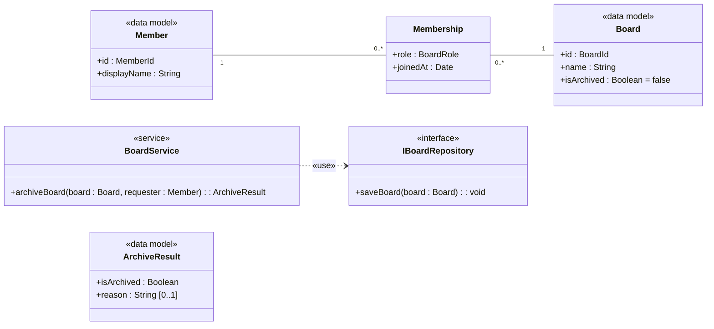

*Attribute note:* A new board has `isArchived = false` (Handbook Section 10.2). The guard `board is already archived` reads that attribute. On the success path, `archiveBoard` sets it to true and `saveBoard` stores that board. The two rejected paths do not change it. No separate message assigns the attribute: the change is inside `archiveBoard`.

*Open modeling point:* It remains «TBC» which operations reject an archived board. Edit is confirmed; Move and Assign are not specified.

**Sequence**

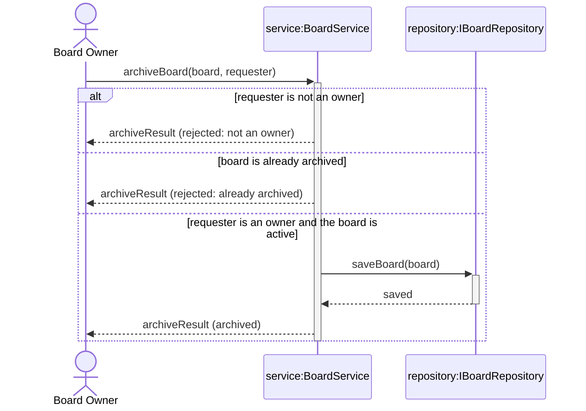

`IBoardRepository` in this archive interaction contains only `saveBoard(board) : void`, because `archiveBoard(board, requester)` already receives the `Board`. This sequence does not call `ITaskRepository`. The Level 1 baseline still loads a board through `TaskService.loadBoard` and `ITaskRepository.loadBoard` (Reference solutions 5, 6 and 8). Those operations remain the baseline. Part C's reload path does not replace them unless that «Proposed» strategy is approved.

The repository allocation is a design decision supporting the confirmed R8 behavior. R8 confirms Archive Board behavior, but it does not prescribe repository names or persistence boundaries.

### Part B – Assign and refresh

**Class Diagram additions**

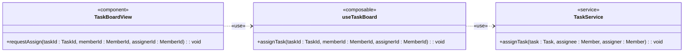

**Sequence**

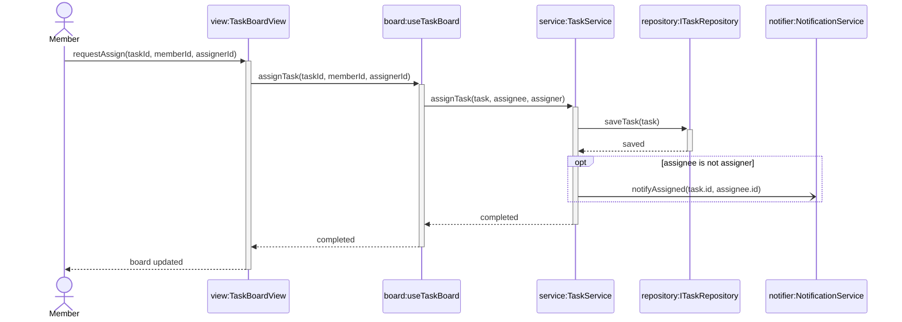

*Interaction note:* After `TaskService.assignTask(...)` completes, `useTaskBoard` updates reactive board state and Vue re-renders. This is state/rendering context, not an additional UML message.

`TaskService.assignTask(...)`, `useTaskBoard.assignTask(...)` and `TaskBoardView.requestAssign(...)` all return `void`; therefore `completed` and `board updated` are completion replies, not returned domain values.

The asynchronous `notifyAssigned(...)` message has no reply. `TaskService` dispatches it before completing its synchronous call, but notification delivery does not block the completion replies, reactive-state update or view rendering. Delivery may occur before or after the member sees the updated board.

The workbook asks for `par` only when the view update and the notification are independent operands. This reference architecture does not use `par`. Notification dispatch belongs to `TaskService`, while the reactive-state update occurs in `useTaskBoard` after the synchronous service call completes. The asynchronous notification message already expresses that notification delivery does not block the view update. Handbook Section 12.1 answers task 5: `par` operands may run concurrently, and order is guaranteed only within each operand.

Accept a learner's `par` only when the submitted responsibility allocation genuinely creates two independent operands. The same execution must not send a synchronous reply in one operand and then continue required work in another operand. Activations must remain balanced, and no reply may be drawn from `NotificationService` unless the learner changes the contract and justifies that change with evidence.

### Part C – Real-time changes

**Use Case Diagram**

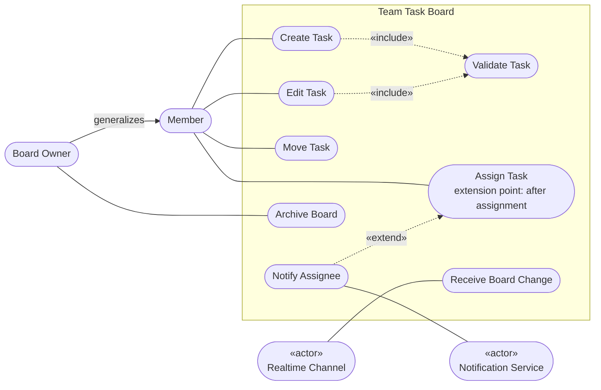

The canonical Actor Generalization notation is shown in Handbook Figure 11.1. R10 confirms asynchronous receipt of changes from an external Realtime Channel and reflection of those changes on the open board. `Receive Board Change` and the allocation of `handleRemoteChange(change)` to `useTaskBoard` are reference-architecture decisions supporting that confirmed behavior.

**Class Diagram additions**

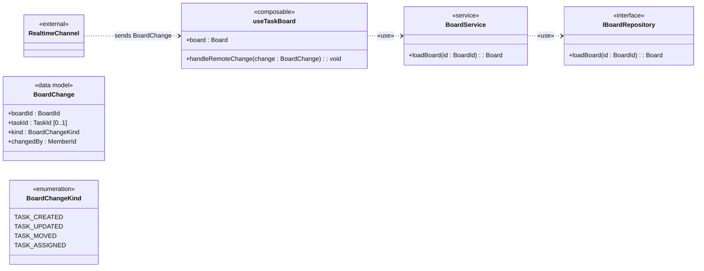

*Evidence-status note:* `BoardChange` fields are «Proposed» reference payload choices, not details confirmed by R10.

*Evidence-status note:* `BoardChangeKind` literals are «Proposed» reference payload choices, not details confirmed by R10.

*Evidence-status note:* `BoardService.loadBoard(...)` and `IBoardRepository.loadBoard(...)` belong to the «Proposed» reload strategy; applying `BoardChange` directly is the alternative. This is not the baseline `ITaskRepository.loadBoard`. Adopting the split would move `loadBoard` from `ITaskRepository` to `IBoardRepository`.

`BoardChange` fields and `BoardChangeKind` literals are `«Proposed»`. R10 does not specify the payload shape, event taxonomy, or whether the channel sends a delta, notification, or snapshot. Trainers must not assess these field names or literals as confirmed requirements.

`handleRemoteChange(change)` is allocated to `useTaskBoard` as a reference design decision because the composable owns the loaded reactive board. R10 confirms the required behavior, not the receiver operation name or software-layer allocation.

**Sequence**

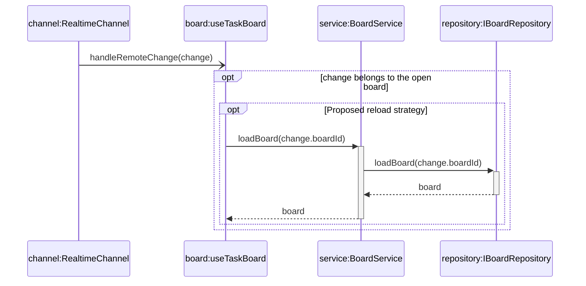

*Interaction note:* After the reload returns, `useTaskBoard` replaces or updates reactive board state and the view re-renders. This is state/rendering context, not an additional UML message.

*Alternative design note:* Instead of reloading, the composable may apply the proposed `BoardChange` payload directly. This remains an alternative strategy, not a second interaction message.

- `useTaskBoard` receives the change because it owns the loaded board as reactive state; this is the reference architecture's allocation, not a detail prescribed by R10.
- No reply is drawn to the Realtime Channel: the message is asynchronous.
- The entire reload path, including `BoardService.loadBoard(...)`, `IBoardRepository.loadBoard(...)`, and both dependencies, belongs to the `«Proposed»` reload strategy. It is not baseline behavior confirmed by R10. The baseline load operation remains `ITaskRepository.loadBoard` until this split is approved.
- **Open draft:** the evidence does not decide what happens when a remote change affects a task in an open draft. Mark this `«TBC»`. It is related to the concurrency concerns in R12, but R12 does not explicitly resolve draft reconciliation.

### Part D – Proposals for open requirements

| ID | Option | Status | Evidence needed | Affected model elements and diagrams to update |
|---|---|---|---|---|
| R11 | A. Deleting a column that still holds tasks is rejected | «Proposed» | Product owner decision | New Delete Column scenario and sequence with a rejected branch; Column–Task stays Association |
| R11 | B. The tasks are deleted with the column | «Proposed» | Product owner decision | Column–Task becomes Composition; Handbook Section 7.3 example changes |
| R12 | A. The second move is rejected if the task changed after it was loaded (version check) | «Proposed» | Product owner and architecture decision | `Task` gains a version; `MoveResult.reason` gains a conflict case; open drafts are checked the same way |
| R12 | B. The last move wins and the other member is informed through a board change | «Proposed» | Product owner decision | Realtime sequence gains a conflict note; no new attribute |
| R15 | A. Subtasks count against the WIP limit | «Proposed» | Product owner decision | Guard of the `alt` in Handbook Figure 12.3; the WIP guard's task count includes subtasks |
| R15 | B. Only the moved task counts | «Proposed» | Product owner decision | None; the R15 open modeling point below Figure 12.3 is removed |

Undo and redo (second half of R12) remain «TBC»; accept a learner who proposes options for them separately.

### Part E – Traceability

| Requirement | Model elements |
|---|---|
| R4 | Assign Task Use Case and scenario; Notify Assignee «extend»; `TaskService.assignTask(task, assignee, assigner)`; `NotificationService.notifyAssigned`; Assign and refresh sequence |
| R8 | Board Owner specializes Member; Archive Board Use Case and scenario; `Board.isArchived = false`; `BoardService.archiveBoard`; `ArchiveResult`; `IBoardRepository.saveBoard(board)`; Archive Board sequence |
| R10 | Confirmed behavior: asynchronous change from Realtime Channel appears on the open board. Reference allocation: Receive Board Change and `useTaskBoard.handleRemoteChange`. `«Proposed»`: BoardChange fields, BoardChangeKind literals, and reload path. `«TBC»`: open-draft reconciliation. Real-time sequence |
| R11 | Part D proposals; Column–Task open modeling point «TBC» |
| R12 | Part D proposals; open-draft note «TBC» |
| R15 | Part D proposals; open modeling point below Handbook Figure 12.3 |

`IBoardRepository.saveBoard(board)` is a design allocation that supports the confirmed R8 behavior; R8 does not prescribe the repository boundary itself.

For R10 assessment, separate status explicitly:

| Part C element | Evidence status |
|---|---|
| Asynchronous remote change from Realtime Channel appears on the open board | `«Confirmed»` by R10 |
| Receive Board Change and allocation to `useTaskBoard.handleRemoteChange(change)` | Reference architecture decision supporting R10 |
| `BoardChange` fields and `BoardChangeKind` literals | `«Proposed»` payload design |
| Reload path through `BoardService.loadBoard(...)` and `IBoardRepository.loadBoard(...)` | `«Proposed»` strategy |
| Reconciliation with an open draft | `«TBC»`; related to R12 concurrency concerns but not explicitly resolved by R12 |


**Checklist.** Every L1 and L2 item of Handbook Section 17 must be ticked. Check in particular: one return type per operation (`ArchiveResult`), balanced activations, no reply after `notifyAssigned` or `handleRemoteChange`, no TBC item drawn as decided.

**Review in the Handbook:** All sections; Section 15.1 for Part D.

---

## Trainer quick-review checklist

| ☐ | Check |
|---|---|
| ☐ | No unconfirmed requirement is drawn as decided; «TBC» and «Proposed» are visible. |
| ☐ | Names of Handbook classifiers are not changed. |
| ☐ | Every lifeline has a declared classifier or is «external». |
| ☐ | Every call message matches an operation on the receiver, with the exact name. |
| ☐ | Each operation has one declared return type for all outcomes. |
| ☐ | Replies are values or outcomes; no reply follows an asynchronous message. |
| ☐ | Composition only with ownership and lifecycle evidence. |
| ☐ | «include» and «extend» point the right way; each «extend» has an extension point. |
| ☐ | Activations are balanced; a destroyed lifeline does not continue. |
| ☐ | Component → composable → service → repository; a store is not a persistence boundary. |
| ☐ | Mermaid diagrams render in the training environment. |

---

## Assembled model catalog

Trainer control copy for the Handbook, the Workbook and this Answer Guide. Learners do not receive this section. It stays here so the assembled model is not a fourth document and is not a source file from which the Handbook is generated. The Handbook remains the teaching narrative. Its figures are views. This catalog is the merged classifier list those views must fit.

An empty or omitted compartment means the feature is not drawn in that figure (Handbook Section 6.1). It does not delete a feature listed here. A figure may suppress a feature. It may not give the same classifier a different signature, multiplicity or relationship kind. A learner answer may use other names for a capstone reference allocation when the meaning, the evidence status and the learner's own diagrams stay consistent. It may not decide an item in the Open Decisions Register.

`WorkItem`, `Bug` and `estimate()` belong only to the illustrative Figure 10.1. They are not part of this catalog.

Identifier types `BoardId`, `ColumnId`, `TaskId` and `MemberId` have no attributes in the model. `String`, `Integer`, `Boolean` and `Date` are the primitive types used by the attributes below.

### Adopted classifiers

| Classifier | Features | Where the full feature is introduced |
|---|---|---|
| `Board` «data model» | `+ id : BoardId`; `+ name : String`; `+ isArchived : Boolean = false` | Figure 7.1 for `id` and `name`; `isArchived = false` in Handbook Section 10.2 and the Capstone reference for R8 |
| `Column` «data model» | `+ id : ColumnId`; `+ name : String`; `+ wipLimit : Integer [0..1]` | Figure 7.1 |
| `Task` «data model» | `+ id : TaskId`; `+ title : String`; `+ priority : Priority`; `+ dueDate : Date [0..1]` | Figure 7.1 |
| `Member` «data model» | `+ id : MemberId`; `+ displayName : String` | Figure 7.1 |
| `Priority` «enumeration» | `LOW`, `MEDIUM`, `HIGH` | Figure 7.1 |
| `BoardRole` «enumeration» | `OWNER`, `EDITOR`, `VIEWER` | Figure 10.2 |
| `Membership` association class | `+ role : BoardRole`; `+ joinedAt : Date` | Figure 10.2 |
| `TaskInput` «data model» | `+ title : String`; `+ priority : Priority`; `+ dueDate : Date [0..1]` | Figure 8.1 |
| `ValidationResult` «data model» | `+ isValid : Boolean`; `+ errors : String [0..*]` | Figure 8.1 |
| `TaskResult` «data model» | `+ task : Task [0..1]`; `+ validation : ValidationResult` | Figure 8.1 |
| `MoveResult` «data model» | `+ isMoved : Boolean`; `+ reason : String [0..1]` | Figure 9.1 |
| `ArchiveResult` «data model» | `+ isArchived : Boolean`; `+ reason : String [0..1]` | Capstone reference for R8 |
| `TaskDraft` «data model» | `+ title : String`; `+ priority : Priority`; `+ dueDate : Date [0..1]`; `+ editedTask : Task [0..1]`; `+ TaskDraft(column : Column)`; `+ TaskDraft(task : Task)`; `+ toInput() : TaskInput`; `+ discard() : void` | Figure 12.1; edit constructor and `editedTask` in Exercise 9 |
| `TaskService` «service» | `+ loadBoard(id : BoardId) : Board`; `+ createTask(column : Column, input : TaskInput) : TaskResult`; `+ updateTask(task : Task, input : TaskInput) : TaskResult`; `+ moveTask(task : Task, target : Column) : MoveResult`; `+ assignTask(task : Task, assignee : Member, assigner : Member) : void`; `- validate(input : TaskInput) : ValidationResult` | Figures 8.1 and 9.1; `loadBoard` and `updateTask` in Exercises 3–6; `assigner` on `assignTask` |
| `ITaskRepository` «interface» | `+ loadBoard(id : BoardId) : Board`; `+ saveTask(task : Task) : void` | `saveTask` in Figure 8.1; `loadBoard` in Exercises 3–6 |
| `ApiTaskRepository` | Realizes `ITaskRepository` | Figure 8.1 |
| `NotificationService` «external» | `+ notifyAssigned(taskId : TaskId, memberId : MemberId) : void` | Figure 8.1. Sequences call it asynchronously and draw no reply |
| `BoardService` «service» | `+ archiveBoard(board : Board, requester : Member) : ArchiveResult` | Capstone reference for R8 |
| `IBoardRepository` «interface» | `+ saveBoard(board : Board) : void` | Capstone reference for R8. This baseline operation is `saveBoard` only |
| `TaskBoardView` «component» | `+ requestMove(taskId : TaskId, columnId : ColumnId) : void`; `+ requestEdit(taskId : TaskId) : void`; `+ requestSaveEdit() : void`; `+ requestCloseForm() : void`; `+ requestAssign(taskId : TaskId, memberId : MemberId, assignerId : MemberId) : void` | Figure 13.1; edit operations in Exercise 9; assign operation in the Capstone |
| `useTaskBoard` «composable» | `+ board : Board`; `+ lastMoveResult : MoveResult [0..1]`; `+ lastTaskResult : TaskResult [0..1]`; `+ openCreateForm(column : Column) : void`; `+ createTask() : void`; `+ openEditForm(taskId : TaskId) : void`; `+ editTask() : void`; `+ closeForm() : void`; `+ moveTask(taskId : TaskId, columnId : ColumnId) : void`; `+ assignTask(taskId : TaskId, memberId : MemberId, assignerId : MemberId) : void` | Figures 12.1 and 13.1; edit operations in Exercise 9; assign operation in the Capstone |
| `BoardStore` «store» | `+ selectedBoardId : BoardId`; `+ selectBoard(id : BoardId) : void` | Figure 13.1 |

`Board.isArchived = false` is the state of a new board. Archiving sets it to true. `ArchiveResult.isArchived` records the outcome of `archiveBoard`, in the same way `MoveResult.isMoved` records the outcome of `moveTask`. The Exercise 10 case, traced to R8, confirms that an archived board cannot be edited. The reference sequences do not draw that guard on `updateTask`. The catalog does not add one. Which of Move and Assign also reject an archived board remains «TBC» (Reference solution 10, Part A).

`closeForm`, `requestCloseForm` and `selectBoard` are declared even where no sequence draws them. The undrawn close-without-save path discards the draft.

### Adopted relationships

| Relationship | Ends and meaning | Evidence |
|---|---|---|
| Composition | `Board` `1` ◆— `1..*` `Column`, role `columns` | R5 |
| Association | `Column` `1` — `0..*` `Task`, role `tasks`. Not Composition while R11 is «TBC» | R6, R11 |
| Navigable Association | `Task` `0..*` → `0..1` `Member`, role `assignee` | R1, R4 |
| Association class | `Member` `0..*` — `0..*` `Board`, class `Membership` | R7. A Mermaid intermediate class is a workaround, not a second model |
| Reflexive Association | `Task` role `parent` `0..1` — role `subtasks` `0..*` `Task`. Not Composition | R9. The move loop saves direct subtasks |
| Realization | `ApiTaskRepository` realizes `ITaskRepository` | Figure 8.1 |
| Dependency «use» | `TaskService` → `ITaskRepository`; `TaskService` → `NotificationService`; `BoardService` → `IBoardRepository`; `TaskBoardView` → `useTaskBoard`; `useTaskBoard` → `TaskService`; `useTaskBoard` → `BoardStore` | The using classifier does not keep a structural link merely because it calls the supplier |
| Dependency «create» | `useTaskBoard` → `TaskDraft` | Figure 12.1 |

No connector is drawn for `Priority`, `BoardRole`, `TaskInput`, `ValidationResult`, `TaskResult`, `MoveResult` or `ArchiveResult`. Each is the type of an attribute, a parameter or a return value.

### Outside the adopted model

| Item | Status | Catalog rule |
|---|---|---|
| `WorkItem`, `Bug`, `estimate()` | Illustrative, Figure 10.1 only | Do not merge into `Task` |
| `RealtimeChannel` «external» | Confirmed external source for R10. The reference class has no operations. It draws `RealtimeChannel` → `useTaskBoard`, labelled `sends BoardChange` | Do not add operations to the channel, and do not treat that dependency label as «use» |
| `BoardChange`, `BoardChangeKind`, and `useTaskBoard.handleRemoteChange(change : BoardChange) : void` | `handleRemoteChange` is a reference allocation for confirmed R10. The payload fields and literals are «Proposed» | Do not assess the payload as a confirmed signature, and do not add `handleRemoteChange` to the adopted `useTaskBoard` row |
| `BoardService.loadBoard(id : BoardId) : Board` and `IBoardRepository.loadBoard(id : BoardId) : Board` | «Proposed» reload strategy, including `useTaskBoard` → `BoardService` «use» | Baseline load remains `TaskService.loadBoard` and `ITaskRepository.loadBoard` unless this strategy is approved. The adopted `BoardService` → `IBoardRepository` «use» is only the archive `saveBoard` dependency |
| One global store of every board's tasks | «Proposed», R13 | `BoardStore` keeps `selectedBoardId` only |
| Column deletion, concurrent moves, undo and redo, subtask WIP counting, open-draft reconciliation | «TBC» | Do not add attributes, Composition or operations for them |

When a Handbook figure or a reference solution disagrees with this catalog on a signature or a relationship kind, correct the view and this catalog in the same change. Suppression alone is not a disagreement. The Exercise 7 starter diagrams are intentional defects. Leave them defective, and do not copy their signatures or relationship kinds into this catalog.

---

## Revision history

| Version | Date | Changes |
|---|---|---|
| v1.7.1 | 3 November 2026 | Last version of the v1.x Answer Guide. |
| v2.0 | baseline, 3 November 2026 | Trainer-only training baseline approved after RS0–RS10 consistency review, evidence-status normalization, RS10 Parts A–E repair, self-contained evidence cleanup and final render audit. |
| v2.0.1 | 4 November 2026 | Consistency fixes aligned with Handbook and Workbook v2.0.1: `assigner` on `assignTask`, balanced Edit Task replies, baseline `loadBoard` kept on `ITaskRepository`, direct-subtask note, `estimate()` mapped, R12 added to the register, `par` guidance matched to Exercise 10. |
| v2.0.2 | 4 November 2026 | Added the assembled model catalog as the trainer control copy for the Handbook, Workbook and this Answer Guide. The catalog records adopted class features and relationships, keeps Proposed and TBC items outside that list, and leaves the Exercise 7 starters defective. |
| v2.0.3 | 4 November 2026 | `Board.isArchived` now has the default `false`, matching Handbook Section 10.2 and R8. The archive scenario and sequence use that value: success sets it to true; rejected paths leave it unchanged. The Level 1 class diagram does not include it. `ArchiveResult.isArchived` stays the operation outcome and has no default. |


## Open Decisions Register

This register is the canonical status summary for unresolved or proposed requirement decisions in this baseline. Items listed here must not be treated as adopted behavior until their status is changed through an approved decision.

| ID | Status | Open question | Baseline treatment | Closure condition |
|---|---|---|---|---|
| R11 | `«TBC»` | What happens to the tasks of a deleted column? | `Column`–`Task` remains a plain Association. The baseline does not assume cascade deletion or lifecycle ownership. | The product owner approves delete, move-to-fallback, reject-deletion or archive behavior, including subtask and undo/audit effects. |
| R12 | `«TBC»` | What happens when two members move the same task at the same time, and are undo and redo in this release? | No concurrency, undo, or redo behavior is modeled. Exercises and the Capstone may propose options, but must not model any option as adopted behavior. | The product owner decides which move wins, what the other member is told, and whether undo and redo are in this release. |
| R13 | `«Proposed»` | Should one global store keep all tasks of all boards? | The active board remains in `useTaskBoard.board`; `BoardStore` keeps the selected board identity. The proposal is outside the adopted architecture. | A use case, ownership boundary, permission model, cache invalidation strategy and eviction/performance approach are approved. |
| R15 | `«TBC»` | Do subtasks count against the target-column WIP limit? | Figure 12.3 checks the moved task only and does not decide subtask counting. | The product owner confirms whether subtasks occupy independent WIP slots and defines counting, atomic move and concurrency behavior. |

