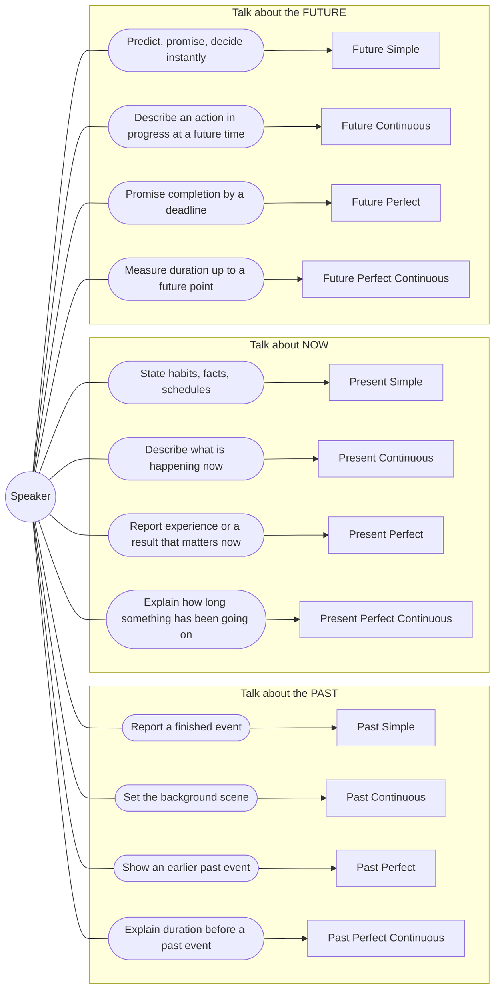
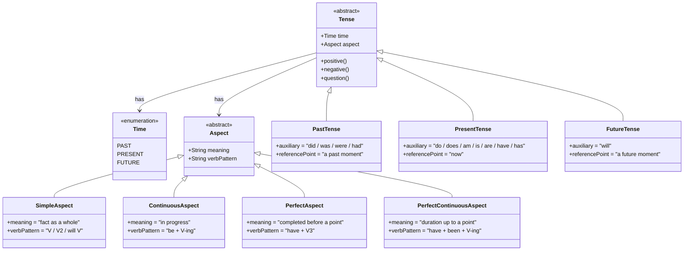
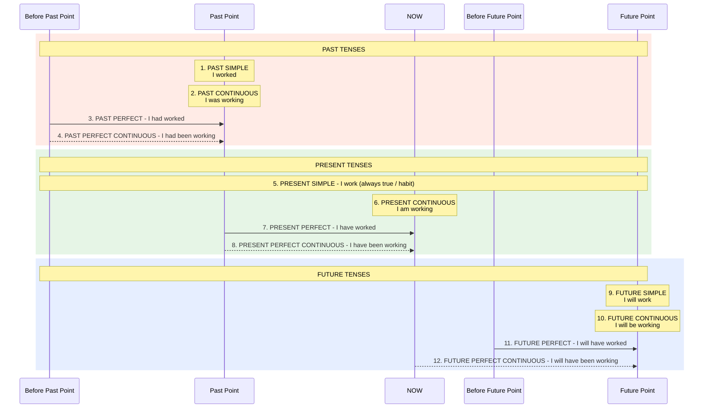
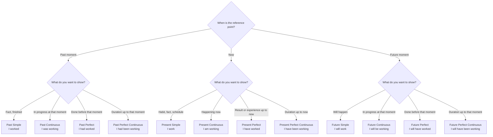
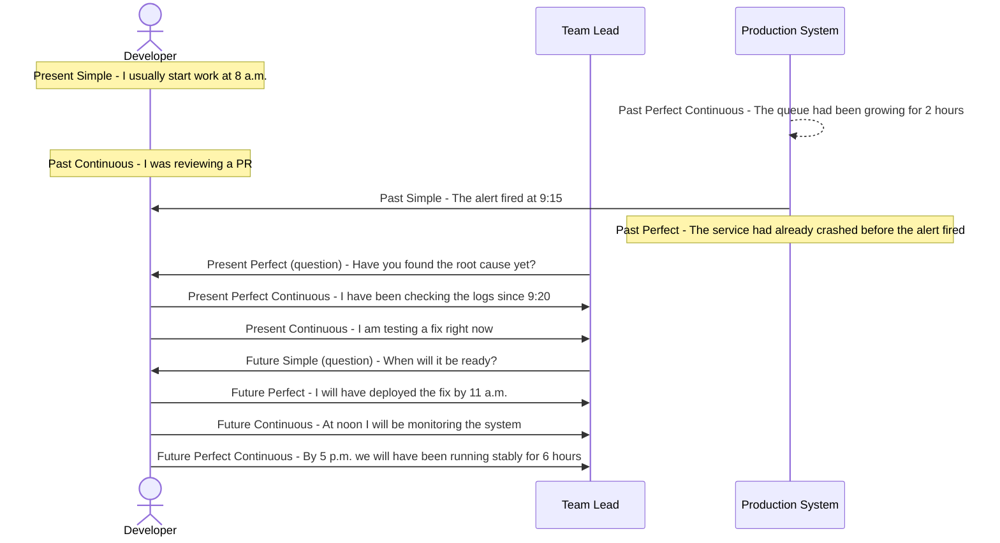

# English 12 Tenses — Visual Handbook

> Learn the 12 English tenses as a **system**, not as 12 separate rules.
> Every tense = **TIME** (Past / Present / Future) × **ASPECT** (Simple / Continuous / Perfect / Perfect Continuous).

---

## Table of Contents

1. [The Big Idea: 3 × 4 = 12](#1-the-big-idea-3--4--12)
2. [Use Case Diagram — What do you want to say?](#2-use-case-diagram--what-do-you-want-to-say)
3. [Class Diagram — How tenses are built](#3-class-diagram--how-tenses-are-built)
4. [Sequence Diagram — All 12 tenses on one timeline](#4-sequence-diagram--all-12-tenses-on-one-timeline)
5. [Tense-by-Tense Reference](#5-tense-by-tense-reference)
6. [Decision Flow — Which tense should I use?](#6-decision-flow--which-tense-should-i-use)
7. [Sequence Diagram — One story, many tenses](#7-sequence-diagram--one-story-many-tenses)
8. [Commonly Confused Pairs](#8-commonly-confused-pairs)
9. [Stative Verbs — The "no -ing" rule](#9-stative-verbs--the-no--ing-rule)
10. [Practice Exercises + Answer Key](#10-practice-exercises--answer-key)
11. [One-Page Cheat Sheet](#11-one-page-cheat-sheet)

---

## 1. The Big Idea: 3 × 4 = 12

| Aspect ↓ / Time → | **Past** | **Present** | **Future** |
|---|---|---|---|
| **Simple** — the fact, as a whole | worked | work(s) | will work |
| **Continuous** — in progress | was/were working | am/is/are working | will be working |
| **Perfect** — completed *before* a point | had worked | have/has worked | will have worked |
| **Perfect Continuous** — duration *up to* a point | had been working | have/has been working | will have been working |

**Three building blocks you only need to learn once:**

| Block | Form | Meaning it adds |
|---|---|---|
| Continuous | **be + V-ing** | "in progress" |
| Perfect | **have + V3** | "before a reference point" |
| Perfect Continuous | **have + been + V-ing** | "in progress *up to* a reference point" |

Then you only change the **first auxiliary** by time:

- Past → `was/were`, `had`, `did`
- Present → `am/is/are`, `have/has`, `do/does`
- Future → `will`

---

## 2. Use Case Diagram — What do you want to say?

Start from **intention** (what the speaker wants to communicate), then pick the tense.

---

## 3. Class Diagram — How tenses are built

Think of a tense as an object composed of **Time** and **Aspect**. The aspect decides the verb pattern; the time decides the auxiliary.

**How to read it:** `Present Perfect` = `PresentTense` (auxiliary *have/has*) + `PerfectAspect` (*have + V3*) → **I have worked**.

---

## 4. Sequence Diagram — All 12 tenses on one timeline

**Legend:** Note = action **at** a point · Solid arrow `->>` = completed **before** a point (result) · Dashed arrow `-->>` = continuing **up to** a point (duration)

**Key insight:** Perfect tenses always **look back** from a reference point. Move the reference point (past moment → now → future moment) and you get Past / Present / Future Perfect.

---

## 5. Tense-by-Tense Reference

### 5.1 Past Group

#### 1. Past Simple
| | Form | Example |
|---|---|---|
| (+) | S + V2/ed | I **fixed** the bug yesterday. |
| (−) | S + did not + V | I **didn't fix** the bug yesterday. |
| (?) | Did + S + V? | **Did** you **fix** the bug yesterday? |

- **Use:** finished action at a specific past time; a sequence of past events.
- **Signals:** yesterday, last week/month/year, ago, in 2020, when I was…
- ⚠️ Don't use with *already / so far / ever* when the time is unfinished → use Present Perfect.

#### 2. Past Continuous
| | Form | Example |
|---|---|---|
| (+) | S + was/were + V-ing | I **was testing** at 8 p.m. |
| (−) | S + was/were not + V-ing | I **wasn't testing** at 8 p.m. |
| (?) | Was/Were + S + V-ing? | **Were** you **testing** at 8 p.m.? |

- **Use:** in progress at a past moment; background interrupted by a Past Simple action; two parallel past actions (*while*).
- **Signals:** at + time + yesterday, while, when.
- Pattern: *I **was coding** (background) **when** the power **went** out (interruption).*

#### 3. Past Perfect
| | Form | Example |
|---|---|---|
| (+) | S + had + V3 | The build **had failed** before I arrived. |
| (−) | S + had not + V3 | The build **hadn't failed** before I arrived. |
| (?) | Had + S + V3? | **Had** the build **failed** before you arrived? |

- **Use:** the **earlier** of two past events; "past of the past".
- **Signals:** before, after, by the time, already, when (+ Past Simple).

#### 4. Past Perfect Continuous
| | Form | Example |
|---|---|---|
| (+) | S + had been + V-ing | I **had been waiting** for 2 hours. |
| (−) | S + had not been + V-ing | I **hadn't been waiting** long. |
| (?) | Had + S + been + V-ing? | How long **had** you **been waiting**? |

- **Use:** duration of an activity **up to** a past point; explains a past result.
- **Signals:** for, since, how long, before, when.
- e.g. *She was tired because she **had been debugging** all night.*

### 5.2 Present Group

#### 5. Present Simple
| | Form | Example |
|---|---|---|
| (+) | S + V(s/es) | She **reviews** PRs every morning. |
| (−) | S + do/does not + V | She **doesn't review** PRs on Fridays. |
| (?) | Do/Does + S + V? | **Does** she **review** PRs every morning? |

- **Use:** habits, facts, general truths, fixed timetables (*The train leaves at 7*).
- **Signals:** always, usually, often, sometimes, never, every day.

#### 6. Present Continuous
| | Form | Example |
|---|---|---|
| (+) | S + am/is/are + V-ing | I **am deploying** the app now. |
| (−) | S + am/is/are not + V-ing | I **am not deploying** now. |
| (?) | Am/Is/Are + S + V-ing? | **Are** you **deploying** now? |

- **Use:** happening now; temporary situations; **fixed personal plans** in the near future (*I'm meeting the client tomorrow*).
- **Signals:** now, right now, at the moment, currently, Look!, Listen!

#### 7. Present Perfect
| | Form | Example |
|---|---|---|
| (+) | S + have/has + V3 | I **have fixed** three bugs so far. |
| (−) | S + have/has not + V3 | I **haven't fixed** it yet. |
| (?) | Have/Has + S + V3? | **Have** you ever **used** Kafka? |

- **Use:** life experience; past action with a **result now**; unfinished time period (today, this week).
- **Signals:** already, yet, just, ever, never, so far, recently, since, for.

#### 8. Present Perfect Continuous
| | Form | Example |
|---|---|---|
| (+) | S + have/has been + V-ing | I **have been debugging** since 9 a.m. |
| (−) | S + have/has not been + V-ing | I **haven't been sleeping** well. |
| (?) | Have/Has + S + been + V-ing? | How long **have** you **been working** here? |

- **Use:** started in the past, continues **up to now** (may continue); focus on **duration / activity**.
- **Signals:** for, since, all day, how long, lately.

### 5.3 Future Group

#### 9. Future Simple
| | Form | Example |
|---|---|---|
| (+) | S + will + V | I **will send** the report. |
| (−) | S + will not (won't) + V | I **won't send** it today. |
| (?) | Will + S + V? | **Will** you **send** it? |

- **Use:** instant decision, prediction (opinion), promise, offer.
- **Signals:** tomorrow, next week, soon, I think, probably.
- ⚠️ Plan already decided → *be going to*: *I'm going to refactor this module.*

#### 10. Future Continuous
| | Form | Example |
|---|---|---|
| (+) | S + will be + V-ing | I **will be presenting** at 10 a.m. |
| (−) | S + will not be + V-ing | I **won't be working** on Sunday. |
| (?) | Will + S + be + V-ing? | **Will** you **be using** the room at 3? |

- **Use:** in progress at a specific future moment; polite questions about plans.
- **Signals:** at this time tomorrow, at 10 a.m. next Monday.

#### 11. Future Perfect
| | Form | Example |
|---|---|---|
| (+) | S + will have + V3 | By Friday, I **will have finished** the sprint. |
| (−) | S + will not have + V3 | I **won't have finished** by Friday. |
| (?) | Will + S + have + V3? | **Will** you **have finished** by Friday? |

- **Use:** completed **before** a future point (deadline thinking).
- **Signals:** by + time, by the time, before, by then.

#### 12. Future Perfect Continuous
| | Form | Example |
|---|---|---|
| (+) | S + will have been + V-ing | By December, I **will have been working** here for 5 years. |
| (−) | S + will not have been + V-ing | I **won't have been working** here long. |
| (?) | Will + S + have been + V-ing? | How long **will** you **have been working** here? |

- **Use:** duration of an activity **up to** a future point.
- **Signals:** by + time + for + period.

---

## 6. Decision Flow — Which tense should I use?

**Two questions decide every tense:**
1. **Where is my reference point?** (past moment / now / future moment)
2. **What do I focus on?** (fact / in progress / completed before / duration up to)

---

## 7. Sequence Diagram — One story, many tenses

A real workday told with 10 tenses. Read the messages top to bottom.

---

## 8. Commonly Confused Pairs

| Pair | Difference | Example |
|---|---|---|
| Past Simple vs Present Perfect | Specific finished time **vs** no time / result now | I **lost** my key yesterday. / I **have lost** my key (I still can't get in). |
| Present Perfect vs Present Perfect Continuous | **Result / quantity** vs **activity / duration** | I **have written** 3 tests. / I **have been writing** tests all morning. |
| Past Simple vs Past Perfect | One past event **vs** the earlier of two | When I arrived, the meeting **started**. (on arrival) / …the meeting **had started**. (before arrival) |
| Past Simple vs Past Continuous | Complete event **vs** background in progress | I **coded** a feature. / I **was coding** when he called. |
| will vs be going to vs Present Continuous | Instant decision **vs** intention **vs** arranged plan | I'll help you. / I'm going to learn Rust. / I'm meeting the client at 3. |
| Future Simple vs Future Perfect | Happens at a point **vs** finished before a point | I **will finish** on Friday. / I **will have finished** by Friday. |

---

## 9. Stative Verbs — The "no -ing" rule

Stative verbs describe **states**, not actions, so they are usually **not** used in Continuous tenses.

| Category | Verbs |
|---|---|
| Mind | know, believe, understand, remember, mean |
| Feeling | like, love, hate, want, need, prefer |
| Possession | have (= own), own, belong |
| Senses | see, hear, smell, taste (involuntary) |
| Being | be, seem, contain, consist |

- ❌ *I am knowing the answer.* → ✅ *I **know** the answer.*
- ❌ *I have been knowing him for years.* → ✅ *I **have known** him for years.*
- Exception (action meaning): *I'**m having** lunch.* / *I'**m thinking** about it.*

---

## 10. Practice Exercises + Answer Key

### Exercise A — Choose the correct tense

1. I ______ (work) here since 2021.
2. When I arrived, the meeting ______ (already / start).
3. Look! The server ______ (restart).
4. By next June, she ______ (complete) the course.
5. I ______ (meet) him last week.
6. At 9 p.m. tomorrow, I ______ (fly) to Hanoi.
7. She was exhausted because she ______ (code) all night.
8. Water ______ (boil) at 100°C.
9. ______ you ever ______ (use) Typesense?
10. By 2027, I ______ (study) English for 2 years.

### Exercise B — Fix the mistake

1. I have met him yesterday.
2. I am knowing this API well.
3. When I came, she already left.
4. I will have finish it by Friday.
5. How long are you working here?

### Answer Key

**A.**
1. have worked / have been working — *Present Perfect (Continuous)*
2. had already started — *Past Perfect*
3. is restarting — *Present Continuous*
4. will have completed — *Future Perfect*
5. met — *Past Simple*
6. will be flying — *Future Continuous*
7. had been coding — *Past Perfect Continuous*
8. boils — *Present Simple*
9. Have … used — *Present Perfect*
10. will have been studying — *Future Perfect Continuous*

**B.**
1. I **met** him yesterday. (specific past time → Past Simple)
2. I **know** this API well. (stative verb)
3. When I came, she **had already left**. (earlier past event)
4. I will have **finished** it by Friday. (have + V3)
5. How long **have you been working** here? (duration up to now)

---

## 11. One-Page Cheat Sheet

| # | Tense | Formula (+) | Core idea | Key signals |
|---|---|---|---|---|
| 1 | Past Simple | S + V2/ed | finished at past time | yesterday, ago, last |
| 2 | Past Continuous | S + was/were + V-ing | in progress at past moment | while, when, at 8 p.m. yesterday |
| 3 | Past Perfect | S + had + V3 | before another past event | before, after, by the time |
| 4 | Past Perfect Continuous | S + had been + V-ing | duration up to past point | for, since, when |
| 5 | Present Simple | S + V(s/es) | habit, fact, schedule | always, usually, every |
| 6 | Present Continuous | S + am/is/are + V-ing | happening now / arranged plan | now, at the moment |
| 7 | Present Perfect | S + have/has + V3 | result / experience up to now | already, yet, ever, so far |
| 8 | Present Perfect Continuous | S + have/has been + V-ing | duration up to now | for, since, all day |
| 9 | Future Simple | S + will + V | decision, prediction, promise | tomorrow, soon, probably |
| 10 | Future Continuous | S + will be + V-ing | in progress at future moment | at this time tomorrow |
| 11 | Future Perfect | S + will have + V3 | done before future point | by + time |
| 12 | Future Perfect Continuous | S + will have been + V-ing | duration up to future point | by + time + for |

**Memory rule:** `be + V-ing` = in progress · `have + V3` = looking back · `have been + V-ing` = looking back at a process.

### Suggested study path

1. Master the **3 × 4 grid** (Section 1).
2. Draw the **timeline** from memory (Section 4).
3. Practise with the **decision flow** (Section 6).
4. Study the **confused pairs** (Section 8) — this is where most mistakes happen.
5. Do the exercises (Section 10), then write 12 sentences about your own workday.
