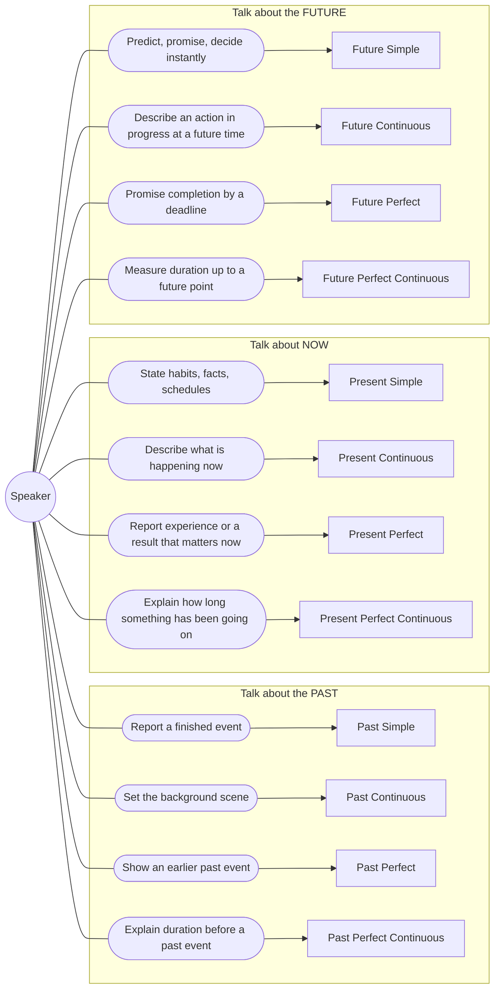
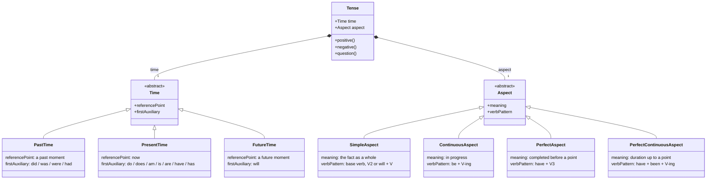
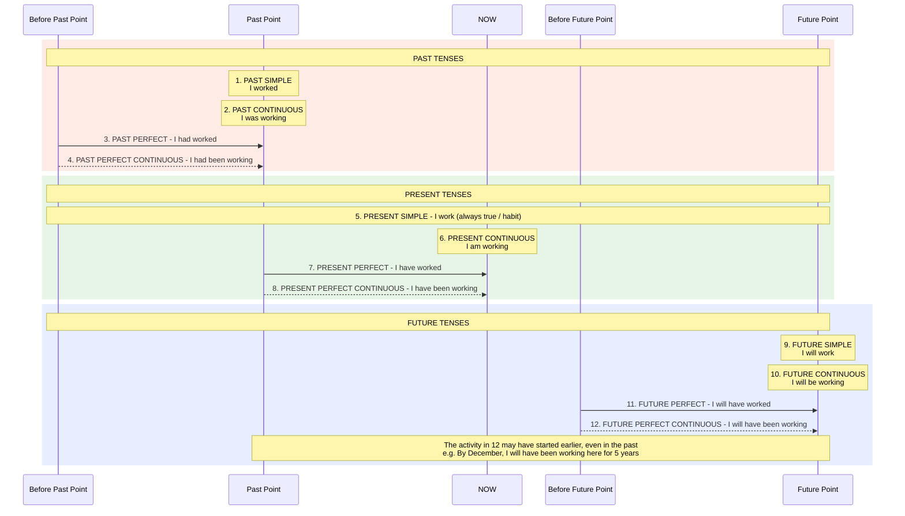
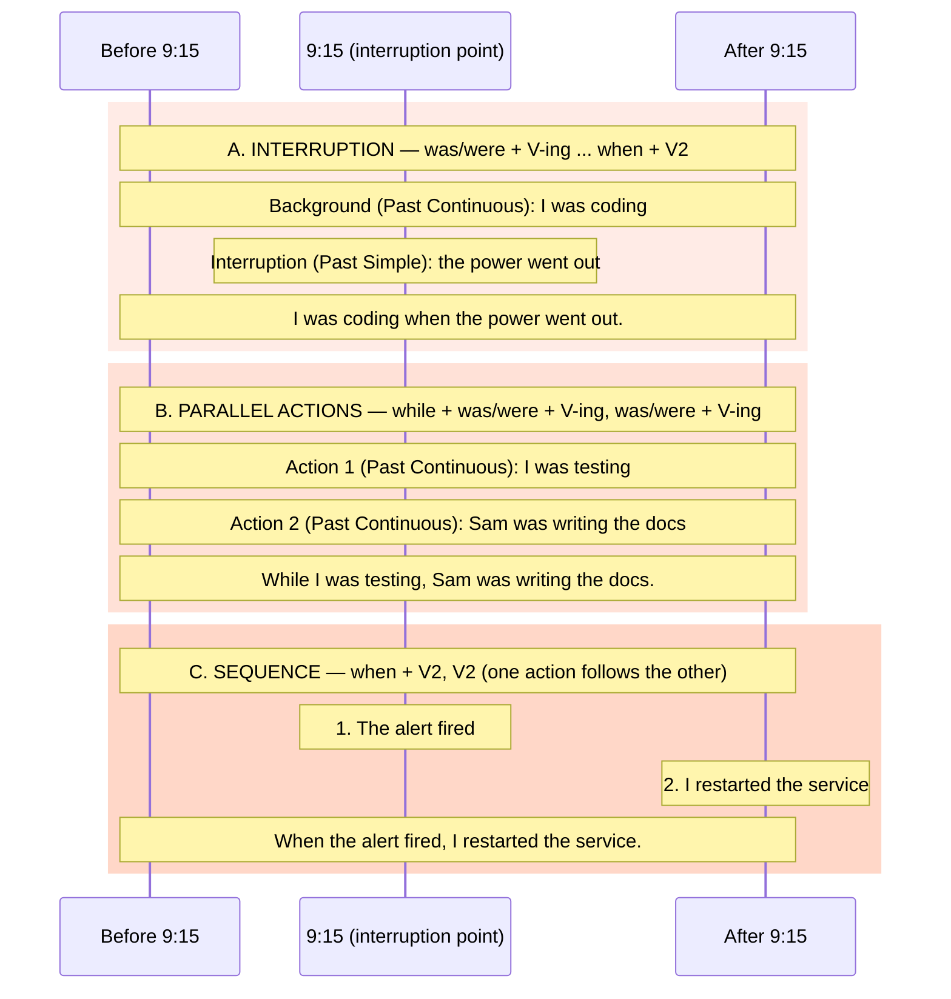
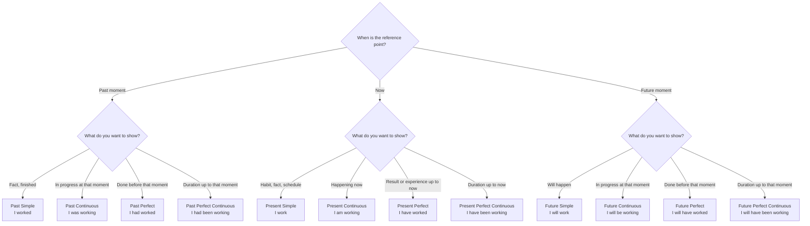
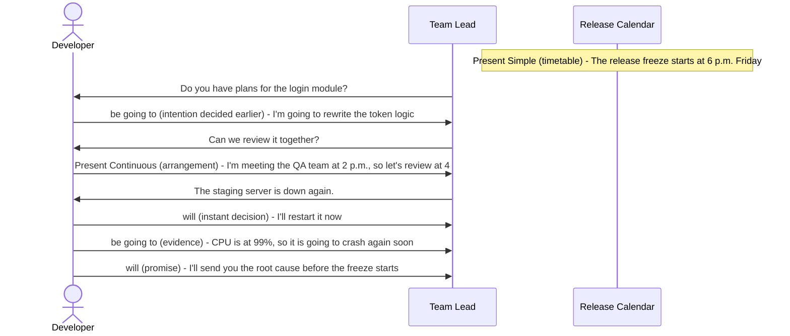
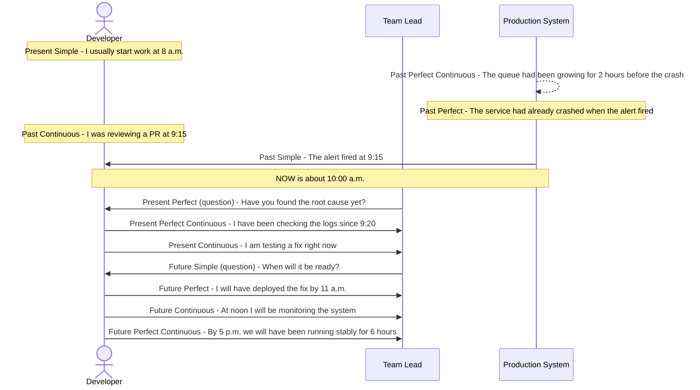

# English 12 Tenses — Visual Handbook

> Learn the 12 English tenses as a **system**, not as 12 separate rules.
> Version 1.2 — Phase 1 additions (high-priority items).
>
> Every tense = **TIME** (Past / Present / Future) × **ASPECT** (Simple / Continuous / Perfect / Perfect Continuous).

### Changelog

| Version | Changes |
|---|---|
| 1.2 | Added Wh-questions and short answers for all 12 tenses (Section 5); *for / since*, *been / gone* and adverb position (Section 5, Present Perfect); interruption diagram (Section 5, Past Continuous); new Section 7 *Future Forms*; new Section 10 *Common Mistakes*; sections renumbered. |
| 1.1 | Fixed class diagram model, story chronology, Future Perfect Continuous arrow; added form rules and time clauses. |
| 1.0 | First release. |

---

## Table of Contents

1. [The Big Idea: 3 × 4 = 12](#1-the-big-idea-3--4--12)
2. [Use Case Diagram — What do you want to say?](#2-use-case-diagram--what-do-you-want-to-say)
3. [Class Diagram — How tenses are built](#3-class-diagram--how-tenses-are-built)
4. [Sequence Diagram — All 12 tenses on one timeline](#4-sequence-diagram--all-12-tenses-on-one-timeline)
5. [Tense-by-Tense Reference](#5-tense-by-tense-reference)
6. [Decision Flow — Which tense should I use?](#6-decision-flow--which-tense-should-i-use)
7. [Future Forms — will, be going to, Present Continuous, Present Simple](#7-future-forms--will-be-going-to-present-continuous-present-simple)
8. [Sequence Diagram — One story, many tenses](#8-sequence-diagram--one-story-many-tenses)
9. [Commonly Confused Pairs](#9-commonly-confused-pairs)
10. [Common Mistakes of Vietnamese Learners](#10-common-mistakes-of-vietnamese-learners)
11. [Stative Verbs — The "no -ing" rule](#11-stative-verbs--the-no--ing-rule)
12. [Form Rules and Time Clauses](#12-form-rules-and-time-clauses)
13. [Practice Exercises + Answer Key](#13-practice-exercises--answer-key)
14. [One-Page Cheat Sheet](#14-one-page-cheat-sheet)

---

## 1. The Big Idea: 3 × 4 = 12

| Aspect ↓ / Time → | **Past** | **Present** | **Future** |
|---|---|---|---|
| **Simple** — the fact, as a whole | worked | work(s) | will work |
| **Continuous** — in progress | was/were working | am/is/are working | will be working |
| **Perfect** — completed *before* a point | had worked | have/has worked | will have worked |
| **Perfect Continuous** — duration *up to* a point | had been working | have/has been working | will have been working |

**Three building blocks you only need to learn once:**

| Block | Form | Meaning it adds |
|---|---|---|
| Continuous | **be + V-ing** | "in progress" |
| Perfect | **have + V3** | "before a reference point" |
| Perfect Continuous | **have + been + V-ing** | "in progress *up to* a reference point" |

Then you only change the **first auxiliary** by time:

- Past → `was/were`, `had`, `did`
- Present → `am/is/are`, `have/has`, `do/does`
- Future → `will`

Exception: positive **Present Simple** and **Past Simple** have no auxiliary (*I work / I worked*). The auxiliary *do / does / did* appears only in negatives and questions.

---

## 2. Use Case Diagram — What do you want to say?

Start from **intention** (what the speaker wants to communicate), then pick the tense.

---

## 3. Class Diagram — How tenses are built

Think of a tense as an object composed of **Time** and **Aspect**. The aspect decides the verb pattern; the time decides the auxiliary.

**How to read it:** a `Tense` is composed of exactly **one** `Time` and **one** `Aspect` (3 × 4 = 12 combinations). Example: `Present Perfect` = `PresentTime` (first auxiliary *have/has*) + `PerfectAspect` (*have + V3*) → **I have worked**.

> Note: positive Present Simple and Past Simple have **no** auxiliary (*I work*, *I worked*); *do/does/did* appear only in negatives and questions.

---

## 4. Sequence Diagram — All 12 tenses on one timeline

**Legend:** Note = action **at** a point · Solid arrow `->>` = completed **before** a point (result) · Dashed arrow `-->>` = continuing **up to** a point (duration)

**Key insight:** Perfect tenses always **look back** from a reference point. Move the reference point (past moment → now → future moment) and you get Past / Present / Future Perfect.

---

## 5. Tense-by-Tense Reference

Each tense table has five rows: positive (+), negative (−), Yes/No question (?), Wh-question (Wh) and short answer (SA).

**Wh-question rule:** put the question word in front of the Yes/No question.

`Wh- word + auxiliary + subject + main verb …?` → *Did you fix it?* → *When **did** you **fix** it?*

| Question word | Asks about |
|---|---|
| What / Which | thing, choice |
| When / What time | time |
| Where | place |
| Why | reason |
| How / How long / How many | manner, duration, quantity |
| Who / Whom | person |

⚠️ **Subject questions** — when *Who* or *What* **is the subject**, there is no *do / does / did* and the word order stays like a statement:
*Who **fixed** the bug?* (not ~~Who did fix the bug?~~) · *What **happened**?* (not ~~What did happen?~~)

**Short answers** repeat only the **first auxiliary**: *Have you finished? — Yes, I **have**. / No, I **haven't**.* Never answer with the main verb (~~Yes, I finished~~ as a short answer to a Perfect question).

### 5.1 Past Group

#### 1. Past Simple
| | Form | Example |
|---|---|---|
| (+) | S + V2/ed | I **fixed** the bug yesterday. |
| (−) | S + did not + V | I **didn't fix** the bug yesterday. |
| (?) | Did + S + V? | **Did** you **fix** the bug yesterday? |
| (Wh) | Wh- + did + S + V? | When **did** you **fix** the bug? |
| (SA) | Yes, S did. / No, S didn't. | Yes, I **did**. / No, I **didn't**. |

- **Use:** finished action at a specific past time; a sequence of past events.
- **Signals:** yesterday, last week/month/year, ago, in 2020, when I was…
- ⚠️ For unfinished time or no specific time (*so far, ever, today, this week*), standard/British usage prefers Present Perfect. American English often accepts *already / yet / just* with Past Simple (*Did you eat yet?*); in exams, use Present Perfect.

#### 2. Past Continuous
| | Form | Example |
|---|---|---|
| (+) | S + was/were + V-ing | I **was testing** at 8 p.m. |
| (−) | S + was/were not + V-ing | I **wasn't testing** at 8 p.m. |
| (?) | Was/Were + S + V-ing? | **Were** you **testing** at 8 p.m.? |
| (Wh) | Wh- + was/were + S + V-ing? | What **were** you **testing** at 8 p.m.? |
| (SA) | Yes, S was/were. / No, S wasn't/weren't. | Yes, I **was**. / No, I **wasn't**. |

- **Use:** in progress at a past moment; background interrupted by a Past Simple action; two parallel past actions (*while*).
- **Signals:** at + time + yesterday, while, when.
- Pattern: *I **was coding** (background) **when** the power **went** out (interruption).*

**Interruption and parallel actions — timeline view**

Same legend as Section 4: a wide Note = an action in progress over a period; a narrow Note = an action at one point.

| Pattern | Meaning |
|---|---|
| *I **was restarting** the service when the alert **fired**.* | The restart was already in progress; the alert interrupted it. |
| *When the alert **fired**, I **restarted** the service.* | The alert came first; the restart happened after it. |

#### 3. Past Perfect
| | Form | Example |
|---|---|---|
| (+) | S + had + V3 | The build **had failed** before I arrived. |
| (−) | S + had not + V3 | The build **hadn't failed** before I arrived. |
| (?) | Had + S + V3? | **Had** the build **failed** before you arrived? |
| (Wh) | Wh- + had + S + V3? | Why **had** the build **failed**? |
| (SA) | Yes, S had. / No, S hadn't. | Yes, it **had**. / No, it **hadn't**. |

- **Use:** the **earlier** of two past events; "past of the past".
- **Signals:** before, after, by the time, already, when (+ Past Simple).

#### 4. Past Perfect Continuous
| | Form | Example |
|---|---|---|
| (+) | S + had been + V-ing | I **had been waiting** for 2 hours. |
| (−) | S + had not been + V-ing | I **hadn't been waiting** long. |
| (?) | Had + S + been + V-ing? | **Had** you **been waiting** long? |
| (Wh) | Wh- + had + S + been + V-ing? | How long **had** you **been waiting**? |
| (SA) | Yes, S had. / No, S hadn't. | Yes, I **had**. / No, I **hadn't**. |

- **Use:** duration of an activity **up to** a past point; explains a past result.
- **Signals:** for, since, how long, before, when.
- e.g. *She was tired because she **had been debugging** all night.*

### 5.2 Present Group

#### 5. Present Simple
| | Form | Example |
|---|---|---|
| (+) | S + V(s/es) | She **reviews** PRs every morning. |
| (−) | S + do/does not + V | She **doesn't review** PRs on Fridays. |
| (?) | Do/Does + S + V? | **Does** she **review** PRs every morning? |
| (Wh) | Wh- + do/does + S + V? | When **does** she **review** PRs? |
| (SA) | Yes, S do/does. / No, S don't/doesn't. | Yes, she **does**. / No, she **doesn't**. |

- **Use:** habits, facts, general truths, fixed timetables (*The train leaves at 7*).
- **Signals:** always, usually, often, sometimes, never, every day.

#### 6. Present Continuous
| | Form | Example |
|---|---|---|
| (+) | S + am/is/are + V-ing | I **am deploying** the app now. |
| (−) | S + am/is/are not + V-ing | I **am not deploying** now. |
| (?) | Am/Is/Are + S + V-ing? | **Are** you **deploying** now? |
| (Wh) | Wh- + am/is/are + S + V-ing? | What **are** you **deploying** now? |
| (SA) | Yes, S am/is/are. / No, S 'm not/isn't/aren't. | Yes, I **am**. / No, I**'m not**. |

- **Use:** happening now; temporary situations; **fixed personal plans** in the near future (*I'm meeting the client tomorrow*).
- **Signals:** now, right now, at the moment, currently, Look!, Listen!

#### 7. Present Perfect
| | Form | Example |
|---|---|---|
| (+) | S + have/has + V3 | I **have fixed** three bugs so far. |
| (−) | S + have/has not + V3 | I **haven't fixed** it yet. |
| (?) | Have/Has + S + V3? | **Have** you ever **used** Kafka? |
| (Wh) | Wh- + have/has + S + V3? | How many bugs **have** you **fixed** so far? |
| (SA) | Yes, S have/has. / No, S haven't/hasn't. | Yes, I **have**. / No, I **haven't**. |

- **Use:** life experience; past action with a **result now**; unfinished time period (today, this week).
- **Signals:** already, yet, just, ever, never, so far, recently, since, for.

**For vs Since**

| Word | Followed by | Examples |
|---|---|---|
| **for** | a **period** of time (how long) | for 3 years, for two hours, for a long time, for ages |
| **since** | a **starting point** (from when) | since 2021, since Monday, since 9 a.m., since I joined the team |

- *I have worked here **for** 3 years.* = *I have worked here **since** 2023.* (if now is 2026)
- *since* + a clause uses **Past Simple**: *I have used Kafka **since** I **joined** this project.*

**Been vs Gone**

| Form | Meaning | Example |
|---|---|---|
| **has/have been to** | went **and came back** (experience) | *She **has been to** Japan.* → She is home now. |
| **has/have gone to** | went and **is still there / on the way** | *She **has gone to** Japan.* → She is not here now. |

**Position of already / yet / just / ever / never**

| Adverb | Usual sentence type | Position | Example |
|---|---|---|---|
| **already** | (+), sometimes (?) to show surprise | between *have* and V3 (end position is also common) | I **have already** fixed it. / Have you fixed it **already**? |
| **yet** | (−) and (?) | **end** of the sentence | I **haven't** fixed it **yet**. / Have you fixed it **yet**? |
| **just** | (+) | between *have* and V3 | I **have just** pushed the code. |
| **ever** | (?) and after superlatives | between subject and V3 | **Have** you **ever** used Kafka? / It's the worst bug I **have ever** seen. |
| **never** | (+) form with negative meaning | between *have* and V3 | I **have never** used Rust. (not ~~I haven't never used~~) |

#### 8. Present Perfect Continuous
| | Form | Example |
|---|---|---|
| (+) | S + have/has been + V-ing | I **have been debugging** since 9 a.m. |
| (−) | S + have/has not been + V-ing | I **haven't been sleeping** well. |
| (?) | Have/Has + S + been + V-ing? | **Have** you **been working** here long? |
| (Wh) | Wh- + have/has + S + been + V-ing? | How long **have** you **been working** here? |
| (SA) | Yes, S have/has. / No, S haven't/hasn't. | Yes, I **have**. / No, I **haven't**. |

- **Use:** started in the past, continues **up to now** (may continue); focus on **duration / activity**.
- **Signals:** for, since, all day, how long, lately.

### 5.3 Future Group

#### 9. Future Simple
| | Form | Example |
|---|---|---|
| (+) | S + will + V | I **will send** the report. |
| (−) | S + will not (won't) + V | I **won't send** it today. |
| (?) | Will + S + V? | **Will** you **send** it? |
| (Wh) | Wh- + will + S + V? | When **will** you **send** it? |
| (SA) | Yes, S will. / No, S won't. | Yes, I **will**. / No, I **won't**. |

- **Use:** instant decision, prediction (opinion), promise, offer.
- **Signals:** tomorrow, next week, soon, I think, probably.
- ⚠️ Plan already decided → *be going to*: *I'm going to refactor this module.* See Section 7 for all future forms.

#### 10. Future Continuous
| | Form | Example |
|---|---|---|
| (+) | S + will be + V-ing | I **will be presenting** at 10 a.m. |
| (−) | S + will not be + V-ing | I **won't be working** on Sunday. |
| (?) | Will + S + be + V-ing? | **Will** you **be using** the room at 3? |
| (Wh) | Wh- + will + S + be + V-ing? | What **will** you **be doing** at 3? |
| (SA) | Yes, S will. / No, S won't. | Yes, I **will**. / No, I **won't**. |

- **Use:** in progress at a specific future moment; polite questions about plans.
- **Signals:** at this time tomorrow, at 10 a.m. next Monday.

#### 11. Future Perfect
| | Form | Example |
|---|---|---|
| (+) | S + will have + V3 | By Friday, I **will have finished** the sprint. |
| (−) | S + will not have + V3 | I **won't have finished** by Friday. |
| (?) | Will + S + have + V3? | **Will** you **have finished** by Friday? |
| (Wh) | Wh- + will + S + have + V3? | How much **will** you **have finished** by Friday? |
| (SA) | Yes, S will. / No, S won't. | Yes, I **will**. / No, I **won't**. |

- **Use:** completed **before** a future point (deadline thinking).
- **Signals:** by + time, by the time, before, by then.

#### 12. Future Perfect Continuous
| | Form | Example |
|---|---|---|
| (+) | S + will have been + V-ing | By December, I **will have been working** here for 5 years. |
| (−) | S + will not have been + V-ing | I **won't have been working** here long. |
| (?) | Will + S + have been + V-ing? | **Will** you **have been working** here for 5 years by December? |
| (Wh) | Wh- + will + S + have been + V-ing? | How long **will** you **have been working** here by December? |
| (SA) | Yes, S will. / No, S won't. | Yes, I **will**. / No, I **won't**. |

- **Use:** duration of an activity **up to** a future point.
- **Signals:** by + time + for + period.

---

## 6. Decision Flow — Which tense should I use?

> Note: the flow covers the 12 tenses only. If the reference point is the future, first check Section 7: *will* is only one of four common ways to talk about the future.

**Two questions decide every tense:**
1. **Where is my reference point?** (past moment / now / future moment)
2. **What do I focus on?** (fact / in progress / completed before / duration up to)

---

## 7. Future Forms — will, be going to, Present Continuous, Present Simple

English has no single "future tense". Choose the form by **how certain or how planned** the future action is.

| Form | Structure | Use | Example |
|---|---|---|---|
| **will** | S + will + V | instant decision (decided at the moment of speaking); prediction based on opinion; promise; offer | *The build failed? I'**ll** check it.* / *I think it **will** rain.* |
| **be going to** | S + am/is/are going to + V | intention decided **before** speaking; prediction based on **present evidence** | *I'**m going to** refactor this module next sprint.* / *Look at those errors — the build **is going to** fail.* |
| **Present Continuous** | S + am/is/are + V-ing | fixed **arrangement** with other people, time and place agreed | *I'**m meeting** the client at 3 p.m. tomorrow.* |
| **Present Simple** | S + V(s/es) | official **timetable / schedule** | *The release train **leaves** at 6 p.m. on Friday.* / *The sprint **starts** on Monday.* |

**From least to most fixed:** will (decided now) → be going to (decided earlier) → Present Continuous (arranged with others) → Present Simple (official schedule).

Note the last line: *before the freeze **starts*** uses Present Simple after *before* — the time-clause rule in Section 12.3.

| Situation | Best form | Why |
|---|---|---|
| Phone rings: "______ answer it!" | **I'll** | decided right now |
| You booked a dentist appointment for Tuesday | **I'm seeing** the dentist on Tuesday | arranged with another person |
| You decided last week to learn Rust | **I'm going to learn** Rust | intention made earlier |
| The bus schedule says 7:45 | The bus **leaves** at 7:45 | official timetable |

---

## 8. Sequence Diagram — One story, many tenses

A real workday told with **all 12 tenses**. The story is spoken at **about 10:00 a.m.** (= NOW). Messages are in chronological order of the events they describe.

---

## 9. Commonly Confused Pairs

| Pair | Difference | Example |
|---|---|---|
| Past Simple vs Present Perfect | Specific finished time **vs** no time / result now | I **lost** my key yesterday. / I **have lost** my key (I still can't get in). |
| Present Perfect vs Present Perfect Continuous | **Result / quantity** vs **activity / duration** | I **have written** 3 tests. / I **have been writing** tests all morning. |
| Past Simple vs Past Perfect | One past event **vs** the earlier of two | When I arrived, the meeting **started**. (on arrival) / …the meeting **had started**. (before arrival) |
| Past Simple vs Past Continuous | Complete event **vs** background in progress | I **coded** a feature. / I **was coding** when he called. |
| will vs be going to vs Present Continuous | Instant decision **vs** intention **vs** arranged plan | I'll help you. / I'm going to learn Rust. / I'm meeting the client at 3. |
| Future Simple vs Future Perfect | Happens at a point **vs** finished before a point | I **will finish** on Friday. / I **will have finished** by Friday. |

---

## 10. Common Mistakes of Vietnamese Learners

Vietnamese marks time with separate words (*đã*, *đang*, *sẽ*) and never changes the verb. English marks time **inside the verb phrase**, so most mistakes come from forgetting to change the verb or the auxiliary.

| # | ❌ Wrong | ✅ Correct | Why |
|---|---|---|---|
| 1 | She **work** here. | She **works** here. | Present Simple: he/she/it needs **-s/-es**. |
| 2 | He **doesn't works** on Sunday. | He **doesn't work** on Sunday. | After *do/does/did*, the main verb is the **base form**. |
| 3 | **Did** you **went** home? | **Did** you **go** home? | Same rule: *did* already shows the past. |
| 4 | I **didn't finished** it. | I **didn't finish** it. | Same rule in negatives. |
| 5 | Yesterday I **go** to the office. | Yesterday I **went** to the office. | A time word (*yesterday*) does not replace the past form. |
| 6 | I **am agree**. | I **agree**. | *agree* is a verb; do not add *am*. |
| 7 | I **going** to the office now. | I **am going** to the office now. | Continuous needs **be** + V-ing. |
| 8 | I **will to send** it. | I **will send** it. | *will* + base form, no *to*. |
| 9 | I **am working** here **for 3 years**. | I **have been working** here for 3 years. | Duration up to now → Present Perfect (Continuous). |
| 10 | I have lived here **since 3 years**. | I have lived here **for 3 years**. | *for* + period, *since* + starting point (Section 5, Present Perfect). |
| 11 | I **have seen** him **yesterday**. | I **saw** him yesterday. | Specific finished time → Past Simple. |
| 12 | **Where you are** going? | **Where are you** going? | Questions invert auxiliary and subject. |
| 13 | **Who did fix** the bug? | **Who fixed** the bug? | Subject question → no *did* (Section 5). |
| 14 | **How long time** have you worked here? | **How long** have you worked here? | *How long* already means "how much time". |
| 15 | He **is having** a new laptop. | He **has** a new laptop. | *have* (= own) is a stative verb (Section 11). |
| 16 | When I **will finish**, I'll call you. | When I **finish**, I'll call you. | Time clause → no *will* (Section 12.3). |
| 17 | I **haven't never** used it. | I **have never** used it. / I **haven't ever** used it. | Only one negative word in a clause. |
| 18 | Have you finished? — Yes, I **finished**. | Have you finished? — Yes, I **have**. | Short answer repeats the auxiliary. |

**Self-check before you speak or write:**
1. Is the time past, present or future? → is the **first verb** in the right form?
2. Is there *do / does / did*, a modal or *will*? → is the main verb in the **base form**?
3. Is it a question? → is the **auxiliary before the subject** (except subject questions)?

---

## 11. Stative Verbs — The "no -ing" rule

Stative verbs describe **states**, not actions, so they are usually **not** used in Continuous tenses.

| Category | Verbs |
|---|---|
| Mind | know, believe, understand, remember, mean |
| Feeling | like, love, hate, want, need, prefer |
| Possession | have (= own), own, belong |
| Senses | see, hear, smell, taste (involuntary) |
| Being | be, seem, contain, consist |

- ❌ *I am knowing the answer.* → ✅ *I **know** the answer.*
- ❌ *I have been knowing him for years.* → ✅ *I **have known** him for years.*
- Exception (action meaning): *I'**m having** lunch.* / *I'**m thinking** about it.*

---

## 12. Form Rules and Time Clauses

### 12.1 Spelling rules

| Form | Rule | Examples |
|---|---|---|
| **V-s / V-es** (he/she/it) | add **-es** after -s, -ss, -sh, -ch, -x, -o | fixes, watches, goes |
| | consonant + **y** → **-ies** | try → tries |
| | vowel + y → just **-s** | play → plays |
| | irregular | have → **has** |
| **V-ing** | drop final silent **-e** | write → writing |
| | **-ie** → **-ying** | lie → lying |
| | double final consonant after a short stressed vowel (CVC) | run → running, stop → stopping |
| **V2 / V3** (regular) | add **-ed** (same spelling rules: tried, stopped) | work → worked → worked |
| **V2 / V3** (irregular) | must be memorised | go → went → gone; write → wrote → written |

### 12.2 Contractions

| Full | Contracted |
|---|---|
| I am / you are / he is | I'm / you're / he's |
| do not / does not / did not | don't / doesn't / didn't |
| have not / has not / had not | haven't / hasn't / hadn't |
| will / will not | 'll / won't |

⚠️ **he's** can be *he is* or *he has* (*He's working* vs *He's worked*); **I'd** can be *I had* or *I would*.

### 12.3 Time clauses — no *will* after *when / if / before / after / until / as soon as*

When a clause with these words talks about the future, use a **present** tense, not *will*.

| ❌ Wrong | ✅ Correct | Tense used in the clause |
|---|---|---|
| When I **will finish**, I'll call you. | When I **finish**, I'll call you. | Present Simple |
| I'll deploy after the tests **will have passed**. | I'll deploy after the tests **have passed**. | Present Perfect |

---

## 13. Practice Exercises + Answer Key

### Exercise A — Choose the correct tense

1. I ______ (work) here since 2021.
2. When I arrived, the meeting ______ (already / start).
3. Look! The server ______ (restart).
4. By next June, she ______ (complete) the course.
5. I ______ (meet) him last week.
6. At 9 p.m. tomorrow, I ______ (fly) to Hanoi.
7. She was exhausted because she ______ (code) all night.
8. Water ______ (boil) at 100°C.
9. ______ you ever ______ (use) Typesense?
10. By 2027, I ______ (study) English for 2 years.

### Exercise B — Fix the mistake

1. I have met him yesterday.
2. I am knowing this API well.
3. When I came, she already left.
4. I will have finish it by Friday.
5. How long are you working here?
6. I will call you as soon as I will arrive.

### Answer Key

**A.**
1. have worked / have been working — *Present Perfect (Continuous)*
2. had already started — *Past Perfect*
3. is restarting — *Present Continuous*
4. will have completed — *Future Perfect*
5. met — *Past Simple*
6. will be flying — *Future Continuous*
7. had been coding — *Past Perfect Continuous*
8. boils — *Present Simple*
9. Have … used — *Present Perfect*
10. will have been studying — *Future Perfect Continuous*

**B.**
1. I **met** him yesterday. (specific past time → Past Simple)
2. I **know** this API well. (stative verb)
3. When I came, she **had already left**. (earlier past event; *already left* is heard in informal American English, but Past Perfect is the standard answer)
4. I will have **finished** it by Friday. (have + V3)
5. How long **have you been working** here? (duration up to now)
6. I will call you as soon as I **arrive**. (time clause → no *will*, see Section 12.3)

---

## 14. One-Page Cheat Sheet

| # | Tense | Formula (+) | Wh-question example | Core idea | Key signals |
|---|---|---|---|---|---|
| 1 | Past Simple | S + V2/ed | *When did you work?* | finished at past time | yesterday, ago, last |
| 2 | Past Continuous | S + was/were + V-ing | *What were you doing?* | in progress at past moment | while, when, at 8 p.m. yesterday |
| 3 | Past Perfect | S + had + V3 | *Why had it failed?* | before another past event | before, after, by the time |
| 4 | Past Perfect Continuous | S + had been + V-ing | *How long had you been waiting?* | duration up to past point | for, since, when |
| 5 | Present Simple | S + V(s/es) | *When does she work?* | habit, fact, schedule | always, usually, every |
| 6 | Present Continuous | S + am/is/are + V-ing | *What are you doing?* | happening now / arranged plan | now, at the moment |
| 7 | Present Perfect | S + have/has + V3 | *How many bugs have you fixed?* | result / experience up to now | already, yet, ever, so far |
| 8 | Present Perfect Continuous | S + have/has been + V-ing | *How long have you been working?* | duration up to now | for, since, all day |
| 9 | Future Simple | S + will + V | *When will you send it?* | decision, prediction, promise | tomorrow, soon, probably |
| 10 | Future Continuous | S + will be + V-ing | *What will you be doing?* | in progress at future moment | at this time tomorrow |
| 11 | Future Perfect | S + will have + V3 | *What will you have finished by Friday?* | done before future point | by + time |
| 12 | Future Perfect Continuous | S + will have been + V-ing | *How long will you have been working?* | duration up to future point | by + time + for |

**Memory rule:** `be + V-ing` = in progress · `have + V3` = looking back · `have been + V-ing` = looking back at a process.

### Suggested study path

1. Master the **3 × 4 grid** (Section 1).
2. Draw the **timeline** from memory (Section 4).
3. Learn each tense with its **Wh-question and short answer** (Section 5).
4. Practise with the **decision flow** and **future forms** (Sections 6–7).
5. Study the **confused pairs** and **common mistakes** (Sections 9–10) — this is where most errors happen.
6. Learn the **form rules and time clauses** (Section 12).
7. Do the exercises (Section 13), then write 12 sentences about your own workday.
