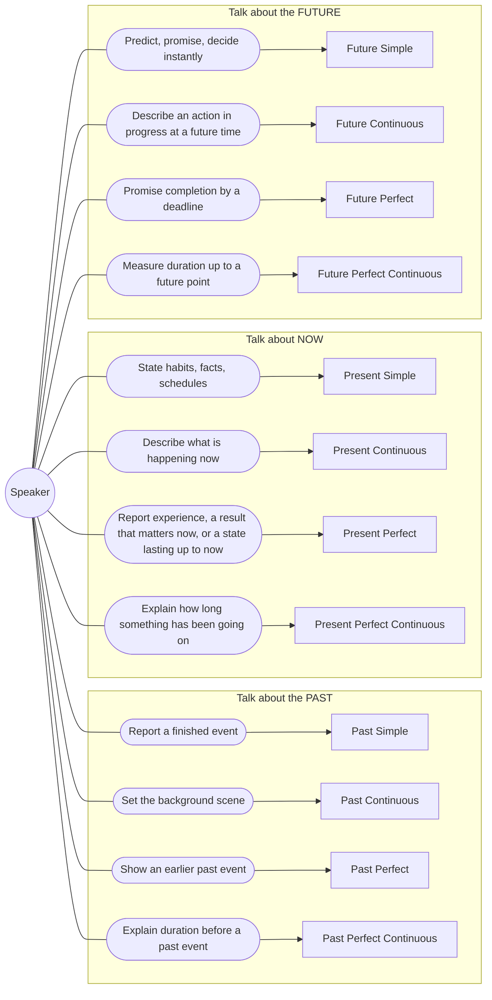
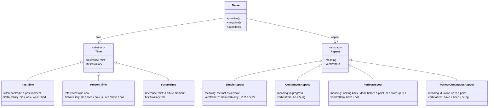
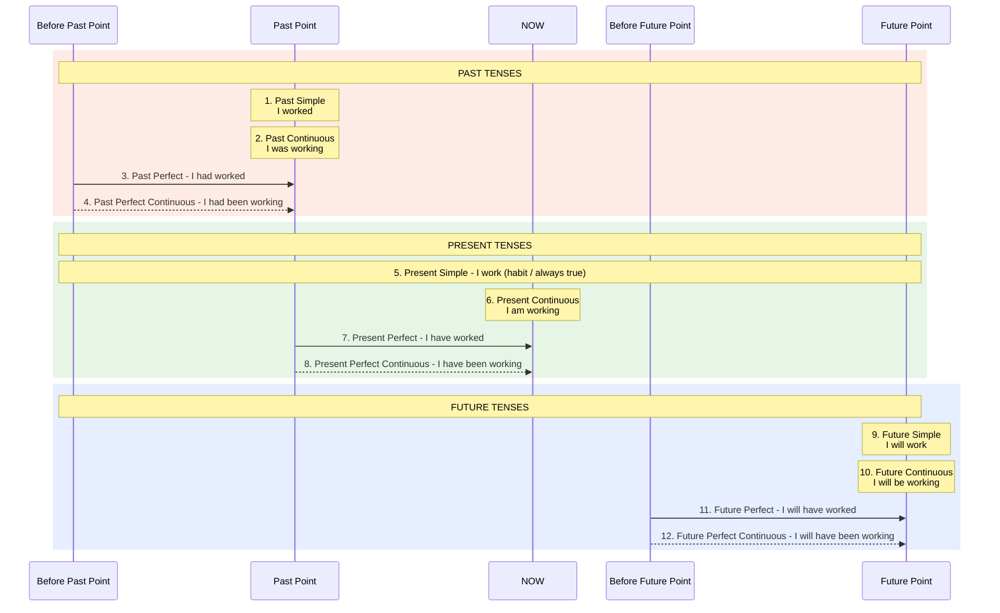
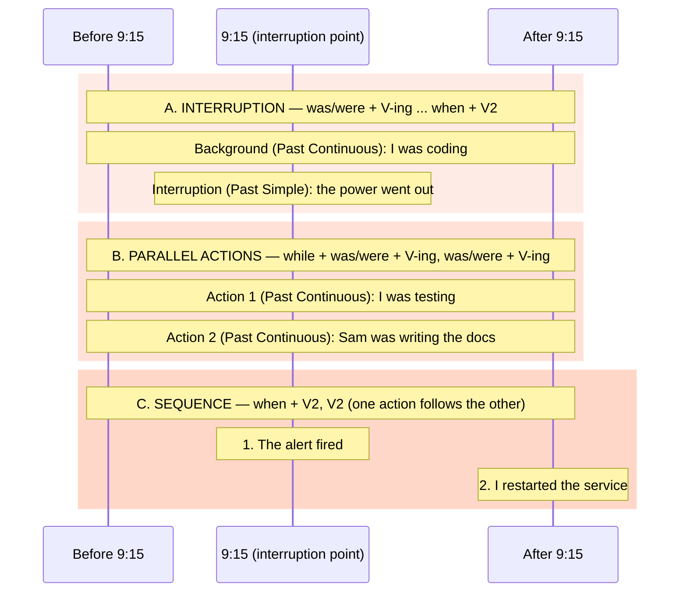
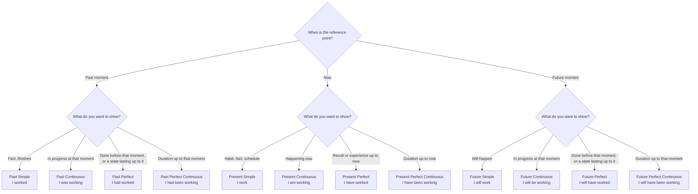
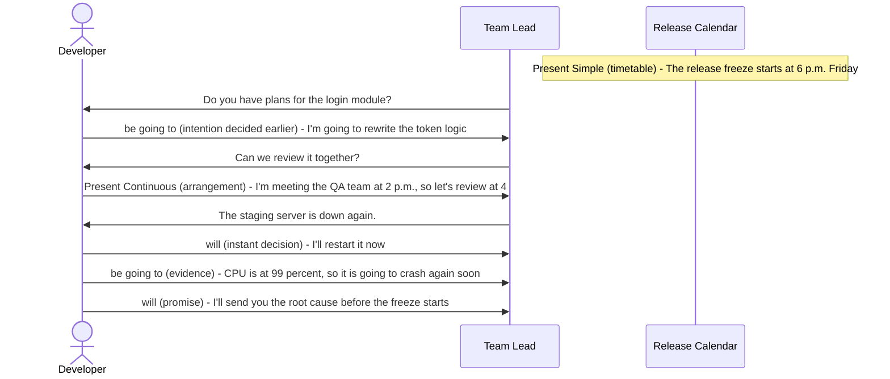
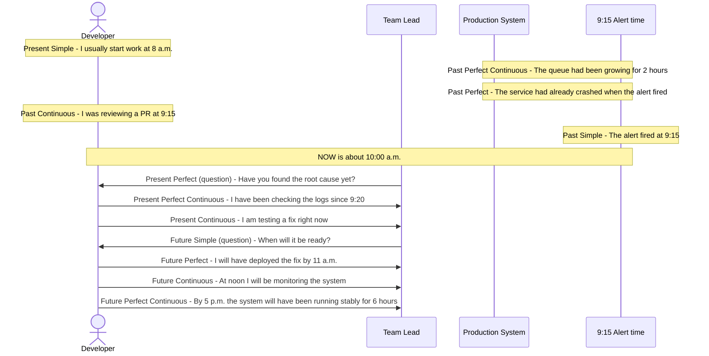
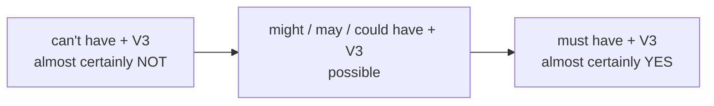
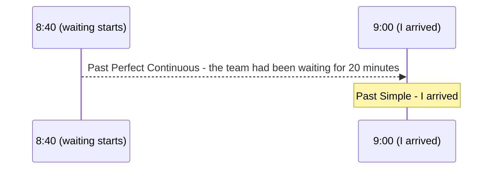

# English 12 Tenses — Visual Handbook

> Learn the 12 English tenses as a **system**, not as 12 separate rules.
> Version 1.3.5 — final content release (no new content). Next step: render-check all diagrams.
>
> Every tense = **TIME** (Past / Present / Future) × **ASPECT** (Simple / Continuous / Perfect / Perfect Continuous).

### Changelog

| Version | Changes |
|---|---|
| 1.3.5 | Polish only: removed duplicated attributes from `Tense` in the class diagram (the associations already show them); clarified that "Future Simple" is a teaching label (Section 7). |
| 1.3.4 | Fixes only: new Perfect definition also applied to the Decision Flow (Section 6), the Cheat Sheet (Section 15) and the Use Case diagram (Section 2); corrected the note on Present Perfect and time expressions (a *since* starting point is allowed). |
| 1.3.3 | Fixes only: Perfect redefined as *looking back from a point* (done before it, or a state lasting up to it) in Sections 1, 3, 4 and 5; note that Present Perfect has no stated start time; exceptions flagged in 11.1; separate *-ed* spelling rules and *-z → -es*; Note width has no time meaning in conversation diagrams; Future Perfect Continuous negative example given a time point; Exercise B mapped to Section 11; parentheses removed from a class-diagram member. |
| 1.3.2 | Fixes only: legend now explains overview vs detail diagrams and conversation diagrams; story diagram uses arrows only for speech; tense names no longer in capitals inside diagrams; scope note for the time-clause rule (12.3); instructions added to Exercises G and H; corrected position of *ever*; Past Simple with finished parts of *today / this week*; class diagram uses association instead of composition; spelling rule for *w / x / y*; corrected definition of the AAA/ABB/ABA/ABC labels. |
| 1.3.1 | Fixes only: unified diagram legend (narrow vs wide Note) in Sections 4–5; story diagram uses an explicit time point instead of a self-arrow; resolved *look* contradiction in 11.1; removed *will* from `SimpleAspect`; story subject corrected; G4 accepts both answers; added /θ/ to *-ed* rule; added *-ee/-ye/-oe* spelling exception; removed `%` from a Mermaid diagram. |
| 1.3 | Expanded Section 11 (stative verbs with two meanings, *always* + Continuous); added Section 12.4 (pronunciation of *-ed* and *-s/-es*); new Section 13 *Beyond the 12 Tenses* (*used to / would*, *be used to*, modal perfect); expanded Section 14 exercises (Parts C–I, including a timeline task); added a frequency column to the Cheat Sheet; new Appendix A (irregular verbs); sections renumbered. |
| 1.2 | Added Wh-questions and short answers for all 12 tenses (Section 5); *for / since*, *been / gone* and adverb position (Section 5, Present Perfect); interruption diagram (Section 5, Past Continuous); new Section 7 *Future Forms*; new Section 10 *Common Mistakes*; sections renumbered. |
| 1.1 | Fixed class diagram model, story chronology, Future Perfect Continuous arrow; added form rules and time clauses. |
| 1.0 | First release. |

**Out of scope:** passive voice across tenses and reported speech (backshift) — see a separate handbook.

---

## Table of Contents

1. [The Big Idea: 3 × 4 = 12](#1-the-big-idea-3--4--12)
2. [Use Case Diagram — What do you want to say?](#2-use-case-diagram--what-do-you-want-to-say)
3. [Class Diagram — How tenses are built](#3-class-diagram--how-tenses-are-built)
4. [Sequence Diagram — All 12 tenses on one timeline](#4-sequence-diagram--all-12-tenses-on-one-timeline)
5. [Tense-by-Tense Reference](#5-tense-by-tense-reference)
6. [Decision Flow — Which tense should I use?](#6-decision-flow--which-tense-should-i-use)
7. [Future Forms — will, be going to, Present Continuous, Present Simple](#7-future-forms--will-be-going-to-present-continuous-present-simple)
8. [Sequence Diagram — One story, many tenses](#8-sequence-diagram--one-story-many-tenses)
9. [Commonly Confused Pairs](#9-commonly-confused-pairs)
10. [Common Mistakes of Vietnamese Learners](#10-common-mistakes-of-vietnamese-learners)
11. [Stative Verbs — The "no -ing" rule](#11-stative-verbs--the-no--ing-rule)
12. [Form Rules, Pronunciation and Time Clauses](#12-form-rules-pronunciation-and-time-clauses)
13. [Beyond the 12 Tenses — used to, would, modal perfect](#13-beyond-the-12-tenses--used-to-would-modal-perfect)
14. [Practice Exercises + Answer Key](#14-practice-exercises--answer-key)
15. [One-Page Cheat Sheet](#15-one-page-cheat-sheet)
- [Appendix A — Common Irregular Verbs](#appendix-a--common-irregular-verbs)

---

## 1. The Big Idea: 3 × 4 = 12

| Aspect ↓ / Time → | **Past** | **Present** | **Future** |
|---|---|---|---|
| **Simple** — the fact, as a whole | worked | work(s) | will work |
| **Continuous** — in progress | was/were working | am/is/are working | will be working |
| **Perfect** — looking back from a point: done *before* it, or a state lasting *up to* it | had worked | have/has worked | will have worked |
| **Perfect Continuous** — duration *up to* a point | had been working | have/has been working | will have been working |

**Three building blocks you only need to learn once:**

| Block | Form | Meaning it adds |
|---|---|---|
| Continuous | **be + V-ing** | "in progress" |
| Perfect | **have + V3** | "looking back from a reference point" — done before it, or a state lasting up to it |
| Perfect Continuous | **have + been + V-ing** | "in progress *up to* a reference point" |

Then you only change the **first auxiliary** by time:

- Past → `was/were`, `had`, `did`
- Present → `am/is/are`, `have/has`, `do/does`
- Future → `will`

Exception: positive **Present Simple** and **Past Simple** have no auxiliary (*I work / I worked*). The auxiliary *do / does / did* appears only in negatives and questions.

---

## 2. Use Case Diagram — What do you want to say?

Start from **intention** (what the speaker wants to communicate), then pick the tense.

---

## 3. Class Diagram — How tenses are built

Think of a tense as an object that refers to one **Time** and one **Aspect**. The aspect decides the verb pattern; the time decides the auxiliary.

**How to read it:** each `Tense` refers to exactly **one** `Time` and **one** `Aspect` (3 × 4 = 12 combinations). The two arrows labelled `time` and `aspect` are associations, not ownership: the same `PastTime` is shared by all four past tenses. Example: `Present Perfect` = `PresentTime` (first auxiliary *have/has*) + `PerfectAspect` (*have + V3*) → **I have worked**.

> Note: in Future Simple, *will* comes from `FutureTime`; `SimpleAspect` adds nothing, so the verb stays in the base form (*will work*).
>
> Note: positive Present Simple and Past Simple have **no** auxiliary (*I work*, *I worked*); *do/does/did* appear only in negatives and questions.

---

## 4. Sequence Diagram — All 12 tenses on one timeline

**Legend (used by every timeline diagram in this handbook):**

| Symbol | Meaning |
|---|---|
| **Narrow Note** (over one column) | action **at** one point |
| **Wide Note** (spanning several columns) | action or state **in progress over a period**, or a group title in CAPITALS |
| Solid arrow `->>` | Perfect: looking back from a point — done **before** it (result), or a state lasting **up to** it |
| Dashed arrow `-->>` | continuing **up to** a point (duration) |

**Two kinds of timeline diagram:**
- **Overview** (this section): each column is a reference point. Continuous tenses are drawn as a narrow Note **at** their reference point, because the overview only shows *which* point they belong to.
- **Detail** (Section 5, Past Continuous): zooms in on one reference point, so a Continuous action appears as a wide Note covering the period around that point.

**Conversation diagrams** (Sections 7 and 8) are different: there, an arrow is **someone speaking**, not a timeline symbol, and the width of a Note has no time meaning. Each of those sections says so at the top.

Note on 5: Present Simple is a wide Note because a habit or fact is true over a long period, not at one point.

Note on 7–8: the starting point can be anywhere in the past. The *Past Point* column is only where the arrow is drawn. Present Perfect is never used with a **finished** past time expression that gives the time of the action (*yesterday, last week, in 2020*), but a starting point with **since** is fine: *I have worked here since 2021.*

Note on 12: the activity may have started earlier, even in the past — *By December, I will have been working here for 5 years.*

**Key insight:** Perfect tenses always **look back** from a reference point. Move the reference point (past moment → now → future moment) and you get Past / Present / Future Perfect.

---

## 5. Tense-by-Tense Reference

Each tense table has five rows: positive (+), negative (−), Yes/No question (?), Wh-question (Wh) and short answer (SA).

**Wh-question rule:** put the question word in front of the Yes/No question.

`Wh- word + auxiliary + subject + main verb …?` → *Did you fix it?* → *When **did** you **fix** it?*

| Question word | Asks about |
|---|---|
| What / Which | thing, choice |
| When / What time | time |
| Where | place |
| Why | reason |
| How / How long / How many | manner, duration, quantity |
| Who / Whom | person |

⚠️ **Subject questions** — when *Who* or *What* **is the subject**, there is no *do / does / did* and the word order stays like a statement:
*Who **fixed** the bug?* (not ~~Who did fix the bug?~~) · *What **happened**?* (not ~~What did happen?~~)

**Short answers** repeat only the **first auxiliary**: *Have you finished? — Yes, I **have**. / No, I **haven't**.* Never answer with the main verb (~~Yes, I finished~~ as a short answer to a Perfect question).

### 5.1 Past Group

#### 1. Past Simple
| | Form | Example |
|---|---|---|
| (+) | S + V2/ed | I **fixed** the bug yesterday. |
| (−) | S + did not + V | I **didn't fix** the bug yesterday. |
| (?) | Did + S + V? | **Did** you **fix** the bug yesterday? |
| (Wh) | Wh- + did + S + V? | When **did** you **fix** the bug? |
| (SA) | Yes, S did. / No, S didn't. | Yes, I **did**. / No, I **didn't**. |

- **Use:** finished action at a specific past time; a sequence of past events.
- **Signals:** yesterday, last week/month/year, ago, in 2020, when I was…
- ⚠️ For unfinished time or no specific time (*so far, ever, today, this week*), standard/British usage prefers Present Perfect — unless that part of the period is already over: *I **saw** him this morning* (said in the afternoon). American English often accepts *already / yet / just* with Past Simple (*Did you eat yet?*); in exams, use Present Perfect.

#### 2. Past Continuous
| | Form | Example |
|---|---|---|
| (+) | S + was/were + V-ing | I **was testing** at 8 p.m. |
| (−) | S + was/were not + V-ing | I **wasn't testing** at 8 p.m. |
| (?) | Was/Were + S + V-ing? | **Were** you **testing** at 8 p.m.? |
| (Wh) | Wh- + was/were + S + V-ing? | What **were** you **testing** at 8 p.m.? |
| (SA) | Yes, S was/were. / No, S wasn't/weren't. | Yes, I **was**. / No, I **wasn't**. |

- **Use:** in progress at a past moment; background interrupted by a Past Simple action; two parallel past actions (*while*).
- **Signals:** at + time + yesterday, while, when.
- Pattern: *I **was coding** (background) **when** the power **went** out (interruption).*

**Interruption and parallel actions — detail timeline**

Same legend as Section 4: wide Note = in progress over a period; narrow Note = at one point. The example sentence for each pattern is written below the diagram.

| Block | Example sentence |
|---|---|
| A. Interruption | *I **was coding** when the power **went** out.* |
| B. Parallel actions | *While I **was testing**, Sam **was writing** the docs.* |
| C. Sequence | *When the alert **fired**, I **restarted** the service.* |

| Pattern | Meaning |
|---|---|
| *I **was restarting** the service when the alert **fired**.* | The restart was already in progress; the alert interrupted it. |
| *When the alert **fired**, I **restarted** the service.* | The alert came first; the restart happened after it. |

#### 3. Past Perfect
| | Form | Example |
|---|---|---|
| (+) | S + had + V3 | The build **had failed** before I arrived. |
| (−) | S + had not + V3 | The build **hadn't failed** before I arrived. |
| (?) | Had + S + V3? | **Had** the build **failed** before you arrived? |
| (Wh) | Wh- + had + S + V3? | Why **had** the build **failed**? |
| (SA) | Yes, S had. / No, S hadn't. | Yes, it **had**. / No, it **hadn't**. |

- **Use:** the **earlier** of two past events; "past of the past"; a **state** lasting up to a past point (*By 2020, I **had known** him for 10 years.*).
- **Signals:** before, after, by the time, already, when (+ Past Simple).

#### 4. Past Perfect Continuous
| | Form | Example |
|---|---|---|
| (+) | S + had been + V-ing | I **had been waiting** for 2 hours. |
| (−) | S + had not been + V-ing | I **hadn't been waiting** long. |
| (?) | Had + S + been + V-ing? | **Had** you **been waiting** long? |
| (Wh) | Wh- + had + S + been + V-ing? | How long **had** you **been waiting**? |
| (SA) | Yes, S had. / No, S hadn't. | Yes, I **had**. / No, I **hadn't**. |

- **Use:** duration of an activity **up to** a past point; explains a past result.
- **Signals:** for, since, how long, before, when.
- e.g. *She was tired because she **had been debugging** all night.*

### 5.2 Present Group

#### 5. Present Simple
| | Form | Example |
|---|---|---|
| (+) | S + V(s/es) | She **reviews** PRs every morning. |
| (−) | S + do/does not + V | She **doesn't review** PRs on Fridays. |
| (?) | Do/Does + S + V? | **Does** she **review** PRs every morning? |
| (Wh) | Wh- + do/does + S + V? | When **does** she **review** PRs? |
| (SA) | Yes, S do/does. / No, S don't/doesn't. | Yes, she **does**. / No, she **doesn't**. |

- **Use:** habits, facts, general truths, fixed timetables (*The train leaves at 7*).
- **Signals:** always, usually, often, sometimes, never, every day.

#### 6. Present Continuous
| | Form | Example |
|---|---|---|
| (+) | S + am/is/are + V-ing | I **am deploying** the app now. |
| (−) | S + am/is/are not + V-ing | I **am not deploying** now. |
| (?) | Am/Is/Are + S + V-ing? | **Are** you **deploying** now? |
| (Wh) | Wh- + am/is/are + S + V-ing? | What **are** you **deploying** now? |
| (SA) | Yes, S am/is/are. / No, S 'm not/isn't/aren't. | Yes, I **am**. / No, I**'m not**. |

- **Use:** happening now; temporary situations; **fixed personal plans** in the near future (*I'm meeting the client tomorrow*).
- **Signals:** now, right now, at the moment, currently, Look!, Listen!

#### 7. Present Perfect
| | Form | Example |
|---|---|---|
| (+) | S + have/has + V3 | I **have fixed** three bugs so far. |
| (−) | S + have/has not + V3 | I **haven't fixed** it yet. |
| (?) | Have/Has + S + V3? | **Have** you ever **used** Kafka? |
| (Wh) | Wh- + have/has + S + V3? | How many bugs **have** you **fixed** so far? |
| (SA) | Yes, S have/has. / No, S haven't/hasn't. | Yes, I **have**. / No, I **haven't**. |

- **Use:** life experience; past action with a **result now**; unfinished time period (today, this week); a **state** that started in the past and continues up to now, usually with *for / since* and stative verbs (*I **have known** him for years.* / *I **have worked** here since 2021.*).
- **Signals:** already, yet, just, ever, never, so far, recently, since, for.

**For vs Since**

| Word | Followed by | Examples |
|---|---|---|
| **for** | a **period** of time (how long) | for 3 years, for two hours, for a long time, for ages |
| **since** | a **starting point** (from when) | since 2021, since Monday, since 9 a.m., since I joined the team |

- *I have worked here **for** 3 years.* = *I have worked here **since** 2023.* (if now is 2026)
- *since* + a clause uses **Past Simple**: *I have used Kafka **since** I **joined** this project.*

**Been vs Gone**

| Form | Meaning | Example |
|---|---|---|
| **has/have been to** | went **and came back** (experience) | *She **has been to** Japan.* → She is home now. |
| **has/have gone to** | went and **is still there / on the way** | *She **has gone to** Japan.* → She is not here now. |

**Position of already / yet / just / ever / never**

| Adverb | Usual sentence type | Position | Example |
|---|---|---|---|
| **already** | (+), sometimes (?) to show surprise | between *have* and V3 (end position is also common) | I **have already** fixed it. / Have you fixed it **already**? |
| **yet** | (−) and (?) | **end** of the sentence | I **haven't** fixed it **yet**. / Have you fixed it **yet**? |
| **just** | (+) | between *have* and V3 | I **have just** pushed the code. |
| **ever** | (?) and after superlatives | after the subject in questions; between *have* and V3 in statements | **Have** you **ever** used Kafka? / It's the worst bug I **have ever** seen. |
| **never** | (+) form with negative meaning | between *have* and V3 | I **have never** used Rust. (not ~~I haven't never used~~) |

#### 8. Present Perfect Continuous
| | Form | Example |
|---|---|---|
| (+) | S + have/has been + V-ing | I **have been debugging** since 9 a.m. |
| (−) | S + have/has not been + V-ing | I **haven't been sleeping** well. |
| (?) | Have/Has + S + been + V-ing? | **Have** you **been working** here long? |
| (Wh) | Wh- + have/has + S + been + V-ing? | How long **have** you **been working** here? |
| (SA) | Yes, S have/has. / No, S haven't/hasn't. | Yes, I **have**. / No, I **haven't**. |

- **Use:** started in the past, continues **up to now** (may continue); focus on **duration / activity**.
- **Signals:** for, since, all day, how long, lately.

### 5.3 Future Group

#### 9. Future Simple
| | Form | Example |
|---|---|---|
| (+) | S + will + V | I **will send** the report. |
| (−) | S + will not (won't) + V | I **won't send** it today. |
| (?) | Will + S + V? | **Will** you **send** it? |
| (Wh) | Wh- + will + S + V? | When **will** you **send** it? |
| (SA) | Yes, S will. / No, S won't. | Yes, I **will**. / No, I **won't**. |

- **Use:** instant decision, prediction (opinion), promise, offer.
- **Signals:** tomorrow, next week, soon, I think, probably.
- ⚠️ Plan already decided → *be going to*: *I'm going to refactor this module.* See Section 7 for all future forms.

#### 10. Future Continuous
| | Form | Example |
|---|---|---|
| (+) | S + will be + V-ing | I **will be presenting** at 10 a.m. |
| (−) | S + will not be + V-ing | I **won't be working** on Sunday. |
| (?) | Will + S + be + V-ing? | **Will** you **be using** the room at 3? |
| (Wh) | Wh- + will + S + be + V-ing? | What **will** you **be doing** at 3? |
| (SA) | Yes, S will. / No, S won't. | Yes, I **will**. / No, I **won't**. |

- **Use:** in progress at a specific future moment; polite questions about plans.
- **Signals:** at this time tomorrow, at 10 a.m. next Monday.

#### 11. Future Perfect
| | Form | Example |
|---|---|---|
| (+) | S + will have + V3 | By Friday, I **will have finished** the sprint. |
| (−) | S + will not have + V3 | I **won't have finished** by Friday. |
| (?) | Will + S + have + V3? | **Will** you **have finished** by Friday? |
| (Wh) | Wh- + will + S + have + V3? | How much **will** you **have finished** by Friday? |
| (SA) | Yes, S will. / No, S won't. | Yes, I **will**. / No, I **won't**. |

- **Use:** completed **before** a future point (deadline thinking); a **state** lasting up to a future point (*By December, I **will have known** him for 10 years.*).
- **Signals:** by + time, by the time, before, by then.

#### 12. Future Perfect Continuous
| | Form | Example |
|---|---|---|
| (+) | S + will have been + V-ing | By December, I **will have been working** here for 5 years. |
| (−) | S + will not have been + V-ing | By December, I **won't have been working** here for long. |
| (?) | Will + S + have been + V-ing? | **Will** you **have been working** here for 5 years by December? |
| (Wh) | Wh- + will + S + have been + V-ing? | How long **will** you **have been working** here by December? |
| (SA) | Yes, S will. / No, S won't. | Yes, I **will**. / No, I **won't**. |

- **Use:** duration of an activity **up to** a future point.
- **Signals:** by + time + for + period.

---

## 6. Decision Flow — Which tense should I use?

> Note: the flow covers the 12 tenses only. If the reference point is the future, first check Section 7: *will* is only one of four common ways to talk about the future.

**Two questions decide every tense:**
1. **Where is my reference point?** (past moment / now / future moment)
2. **What do I focus on?** (fact / in progress / completed before or state up to / duration up to)

---

## 7. Future Forms — will, be going to, Present Continuous, Present Simple

"Future Simple" (*will* + V) is a **teaching label**: English has no single future tense, and *will* is only one of several ways to talk about the future. Choose the form by **how certain or how planned** the future action is.

| Form | Structure | Use | Example |
|---|---|---|---|
| **will** | S + will + V | instant decision (decided at the moment of speaking); prediction based on opinion; promise; offer | *The build failed? I'**ll** check it.* / *I think it **will** rain.* |
| **be going to** | S + am/is/are going to + V | intention decided **before** speaking; prediction based on **present evidence** | *I'**m going to** refactor this module next sprint.* / *Look at those errors — the build **is going to** fail.* |
| **Present Continuous** | S + am/is/are + V-ing | fixed **arrangement** with other people, time and place agreed | *I'**m meeting** the client at 3 p.m. tomorrow.* |
| **Present Simple** | S + V(s/es) | official **timetable / schedule** | *The release train **leaves** at 6 p.m. on Friday.* / *The sprint **starts** on Monday.* |

**From least to most fixed:** will (decided now) → be going to (decided earlier) → Present Continuous (arranged with others) → Present Simple (official schedule).

> **Conversation diagram:** in this diagram an arrow means **someone speaking**, and the width of a Note has no time meaning. It does not follow the timeline legend in Section 4.

Note the last line: *before the freeze **starts*** uses Present Simple after *before* — the time-clause rule in Section 12.3.

| Situation | Best form | Why |
|---|---|---|
| Phone rings: "______ answer it!" | **I'll** | decided right now |
| You booked a dentist appointment for Tuesday | **I'm seeing** the dentist on Tuesday | arranged with another person |
| You decided last week to learn Rust | **I'm going to learn** Rust | intention made earlier |
| The bus schedule says 7:45 | The bus **leaves** at 7:45 | official timetable |

---

## 8. Sequence Diagram — One story, many tenses

A real workday told with **all 12 tenses**. The story is spoken at **about 10:00 a.m.** (= NOW). Events are in chronological order.

> **Conversation diagram:** arrows are **lines of dialogue** between people. Events that are not speech (the queue, the crash, the alert) are shown as Notes, so no arrow here has the timeline meaning from Section 4. The width of a Note has no time meaning either: a wide Note is only there to fit the text.

---

## 9. Commonly Confused Pairs

| Pair | Difference | Example |
|---|---|---|
| Past Simple vs Present Perfect | Specific finished time **vs** no time / result now | I **lost** my key yesterday. / I **have lost** my key (I still can't get in). |
| Present Perfect vs Present Perfect Continuous | **Result / quantity** vs **activity / duration** | I **have written** 3 tests. / I **have been writing** tests all morning. |
| Past Simple vs Past Perfect | One past event **vs** the earlier of two | When I arrived, the meeting **started**. (on arrival) / …the meeting **had started**. (before arrival) |
| Past Simple vs Past Continuous | Complete event **vs** background in progress | I **coded** a feature. / I **was coding** when he called. |
| will vs be going to vs Present Continuous | Instant decision **vs** intention **vs** arranged plan | I'll help you. / I'm going to learn Rust. / I'm meeting the client at 3. |
| Future Simple vs Future Perfect | Happens at a point **vs** finished before a point | I **will finish** on Friday. / I **will have finished** by Friday. |

---

## 10. Common Mistakes of Vietnamese Learners

Vietnamese marks time with separate words (*đã*, *đang*, *sẽ*) and never changes the verb. English marks time **inside the verb phrase**, so most mistakes come from forgetting to change the verb or the auxiliary.

| # | ❌ Wrong | ✅ Correct | Why |
|---|---|---|---|
| 1 | She **work** here. | She **works** here. | Present Simple: he/she/it needs **-s/-es**. |
| 2 | He **doesn't works** on Sunday. | He **doesn't work** on Sunday. | After *do/does/did*, the main verb is the **base form**. |
| 3 | **Did** you **went** home? | **Did** you **go** home? | Same rule: *did* already shows the past. |
| 4 | I **didn't finished** it. | I **didn't finish** it. | Same rule in negatives. |
| 5 | Yesterday I **go** to the office. | Yesterday I **went** to the office. | A time word (*yesterday*) does not replace the past form. |
| 6 | I **am agree**. | I **agree**. | *agree* is a verb; do not add *am*. |
| 7 | I **going** to the office now. | I **am going** to the office now. | Continuous needs **be** + V-ing. |
| 8 | I **will to send** it. | I **will send** it. | *will* + base form, no *to*. |
| 9 | I **am working** here **for 3 years**. | I **have been working** here for 3 years. | Duration up to now → Present Perfect (Continuous). |
| 10 | I have lived here **since 3 years**. | I have lived here **for 3 years**. | *for* + period, *since* + starting point (Section 5, Present Perfect). |
| 11 | I **have seen** him **yesterday**. | I **saw** him yesterday. | Specific finished time → Past Simple. |
| 12 | **Where you are** going? | **Where are you** going? | Questions invert auxiliary and subject. |
| 13 | **Who did fix** the bug? | **Who fixed** the bug? | Subject question → no *did* (Section 5). |
| 14 | **How long time** have you worked here? | **How long** have you worked here? | *How long* already means "how much time". |
| 15 | He **is having** a new laptop. | He **has** a new laptop. | *have* (= own) is a stative verb (Section 11). |
| 16 | When I **will finish**, I'll call you. | When I **finish**, I'll call you. | Time clause → no *will* (Section 12.3). |
| 17 | I **haven't never** used it. | I **have never** used it. / I **haven't ever** used it. | Only one negative word in a clause. |
| 18 | Have you finished? — Yes, I **finished**. | Have you finished? — Yes, I **have**. | Short answer repeats the auxiliary. |

**Self-check before you speak or write:**
1. Is the time past, present or future? → is the **first verb** in the right form?
2. Is there *do / does / did*, a modal or *will*? → is the main verb in the **base form**?
3. Is it a question? → is the **auxiliary before the subject** (except subject questions)?

---

## 11. Stative Verbs — The "no -ing" rule

Stative verbs describe **states**, not actions, so they are usually **not** used in Continuous tenses.

| Category | Verbs |
|---|---|
| Mind | know, believe, understand, remember, mean |
| Feeling | like, love, hate, want, need, prefer |
| Possession | have (= own), own, belong |
| Senses | see, hear, smell, taste (involuntary) |
| Being | be, seem, contain, consist |

- ❌ *I am knowing the answer.* → ✅ *I **know** the answer.*
- ❌ *I have been knowing him for years.* → ✅ *I **have known** him for years.* (Perfect Continuous → use Perfect instead)
- Exception (action meaning): *I'**m having** lunch.* / *I'**m thinking** about it.*

### 11.1 Verbs with two meanings

Some verbs are stative in one meaning and dynamic (action) in another. Normally only the **action** meaning can take *-ing* (exceptions: *feel* and *look* — see the note below the table).

| Verb | State meaning → Simple | Action meaning → Continuous OK |
|---|---|---|
| **think** | opinion: *I **think** it's a race condition.* | process of thinking: *I'**m thinking** about the new design.* |
| **have** | own / possess: *She **has** two monitors.* | experience / activity: *We'**re having** a meeting.* / *I'**m having** lunch.* |
| **see** | perceive / understand: *I **see** what you mean.* | meet (arranged): *I'**m seeing** the client tomorrow.* |
| **taste / smell** | quality: *This coffee **tastes** bitter.* | the action of testing: *The chef **is tasting** the soup.* |
| **look** | appearance: *You **look** tired.* (Continuous also possible: *You're looking well.*) | the action of looking: *I'**m looking** at the logs.* |
| **be** | permanent character: *He **is** careful.* | temporary behaviour: *He'**s being** very careful today.* |
| **weigh / measure** | value: *The package **weighs** 2 kg.* | the action: *She'**s weighing** the package.* |

Note: *feel* (= have a physical/emotional feeling) and *look* (= appearance) are exceptions: both Simple and Continuous are accepted with little difference — *I feel tired.* / *I'm feeling tired.* · *You look well.* / *You're looking well.*

### 11.2 *always* + Continuous = complaint or annoyance

| Form | Meaning | Example |
|---|---|---|
| *always* + Present Simple | neutral habit | *He **always pushes** his code before 6 p.m.* |
| *always* + Present Continuous | repeated, **annoying** (or surprising) behaviour | *He'**s always breaking** the build!* |
| *always* + Past Continuous | the same, in the past | *My old manager **was always changing** the requirements.* |

Similar adverbs: *constantly, forever* (*She's constantly interrupting me*).

---

## 12. Form Rules, Pronunciation and Time Clauses

### 12.1 Spelling rules

| Form | Rule | Examples |
|---|---|---|
| **V-s / V-es** (he/she/it) | add **-es** after -s, -ss, -sh, -ch, -x, -z, -o | fixes, watches, buzzes, goes |
| | consonant + **y** → **-ies** | try → tries |
| | vowel + y → just **-s** | play → plays |
| | irregular | have → **has** |
| **V-ing** | drop final silent **-e** | write → writing |
| | **-ee / -ye / -oe** → keep the *-e* | see → seeing, agree → agreeing, dye → dyeing |
| | **-ie** → **-ying** | lie → lying |
| | double final consonant after a short stressed vowel (CVC) | run → running, stop → stopping |
| | never double **w, x, y** | fix → fixing, play → playing, show → showing |
| **V2 / V3** (regular) | add **-ed** | work → worked → worked |
| | ends in **-e** → add only **-d** | like → liked, agree → agreed, die → died |
| | consonant + **y** → **-ied** | try → tried |
| | vowel + y → just **-ed** | play → played |
| | double final consonant after a short stressed vowel (CVC); never double **w, x, y** | stop → stopped, fix → fixed, show → showed |
| **V2 / V3** (irregular) | must be memorised — see Appendix A | go → went → gone; write → wrote → written |

⚠️ The *-ie → -ying* rule is for V-ing only: *die → dying*, but *die → died*.

### 12.2 Contractions

| Full | Contracted |
|---|---|
| I am / you are / he is | I'm / you're / he's |
| do not / does not / did not | don't / doesn't / didn't |
| have not / has not / had not | haven't / hasn't / hadn't |
| will / will not | 'll / won't |

⚠️ **he's** can be *he is* or *he has* (*He's working* vs *He's worked*); **I'd** can be *I had* or *I would*.

### 12.3 Time clauses — no *will* after *when / if / before / after / until / as soon as*

When a **time clause** (an adverbial clause starting with these words) talks about the future, use a **present** tense, not *will*.

| ❌ Wrong | ✅ Correct | Tense used in the clause |
|---|---|---|
| When I **will finish**, I'll call you. | When I **finish**, I'll call you. | Present Simple |
| I'll deploy after the tests **will have passed**. | I'll deploy after the tests **have passed**. | Present Perfect |

⚠️ **Scope:** the rule applies only to time (and *if*) clauses. *will* is correct in:
- **Wh-questions:** *When **will** you send it?* (Section 5)
- **noun clauses** (the clause is the object): *I don't know when he **will** arrive.* / *I wonder if it **will** rain.*

### 12.4 Pronunciation of *-ed* and *-s / -es*

The ending depends on the **last sound** (not the last letter) of the base verb.

**-ed endings (Past Simple, V3)**

| Sound | When the verb ends in… | Examples |
|---|---|---|
| **/ɪd/** (extra syllable) | /t/ or /d/ | start**ed**, test**ed**, add**ed**, need**ed**, updat**ed** |
| **/t/** | a voiceless sound: /p/ /k/ /f/ /θ/ /s/ /ʃ/ /tʃ/ | stopp**ed**, work**ed**, fix**ed** (/ks/), push**ed**, watch**ed** |
| **/d/** | a voiced sound (all vowels and other consonants) | play**ed**, call**ed**, deploy**ed**, logg**ed**, us**ed** (/juːzd/) |

**-s / -es endings (Present Simple he/she/it, plural nouns)**

| Sound | When the verb ends in… | Examples |
|---|---|---|
| **/ɪz/** (extra syllable) | /s/ /z/ /ʃ/ /ʒ/ /tʃ/ /dʒ/ | fix**es**, us**es**, push**es**, watch**es**, chang**es** |
| **/s/** | a voiceless sound: /p/ /t/ /k/ /f/ /θ/ | stop**s**, test**s**, work**s**, laugh**s** |
| **/z/** | a voiced sound (all vowels and other consonants) | play**s**, run**s**, deploy**s**, call**s**, goe**s** |

Tips:
- Only **/ɪd/** and **/ɪz/** add an extra syllable. *worked* is one syllable (/wɜːkt/), not "work-ed".
- *used to* (past habit) is pronounced **/juːst tə/**, but the verb *used* (= utilised) is **/juːzd/**.
- Irregular: *says* /sez/, *said* /sed/, *does* /dʌz/.

---

## 13. Beyond the 12 Tenses — used to, would, modal perfect

These forms are not among the 12 tenses, but they use the same building blocks (base verb, *have + V3*) and are needed to talk about the past naturally.

### 13.1 *used to* and *would* — past habits

| Form | Structure | Use | Example |
|---|---|---|---|
| **used to** | S + used to + V | past **habit or state** that is **no longer true** | *I **used to work** night shifts.* / *I **used to live** in Hanoi.* |
| **would** | S + would + V | repeated past **action** only (not states), often in storytelling | *Every release night, we **would order** pizza and **deploy** at 11 p.m.* |
| **Past Simple** | S + V2 | any finished past action or state; also habits when the period is given | *I **worked** night shifts **for two years**.* |

- (−) *I **didn't use to** like coffee.* · (?) ***Did** you **use to** work here?* — after *did*, write **use** (no *-d*).
- ❌ *I would live in Hanoi.* (state) → ✅ *I **used to live** in Hanoi.*
- *used to* has no present form: for present habits use Present Simple (*I usually work days.*).

**Don't confuse with *be / get used to + V-ing* (= be / become accustomed to)**

| Form | Meaning | Example |
|---|---|---|
| **used to + V** | past habit, not now | *I **used to work** late.* (I don't now) |
| **be used to + V-ing / noun** | be familiar with, not strange | *I'**m used to working** late.* (it's normal for me) |
| **get used to + V-ing / noun** | become familiar with (a process) | *I'**m getting used to** the new IDE.* |

### 13.2 Modal perfect — modal + *have* + V3

Use modal perfect to **judge, regret or guess about the past**. The structure is always the same: `modal + have + V3` (never *has*, never *had*).

| Form | Meaning | Example |
|---|---|---|
| **should have + V3** | past advice / regret: it was right, but you didn't do it | *I **should have tested** it before deploying.* |
| **shouldn't have + V3** | criticism: you did it, but it was wrong | *We **shouldn't have deployed** on Friday evening.* |
| **must have + V3** | strong deduction: almost certainly happened | *The uptime is 2 minutes — the server **must have restarted**.* |
| **can't / couldn't have + V3** | deduction: almost certainly did **not** happen | *He **can't have finished** already; he started 10 minutes ago.* |
| **might / may / could have + V3** | possibility: perhaps it happened | *The request **might have timed out**.* |
| **could have + V3** | possible in the past, but did not happen | *We **could have avoided** the outage with a canary release.* |
| **would have + V3** | imagined (unreal) past result — third conditional | *If I **had seen** the alert, I **would have fixed** it.* |
| **needn't have + V3** | did it, but it was unnecessary | *You **needn't have restarted** it; it recovered by itself.* |

**Certainty scale for deductions about the past**

⚠️ Pronunciation: *should have* → /ʃʊd əv/ (often written *should've*). Never write ~~should of~~.

---

## 14. Practice Exercises + Answer Key

| Part | Focus | Related section |
|---|---|---|
| A | Choose the correct tense | 5 |
| B | Fix the mistake | 5, 11, 12.3 |
| C | Wh-questions and short answers | 5 |
| D | *for / since*, *been / gone*, adverb position | 5 (Present Perfect) |
| E | Confused pairs and interruptions | 5 (Past Continuous), 9 |
| F | Future forms | 7 |
| G | Common mistakes | 10 |
| H | Stative verbs, *used to*, modal perfect | 11, 13 |
| I | Draw the timeline | 4 |

### Exercise A — Choose the correct tense

Put the verb in brackets into the correct tense.

1. I ______ (work) here since 2021.
2. When I arrived, the meeting ______ (already / start).
3. Look! The server ______ (restart).
4. By next June, she ______ (complete) the course.
5. I ______ (meet) him last week.
6. At 9 p.m. tomorrow, I ______ (fly) to Hanoi.
7. She was exhausted because she ______ (code) all night.
8. Water ______ (boil) at 100°C.
9. ______ you ever ______ (use) Typesense?
10. By 2027, I ______ (study) English for 2 years.

### Exercise B — Fix the mistake

Each sentence has one mistake. Correct it.

1. I have met him yesterday.
2. I am knowing this API well.
3. When I came, she already left.
4. I will have finish it by Friday.
5. How long are you working here?
6. I will call you as soon as I will arrive.

### Exercise C — Wh-questions and short answers

Make a question about the **bold** part (1–3), or give a short answer (4–5).

1. She reviewed **three** PRs.
2. **Sam** fixed the bug.
3. I have been working here **since 2021**.
4. *Will you have finished by Friday?* (Yes)
5. *Were you testing at 8 p.m.?* (No)

### Exercise D — for / since, been / gone, adverb position

Fill in the gap (1–4), or add the word in italics in the correct position (5–6).

1. I have used Kafka ______ 2022.
2. She has been on the team ______ two weeks.
3. Minh isn't at his desk. He has ______ to a meeting.
4. I have ______ to Da Nang three times.
5. Add *just*: I have finished the report.
6. Add *yet*: Have you pushed the code?

### Exercise E — Confused pairs and interruptions

Put the verbs in brackets into the correct tense. Use the hint in brackets where given.

1. I ______ (review) a PR when the alert ______ (fire).
2. While I ______ (test), Sam ______ (write) the docs.
3. When the alert fired, I ______ (restart) the service. (The restart happened after the alert.)
4. I ______ (write) three tests this morning. (The morning is not over; focus on the result.)
5. I'm tired. I ______ (write) tests all morning. (Focus on the activity.)
6. I ______ (lose) my badge yesterday, and I still ______ (not find) it.

### Exercise F — Future forms

Choose *will*, *be going to*, Present Continuous or Present Simple.

1. "The build is red." — "OK, I ______ (look) at it."
2. I ______ (meet) the client at 3 p.m. tomorrow. It's in both our calendars.
3. According to the schedule, the sprint ______ (start) on Monday.
4. Look at the CPU graph — the server ______ (crash).
5. I've decided: I ______ (learn) Rust next year.

### Exercise G — Common mistakes

Each sentence has one mistake. Correct it.

1. Did she sent the email?
2. He work remotely on Fridays.
3. I am agree with your proposal.
4. How long time have you learned English?
5. Where you are going after the meeting?

### Exercise H — Stative verbs, used to, modal perfect

Put the verb in brackets into the correct form. In 3, use *used to*. In 4–6, use a **modal perfect** (*should / must / can't have + V3*).

1. I ______ (think) it's a caching issue. (opinion)
2. He ______ (always / break) the build! I'm tired of it.
3. I ______ (work) night shifts, but now I work days.
4. I didn't test the fix, and it failed in production. I ______ (test) it.
5. The uptime is only 2 minutes. The server ______ (restart).
6. He ______ (finish) already — he only started 10 minutes ago.

### Exercise I — Draw the timeline

Draw a Mermaid sequence diagram for this sentence, using the legend in Section 4:

> *By the time I arrived at 9:00, the team had been waiting for 20 minutes.*

### Answer Key

**A.**
1. have worked / have been working — *Present Perfect (Continuous)*
2. had already started — *Past Perfect*
3. is restarting — *Present Continuous*
4. will have completed — *Future Perfect*
5. met — *Past Simple*
6. will be flying — *Future Continuous*
7. had been coding — *Past Perfect Continuous*
8. boils — *Present Simple*
9. Have … used — *Present Perfect*
10. will have been studying — *Future Perfect Continuous*

**B.**
1. I **met** him yesterday. (specific past time → Past Simple)
2. I **know** this API well. (stative verb)
3. When I came, she **had already left**. (earlier past event; *already left* is heard in informal American English, but Past Perfect is the standard answer)
4. I will have **finished** it by Friday. (have + V3)
5. How long **have you been working** here? (duration up to now)
6. I will call you as soon as I **arrive**. (time clause → no *will*, see Section 12.3)

**C.**
1. **How many** PRs **did** she **review**?
2. **Who fixed** the bug? (subject question → no *did*)
3. **How long have** you **been working** here? (or *Since when have you been working here?*)
4. Yes, I **will**.
5. No, I **wasn't**.

**D.**
1. **since** (starting point)
2. **for** (period)
3. **gone** (he is still there)
4. **been** (went and came back)
5. I have **just** finished the report.
6. Have you pushed the code **yet**?

**E.**
1. **was reviewing**, **fired** (background + interruption)
2. **was testing**, **was writing** (parallel actions)
3. **restarted** (sequence)
4. **have written** (result / quantity)
5. **have been writing** (activity / duration)
6. **lost**, **haven't found** (specific past time + result up to now)

**F.**
1. **'ll look** (instant decision)
2. **am meeting** (arrangement)
3. **starts** (timetable)
4. **is going to crash** (present evidence)
5. **am going to learn** (intention decided earlier)

**G.**
1. Did she **send** the email? (base form after *did*)
2. He **works** remotely on Fridays. (he/she/it + -s)
3. I **agree** with your proposal. (no *am*)
4. **How long** have you **learned / been learning** English? (*How long* already means time; both are correct — the Continuous form is preferred for an ongoing activity)
5. Where **are you** going after the meeting? (auxiliary before subject)

**H.**
1. **think** (stative opinion)
2. **is always breaking** (annoying repeated behaviour)
3. **used to work** (past habit, not true now)
4. **should have tested** (regret)
5. **must have restarted** (strong deduction)
6. **can't have finished** (deduction: almost certainly not)

**I. Model answer**

Dashed arrow = duration **up to** the past point (*had been waiting*); narrow Note = the past point itself (*arrived*).

---

## 15. One-Page Cheat Sheet

**Frequency** (approximate guidance for learners): ⭐⭐⭐ = use every day, master first · ⭐⭐ = common, learn to use · ⭐ = less common, recognise and use when needed.

| # | Tense | Formula (+) | Wh-question example | Core idea | Key signals | Frequency |
|---|---|---|---|---|---|---|
| 1 | Past Simple | S + V2/ed | *When did you work?* | finished at past time | yesterday, ago, last | ⭐⭐⭐ |
| 2 | Past Continuous | S + was/were + V-ing | *What were you doing?* | in progress at past moment | while, when, at 8 p.m. yesterday | ⭐⭐ |
| 3 | Past Perfect | S + had + V3 | *Why had it failed?* | before another past event / state up to a past point | before, after, by the time | ⭐⭐ |
| 4 | Past Perfect Continuous | S + had been + V-ing | *How long had you been waiting?* | duration up to past point | for, since, when | ⭐ |
| 5 | Present Simple | S + V(s/es) | *When does she work?* | habit, fact, schedule | always, usually, every | ⭐⭐⭐ |
| 6 | Present Continuous | S + am/is/are + V-ing | *What are you doing?* | happening now / arranged plan | now, at the moment | ⭐⭐⭐ |
| 7 | Present Perfect | S + have/has + V3 | *How many bugs have you fixed?* | result / experience / state up to now | already, yet, ever, so far | ⭐⭐⭐ |
| 8 | Present Perfect Continuous | S + have/has been + V-ing | *How long have you been working?* | duration up to now | for, since, all day | ⭐⭐ |
| 9 | Future Simple | S + will + V | *When will you send it?* | decision, prediction, promise | tomorrow, soon, probably | ⭐⭐⭐ |
| 10 | Future Continuous | S + will be + V-ing | *What will you be doing?* | in progress at future moment | at this time tomorrow | ⭐ |
| 11 | Future Perfect | S + will have + V3 | *What will you have finished by Friday?* | done before / state up to a future point | by + time | ⭐ |
| 12 | Future Perfect Continuous | S + will have been + V-ing | *How long will you have been working?* | duration up to future point | by + time + for | ⭐ |

Also ⭐⭐⭐: *be going to* (Section 7) and *used to* (Section 13).

**Memory rule:** `be + V-ing` = in progress · `have + V3` = looking back · `have been + V-ing` = looking back at a process.

### Suggested study path

1. Master the **3 × 4 grid** (Section 1).
2. Draw the **timeline** from memory (Section 4).
3. Learn each tense with its **Wh-question and short answer** (Section 5) — start with the ⭐⭐⭐ tenses.
4. Practise with the **decision flow** and **future forms** (Sections 6–7).
5. Study the **confused pairs** and **common mistakes** (Sections 9–10) — this is where most errors happen.
6. Learn **stative verbs** and the **form and pronunciation rules** (Sections 11–12).
7. Extend to **used to** and **modal perfect** (Section 13).
8. Do the exercises (Section 14), then write 12 sentences about your own workday.

---

## Appendix A — Common Irregular Verbs

Grouped by pattern. The letters show **which forms are the same**, not column positions: the same letter means the same form. **AAA** = all three forms identical; **ABB** = V2 and V3 identical; **ABA** = base and V3 identical; **ABC** = all three different. Learning by group is easier than learning an alphabetical list.

### Group AAA — all three forms are the same

| Base | V2 | V3 |
|---|---|---|
| put | put | put |
| cut | cut | cut |
| set | set | set |
| let | let | let |
| hit | hit | hit |
| cost | cost | cost |
| shut | shut | shut |
| hurt | hurt | hurt |
| quit | quit | quit |
| spread | spread | spread |
| read /riːd/ | read /red/ | read /red/ |

### Group ABB — V2 and V3 are the same

| Base | V2 | V3 |
|---|---|---|
| bring | brought | brought |
| buy | bought | bought |
| think | thought | thought |
| teach | taught | taught |
| catch | caught | caught |
| build | built | built |
| send | sent | sent |
| spend | spent | spent |
| keep | kept | kept |
| sleep | slept | slept |
| feel | felt | felt |
| leave | left | left |
| meet | met | met |
| lead | led | led |
| mean | meant | meant |
| lose | lost | lost |
| find | found | found |
| have | had | had |
| make | made | made |
| pay | paid | paid |
| say | said | said |
| hear | heard | heard |
| hold | held | held |
| sell | sold | sold |
| tell | told | told |
| sit | sat | sat |
| stand | stood | stood |
| understand | understood | understood |
| get | got | got (US: gotten) |

### Group ABA — base and V3 are the same

| Base | V2 | V3 |
|---|---|---|
| come | came | come |
| become | became | become |
| run | ran | run |

### Group ABC — all three forms are different

| Base | V2 | V3 |
|---|---|---|
| be | was / were | been |
| do | did | done |
| go | went | gone |
| see | saw | seen |
| take | took | taken |
| give | gave | given |
| write | wrote | written |
| know | knew | known |
| show | showed | shown |
| speak | spoke | spoken |
| break | broke | broken |
| choose | chose | chosen |
| forget | forgot | forgotten |
| begin | began | begun |
| drink | drank | drunk |
| drive | drove | driven |
| eat | ate | eaten |
| fall | fell | fallen |
| fly | flew | flown |
| grow | grew | grown |
| wear | wore | worn |
| wake | woke | woken |
| hide | hid | hidden |
| rise | rose | risen |
| steal | stole | stolen |

Note: some verbs have both a regular and an irregular form, e.g. *learn → learned / learnt*, *dream → dreamed / dreamt* (the *-t* forms are more common in British English).
