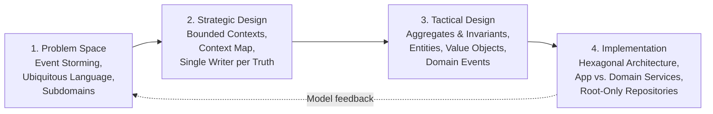
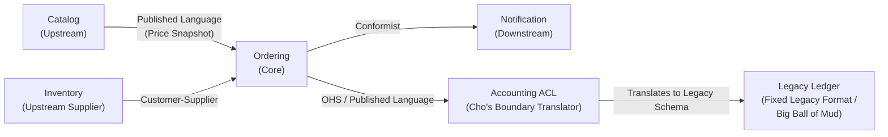
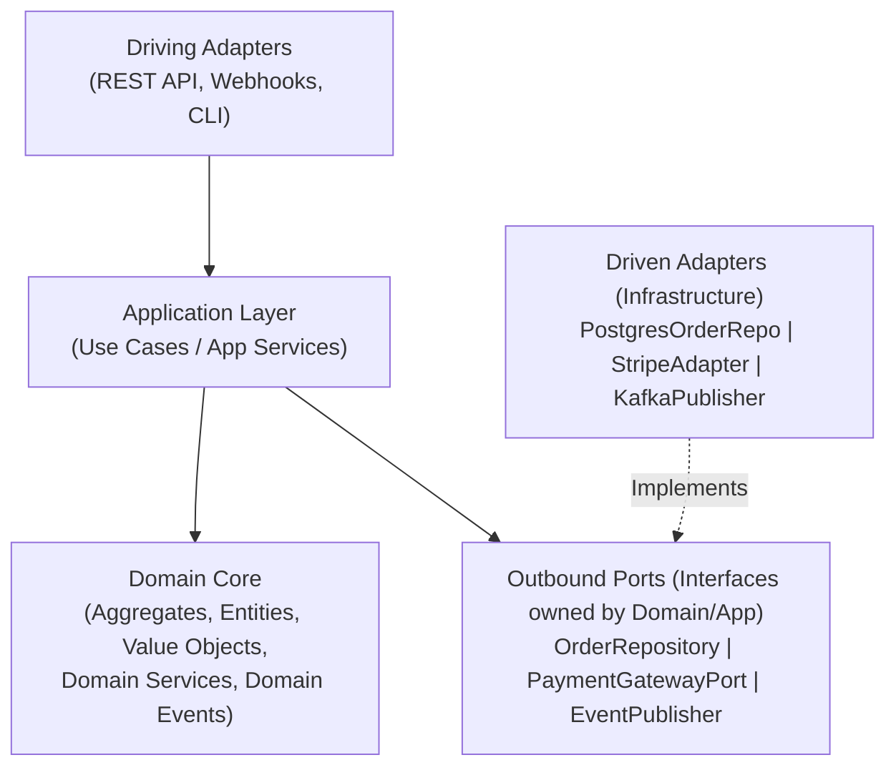

# Domain-Driven Design (DDD) — Architect's Supplement & Corrections

A practical companion guide filling the **strategic gaps** and fixing the **tactical misconceptions** commonly missed in short introductory DDD videos. All examples align with **Cho Marketplace** and your 10-step SA template.

---

## 1. The Right Sequence (Strategic Before Tactical)

Introductory videos often teach `Entity → Bounded Context → Code → Event Storming` backwards. In real Software Solution Architecture, **you always move from Problem Space to Solution Space**:



**Why order matters:** Defining `Order` classes before drawing Bounded Contexts creates a single giant shared model across Sales, Inventory, and Accounting — the exact *Big Ball of Mud* DDD exists to prevent.

---

## 2. Missing Piece #1: Subdomains (Where to Spend Your Engineering Budget)

DDD does **not** mean applying heavy tactical patterns everywhere. First classify your **Problem Space** into three subdomain types to drive **Build vs. Buy** and complexity budgets:

| Subdomain Type | Business Impact | Engineering Strategy | Example in Cho Marketplace |
| --- | --- | --- | --- |
| **Core Domain** | Competitive differentiator; complex, evolving rules | **Build in-house with full Tactical DDD** (Aggregates, Invariants, Domain Events) | `Ordering`, `Inventory Reservation` (hot-SKU consistency) |
| **Supporting Subdomain** | Necessary for the business, low algorithmic complexity | **Build simply** (Transaction Script / clean CRUD — skip heavy DDD boilerplate) | `Catalog` (product listing), basic seller profile |
| **Generic Subdomain** | Solved problem across the entire industry | **Buy / SaaS / Open-Source** (wrap behind an interface or ACL) | `Identity (OAuth2/OIDC)`, `Payment Gateway`, `Email/SMS` |

---

## 3. Missing Piece #2: Context Mapping (How Boundaries Integrate)

Drawing Bounded Context boxes is only half of Strategic DDD. A **Context Map** defines **direction of dependency (Upstream → Downstream)** and the exact **integration pattern** between each pair:



| Pattern | Meaning | SA Rule of Thumb |
| --- | --- | --- |
| **Customer-Supplier** | Upstream plans around downstream's needs | Use between closely collaborating internal contexts (`Inventory` → `Ordering`) |
| **Conformist** | Downstream adopts upstream's model verbatim | Acceptable for low-priority downstream consumers (`Notification`) |
| **Anti-Corruption Layer (ACL)** | Translator on your side isolating a foreign/legacy model | Mandatory at boundaries with legacy systems (`Legacy Ledger`) or 3rd-party gateways |
| **Open Host Service (OHS) + Published Language** | Stable, versioned public contract (API / Event schema) | Standard way to expose a Core Context to multiple consumers |
| **Shared Kernel** | Two contexts co-edit a shared code/data module | **Avoid by default** — creates tight release coupling |
| **Separate Ways** | Intentionally do not integrate | Prefer when integration cost exceeds duplication cost |

---

## 4. Correction #1: Aggregates = Transactional Boundaries for True Invariants

An Aggregate is **not** just a visual folder of related objects. In DDD, an Aggregate is the **unit of transactional consistency**:

1. **One transaction modifies one Aggregate.** Never lock and update two aggregates in one database transaction if they belong to separate contexts.
2. **Reference other Aggregates by ID only** (e.g., `Order` holds `buyerId` and `skuId`, never the `Buyer` or `Inventory` object).
3. **Separate True Invariants from Eventual Invariants:**
   - **True Invariant (must be true immediately):** Put the required fields in the **same Aggregate** (e.g., `Inventory.availableQty = totalQty - reservedQty - committedQty >= 0`).
   - **Eventual Invariant (tolerates seconds of lag):** Keep Aggregates separate and coordinate via **Domain Events + Policy/Saga** (e.g., when `PaymentConfirmed`, then `CommitStock` and `CreateShipment`).

**Common Mistake:** Merging `Order` and `Inventory` into one giant Aggregate causes severe DB lock contention and breaks module boundaries.

---

## 5. Correction #2: Value Objects Done Right

A Value Object is **not** merely "a passive data snippet without an ID." It has **four defining traits**:

- **Value Equality:** Two `Money(100, "VND")` instances are completely equal.
- **Immutability:** You never mutate a Value Object in place; any change returns a new instance.
- **Self-Validation:** Invalid values cannot be constructed (e.g., `Money` rejects negative amounts or invalid currency codes in its constructor).
- **Rich Behavior:** Value Objects encapsulate domain operations (e.g., `moneyA.add(moneyB)` enforces matching currencies; `Address.isWithinDeliveryZone()`).

*Rule of thumb:* Prefer Value Objects over raw primitives (`Money` instead of `decimal`, `Email` instead of `string`) to eliminate scattered validation logic.

---

## 6. Correction #3: Application Service vs. Domain Service (Avoiding Anemic Models)

Lumping everything under a generic "Service executes business processes" leads straight to the **Anemic Domain Model** anti-pattern (dumb data structs + bloated procedural service classes).

| Component | Layer | What Belongs Here | What Is Forbidden Here |
| --- | --- | --- | --- |
| **Entity / Aggregate Root** | Domain | Core business rules, state transitions, invariants, and domain-level Authz (`order.cancel(actor, reason)`) | Direct DB queries, HTTP calls, transaction management |
| **Domain Service** | Domain | Stateless domain logic spanning multiple domain objects that does not naturally belong to one Entity (e.g., `PricingCalculator`) | Persistence calls, sending emails, HTTP serialization |
| **Application Service** | Application | Use-case orchestration: start transaction → load Aggregate via Repository → call domain method → save → publish event | Core business rules (`if order.status == 2 && ...`) |

### Anemic vs. Rich Domain Model (Side-by-Side)

```text
// WRONG — Anemic Domain Model (business rules leaked into Service)
class OrderService {
  cancelOrder(orderId) {
    order = repo.find(orderId)
    if (order.status != "PENDING_PAYMENT") throw Error("Cannot cancel")
    order.status = "CANCELLED"
    repo.save(order)
  }
}

// RIGHT — Rich Domain Model (Invariants + Domain Authz) + Thin Application Service
class Order { // Aggregate Root owns state invariants & resource ownership rules
  cancel(actor, reason) {
    if (actor.id != this.buyerId && !actor.isOps()) throw ForbiddenError("Not allowed")
    if (this.status != PENDING_PAYMENT) throw DomainError("Invalid transition")
    this.status = CANCELLED
    this.recordEvent(new OrderCancelled(this.id, reason))
  }
}

class CancelOrderUseCase { // Application Service only orchestrates
  execute(actor, orderId, reason) {
    tx.run(() => {
      order = orderRepo.findById(orderId)
      order.cancel(actor, reason)
      orderRepo.save(order) // also writes outbox row atomically
    })
  }
}
```

---

## 7. Correction #4: Root-Only Repositories & Hexagonal Dependency Direction

### Repositories Are for Aggregate Roots Only
- **Allowed:** `OrderRepository` (loads/saves the entire `Order` aggregate including its `OrderLine` items).
- **Forbidden:** `OrderLineRepository` — bypassing the Aggregate Root allows callers to mutate child entities and silently break `Order.totalAmount` invariants.

### Upgrading Classic 4-Layer Architecture to Hexagonal (Ports & Adapters)
In classic 4-layer architecture (`Presentation → Application → Domain → Infrastructure`), Domain depends downward on Infrastructure. Modern DDD flips that arrow using **Dependency Inversion (Hexagonal Architecture)** so the Domain has **zero dependencies** on databases, brokers, or frameworks:



---

## 8. Missing Piece #3: Domain Events vs. Integration Events

Domain Events are the glue that keeps Aggregates small and Bounded Contexts decoupled:

| Dimension | Domain Event | Integration Event |
| --- | --- | --- |
| **Scope** | Internal to one Bounded Context | Cross-context / cross-service contract |
| **Naming** | Past tense (`OrderPlaced`, `StockReserved`) | Versioned Published Language (`cho.ordering.OrderPlaced.v1`) |
| **Payload** | Rich internal domain terms | Minimal, stable, backward-compatible schema |
| **Delivery** | In-process or same-context handler | Message Broker via **Transactional Outbox** |

---

## 9. Six DDD Anti-Patterns to Catch in Reviews

- [ ] **Tactical DDD everywhere:** Building complex Aggregates and Value Objects for simple CRUD supporting screens.
- [ ] **Anemic Domain Model:** Putting all `if/else` business rules in `OrderService` while `Order` only has getters/setters.
- [ ] **God Aggregate:** Merging `Order`, `Inventory`, and `Customer` into one Aggregate causing lock contention.
- [ ] **Child Repositories:** Creating `OrderLineRepository` and modifying child entities outside the Aggregate Root.
- [ ] **Shared Database / Shared Kernel across Contexts:** Two contexts writing to the same table or sharing mutable models.
- [ ] **Domain depending on Infrastructure:** Importing ORM/HTTP framework annotations directly into core domain invariants.