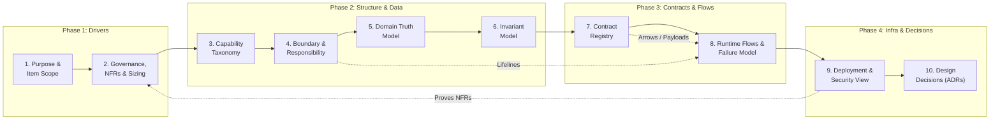
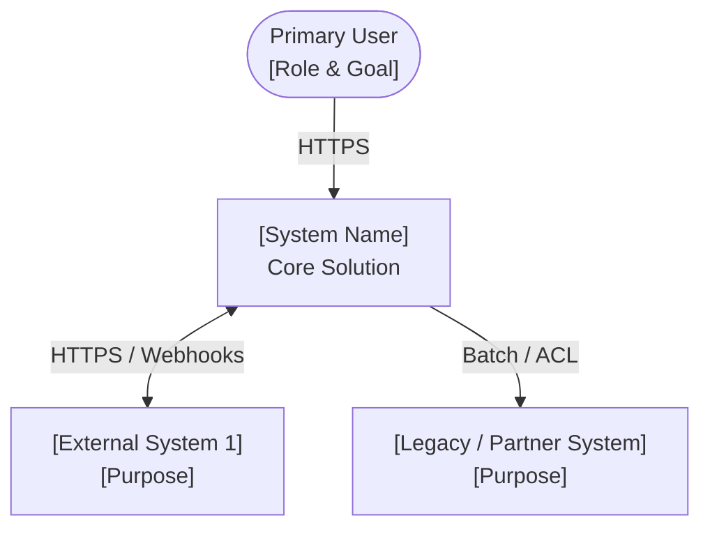
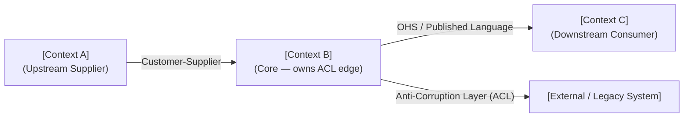
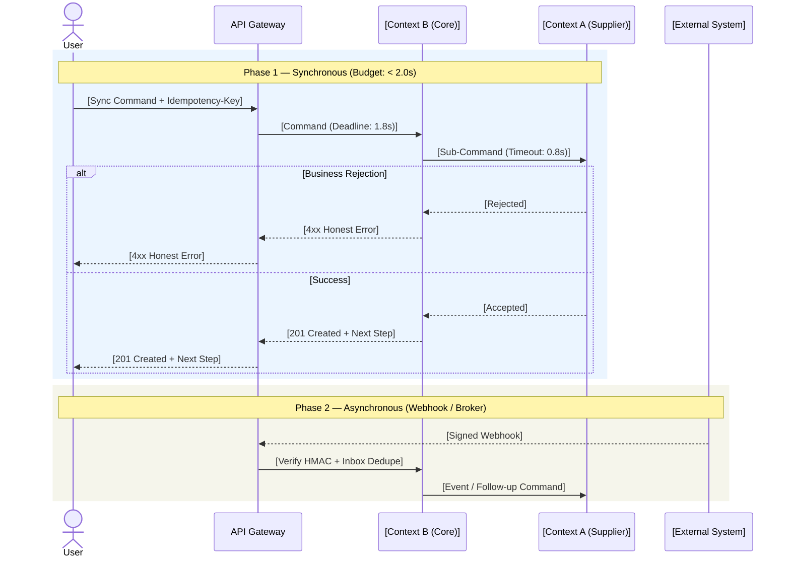
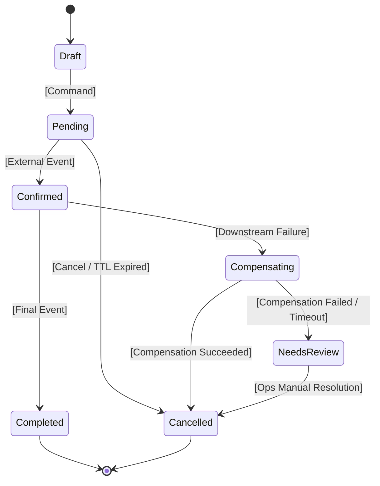
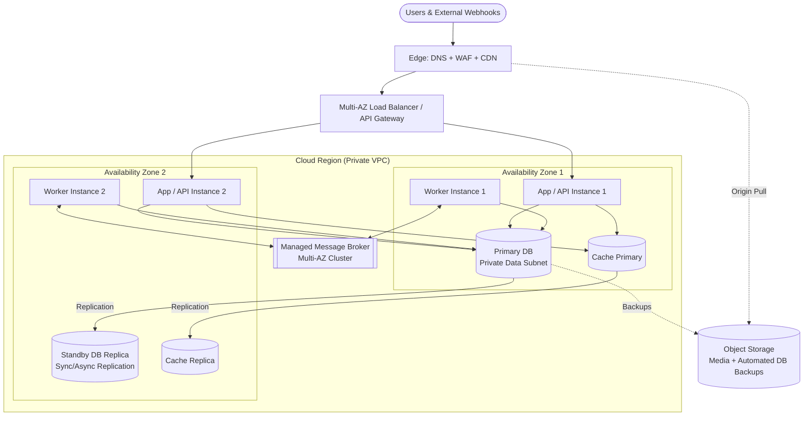

# Software Solution Architecture — 10-Step Specification Template

A reusable, end-to-end architecture specification template for **Software Solution Architects**. Fill it top-to-bottom during design; every downstream step builds directly on verified outputs from earlier steps.

> **Document Metadata**
> - **System / Initiative:** `[System Name]`
> - **Version / Status:** `v0.1 — Draft | In Review | Approved`
> - **Author (SA):** `[Name]`
> - **Reviewers:** `[Tech Lead, Security, SRE/Platform, Product]`
> - **Last Updated:** `[YYYY-MM-DD]`

---

## How the 10 Steps Connect



*Note for executive readers: once all 10 steps are complete, you may copy the ADR summary table from Step 10 to the top of the document as an Executive Summary.*

---

## Phase 1: Inputs, Scope & Quantitative Drivers

### Step 1. Purpose & Item Scope

*Guiding question: Why does this system exist, who uses it, and where do we draw the hard line on v1 scope?*

- **Business Objective:** `[1–2 measurable sentences stating the business problem and success metric.]`
- **Target Users / Actors:** `[List primary user roles and internal operators.]`
- **External Systems:** `[List third-party APIs, legacy systems, and upstream/downstream platforms.]`
- **In Scope (v1):**
  - `[Core capability 1]`
  - `[Core capability 2]`
- **Explicitly Out of Scope (v1):**
  - `[What we intentionally defer or will NOT rewrite, e.g., legacy accounting ledger]`

#### C4 System Context Diagram


---

### Step 2. Inherited Governance, NFRs & Baseline Sizing

*Guiding question: What organizational rules, compliance mandates, traffic loads, and reliability numbers constrain every design choice below?*

#### 2.1 Inherited Governance & Constraints
- **Team & Timeline:** `[e.g., 1 stream-aligned team of 6 engineers; 4-month MVP]`
- **Organizational Standards:** `[Approved cloud provider, mandatory IdP, logging/observability platform, CI/CD standards]`
- **Compliance & Legal:** `[e.g., PCI-DSS scope reduction (zero card storage), PII encryption & deletion/anonymization, financial audit retention]`

#### 2.2 Baseline Sizing & FinOps (Back-of-the-Envelope)

| Metric | Average | Peak / Burst (e.g., 10x) | Notes / Assumptions |
| --- | --- | --- | --- |
| Write Volume (RPS / Daily) | `[e.g., 0.12 RPS / 10K/day]` | `[e.g., 50 RPS]` | `[e.g., 2-hour flash sale]` |
| Read Volume (RPS / Daily) | `[e.g., 6 RPS / 500K/day]` | `[e.g., 2,000 RPS]` | `[e.g., 50:1 read/write ratio]` |
| 3-Year Relational Storage | `[e.g., 45 GB]` | — | `[Bytes/record × records × 3 yrs]` |
| 3-Year Media / Object Storage | `[e.g., 600 GB]` | `[Egress TB/mo]` | `[Stored in Object Storage + CDN]` |
| FinOps Target | `[e.g., <= $X / unit]` | — | `[Monthly infra ceiling ÷ volume]` |

#### 2.3 Quality Attribute Scenarios (6-Part Format: Source, Stimulus, Artifact, Environment, Response, Measure)

| ID | Quality Attribute | Source & Stimulus | Artifact & Response | Environment | Measurable Target |
| --- | --- | --- | --- | --- | --- |
| QA-1 | Latency | `[User triggers core write]` | `[API Gateway + Core Contexts persist & reply]` | Normal load | `[e.g., p99 < 2.0s over 30 days]` |
| QA-2 | Availability | `[External/user API calls]` | `[Edge + Multi-AZ API serves requests]` | Monthly window | `[e.g., 99.9% (~43 min/mo budget)]` |
| QA-3 | Consistency | `[Post-write read / webhook]` | `[Write DB strong; Read Model updates via event]` | Normal load | `[e.g., 0s on write; < 5s lag on read model]` |
| QA-4 | Disaster Recovery | `[Full AZ / DB primary outage]` | `[Standby replica promotes & serves traffic]` | Outage | `[e.g., RPO <= X min, RTO <= Y min]` |
| QA-5 | Scalability / Peak | `[10x burst traffic]` | `[Hot-SKU lock holds; async queues absorb spike]` | Peak event | `[e.g., Zero overselling; async lag < 60s]` |
| QA-6 | Modifiability | `[Schema or policy update]` | `[CI/CD deploys via Expand & Contract]` | Live production | `[e.g., Zero downtime; rollback < 10 min]` |

---

## Phase 2: Static Structure, Ownership & Domain Integrity

### Step 3. Capability Taxonomy

*Guiding question: What business capabilities are required, which ones differentiate us, and which should we buy?*

| Capability | Subdomain Type | Strategy | Rationale |
| --- | --- | --- | --- |
| `[e.g., Order Lifecycle]` | **Core** | Build | Competitive differentiator; custom business rules |
| `[e.g., Inventory Reservation]` | **Core** | Build | Strict hot-SKU consistency requirements |
| `[e.g., Product Catalog]` | **Supporting** | Build (Simple) | Necessary, low algorithmic complexity |
| `[e.g., Identity / Auth]` | **Generic** | Buy / SaaS | Commodity; high security risk to self-build |
| `[e.g., Payment Processing]` | **Generic** | Buy / Integrate | PCI-DSS compliance and banking rails |
| `[e.g., Legacy Ledger]` | **External / Legacy** | Wrap (ACL) | Out of scope to rewrite; isolate via adapter |

---

### Step 4. Boundary & Responsibility Model

*Guiding question: How do we partition capabilities into Bounded Contexts, how do they relate, and who owns each boundary?*

#### 4.1 Bounded Contexts & Responsibility Allocation

| Bounded Context | Core Responsibility (1 Sentence) | Owning Team | Ubiquitous Language (Key Terms) |
| --- | --- | --- | --- |
| `[Context A]` | `[Upstream supplier owning resource availability]` | `[Team name]` | `[Term 1: exact meaning; Term 2: exact meaning]` |
| `[Context B]` | `[Core context owning primary lifecycle & ACL edge to legacy]` | `[Team name]` | `[Term 1: exact meaning; Legacy term -> Core term]` |
| `[Context C]` | `[Downstream consumer reacting to published events]` | `[Team name]` | `[Term 1: exact meaning]` |

#### 4.2 DDD Context Map
*(Label every edge with Upstream/Downstream direction and exact pattern: Customer-Supplier, Conformist, ACL, OHS/Published Language, Separate Ways. Avoid Shared Kernel unless explicitly justified.)*



---

### Step 5. Domain Truth Model

*Guiding question: For every critical piece of business truth, which single context is the authoritative writer, and what staleness is allowed for readers?*

| Business Truth / Data Asset | Authoritative Writer (Single Source of Truth) | Storage & Schema | Read Consumers (Copies / Projections) | Max Allowed Lag |
| --- | --- | --- | --- | --- |
| `[e.g., Order Status & Locked Price]` | `[Ordering]` | `postgres.ordering` | `[Seller Dashboard (CQRS)]` | `< 5s` |
| `[e.g., Available Stock]` | `[Inventory]` | `postgres.inventory` | `None at checkout (never cached)` | `0s (Strong)` |
| `[e.g., Listed Price & Media]` | `[Catalog]` | `postgres.catalog` + `S3` | `[Redis Cache, Search Index]` | `< 60s / Event-invalidated` |
| `[e.g., Payment Settlement]` | `[Payment]` | `postgres.payment` | `[Ordering, Accounting ACL]` | `Webhook + 5m Reconcile` |

*Rule: Two contexts must never write to the same database table or share mutable schemas.*

---

### Step 6. Invariant Model

*Guiding question: Which business rules must hold immediately inside one transaction (True Invariants → Aggregate boundaries), and which tolerate brief lag (Eventual Invariants → Events/Sagas)?*

#### 6.1 True Invariants (Immediate Consistency — Aggregate Boundaries)

| Aggregate | Owned State & ID-Only References | Invariants (Must Always Hold After Commit) | Concurrency / Locking Strategy |
| --- | --- | --- | --- |
| `[Aggregate 1, e.g., Order]` | Owns: `[items, lockedPrices, status]`<br/>Refs by ID: `[buyerId, paymentId]` | 1. `[Locked price immutable after Draft]`<br/>2. `[Valid state transitions only]` | `[e.g., Optimistic locking (version)]` |
| `[Aggregate 2, e.g., Inventory]` | Owns: `[totalQty, reservations, committedQty]`<br/>Refs by ID: `[shopId, skuId]` | 1. `[availableQty = total - reserved - committed >= 0]` | `[e.g., Conditional atomic UPDATE / SELECT FOR UPDATE for hot SKUs; short tx, zero HTTP inside lock]` |

#### 6.2 Eventual Invariants (Cross-Aggregate — Policy / Saga)
- `[e.g., Every confirmed payment must either commit reserved stock or trigger a refund within X minutes.]`
- `[e.g., Search index reflects catalog price updates within 5 seconds.]`

---

## Phase 3: Contracts & Dynamic Behavior

### Step 7. Contract Registry

*Guiding question: What are the exact APIs, commands, integration events, and webhooks crossing context boundaries?*

| Contract Name | Type | Sync / Async | Producer → Consumer | Idempotency Mechanism | Version & Evolution Policy |
| --- | --- | --- | --- | --- | --- |
| `[POST /v1/orders]` | Sync API / Command | Sync (< 2s) | `Web → Ordering` | `Idempotency-Key` header | Additive fields keep `v1`; breaking → `v2` |
| `[ReserveStock]` | Internal Command | Sync | `Ordering → Inventory` | Unique `(orderId, skuId)` | Internal module interface |
| `[sys.ordering.OrderPlaced.v1]` | Integration Event (Topic) | Async | `Ordering → Inventory, Notify` | Consumer `Inbox` table | Published Language + consumer contract test |
| `[POST /webhooks/payment]` | External Webhook | Async | `Gateway → Payment` | `Inbox (gatewayEventId)` | HMAC signature + timestamp check |

*Note: Step 4 (Boundaries) + Step 7 (Contracts) are the direct inputs to Step 8 (HLD Sequence Diagrams). Do not model class-level method calls here.*

---

### Step 8. Runtime Flows & Failure Model

*Guiding question: How do contexts interact over time on the happy path, and how does the system survive partial failures, timeouts, and dropped webhooks?*

#### 8.1 HLD Sequence Diagram (Core Flow — Sync vs. Async Boundary)


#### 8.2 Entity State Machine (Long-Lived Entity)


#### 8.3 Saga & Compensation Table

| Step | Context | Local ACID Commit | Compensating Action | If Compensation Fails |
| --- | --- | --- | --- | --- |
| 1 | `[Context B]` | `[Local state change]` | `[Business undo]` | `[Flag NeedsReview + Ops alert]` |
| 2 | `[Context A]` | `[Local reservation]` | `[Release reservation]` | `[Retry + drift alert]` |
| 3 | `[External]` | `[Capture / Charge]` | `[Issue refund]` | `[Reconciliation job + Ops queue]` |

#### 8.4 Resilience, Outbox & Observability Rules
- **Dual-Write Prevention:** Transactional Outbox in producer DB + Idempotent Inbox in consumer DB.
- **Deadline Propagation:** Downstream timeout strictly shorter than caller's remaining budget (`Gateway 2.0s → Context B 1.8s → Context A 0.8s → DB 0.4s`).
- **Retries & Circuit Breakers:** Retry transient errors only (never 4xx), exponential backoff + jitter, capped attempts; define user-facing fallback when external circuit opens.
- **Webhook Safety:** Deduplicate via Inbox, guard order via State Machine, recover dropped webhooks via periodic **reconciliation job** (every `[X]` minutes).
- **Observability:** Structured JSON logs (`traceId`, entity ID, zero raw PII); separate business errors from system-incident metrics (5xx, outbox lag, DLQ depth); end-to-end distributed traces.

---

## Phase 4: Infrastructure, Security & Architectural Decisions

### Step 9. Deployment & Security View

*Guiding question: Does our physical topology actually prove the NFRs from Step 2, and have we mitigated the top security threats?*

#### 9.1 C4 Container & Multi-AZ Deployment Topology



- **Read Path Scaling:** `[Cache-aside rules, stampede protection, Search sync, CQRS projection]`
- **Zero-Downtime Migrations:** `[Expand & Contract workflow for schema changes]`
- **RPO / RTO Proof:** `[State exact RPO and RTO achieved by this topology and verify it meets QA-4.]`

#### 9.2 Authn, Authz & Compliance Controls
- **Authn:** `[OAuth 2.0 Authorization Code + PKCE / OIDC; JWT validation at API Gateway/API]`
- **Authz:** `[Server-side resource-level ownership checks inside the owning Bounded Context]`
- **Secrets & Encryption:** `[TLS in transit, encryption at rest, Secret Manager with key rotation]`
- **Webhook & PII:** `[HMAC verification + replay timestamp check; PII masking in logs; PII anonymization on deletion]`

#### 9.3 One-Page STRIDE Threat Model

| Threat | Concrete Risk in This System | Mitigation |
| --- | --- | --- |
| **S**poofing | `[Impersonating user or forging webhook]` | `[IdP JWT validation; HMAC + timestamp on webhooks]` |
| **T**ampering | `[Modifying price/payload in transit]` | `[Ignore client prices; fetch authoritative truth server-side]` |
| **R**epudiation | `[Denying transaction or dispute]` | `[Immutable audit log with actor, timestamp, external tx ID]` |
| **I**nformation Disclosure | `[Exposing PII, credentials, or card data]` | `[Zero card storage; TLS + at-rest encryption; log masking]` |
| **D**enial of Service | `[Bot exhausting stock or APIs]` | `[Rate limits; per-user pending caps; short TTL; circuit breakers]` |
| **E**levation of Privilege | `[Accessing another user's resource or admin API]` | `[Role separation; server-side domain Authz]` |

---

### Step 10. Design Decisions (ADR Log)

*Guiding question: Which hard trade-offs did we make, what did we reject, and what measurable change would force us to revisit each decision?*

#### 10.1 ADR Summary Index

| ID | Decision Title | Status | Key Trade-off | Reversal Trigger |
| --- | --- | --- | --- | --- |
| ADR-001 | `[e.g., Modular Monolith for v1]` | Accepted | `[Simpler ops vs. independent scaling]` | `[e.g., > 3 teams or independent peak > X RPS]` |
| ADR-002 | `[e.g., PostgreSQL with Schema Isolation]` | Accepted | `[ACID integrity vs. horizontal sharding]` | `[e.g., Write TPS > X or DB > Y TB]` |
| ADR-003 | `[e.g., Reserve-Before-Pay Saga]` | Accepted | `[No refund storms vs. hoarding risk]` | `[e.g., Unpaid abandonment > X%]` |

#### 10.2 ADR Entry Template (Copy per Decision)

```text
# ADR-00N: <Clear architectural choice stated as a decision>

- Status: Proposed | Accepted | Superseded by ADR-00M
- Date: YYYY-MM-DD
- Owner: [Name]

## Context
Facts, numbers from Step 2, and constraints driving this decision.

## Options Considered
### Option A: ...
Pros / Cons.
### Option B: ...
Pros / Cons.

## Decision
Choose Option A.
Reversal trigger: Revisit this decision if <measurable condition>.

## Consequences
Immediate engineering impact, residual risks, and monitoring metrics.
```

---

## Pre-Review Self-Audit Checklist (8 Checks)

Before sending this document to a 45-minute architecture review, verify all eight:

- [ ] Every Bounded Context name, event name, and entity state matches verbatim across Steps 4, 5, 7, and 8.
- [ ] Every capacity number and SLO in Step 2 is backed by a concrete mechanism in Steps 6, 8, and 9.
- [ ] Every piece of business truth in Step 5 has exactly one authoritative writer.
- [ ] Every synchronous call chain in Step 8 obeys deadline propagation (downstream timeout < caller remaining budget).
- [ ] No external interactive flow (e.g., payment redirect/3DS) is trapped inside a synchronous 2s API budget.
- [ ] Every external webhook has three defenses: HMAC signature check, Inbox deduplication, and periodic reconciliation.
- [ ] Every ADR in Step 10 lists at least one rejected alternative and a measurable reversal trigger.
- [ ] Zero unqualified adjectives ("scalable", "fast", "secure") appear without a number or condition.
