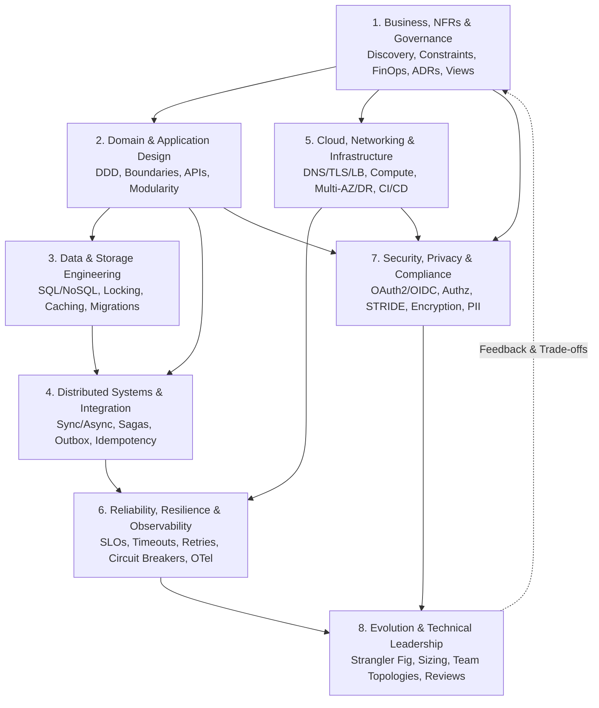

# Software Solution Architect — Core Knowledge Base (Evergreen Foundation)

A vendor-neutral, career-long **foundational knowledge map** of what every Software Solution Architect must master to design reliable systems today and keep scaling into Senior, Staff, and Principal roles.

Unlike a time-boxed study plan, this document is your **permanent mental index**: every framework, cloud service, or AI/data tool you learn over the next 10 years plugs into one of these **8 core pillars**.

---

## 0. The 8-Pillar Architecture Map

**Core Principle:** Tools change every 3–5 years; these 8 pillars stay invariant. Learn every new technology by asking: *"Which pillar does this sit in, what problem does it solve, and what trade-off does it introduce?"*

---

## Pillar 1: Business, NFRs & Governance

Architecture exists to satisfy business outcomes under real constraints (budget, time, team skill, regulation).

### Mandatory Base Knowledge
- **Functional vs. Non-Functional Requirements (NFRs / Quality Attributes):** Turning vague goals ("fast", "reliable") into measurable scenarios (latency p95/p99, availability %, throughput RPS, RPO/RTO, cost ceiling).
- **Constraints & Discovery:** Identifying hard boundaries early (team size, time-to-market, legacy systems, regulatory/legal rules, vendor lock-in).
- **Build vs. Buy vs. Open-Source:** Knowing when to build core differentiators vs. buying commodity capabilities (Identity, Payments, CDN, Observability).
- **Architecture Documentation & Views:** Communicating clearly to different audiences using the [C4 Model](https://c4model.com/) (Context, Container, Component, Code; plus Deployment diagrams as needed), [arc42](https://arc42.org/overview/), and [ADRs](https://adr.github.io/).
- **Architecture Decision Governance:** When an ADR is mandatory (cross-team impact, irreversible trade-off, compliance/security constraint), who decides (DRI + review circle), how exceptions are recorded, and when decisions must be revisited.
- **FinOps & Cost Awareness:** Estimating unit economics (e.g., infrastructure cost per user/order) and understanding major cloud cost drivers (compute, managed DBs, cross-AZ/egress bandwidth, log retention).

### Key Trade-offs to Internalize
- Time-to-market (MVP simplicity) vs. long-term flexibility.
- Upfront engineering cost (Build) vs. recurring licensing and vendor lock-in (Buy).

---

## Pillar 2: Domain & Application Architecture

Structuring software so teams can change it safely without breaking unrelated parts.

### Mandatory Base Knowledge
- **Cohesion & Coupling:** Grouping things that change together; minimizing structural, temporal, and deployment coupling.
- **Structure, Deployment Unit & Communication (separate axes):** Structure — Layered, Hexagonal (Ports & Adapters); Deployment unit — Modular Monolith vs. Microservices (and when *not* to use microservices); Communication style — sync request/response vs. async messaging (event-driven patterns live primarily in Pillar 4).
- **Strategic Domain-Driven Design (DDD):** [Bounded Contexts](https://martinfowler.com/bliki/BoundedContext.html), Ubiquitous Language, [Context Mapping](https://github.com/ddd-crew/context-mapping) (Customer-Supplier, Conformist, Anti-Corruption Layer, Open Host Service, Published Language, Shared Kernel).
- **Tactical DDD Essentials:** Entities, Value Objects, Aggregates (as transactional boundaries), Invariants, Domain Events vs. Integration Events, Single Writer per Truth.
- **API & Contract Design:** REST vs. gRPC vs. GraphQL vs. AsyncAPI; pagination, filtering, error semantics, backward-compatible contract versioning, and consumer-driven contract testing.

### Key Trade-offs to Internalize
- Operational simplicity & local ACID transactions (Modular Monolith) vs. independent scaling & deployment autonomy (Microservices).
- Strict domain isolation (ACL/duplication) vs. short-term reuse (Shared Kernel coupling).

---

## Pillar 3: Data Architecture & Storage Engineering

Data outlives every application rewrite. Most production bottlenecks and incidents are data problems.

### Mandatory Base Knowledge
- **Storage Selection:** Relational (PostgreSQL/MySQL), Key-Value (Redis), Document, Wide-Column, Search Engines (OpenSearch/Elasticsearch), Object Storage (S3/GCS), Time-Series, and Graph — choosing by access pattern, not hype.
- **Transactions & Concurrency:** ACID properties, [Transaction Isolation Levels](https://www.postgresql.org/docs/current/transaction-iso.html) (Read Committed, Repeatable Read, Serializable), [Explicit Locking](https://www.postgresql.org/docs/current/explicit-locking.html), Optimistic Locking (`version`) vs. Pessimistic Locking (`SELECT FOR UPDATE`) vs. Conditional Atomic Updates. Isolation level *names* are not portable across engines (e.g., PostgreSQL Repeatable Read is snapshot isolation); always verify the concrete engine semantics.
- **Database Performance Basics:** B-Tree & composite indexes, query execution plans, connection pooling, N+1 query avoidance, read replicas.
- **Scaling Data:** Vertical scaling first, then partitioning, sharding (shard key selection & hot-shard risks), and archiving/retention policies.
- **Multi-Tenancy Data Models:** Shared schema, schema-per-tenant, and database-per-tenant — chosen by isolation needs, blast radius, and operational cost (especially relevant for marketplace-style products).
- **Caching Architecture:** [Cache-Aside](https://redis.io/docs/latest/develop/use-cases/cache-aside/), Write-Through/Write-Behind, TTL design, cache invalidation, and mitigating **cache stampedes** (singleflight/mutex locks). Knowing what must *never* be trusted from cache.
- **Analytical vs. Operational Data:** Separating OLTP (transactional) from OLAP (reporting/BI/Data Warehouse) via CDC or batch ETL so analytics never degrades live traffic.
- **Zero-Downtime Schema Evolution:** [Expand & Contract (Parallel Change)](https://martinfowler.com/bliki/ParallelChange.html) for backward-compatible DB migrations.

### Key Trade-offs to Internalize
- Normalization (write integrity) vs. denormalization/projections (read speed).
- Strong consistency (locking/latency) vs. high concurrency (optimistic/eventual).

---

## Pillar 4: Distributed Systems & Integration

The moment a workflow crosses two databases, two processes, or an external vendor, you are in distributed systems territory.

### Mandatory Base Knowledge
- **Communication Patterns:** Sync (request/response) vs. Async (fire-and-forget, pub/sub, competing consumers); Queues vs. Topics; [Enterprise Integration Patterns](https://www.enterpriseintegrationpatterns.com/patterns/messaging/).
- **Consistency Models:** Strong vs. Eventual Consistency; CAP theorem (partition trade-offs) and PACELC (normal-operation latency vs. consistency).
- **Delivery Guarantees & Idempotency:** Separate three questions — can the message be delivered again, can consumer code run again, can the business effect be created again. Broker "exactly-once" (e.g., Kafka EOS) covers records and offsets inside that system; external effects still need at-least-once delivery + [Idempotent APIs](https://stripe.com/blog/idempotency) (`Idempotency-Key` on senders, `Inbox` deduplication on receivers) for an effectively-once business outcome.
- **Distributed Workflows:** [Sagas](https://microservices.io/patterns/data/saga.html) (Orchestration vs. Choreography, local transactions + business compensations + compensation-failure queues). Prefer Saga when participants are external APIs, long-running, or cannot prepare; use 2PC only inside the same trust/admin boundary when every participant supports prepare/commit and short lock scope.
- **Reliable Messaging:** Solving the dual-write problem with [Transactional Outbox](https://microservices.io/patterns/data/transactional-outbox.html) (polling or CDC).
- **Read/Write Separation:** CQRS (independent of Event Sourcing) — dedicated read models, read replicas, and caches as the read path; knowing the true operational cost of Event Sourcing (schema evolution, PII deletion, projection rebuilds).
- **Third-Party Integration Patterns:** Webhooks (duplicate, out-of-order, dropped deliveries) paired with periodic **reconciliation jobs**, plus respecting external rate limits.

### Key Trade-offs to Internalize
- Low latency & decoupled services (Async/Eventual) vs. simpler mental model & immediate feedback (Sync/Strong).
- Centralized workflow visibility (Orchestration) vs. loose runtime coupling (Choreography).

---

## Pillar 5: Cloud, Networking & Infrastructure Foundations

An architecture that ignores how packets travel and how machines fail is just a drawing.

### Mandatory Base Knowledge
- **Networking Essentials:** DNS, HTTP/1.1 vs. HTTP/2 vs. HTTP/3, TLS termination, L4 vs. L7 Load Balancers, Reverse Proxies / API Gateways, CDN (edge caching & origin shielding), VPCs, Public vs. Private Subnets, NAT, Private Service Links.
- **Compute & Packaging:** Stateless vs. Stateful workloads, VMs vs. Containers (Docker/Kubernetes) vs. Serverless (FaaS) — cold starts, autoscaling signals, cost profiles; liveness vs. readiness probes so load balancers only route to ready instances.
- **High Availability & Disaster Recovery:** Single points of failure (SPOF), Multi-AZ vs. Multi-Region, Active-Passive vs. Active-Active, Synchronous vs. Asynchronous replication, automated failover, backup & restore drills matching **RPO** and **RTO**.
- **Delivery & Release Engineering:** Infrastructure as Code (IaC), CI/CD pipelines, Blue-Green deployments, Canary rollouts, Feature Flags, and safe rollback criteria.
- **Cloud Architecture Frameworks:** Reviewing designs systematically using frameworks like the [AWS Well-Architected Framework](https://docs.aws.amazon.com/wellarchitected/latest/framework/framework.html).

### Key Trade-offs to Internalize
- Multi-AZ sync replication (near-zero RPO, write latency tied to cross-AZ RTT) vs. Multi-Region Active-Active (usually async replication: better user latency and RTO, RPO equal to replication lag, plus conflict-resolution cost).
- Managed cloud services (faster delivery) vs. self-hosted infrastructure (control & portability).

---

## Pillar 6: Reliability, Resilience & Observability

Design assuming every dependency, network link, and disk will eventually slow down or fail.

### Mandatory Base Knowledge
- **Failure Modes & Containment:** Partial failures, gray failures (slow dependencies are worse than dead ones), blast radius isolation, **Bulkheads**, and graceful degradation / fallbacks.
- **Timeouts & Retries:** [Timeouts, Retries, and Backoff with Jitter](https://d1.awsstatic.com/builderslibrary/pdfs/timeouts-retries-and-backoff-with-jitter.pdf); **Deadline Propagation** (downstream timeout strictly shorter than caller's remaining budget); retry budgets to prevent retry storms.
- **Traffic & Overload Protection:** [Circuit Breakers](https://martinfowler.com/bliki/CircuitBreaker.html) (Closed/Open/Half-Open), Rate Limiting (token bucket / sliding window), Load Shedding, and Dead-Letter Queues (DLQ) with replay runbooks.
- **Reliability Engineering:** [SLIs, SLOs, SLAs, and Error Budgets](https://sre.google/sre-book/service-level-objectives/); distinguishing business errors from system incidents; for async paths, treat **consumer lag** as a first-class SLI alongside request latency.
- **Observability:** [OpenTelemetry](https://opentelemetry.io/docs/concepts/observability-primer/) three signals — Structured Logs (with `traceId`; never log raw PII — use opaque IDs and masking), Metrics (RED/USE methods), and Distributed Tracing across sync and async boundaries.

### Key Trade-offs to Internalize
- Aggressive retries (masking transient blips) vs. cascading overload on struggling dependencies.
- High-cardinality telemetry (faster root-cause debugging) vs. observability storage cost.

---

## Pillar 7: Security, Privacy & Compliance by Design

Security cannot be bolted on at the end; it shapes your network, data model, and APIs from day one.

### Mandatory Base Knowledge
- **Identity & Access:** [OAuth 2.0 + PKCE](https://oauth.net/2/pkce/) & OpenID Connect (OIDC), [OWASP OAuth2 best practices](https://cheatsheetseries.owasp.org/cheatsheets/OAuth2_Cheat_Sheet.html), JWT validation (`iss`, `aud`, `exp`, signature), Service-to-Service auth (mTLS / Client Credentials).
- **Authn vs. Authz:** Separating identity verification (Authn) from permission enforcement (Authz: RBAC, ABAC, and server-side resource-level ownership checks inside the domain).
- **API & Integration Security:** Input validation, OWASP API Security Top 10 (especially BOLA/IDOR), [Webhook HMAC signature verification](https://docs.stripe.com/webhooks) + timestamp replay protection, WAF & DDoS mitigation.
- **Data Protection:** Encryption in transit (TLS 1.3) and at rest (KMS), Secret Management & key rotation, never log raw PII (opaque IDs + masking), **PII anonymization/deletion** without breaking financial audit trails.
- **Threat Modeling & Compliance:** Running lightweight [STRIDE threat models](https://learn.microsoft.com/en-us/azure/security/develop/threat-modeling-tool-threats) on sensitive flows; understanding compliance scope reduction (e.g., PCI-DSS tokenization, GDPR/data residency, audit trails).

### Key Trade-offs to Internalize
- Defense-in-depth & zero-trust controls vs. developer velocity and request latency.
- Strict data minimization/deletion vs. analytics and audit retention needs.

---

## Pillar 8: Evolution & Technical Leadership

What separates a Senior Engineer from a true Software Solution Architect is leading alignment and evolving systems safely over years.

### Mandatory Base Knowledge
- **Capacity Planning (Back-of-the-Envelope):** Deriving average/peak RPS, bandwidth, 3-year storage, and memory footprints from business metrics before picking tech.
- **Legacy Modernization:** [Strangler Fig](https://martinfowler.com/bliki/StranglerFigApplication.html), Branch by Abstraction, Anti-Corruption Layers, and avoiding high-risk big-bang rewrites.
- **Architecture Fitness Functions:** Automated or periodic checks that architectural characteristics (coupling limits, latency budgets, dependency direction, security baselines) still hold as the system evolves.
- **Socio-Technical Alignment:** Conway's Law and [Team Topologies](https://teamtopologies.com/key-concepts) (Stream-aligned, Platform, Enabling, Complicated-subsystem) so architecture matches org structure.
- **Risk & Technical Debt Management:** Maintaining an explicit Risk & Tech Debt register with business impact, mitigation plans, and revisit triggers.
- **Architecture Communication:** Facilitating design reviews, presenting trade-offs neutrally (options + pros/cons + recommendation), aligning Product/Eng/Security/Finance, and saying "no" with numbers.

### Key Trade-offs to Internalize
- Incremental modernization speed vs. temporary dual-running cost and cognitive load.
- Local team autonomy vs. cross-cutting standards that keep the platform coherent.

---

## Career Progression Matrix (Long-Term Growth)

Use this grid to evaluate where you are today and what to stretch toward next:

| Dimension | Baseline SA (Target of 12-Week Handbook) | Senior SA | Staff SA | Principal / Enterprise SA |
| --- | --- | --- | --- | --- |
| **Scope** | Single product / 1–2 teams | Multi-system domain / multiple teams | Multiple teams in one domain; sets cross-squad standards | Org-wide platform & multi-year strategy |
| **Design Depth** | End-to-end C4, DDD, Saga, read models / read replicas / cache, Multi-AZ, STRIDE | Multi-region DR, high-scale partitioning, complex migrations | Domain-wide patterns, shared platforms, multi-squad migration playbooks | Cross-org standards, compliance frameworks, platform ecosystems |
| **Ambiguity** | Clarifies requirements for a defined project | Shapes ambiguous business initiatives into phased roadmaps | Frames domain strategy from incomplete signals across squads | Identifies unstated strategic risks & opportunities across business units |
| **Trade-offs** | Quantifies latency, RPO/RTO, and basic FinOps | Balances TCO, hiring/team skill, and multi-quarter delivery risk | Balances domain TCO against platform leverage and hiring across squads | Aligns architecture directly with P&L, M&A, and long-term company bets |
| **Influence** | Defends designs in 45-min technical reviews | Drives consensus across Engineering, Product, Security, Ops | Mentors Senior SAs; owns review bars for a domain | Mentors other architects; elevates architecture culture org-wide |

---

## How to Use This Knowledge Base Alongside Your Handbook

This file is the permanent mental index. The **Baseline SA** column is a capability target, not a runnable study path inside this repo until the companion 12-week handbook exists here.

1. **First 12 weeks (when available):** Execute `solution-architect-handbook-en.md` on a concrete product domain (e.g., a marketplace) to lock in the **Baseline SA** column across all 8 pillars.
2. **Months 4–6:** Apply the same 8 pillars to two unfamiliar domains (e.g., a **financial ledger/wallet** for high-consistency workloads, and a **real-time notification/IoT ingestion pipeline** for high-throughput streaming).
3. **Ongoing career loop:** Whenever you encounter a new domain (AI/LLM systems, multi-tenant SaaS, global active-active, data mesh), map its patterns back onto these 8 pillars so your foundation compounds instead of fragmenting.
