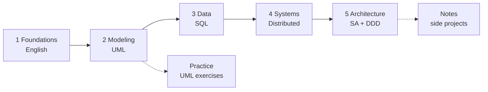

# Learning path

Use this order. Each track builds on the previous one. Inside a track: **Handbook → Workbook → Lab/Practice**.

## Track checklist

| # | Track | Start here | Then | Done when |
| --- | --- | --- | --- | --- |
| 1 | [Foundations](/foundations/) | [Learning process](/foundations/english/learning-process) | [12 tenses](/foundations/english/12-tenses-handbook) | You can parse a technical paragraph without word-by-word Vietnamese order |
| 2 | [Modeling](/modeling/) | [UML handbook](/modeling/uml/handbook) | [Workbook](/modeling/uml/workbook) → [Answer guide](/modeling/uml/answer-guide) | Class + Sequence stay consistent with the requirement register |
| 3 | [Data](/data/) | [SQL handbook](/data/sql/handbook) | [Workbook](/data/sql/workbook) | You can explain isolation, locking, and evidence for a failure |
| 4 | [Systems](/systems/) | [DS handbook](/systems/handbook) | [Workbook](/systems/workbook) → [Lab](/systems/lab) | You can draw Outbox/Saga/idempotency for one checkout flow |
| 5 | [Architecture](/architecture/) | [Core KB](/architecture/core-knowledge-base) | [DDD](/architecture/ddd-deep-dive) → [10-step template](/architecture/10-step-template) | You can fill the template for one product under real constraints |

## Rules that keep the hub clean

1. **One primary document per role** — handbook teaches; workbook drills; lab runs processes.
2. **Latest edition only on the site** — older revisions stay in git history / local archive, not in the nav.
3. **Side notes stay in Notes** — game calculators and one-off experiments are not curriculum.
4. **Edit sources in the repo folders** (`sa/`, `sql/`, `docs/`, …). `site/content/` is generated.

## Optional / reference

- [Systems full edition](/systems/full-edition) — combined handbook+workbook if you prefer one long file.
- [Practice](/practice/) — UML exercise deliverables after Modeling.
- [Notes](/notes/) — SRO and other non-curriculum material.
