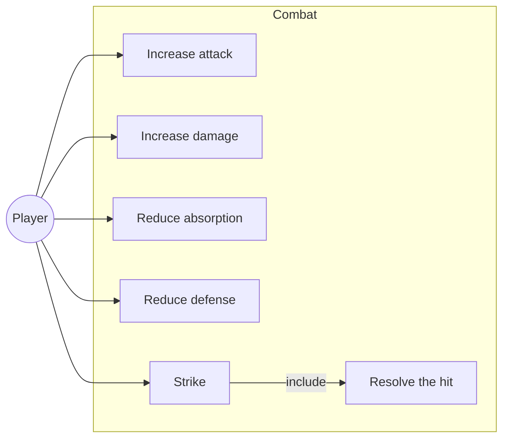
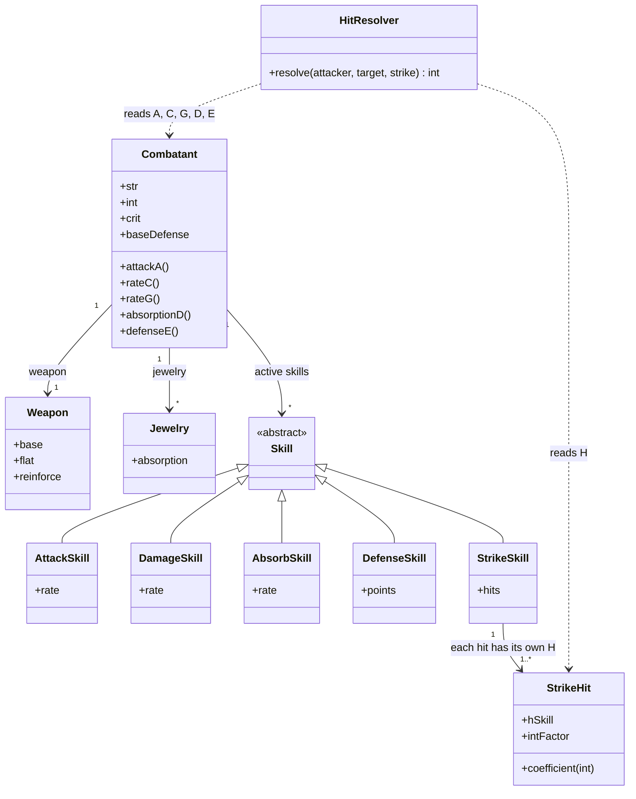
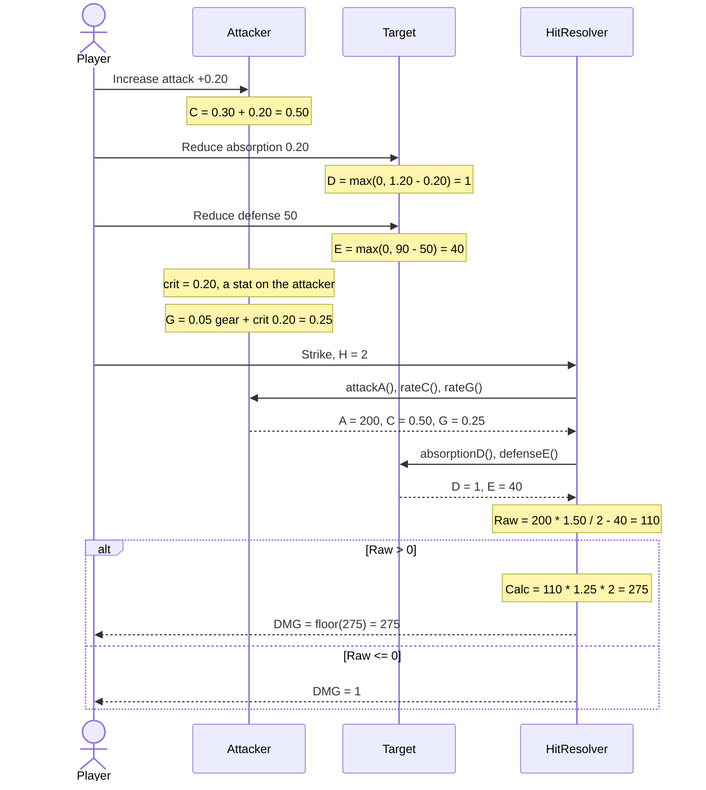

# Combat around the locked formula

One hit. Rates are decimals. Skills do one job each, and that job is already applied before the hit is resolved.

\[
\mathrm{Raw}=\frac{A\,(1+C)}{1+D}-E
\]

\[
\mathrm{Calc}=\mathrm{Raw}\times(1+G)\times H
\]

Raw at or below 0 deals 1. A positive Raw deals \(\max(1,\lfloor\mathrm{Calc}\rfloor)\).

## Use cases

The player prepares the fight with four modifier skills, then strikes. The strike includes resolving the hit. Gear, jewelry, STR, INT, and critical are already on the characters. They are not separate use cases.

| Use case | What the player changes |
| --- | --- |
| Increase attack | Adds a rate to \(C\) on the attacker |
| Increase damage | Adds a rate to \(G\) on the attacker |
| Reduce absorption | Subtracts from the target's \(D\), which stays at or above 0 |
| Reduce defense | Subtracts points from the target's \(E\), which stays at or above 0 |
| Strike | Supplies \(H\) and asks the combat system to resolve the hit |

## Classes

\(A\) comes from the weapon and STR. \(H\) comes from the damage skill and INT. \(C\) and \(G\) are sums on the attacker. \(D\) and \(E\) are the target's absorption and defense after skills. Critical is one rate inside \(G\).

`attackA` is \(\mathrm{Weapon}+\mathrm{Flat}+\mathrm{STR}\times\mathrm{Reinforce}/100\).

`coefficient` is \(H_{\mathrm{skill}}+\mathrm{INT}\times\mathrm{IntFactor}/100\).

`rateC` sums the weapon passive, Mastery when it is not already inside \(A\), and every active attack skill.

`rateG` sums gear, the attacker's `crit` stat, and every active damage skill.

`absorptionD` sums jewelry, subtracts absorb skills, and stops at 0.

`defenseE` starts from armor, subtracts defense skills, and stops at 0.

`resolve` runs the formula once per `StrikeHit` and returns the sum.

## Sequence

The numbers below are the worked hit. Attack +20% on top of 30% already on the character makes \(C = 0.50\). Jewelry 1.20 minus an absorb skill of 0.20 makes \(D = 1\). Armor 90 minus a defense skill of 50 makes \(E = 40\). Gear +5% and critical 20% make \(G = 0.25\). The strike coefficient is \(H = 2\). \(A = 200\).

A strike with several hits repeats the resolve step once per hit. Each hit brings its own \(H\), subtracts \(E\) again, and is floored on its own. The skill damage is the sum of those hits. \(C\), \(D\), \(G\), and \(E\) stay as they were when the strike started.
